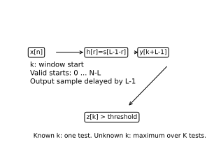
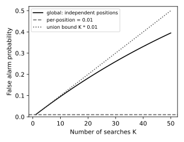

# 匹配滤波检测与未知到达时间

接收记录里出现一个尖峰，究竟是目标脉冲还是噪声的偶然峰？先说清观测、假设和允许的误报，再决定要比较哪个数。本课先解决已知位置、已知正幅度的 Gaussian 简单假设，再改变位置与噪声条件，说明为什么“最大的相关峰”还不够。

## 两个入口

**基础入口**：模板 $s=[1,2,1]$，观测 $x=[0,2,0]$。手算内积4、模板能量6，假定每点独立噪声标准差 $\sigma=1$，标准化得 $z=4/\sqrt6\approx1.633$。在已知位置、单侧1%误报下阈值约2.326，结果“不报”。先走到“一个位置的阈值”，能解释为何大于每个单点仍未过阈值即可停下。

**快进入口**：$x\in\mathbb R^L$，$H_0:x=n$；$H_1:x=As+n$，$A>0$、$s\ne0$ 与 $\sigma>0$ 已知，$n\sim N(0,\sigma^2I)$，目标最大化 $P_D$ subject to $P_{FA}\le\alpha$。直接到似然比，再与基础入口共用阈值/位置/白化各节。

## 从短向量到检测统计量

直接看最大单点忽略形状。若观测改成 $[1,2,1]$，每点最大仍2，但内积6；目标证据沿整条模板累积。统计量

$$T=s^Tx=\sum_{r=0}^{L-1}s[r]x[r],\quad E_s=s^Ts.$$

$T$ 单位为样本单位平方，$E_s$ 同单位，若 $A$ 无量纲，$\sigma\sqrt{E_s}$ 同样为单位平方；$z=T/(\sigma\sqrt{E_s})$ 无量纲。$s$ 可有负瓣，匹配形状不等于“对每点取绝对值”。模板零能量不能归一化，代码必须拒绝。

对任意线性权 $w$，$w^Tx$ 在 $H_1$ 中信号均值为 $Aw^Ts$、噪声方差为 $\sigma^2\|w\|^2$，输出 SNR 为 $A^2(w^Ts)^2/(\sigma^2\|w\|^2)$。Cauchy–Schwarz 给上界 $A^2\|s\|^2/\sigma^2$，$w\propto s$ 达到等号。这证明线性输出 SNR 的最优权；是否同时是检测最优，还要看分布与检测目标。[Modiano 的 MIT 16.36 讲义 slides 8–12](https://ocw.mit.edu/courses/16-36-communication-systems-engineering-spring-2009/cdf7761a13840807fa10f757694dda7b_MIT16_36s09_lec08_09.pdf)给出时域滤波与该不等式路线；这里采用有限离散向量，避免把理想连续白噪声当普通点值。

## Gaussian 似然比为什么只剩一个内积

同协方差 Gaussian 密度中常数相消：

$$\log\Lambda(x)=\log\frac{p(x|H_1)}{p(x|H_0)}=\frac{\|x\|^2-\|x-As\|^2}{2\sigma^2}=\frac{A}{\sigma^2}s^Tx-\frac{A^2E_s}{2\sigma^2}.$$

因此大似然比等价于大 $T$，因为 $A>0$。把 $x$ 分解为沿 $u=s/\|s\|$ 的投影与垂直分量，垂直分量在两个假设下分布相同，Gaussian 下与投影独立；它在密度比里消掉。$T$ 是这两个假设辨别所需的充分统计量，能量与所有点的详细数值不再独立增加证据。这是对给定参数和两假设的 sufficiency，并非说它可估计所有未知噪声参数。

Neyman–Pearson 结论：对两种**完全指定**的分布，选择最大似然比的区域，在相同误报约束下给最高检测概率。可核对的证明骨架是：令 $D^*=\{p_1>\eta p_0\}$，与任意误报不超过 $D^*$ 的决策 $D$ 比较，$(1_{D^*}-1_D)(p_1-\eta p_0)\ge0$，积分后得 $P_1(D^*)-P_1(D)\ge\eta[P_0(D^*)-P_0(D)]\ge0$。连续 Gaussian 无边界概率，无需随机化；一般离散分布达到精确约束可能需边界随机化。[MIT 6.011 Lecture 23 pp.1–3](https://www.ocw.mit.edu/courses/6-011-signals-systems-and-inference-spring-2018/0fd576ed952d28a0e3936b79e092ec2c_MIT6_011S18lec23.pdf)用于核对似然比、先验及误报/检测定义；[Oppenheim–Verghese 完整讲义 Chapter 13 §13.2.5](https://ocw.mit.edu/courses/6-011-introduction-to-communication-control-and-signal-processing-spring-2010/a6bddaee5966f6e73450e6fe79ab0566_MIT6_011S10_notes.pdf)进一步核对固定误报的 LRT 与边界随机化；本页不把 Monte Carlo 当该定理的证明。

## 一个位置的阈值与代价

$H_0:z\sim N(0,1)$，$H_1:z\sim N(d,1)$，$d=A\sqrt{E_s}/\sigma$。以严格 $z>\gamma$ 报警，

$$\gamma=\Phi^{-1}(1-\alpha),\quad P_{FA}=\alpha,\quad P_D=1-\Phi(\gamma-d).$$

这依赖已知 $\sigma$、白且联合 Gaussian、模板位置与正幅度已知。$A$ 不出现在标准化误报阈值里，却决定 $P_D$。未知负号可改变成双侧 $|z|$，阈值需重新按双尾分配；未知噪声方差时不能把本式继续标成 exact Gaussian，估计量及独立训练样本会改变分布。

NP 固定误报约束不需要假设出现频率。若另选择 Bayes 平均代价最小，先验 $\pi_i>0$，$C_{ji}$ 表示真 $H_i$ 却决策 $H_j$ 的代价，且 $C_{10}>C_{00},C_{01}>C_{11}$，则

$$\Lambda(x)>\frac{\pi_0(C_{10}-C_{00})}{\pi_1(C_{01}-C_{11})}=\eta_B.$$

转换到 $T$ 的阈值是 $\sigma^2\log\eta_B/A+AE_s/2$。误报更昂贵使阈值上升，漏检更昂贵使阈值下降；阈值不是脱离使用情境的一条常数。低发生率也使阳性预测值 $\pi_1P_D/(\pi_1P_D+\pi_0P_{FA})$ 可能很低，检测率不能代替 precision。

## 滤波输出的时间索引

对长度 $N$ 的记录、长 $L$ 的模板，仅搜索完整窗，$k=0,\ldots,N-L$：

$$T[k]=\sum_{r=0}^{L-1}s[r]x[k+r].$$

FIR $h[r]=s[L-1-r]$，卷积输出 $y[k+L-1]=T[k]$。峰值输出时间比**窗起点**晚 $L-1$ 个样本。到达估计用 $k$，不能把卷积输出索引直接解释为模板起点。复数模型需 conjugation，这套实数组实现没有宣称复数支持。

图中箭头表达样本进入反序 FIR、取样、标准化和阈值比较。实验 `np.correlate(..., mode='valid')` 直接输出窗起点编号，避免手动扣延迟；记录边缘半个模板不在本实验搜索集合中。

## 未知位置：一个记录有多个机会误报

取 $K=N-L+1$，$M=\max_k z[k]$。逐位置误报1%不等于整条记录误报1%。若 $K$ 个统计量独立，整体误报为 $1-(1-\alpha_{loc})^K$；重叠窗一般相关，不能套独立等式。白噪声时

$$\operatorname{Cov}(z[k],z[j])=\frac{\sum_r s[r]s[r+k-j]}{E_s},$$

其中模板范围外 $s=0$。例如非重叠窗独立；相邻正脉冲窗相关。任意依赖下 union bound 给 $P(M>\Phi^{-1}(1-\alpha/K))\le\alpha$，是已知模型下 Bonferroni 保守保证。

图用独立位置的精确公式（实线）、逐位置水平（虚线）、union bound（点线）展示搜索次数作用。**它不是重叠模板实验的精确曲线**；该实验的实际统计在 U6 `results.json`。

若 $H_1$ 的 $k$ 未知但 $A$ 固定，对每个 $k$ 的似然比求最大，等价于最大相关，是 generalized likelihood ratio test（GLRT）。这是一个合理复合假设方法，不能沿用 simple NP 的最优性标签。若给定位置先验，则 mixture likelihood 是多个位置似然的加权**求和**，也不必等于最大值。未知正 $A$ 时每窗优化后涉及 $(T[k]_+)^2$；未知位置和幅度都需重述目标、约束、参数集合。

工程替代是用独立无目标训练记录标定 $M$ 的分位点，再冻结阈值，对全新的 $H_0/H_1$ 测试记录评测。有限训练分位点只估计总体阈值，本实验不保证精确1%整体误报。训练/测试都由相同生成模型独立产生也不证明部署分布不变。计数应以记录为单位：FPR=`fp/n0`，TPR=`tp/n1`，某类没有样本时为未知，禁止除以全部记录数或用0伪装。

### 把窗口搜索与候选选择放进同一张误报账本

100个独立窗口、每窗1%时，整条无目标记录至少一次误报为 $1-.99^{100}\approx0.63396766$；若100个统计量完全相同，整体仍是1%。相关重叠窗应由联合模型或独立 noise-only 记录标定，不能凭“100次”选一个精确值。对这两个极端及任意依赖的并集界，见 [[数学/30-概率与统计/09-假设检验错误概率与功效#同一个搜索集合，三种应用中的报告单位|搜索集合与报告单位]]。返回本实验时，把搜索位置、模板、记录长度与阈值一起冻结。

这个问题也出现在 [[AI/20-LLM/40-推理/10-测试时计算验证器误差与预算公平性#错误验证器为何会被更大的搜索放大|候选生成与错误验证器]]：单候选误判对应单窗口误报，选择最高分对应取最大峰，但“整条记录报警”与“强制提交一个答案”不同。模板不断改变，或看到峰后决定继续录多久，都会改变被校准的流程。时间上反复检验的具体反例与有效似然过程，见 [[数学/30-概率与统计/09-假设检验错误概率与功效#固定终点、逐步偷看与有效似然过程|20步停止协议]]；本页固定记录的最大值阈值不自动覆盖无期限等待。

本页上方的 Gaussian NP 证明保留了连续模型下的最优性。若要理解离散边界为何随机化、复合备择何时有单侧 UMP、何时只是 GLRT，继续 [[数学/30-概率与统计/14-似然比最优检验与置换推断|一般似然比检验]]；“投影保留哪一族分布的信息”的定义则见 [[数学/30-概率与统计/12-充分统计量与估计效率|充分统计量]]。

## 有色噪声：先白化两个对象

已知正定协方差 $C$ 的 Gaussian 模型中，

$$\log\Lambda=A s^TC^{-1}x-\tfrac12 A^2s^TC^{-1}s,\quad z_C=\frac{s^TC^{-1}x}{\sqrt{s^TC^{-1}s}}.$$

$H_0$ 下 $z_C\sim N(0,1)$。令 $C=LL^T$，求解 $Lx_w=x,Ls_w=s$，则 $z_C=s_w^Tx_w/\|s_w\|$：**观测与模板一起白化**。用 Cholesky 解线性方程，不显式求逆。正半定奇异 $C$ 需要处理支持子空间，本实验拒绝，不隐式改成伪逆。

可手算 $s=[1,2],x=[2,1],C=\operatorname{diag}(4,1)$：$s^TC^{-1}x=2.5$、$s^TC^{-1}s=4.25$，所以 $z_C=2.5/\sqrt{4.25}$。普通白模型分数则为 $4/\sqrt5$，差异来自第1维噪声方差较大，应降权。[MIT Chapter 10 §10.2.3](https://ocw.mit.edu/courses/6-011-introduction-to-communication-control-and-signal-processing-spring-2010/8075041184d566103ce7c3f69afc5e75_MIT6_011S10_chap10.pdf)说明 shaping/whitening 的谱关系；有限窗口的 $C^{-1}$ 实现并不自动等价于无边界无限 LTI 白化。

若错设 $\widetilde C$，使用权 $w=\widetilde C^{-1}s/\sqrt{s^T\widetilde C^{-1}s}$，真实 $H_0$ 方差为 $w^TCw$，未必1。即使 $\widetilde C$ 看起来平滑，“套标准正态阈值”也会错。估计 PSD 的分段数、漂移、低谱值正则化和训练污染都影响白化；这属于新的估计/标定问题。模板形状错设时均值变成 $A s^Tq/(\sigma\|s\|)$，相关损失导致检测率下降。

## 到达估计与检测不是同一指标

在报警后取 $\hat k=\arg\max_k z[k]$。漏检、误报、多峰/旁瓣、搜索边缘和噪声选峰会影响结果。应同时报告全 $H_1$ 的到达绝对误差与“已检出 $H_1$”的条件误差；只报后者会选择较容易的样本，不能解释为所有目标的定位能力。延迟误差单位从样本除以 $f_s$ 得秒；小于1个样本的分辨率需要插值/连续延迟模型及新的验证，不能凭 argmax 宣称。

## 改条件的陌生题与答案

1. 搜索100个相互独立位置，逐位置阈值仍按1%设定。整体误报大约多少？若相关性未知，用什么方案保证不超过1%？
2. 第1维方差从1变4，其余条件沿手算例。还用原白阈值可称 NP 最优吗？
3. 只有正幅度假设的课程被改成未知符号幅度。检测统计/阈值应如何变？
4. 传感器只给含目标记录，声称“用这批峰值标定1%误报”。能否接受？怎样评分？
5. 一个长记录发生报警，真实到达位置没有标签。可报告真实到达误差吗？

**答案与等价方法**：第1题 $1-.99^{100}\approx0.634$；相关性未知但各局部正态模型成立，采用 $\alpha/100$ 的 Bonferroni，或给出有证明的联合分布阈值。第2题不能；说明 $C^{-1}$ 权、输出真实方差或重新标定均可。第3题可用双侧 $|z|>\Phi^{-1}(1-\alpha/2)$；如另给幅度先验，可推导 mixture LRT，但须声明目标改变。第4题没有独立 $H_0$ 样本不能估计 FPR，合法答案是未知并要求 noise-only 训练与独立评测；拒绝把“目标峰分位点”当误报量。第5题未知；只能报模型估计 $\hat k$ 和条件，不能制造 ground truth。每题2分，结论1分、推导/边界1分；相同目标下的等价统计量、单双边约定清晰可满分。

去 [[数学/30-概率与统计/05-统计估计置信度与模型评测#先定义到底想知道什么|统计估计课]]核对抽样单位、点估计与覆盖含义，返回后给 U6 结果写出其总体和未知层。进一步把 [[数学/30-概率与统计/11-条件期望与最小均方估计#最优性不是口号：一行勾股分解|条件期望课]]的平方误差估计与本课的离散决策目标比较：估计 $E[Y|X]$ 与限制误报的判定不是同一个损失函数。可运行 [[信号与系统/80-实践/03-噪声中的脉冲检测/README|U6 完整教学实验]]，验证本页公式的已实现范围。
