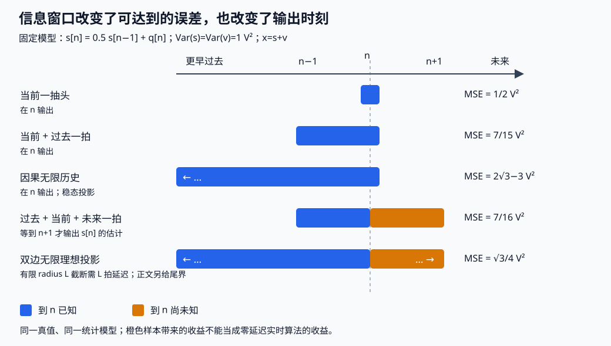

# Wiener滤波、线性预测与创新

一只传感器给出带噪电压，前一拍读数能帮我们估计这一拍吗？能帮多少取决于相关性，也取决于允许使用哪些时刻的读数。把未来读数偷偷放进窗口，改善的是信息集，不能称为原实时算法变好了。

基础入口先算下一节的两样本权重，能代回误差就可停下；快进入口从“投影到线性张成与投影到全部观测函数”进入，把有限正规方程、双边谱比、因果谱因子接成同一投影问题。完整实践在 [[信号与系统/80-实践/07-Wiener估计与预测/README|固定训练与独立测试协议]]，源码和预期不等于已经运行。

## 两样本电压为何胜过只取当前读数

设零均值平稳目标 s[n]，Var(s)=1 V²，E[s[n]s[n−1]]=1/2 V²；观测 x[n]=s[n]+v[n]，v 是方差1 V²的白测量噪声，与整个s过程独立。先只使用 X=(x[n],x[n−1])ᵀ，估计 d=s[n] 为 wᵀX，w无量纲。给定的lag-1模型足以决定这两维问题；后续无限历史例才另加AR(1)结构。

$$R=E[XX^T]=\begin{pmatrix}2&1/2\\1/2&2\end{pmatrix}\mathrm{V^2},\quad p=E[Xd]=\binom1{1/2}\mathrm{V^2},\quad E[d^2]=1\mathrm{V^2}.$$

最小化 J(w)=E[(d−wᵀX)²]。展开得到 J=1−2wᵀp+wᵀRw；两行最优条件为 2w₀+w₁/2=1、w₀/2+2w₁=1/2，故

$$w=(7/15,2/15)^T,\qquad J_{\min}=1-p^Tw=7/15\ \mathrm{V^2}.$$

独立代回：wᵀRw=wᵀp=8/15 V²，误差1−16/15+8/15=7/15。只用x[n]时w=1/2，MSE=1/2 V²。新一拍的信息把MSE减少1/30 V²；不是把两个电压直接平均，也不是保证每次 realization 的误差都变小。原噪声相关变了，R也必须变，后文给反例。

## 正交性、正规方程与奇异矩阵

实X∈Rᵐ、d∈R具有有限二阶矩，已去**总体均值**。对任何方向a，J(w+ta)的一次项为 −2t aᵀE[X(d−wᵀX)]。全部方向均为零等价于

$$Rw=p,\qquad E[Xe]=0,\quad e=d-w^TX.$$

反过来，若正交成立，则对任意其他权重w+a，J(w+a)=J(w)+aᵀRa≥J(w)，所以它是全局最小。非零均值时仿射估计为 μd+wᵀ(X−μX)；随机截距和样本去均值不能代替已知总体均值。

R总是半正定，因为aᵀRa=E[(aᵀX)²]。若a∈kerR，aᵀX=0 a.s.，所以aᵀp=E[(aᵀX)d]=0，p∈rangeR。**真二阶模型**的正规方程总相容；随意拼接分别估出的R、p可能不具有这份保证。有限维张成是闭的，投影存在且输出按a.s.唯一。R正定时系数唯一；奇异时w=R⁺p+kerR，全部最优权重产生同一个输出。

例如X=(Z,Z)、d=Z、VarZ=1，任何w₀+w₁=1都零误差，最小范数解(1/2,1/2)只是系数选择规则。独立加岭改成(R+ηI)w=p，唯一但引入偏差；不是给重复观测增加物理信息。数值求解的QR/SVD边界回 [[数学/20-线性代数与几何/14-最小二乘伪逆与正则化#非唯一性与伪逆|有限维主解释]]。复数情形用估计wᴴX、R=E[XXᴴ]、p=E[Xd*]，条件Rw=p、MSE=E|d|²−pᴴw；不能在这一式随意删共轭。

## 投影到线性张成与投影到全部观测函数

信息集G=σ(X)允许所有平方可积观测函数，最优者为E[d|G]；LMMSE只允许常数和X分量的线性张成。去 [[数学/30-概率与统计/11-条件期望与最小均方估计#最优性不是口号：一行勾股分解|一般MMSE证明]] 带回闭子空间、a.s.唯一和有限L²条件，再比较这里的较小函数类。联合Gaussian是条件均值仿射的一组充分条件；非Gaussian也有LMMSE。

无量纲反例：X在−1、0、1等概率，D=X²−2/3依次取1/3、−2/3、1/3。E[X]=E[D]=E[XD]=0、VarD=2/9。最佳仿射输出恒0，MSE=2/9；条件均值就是D，MSE=0。零协方差只排除了线性改善，未排除非线性可预测性。

## 滤波 预测与平滑的信息集

下面另固定AR(1)全过程：s[n]=(1/2)s[n−1]+q[n]，q是独立同分布零均值Gaussian创新，Varq=3/4 V²，初始/双边平稳分布Vars=1 V²；v仍独立Gaussian白噪声、Varv=1 V²。因此Cs[k]=(1/2)^|k| V²，当前课的两样本统计保持相同。

| 发布时刻与可用读数 | 目标 | 最优有限线性系数、MSE |
| --- | --- | --- |
| n−1，只给x[n−1] | s[n]，一步预测 | 系数1/4，MSE7/8 V² |
| n，给(x[n],x[n−1]) | s[n]，当前滤波 | (7/15,2/15)，MSE7/15 V² |
| n+1，给(x[n−1],x[n],x[n+1]) | 仍是s[n]，一拍延迟平滑 | (1/8,7/16,1/8)，MSE7/16 V² |

三点R的对角为2、相邻为1/2、两端为1/4，p=(1/2,1,1/2)ᵀ；对称设两端t，中间u，方程(9/4)t+u/2=1/2、t+2u=1给上述解。对同一记录(1,2,−1)V，三种发布结果依次为1/4、16/15、7/8 V。它们是同一目标、不同信息集；平滑改善不能归到过去的发布时刻。

无限版本分别用闭包 span{x[k]:k≤n−1}、span{x[k]:k≤n}、span{x[k]:k∈Z}。有限窗口数增大时，投影误差单调下降并收敛到对应闭包投影误差：若P∞d为极限子空间投影，有限张成的并集在该闭包稠密，对任意ε可用一个有限组合逼近P∞d，再由有限投影最优性得误差范数逼近；正交勾股又给投影本身L²收敛。存在的是唯一随机输出，不自动存在绝对可和的物理滤波器。

[[AI/45-机器人与具身智能/20-状态估计与LQG/01-线性Gaussian条件化到Kalman递推#独立解析对照：一次性条件化整个历史|Kalman的同历史批量对照]] 比较固定Y₀:k；加未来观测就换成平滑。平稳Wiener的双边无限历史与从已知初值启动的有限Kalman不能在历史/先验不同的情况下逐点要求相等。

## 由误差正交到谱比

对去总体均值的联合WSS复过程，固定 rdx[k]=E[d[n]x[n−k]*]，Sdx=Σk rdx[k]e⁻ⁱθk；观测为x、目标为d，输出为Σℓh[ℓ]x[n−ℓ]。全双边正交条件给

$$\sum_\ell h[\ell]r_{xx}[k-\ell]=r_{dx}[k],\quad k\in\mathbb Z;\qquad H S_{xx}=S_{dx}.$$

有限因果FIR只对允许的k=0,…,m−1正交，不能把该有限方程未经条件升级为所有整数卷积。相关绝对可和、h绝对可和是交换求和/期望和普通DTFT的一组充分条件；一般L²投影要以谱测度/均方极限解释。

对有密度的谱，输出定义在加权空间 ∫|H|²Sxx dθ<∞。谱矩阵半正定给|Sdx|²≤Sdd Sxx，于Sxx=0的集合Sdx也为0（a.e.）。误差谱配方为

$$S_{ee}=S_{dd}-\frac{|S_{dx}|^2}{S_{xx}}+S_{xx}\left|H-\frac{S_{dx}}{S_{xx}}\right|^2.$$

正密度上Hnc=Sdx/Sxx；零密度处任意选0，只按Sxx加权a.e.唯一，不计算0/0。第一项积分非负、第二项最小为0；由谱Cauchy界，最优输出能量不超过d的有限方差。MSE=(2π)⁻¹∫See dθ，单位V²。Hz密度同时除fs时谱比不变，积分改用df；d、x单位不同则H带目标单位/观测单位。谱线须回谱测度对象，不能把Dirac当有限bin除。

共轭核查取 d[n]=x[n−2]，G=e⁻²ⁱθ；Sdx=G Sxx，解恢复G。在θ=π/4得−i；若反用Sxd得+i，把延迟写成超前。电子页 [[电子电路/38-随机噪声与测量/05-互谱FFT与噪声测量#互谱保留谁共轭|互谱次序]] 是共同约定，单段样本相干恒1不证明总体无噪声。谱比对象可对照 [MIT 6.011 Lecture20 pp2–4](https://ocw.mit.edu/courses/6-011-signals-systems-and-inference-spring-2018/78edf8ff33f3eb92cb6d1e2a83325af1_MIT6_011S18lec20.pdf)；本课相位核查与具体AR例为独立构造。

## 同一AR信号的双边滤波与实际延迟

上面a=1/2模型有

$$S_s(\theta)=\frac{3/4}{5/4-\cos\theta},\quad S_x=\frac{2-\cos\theta}{5/4-\cos\theta},\quad H_{nc}=\frac{3/4}{2-\cos\theta}.$$

令r=2−√3∈(0,1)。从几何级数得 1+2Σk≥1 rᵏcos(kθ)=(1−r²)/(1−2r cosθ+r²)，而2−cosθ=(1−2r cosθ+r²)/(2r)，所以

$$h_{nc}[k]=\frac{\sqrt3}{4}r^{|k|},\qquad J_{nc}=\frac{\sqrt3}{4}\ \mathrm{V^2}.$$

这里See=Ss/(Ss+1)=Hnc，因为Sv=1 V²在归一化数值中；积分取h[0]。k<0项使用未来读数，双边无限最优值不能实时实现。截成−L…L并延迟L拍，得到输出目标s[n−L]的有限平滑器；不把DFT循环边界混成真实过去/未来。丢掉|k|>L的系数，其ℓ¹尾为2(√3/4)r^(L+1)/(1−r)；由观测方差2和Minkowski，输出截断误差L²范数≤√2倍此尾（V），给出可选择L的计算误差界，未把它当硬件延迟认证。

## 因果谱因子如何把未来项移出允许空间

在Sxx=|F|²、F及F⁻¹皆因果稳定时，令z=F⁻¹x；z白、方差1，且x过去闭张成与z过去闭张成相同。因为两个方向都是因果稳定卷积，过去组合各能用另一个过去的均方极限逼近。于是求因果H相当于把d投影到z[n],z[n−1],…；这些单位方差互相正交，系数就是 rdz[k]，k≥0。写Q=Sdx/F*，去掉Q的k<0 Fourier系数，得到

$$H_c=F^{-1}[S_{dx}/F^*]_+,\qquad J_c-J_{nc}=\sum_{k<0}|q[k]|^2.$$

加号包含k=0。Parseval下Q的正/负时间系数正交，最小化||HF−Q||²只能匹配正时间部分；负时间平方和就是因果代价。这里真正使用“可逆因果谱因子”，不能直接把Hnc负时间系数删掉而声称仍最优。[MIT 6.011 Chapter11 §11.3，式11.57–11.65](https://ocw.mit.edu/courses/6-011-introduction-to-communication-control-and-signal-processing-spring-2010/f135b328c7448bf21c4939ea9ff8f8fb_MIT6_011S10_chap11.pdf)给因果分解对照；本课以白化后的正交基明确DT有限/无限对象。

白化变量z按单位方差归一；若x,d保留V，则F带V、Q及q[k]带V，负时间平方和带V²。下面给因子数值时已将电压除1 V，恢复物理输出与MSE再分别乘1 V和1 V²；换成Hz密度也要一致变换白谱尺度。

本课使用严格正、有理且单位圆无极点/零点的Sxx这一充分类：实过程的有理谱满足共轭互反对称，零点/极点成α与1/α*对，分别选单位圆内的一半作为F的零点/极点，常数按正密度配成正平方根；F,F⁻¹都无单位圆外或圆上极点且因果，所以冲激响应几何衰减、绝对可和。原式可能含相消，先约成有理函数再分对。得到的是这一类的存在构造。下面补一般谱的均方合同；它比这一BIBO实现合同弱，闭包投影的存在也不依赖BIBO逆。

### 非有理谱的log条件、外因子与创新方差

先将电压除固定V₀，令X=x/V₀、谱密度f=Sxx/V₀²，避免对有单位的量直接取log。采用rXX[k]=(2π)⁻¹∫f(θ)eⁱᵏθdθ；有奇异谱时整个有限谱测度为dμ=f(θ)dθ/(2π)+dμs。**纯绝对连续**的有限功率合同是f≥0、f∈L¹[−π,π]，再要求

$$\int_{-\pi}^{\pi}\log f(\theta)\,d\theta>-\infty
\quad\Longleftrightarrow\quad \log f\in L^1[-\pi,\pi].$$

因为log⁺f≤f，有限功率已控制log正部；此条件控制负部，特别要求f>0 a.e.。它允许孤立零点，但不允许在正测度频带恒为0。以全部过去闭线性张成为信息，一步创新ε[n]=X[n]−P过去X[n]满足Kolmogorov–Szegő公式

$$\sigma_\varepsilon^2=\exp\!\left(\frac1{2\pi}\int_{-\pi}^{\pi}\log f(\theta)\,d\theta\right)>0.$$

纯绝对连续加log条件使整个过程是纯非确定的：其全部能量来自这份创新的因果均方表示。若μs≠0，创新方差仍由绝对连续密度的log积分决定，但全过程还需Wold的确定部分V[n]；不能只拿f为全部过程白化。[Berkeley EECS225A Lecture8 pp2–4，Theorem4/6/7](https://people.eecs.berkeley.edu/~jiantao/225a2020spring/scribe/EECS225A_Lecture_8.pdf)给这份具名一般合同；“确定”指无限线性过去可预测，不表示某次有限记录无噪或已知所有未来。

可以看见外因子从哪里来。令q为单位圆内的滞后变量（边界q=e⁻ⁱθ），定义γk=(2π)⁻¹∫log f(ϕ)eⁱᵏϕdϕ，则

$$F(q)=\exp\!\left[\frac1{4\pi}\int_{-\pi}^{\pi}
 \frac{e^{-i\phi}+q}{e^{-i\phi}-q}\log f(\phi)\,d\phi\right]
=\exp\!\left(\frac{\gamma_0}{2}+\sum_{k\ge1}\gamma_kq^k\right),\qquad |q|<1.$$

展开核1+2Σk≥1qᵏeⁱᵏϕ即可核系数；任一圆内紧集上积分/级数收敛，F解析且无零点，F(0)=exp(γ₀/2)>0。log|F(re⁻ⁱθ)|²是log f的Poisson平均，在其Lebesgue点趋log f。Jensen给|F(re⁻ⁱθ)|²≤Poisson(f)，积分均值≤∫f/(2π)；对Taylor系数Fk用Parseval得Σ|Fk|²r²ᵏ有统一上界，故Σ|Fk|²<∞。这又使径向F在L²收敛到边界，结合前述a.e.模极限给|F(e⁻ⁱθ)|²=f a.e.。这就是由边界log模选定、没有另乘全通内因子的**outer外因子**；并未承诺Σ|Fk|有限或逆系数可和。

为何F(0)²是可达到的创新方差，而不只一项下界？任何有限预测残差多项式A(q)=1+Σk≥1akqᵏ有常数项1，损失∫|A|²f/(2π)=||AF||²；AF常数项F(0)，Parseval给损失≥F(0)²。达到下界可用一个不假设逆稳定的逼近：将f改为fη=max(f,η)、η>0，按同式构造Fη；Rη=F/Fη在圆内模≤1，且Rη(0)→1。因此||Rη−1||²≤2[1−Rη(0)]→0。Aη=Fη(0)/Fη有常数项1，且因fη≥η而为有界解析函数；AηF=Fη(0)Rη→F(0)于L²。对固定η先把Aη径向缩为Aη(rq)，再截Taylor级数：径向收敛用有界性与f∈L¹支配，截级数在单位圆一致收敛，所得有限多项式的同一加权损失逼近F(0)²。这里允许各阶权重随逼近改变，不能偷偷用一个不稳定逆的普通部分和代替该均方极限。

在这份纯绝对连续log合同下，规范Wold表示为X[n]=Σk≥0Fk z[n−k]，z=ε/σε为单位方差白创新，级数以均方收敛；X过去与z过去的闭张成相等。白只要求二阶正交，不附加独立或Gaussian。把目标也按其固定单位D₀归一为D=d/D₀，前面的因果投影仍可在这两个闭空间之间进行：Q=S_DX/F*属于L²，归一目标的因果输出对应Q的非负时间系数，边界写HcF=[Q]+。恢复物理滤波增益再乘D₀/V₀、误差方差乘D₀²。Hc的有限实现要在加权范数∫|H|²f中逼近，并另核截断/延迟/数值误差；不能从均方存在便称F⁻¹或Hc是有限、BIBO稳定可执行器。一般log合同只给解析外因子和均方创新表示；前面F、F⁻¹都绝对可和是更强的实现充分条件。

### 单点零、整带零与奇异谱各改变什么

取单位方差白u，X[n]=u[n]−u[n−1]，f=|1−e⁻ⁱθ|²。DC有一个零点，但附近log f≈2log|θ|可积；由log(1−ρq)=−Σk≥1ρᵏqᵏ/k的圆周平均0，再让ρ↑1（零点附近有可积log支配）得平均log f=0，故创新方差1、F=1−q。F是有限FIR；逆1/(1−q)=Σk≥0qᵏ的系数全1，绝对和发散，DC极点使逆非BIBO稳定。

均方恢复依然可核：取Σj=0…N−1(1−j/N)X[n−j]=u[n]−N⁻¹Σj=1…N u[n−j]，恢复误差方差1/N→0。反而直接截不稳定逆Σj=0…N−1X[n−j]=u[n]−u[n−N]，误差方差一直1。这让“存在均方因果恢复”与“普通截逆/BIBO白化成功”的差异可直接计算。

若f在一段正测度频带为0，log积分为−∞，一步无限线性创新方差0；该对象不能以非零σε归一成上面的白创新，也不能称无限预测保证给了某一有限滤波器。再取X[n]=u[n]+A，A零均值、方差τ²、与白u独立：绝对连续f=1，另有DC谱原子τ²；过去N拍平均在L²趋A，故确定部分是A、创新仍u且方差1。仅f的因子1只生成u，遗漏了A。单点密度零、整带密度零和谱原子因此是三种不同对象，不能由一张有限FFT图互换。

本例的因子可以直接核验，无需求根黑箱：K=(2+√3)/2=1/(2r)，

$$F=\sqrt K\frac{1-r e^{-i\theta}}{1-\frac12e^{-i\theta}},\quad
Q=\frac{3/4}{\sqrt K(1-\frac12e^{-i\theta})(1-r e^{i\theta})}.$$

展开两份几何级数，Q的k≥0系数为(3/4)(1/2)ᵏ/[√K(1−r/2)]，故

$$H_c=\frac{g}{1-r e^{-i\theta}},\quad g=2\sqrt3-3,\qquad \hat s[n]=r\hat s[n-1]+g x[n].$$

g≈.4641016、r≈.2679492。它使用无限过去、零额外未来延迟，稳态MSE为g V²；可独立从标量Kalman求验证：P⁻=P/4+3/4，P=P⁻/(P⁻+1)，正根P²+6P−3=0就是g，r=(1−P)/2。于是

$$\sqrt3/4 < 2\sqrt3-3 < 7/15 < 1/2.$$

依次比较双边无限、因果无限、两抽头因果、只取当前；严格不等式来自此模型，不是所有模型都严格改善。有限启动的初值误差以rᵏ衰减；无限平稳理论不能直接替换启动段。

### 创新表示不等于物理输入的恢复

**只看到一个白输出，能说产生它的物理系统就是直通吗？** 先固定唯一共同模型：$n\in\mathbb Z$，采样率 $f_s>0$ Hz，$\theta=2\pi f/f_s$ 为 rad/sample；$u[n]$ 是定义在全部整数上的 iid $N(0,1\,\mathrm{V^2})$。两路从无限过去已处于平稳状态，输入与输出均以 V 计，传函无量纲，初始信息只给输出的完整概率律（因此也给完整总体自谱），没有同步输入记录。采用

$$r_{xx}[m]=E[x[n]x[n-m]^*],\quad S_{xx}(\theta)=\sum_mr_{xx}[m]e^{-im\theta},\quad
\operatorname{Var}x=\frac1{2\pi}\int_{-\pi}^{\pi}S_{xx}(\theta)\,d\theta.$$

这里的 $S_{xx}$ 单位为 V²；双边每 Hz 密度为 $P_{xx}(f)=S_{xx}(2\pi f/f_s)/f_s$，单位 V²/Hz，在 $[-f_s/2,f_s/2]$ 积分才得方差。不能把离散白谱的数值1直接称作1 V²/Hz。后面的 $X=x/V_0$、$V_0=1$ V、$f=S_{xx}/V_0^2$ 与本页外因子约定相同；此处的 $f$ 是归一化密度，不是上一句的 Hz 自变量。

| 同一参数与信息表 | A：直通物理系统 | B：稳定全通物理系统 |
| --- | --- | --- |
| $a=1/2$，物理输入 $u$ 起初不可见 | $G_1(z)=1$，$x=u$ | $G_2(z)=A_a(z)=(z^{-1}-a)/(1-az^{-1})$，$x=A_a u$ |
| 冲激响应 $h[0],\ldots,h[4]$ | $(1,0,0,0,0)$ | $(-1/2,3/4,3/8,3/16,3/32)$ |
| 物理极点、零点（$z$ 平面） | 无动态极点、零点 | 极点 $a=1/2$；零点 $1/a=2$ |
| 仅输出：总体 $S_{xx}$、完整有限维律 | $1$ V²；iid $N(0,1\,\mathrm{V^2})$ | 相同谱；在本 Gaussian 假设下相同完整有限维律 |
| 规范输出表示 $X=Fz$，$F(0)>0$ | $F=1$，$z=X$，物理创新 $e=V_0z=x$ | 同一 $F=1$、$z=X$、$e=x$，但 $e$ 不是原 $u$ |
| 增加同步输入后，$S_{xu}/S_{uu}$ 在 $\theta=\pi/2$ | $1$ | $-4/5-(3/5)i$ |
| 总体幅值平方相干 $|S_{xu}|^2/(S_{xx}S_{uu})$ | $1$ | $1$；相干模没有保留上述复相位 |

这张表是 IIR、辨识、电子互谱三页共享的数值入口；它们各自只核自己消费的对象。上表的 $F(0)$ 在滞后变量 $q=z^{-1}$ 的原点取值，不能与物理 $z$ 平面的极点位置混读。

从时域先证明等谱。一般 $0<a<1$ 时

$$h[0]=-a,\qquad h[k]=(1-a^2)a^{k-1},\quad k\ge1,\qquad
\sum_{k\ge0}|h[k]|=1+2a<\infty.$$

因此因果滤波器 B 是 BIBO 稳定的；独立白输入使

$$\frac{r_{xx}[0]}{V_0^2}=a^2+(1-a^2)^2\sum_{j\ge0}a^{2j}=1.$$

对 $m\ge1$，共享输入索引给 $r_{xx}[m]/V_0^2=\sum_{j\ge0}h[j+m]h[j]$；第一项与余尾恰好相消：

$$-a(1-a^2)a^{m-1}+(1-a^2)^2a^m\sum_{j\ge0}a^{2j}
=-(1-a^2)a^m+(1-a^2)a^m=0.$$

实过程的负 lag 对称，也为0。频域独立核查则是

$$|A_a(e^{i\theta})|^2=
\frac{|e^{-i\theta}-a|^2}{|1-ae^{-i\theta}|^2}
=\frac{1+a^2-2a\cos\theta}{1+a^2-2a\cos\theta}=1.$$

分母对全部实 $\theta$ 严格正，故 $S_{xx}=|A_a|^2S_{uu}=1$ V²。这两条路线证明的是完整二阶自相关与谱。要再说**完整输出概率律相同**，需要现在的 Gaussian 输入条件：绝对可和滤波的有限截断向量为联合 Gaussian，均方极限仍联合 Gaussian；任意有限时刻向量均零均值、协方差 $V_0^2 I$，所以是独立单位 Gaussian。两路的有限维律相同，不表示给同一条 $u$ 时两路逐点输出相等，也不表示 $(u,x)$ 的联合律相同。

输出过去信息 $\mathcal H^-_x=\sigma(x[k]:k<n)$ 下，Gaussian 白输出满足 $E[x[n]\mid\mathcal H^-_x]=0$；因此条件创新 $e[n]=x[n]$，它与过去的每个平方可积函数正交且独立。线性过去闭张成的投影也为0。规范 outer 因子 $F=1$ 唯一，是因为 $f=1$、前述 outer 构造的 $\log f=0$ 且 $F(0)>0$；只要求同模便还允许乘全通内因子。规范化识别的是**由输出过去定义的创新表示**。

物理输入的恢复是另一个对象。B 的 $A_a^{-1}(z)=(1-az^{-1})/(z^{-1}-a)$ 有极点 $z=1/a=2$，其因果 ROC $|z|>2$ 不含单位圆，不能因果稳定恢复原 $u$。它可选择包含单位圆的反因果 ROC $|z|<2$，得到使用未来输出的稳定逆；改变允许信息就改变恢复任务。这个例子甚至能量化过去信息的缺口：对于 $k\ge0$，$\operatorname{Cov}(u[n],x[n-k])=h[0]V_0^2$ 当 $k=0$，否则为0；Gaussian 输出各拍独立，所以

$$E[u[n]\mid \sigma(x[k]:k\le n)]=-a x[n],\qquad
\operatorname{Var}(u[n]\mid x_{\le n})=(1-a^2)V_0^2=3/4\ \mathrm{V^2}.$$

包括当拍的无限输出过去也不能精确恢复物理输入；$x$ 自己却已有零条件均值的白创新。若预先限定“物理系统严格最小相位、实系数、无额外延迟、直接项为正、输入白且方差已知”，才可将规范因子解释为该物理传函：此例唯一剩 $G_1=1$。正直接项排除符号，已知输入尺度排除增益歧义，稳定因果逆排除额外延迟与本全通族；可辨性来自新增先验，不来自多采输出。[MIT 6.011 §3.3–3.4，PDF第46–51页](https://ocw.mit.edu/courses/6-011-introduction-to-communication-control-and-signal-processing-spring-2010/a6bddaee5966f6e73450e6fe79ab0566_MIT6_011S10_notes.pdf#page=46)给全通、最小相位及谱分解的定义；本表的 Gaussian 同律、条件恢复方差与数值由此处模型推导。

换成非 Gaussian 会先撤去哪条结论？只给零均值、方差 $V_0^2$ 的二阶白输入，前述卷积仍证等自谱，不能证同完整概率律或条件创新为 $x$。可精确反驳的替换是 iid $u/V_0\in\{-1,+1\}$ 等概率，仍从无限过去平稳：A 有 $E[X^4]=1$；B 的独立输入四阶展开给

$$E[X^4]=3\Big(\sum_jh[j]^2\Big)^2-2\sum_jh[j]^4,
\quad \sum_jh[j]^4=a^4+\frac{(1-a^2)^4}{1-a^4}=2/5,
\quad E[X^4]=11/5.$$

完整律已不同。更强地，在 $a=1/2$ 下

$$E[X[n]X[n-1]^3]=-2\sum_{j\ge1}h[j]h[j-1]^3
=-2\left[-\frac3{32}+\frac{81/512}{1-1/16}\right]=-3/20.$$

二阶配对项为0，因为跨拍协方差为0；$|X|\le\sum|h|=2$，所有矩有限。若 $E[X[n]\mid\mathcal H^-_x]=0$，与可测的 $X[n-1]^3$ 相乘取期望应为0，现值不为0，故这里的线性白创新 $X$ 不是条件均值创新。一般条件创新 $X-E[X\mid\mathcal H^-_x]$ 仍正交过去所有 L² 函数，但不自动独立或 iid。高阶信息在这个指定输入族中拆开两模型，不构成任意非 Gaussian 盲辨识的一般唯一性定理；谱原子与整带零的边界仍回上文，不套用本纯白密度模型。

增加什么信息才区分物理系统？保留本表 Gaussian 激励而**同步观测 $u,x$**，约定 $S_{xu}=E[X_\theta U_\theta^*]$（这里的 Fourier 记号只规定次序，非把无限随机序列当有限 FFT）。无其他相关扰动时 $S_{xu}=G S_{uu}$；本例 $S_{uu}=1$ V² 在全带为正，所以完整复谱比恢复 $G$。在 $\theta=\pi/2$，$q=-i$，

$$A_a=\frac{-a-i}{1+ai}=-\frac{2a}{1+a^2}-i\frac{1-a^2}{1+a^2}=-4/5-(3/5)i.$$

反写 $S_{ux}/S_{uu}$ 得共轭 $-4/5+(3/5)i$；只有相干模1或幅比1仍无法识别相位。若输入未知，仅把它改成另一已知功率的白 Gaussian 源并观察输出，等谱歧义仍在；若改为已知时钟、相位、幅值的确定性输入并观察同步输出，则增加了输入信息。[[信号与系统/40-状态控制与辨识/03-动态回归持续激励与LMS-RLS#同一全通例增加同步输入后识别什么|辨识页]] 说明全带、单频与模型先验各能识别到哪一步，再去 [[电子电路/38-随机噪声与测量/05-互谱FFT与噪声测量#同一全通例的共轭核查与返回|电子互谱]] 核复数符号，最终返回 [[信号与系统/20-数字信号处理/04-IIR设计二阶节与幅相取舍#阶数 群延迟与实时资源|IIR全通与逆稳定]] 核极点／零点。四页共用上表，不将未知激励、已知参考和规范创新互换。

图上方的16拍输入是给定全部整数周期过去的确定性 $\cos(\pi n/2)$ V：它检验同一物理输入下的复响应，**不是 Gaussian 输出同律的仿真**。下方显示理论平稳自相关及零状态 Gaussian 启动的方差公式；后者第0拍为1/4 V²，不能拿它反驳平稳方差1。[[信号与系统/80-实践/09-全通创新与物理辨识/README#固定输入与可复算输出|单源精确计算]] 保留分数数值、同一 CSV 与图、截尾余量及模型界限。

撤去步骤提示：只改 $a=1/3$，其他平稳 Gaussian 条件与谱单位不变。判断两路输出律、规范因子、物理极点／零点和 $\theta=\pi/2$ 同步互谱如何改变；再分别撤去 Gaussian、同步输入、最小相位先验，说明哪一结论失去依据。先写答案再展开。

迁移参考与接受边界

仍是 $S_{xx}=1$ V²、相同 iid Gaussian 完整输出律、$F=1$、$e=x$；B 的极点1/3、零点3，物理逆仍不因果稳定。$S_{xu}/S_{uu}=-3/5-(4/5)i$，反共轭次序得到 $-3/5+(4/5)i$。A 的值仍1，两路幅值平方相干仍1。B 首五系数为 $(-1/3,8/9,8/27,8/81,8/243)$；包括当拍的过去输出恢复 $u[n]$ 的条件方差为8/9 V²。撤 Gaussian 只保二阶条件便只保等谱／线性创新；撤同步输入便不能从输出谱算物理复传函；撤最小相位等先验便又允许全通族。接受同一谱、互谱次序和信息集下的等价推导，不接受一条有限波形或两个直方图作完整律证明。

若从 [[数学/30-概率与统计/11-条件期望与最小均方估计|条件期望]] 返回，核“过去所有函数”与“过去线性张成”。要比较跨时对象，去 [[数学/70-信号处理与多模态数学/03-高斯噪声扩散Score与ODE-SDE直觉#同边缘为什么不保证同路径关系|同边缘与跨时核的反例]] 保留有限维联合律；本例是协方差核也相同的 Gaussian 对照，而各时边缘相同但核不同的过程不能借此换同律。若要比较有限复频响观测，去 [[信号与系统/20-数字信号处理/04-IIR设计二阶节与幅相取舍#阶数 群延迟与实时资源|IIR相位观测]]：有限样点与完整输出 PSD 丢失的是不同信息，增加频点不能替代本例的输入可见性。

## 线性预测、AR与创新怎样接到Kalman

若直接观察无噪s[n]，预测s[n+1]为a s[n]，误差q[n+1]与整个过去独立，MSE=3/4 V²。仅白而非独立的创新仍给线性正交预测，但未授权一般条件均值；Gaussian或条件均值为零的创新才给对应MMSE。

一般m阶线性预测取 d=x[n+1]、X=(x[n],…,x[n−m+1])，Toeplitz R的第ij项为rxx[j−i]、pᵢ=rxx[i+1]（实过程），Rw=p；误差与这些过去读数正交。加入一维新过去Z时，先将Z投影到旧X、得到正交残差Z⊥；新估计等于旧估计+[Cov(d,Z⊥)/VarZ⊥]Z⊥，MSE减少Cov(d,Z⊥)²/VarZ⊥。这是递增阶数的正交化/Levinson思想；VarZ⊥=0时跳过冗余方向，不除零。

对纯AR(p)且伴随状态特征根在单位圆内（等价于滞后多项式A(q)的零点在q圆外）、创新正交过去，真实AR系数满足同一Yule–Walker方程；对任意过程拟合AR(p)只是有限预测模型，未证明真实过程必有该结构。本例预测带噪x[n+1]时两权重=(7/30,1/15)、MSE=28/15 V²，含下一拍测量噪声；预测s[n+1]则同权重但MSE=13/15 V²。不能把两种真值混用。

在最小相位因子F下白化z是x的线性创新（适当按F直接项恢复创新方差）；Kalman创新νn=x[n]−E[x[n]|过去]有方差P⁻+1，在当前AR模型稳态P⁻=P/(1−P)。F⁻¹的零延迟系数1/√K使z=ν/√K，且K=P⁻+1。创新“白”证明过去线性信息已被用尽，不能脱离Gaussian条件直接证明任意非线性过去也无用。

## 谱和相关要从哪段记录估

总体Wiener权重已知时不用训练；现实只知道采样读数时，需要估R,p或谱。若训练没有d真值，不能直接估p=E[Xd]；须另有信号/噪声模型、重复传感器或监督标定。估计目标未知与检测已知模板的任务回 [[信号与系统/30-随机信号与推断/02-匹配滤波检测与未知到达时间|检测主课]] 分开。

对已知零均值WSS长度M、窗w，角频率periodogram为 |Σw[n]x[n]e⁻ⁱθn|²/Σw²。其期望是S与非负窗谱核的圆周卷积：展开平方、代入r[n−m]，再代逆Fourier即可得到；核|W|²/Σw²的(2π)⁻¹积分1。矩形窗对应lag权(1−|k|/M)，所以谱被平滑；加零只细插值，未增加独立观测。未知均值估计还改了低频偏差。真实Hz尺度回 [[电子电路/38-随机噪声与测量/05-互谱FFT与噪声测量#FFT密度归一化与Parseval账本|窗与谱面积]]。

可精确核的方差例：i.i.d. Gaussian白噪、矩形窗、内部非DC/非Nyquist DFT bin，实虚正交等方差，因此P/S是两独立标准正态平方和除2，均值1、方差1；加长M仍不使单bin相对方差趋0。K个真正独立段平均时Var(Pbar)=S²/K，2K·Pbar/S服从χ²₂K，可由指定分位数构造区间；DC/Nyquist只有一个实自由度，不能沿用2K。若段相关/重叠，方差是K⁻²ΣabCov(Pa,Pb)，独立K自由度不再自动成立。窗/分段的偏差与方差角色可对照 [MIT 2.161 Lecture23 pp23–5至23–7](https://ocw.mit.edu/courses/2-161-signal-processing-continuous-and-discrete-fall-2008/c7d1951d44fe78ea97d0e14ea5158aee_lecture_23.pdf)；本页独立推导Gaussian内部bin与相关段公式，不采用重叠段自动独立的简化。Welch减少方差与分辨率、窗偏差交换；样本相干需同一组分段互谱/自谱，不能对一个外积秩1的段报“相干=1故无噪”。

实践保留独立seed的训练与测试：先在训练估经验R,p，冻结w，再在测试与理论w分别算MSE/误差相关，多次完整重复报告均值、散布和模型前提。理论g与样本MSE不同是有限波动/估计误差。[[信号与系统/80-实践/07-Wiener估计与预测/RESULTS|同版独立实验]] 已完成：16次两样本理论权均值0.467126382 V²、因果递推0.464296643 V²；三拍平滑0.438068712 V²使用一拍未来，半径32双边0.433689289 V²使用更远未来，收益需连同延迟比较。噪声改为相关后旧权均值0.530351928 V²、新权0.501929057 V²；这是固定seed的观察，普遍次序和最优性仍由信息集与总体目标的论证给出。有限模拟不能认证真实端口平稳、遍历、Gaussian或噪声独立。读取真实数据还需ADC带宽、时间戳、饱和与标定接口。

## 撤去提示的迁移与往返

1. 维持Vars=Varv=1、s的lag1=1/2，但v的lag1改成1/2（v与s仍独立）。给两样本最优权重和旧权重的真实MSE。
2. 观测改为x=B*s+v且B在一段频带严格为0，如何写双边谱权重？该带有无数据来恢复s？
3. 同一三拍电压，在n时发布s[n]与在n+1时发布s[n]允许哪些系数？给出延迟和误差对象。
4. 重参数化w=Dz，仍写相同字面的η||z||²会保留原岭目标吗？去 [[数学/20-线性代数与几何/17-矩阵范数条件数与数值稳定性#换坐标时，预测、惩罚与误差度量要一起带走|坐标度量规则]] 后带回原噪声单位。

参考解答与等价标准

1. 新R=[[2,1],[1,2]]、p=(1,1/2)，w=(1/2,0)，最优MSE1/2；旧wᵀRneww=2(49+4)/225+2·14/225=134/225，故真实MSE=(225−240+134)/225=119/225。改变相关后旧改善不再成立。
2. Ssx=Ss B*、Sxx=|B|²Ss+Sv，H=Ssx/Sxx。该带若Sv>0则H=0、残留Ss；若Sv=0则观测无能量、权重任意但无法减少该带误差。先验跨频/非平稳或非线性约束是新增信息，不能自动借用本WSS线性公式。
3. n发布允许当前/过去，最优两抽头是(7/15,2/15)；n+1延迟一拍可用未来，三权重(1/8,7/16,1/8)，目标仍s[n]、MSE7/16。等价的排序可接受，但须标索引。
4. 原惩罚wᵀηIw变为zᵀηDᵀDz；原残差度量也要保留。坐标可改善数值表示，但无新观测或激励，不等于增加可预测性。

返回电子端口时携带目标、输入/输出单位、fs、允许带宽和同一互谱次序；返回条件期望页时携带信息集与函数类；去 [[信号与系统/40-状态控制与辨识/03-动态回归持续激励与LMS-RLS#同一平方目标从批量走到在线|动态辨识]] 时携带未知权重为何需要训练、当前残差能否视为创新。硬件、显示和真人理解各自需要证据，不是这条有限理论链的统一停工条件。
