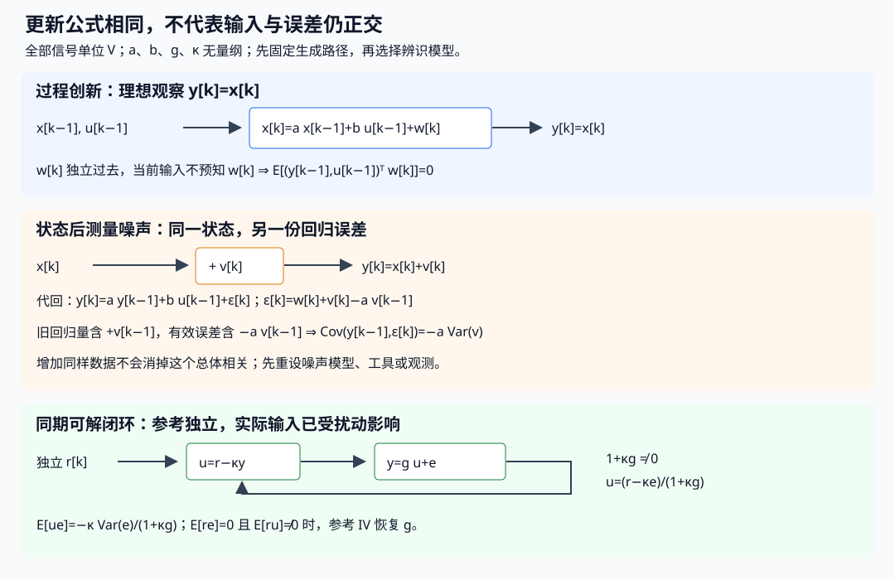

# 动态回归、持续激励与LMS-RLS

已知A/B/C检查可观性，和从输入输出时间记录估计未知A/B/C，是两件事。这里先用两抽头系统回答“怎样给输入才能认出两个参数”，再把同一平方目标写成批量解、LMS和RLS；最后把噪声、闭环和时间验证放回方程。

基础入口手算下面的两行；快进入口从“同一平方目标从批量走到在线”进入。代码与固定输入在 [[信号与系统/80-实践/08-动态辨识与自适应/README|动态辨识实验]]；这一模拟不接控制器、也不认证真实设备。

## 两抽头先说明未知对象

教学系统 y[k]=h₀u[k]+h₁u[k−1]+e[k]，真h=(1/2,−1/4)，u/y/e单位V，h为无量纲增益。采样间隔T秒固定、同步，无隐藏输入延迟，已知过去u[−1]=0。回归向量φk=(u[k],u[k−1])ᵀ，Φ∈Rᴺˣ²每行为φkᵀ，未知为h而不是当前储能状态。

**稳态常值**u[k]=1 V、连同过去都为1，则每行为(1,1)V，只识别h₀+h₁=1/4。重复这一行一百万次仍秩1。**零过去后**u=(1,0)V给两行(1,0)、(0,1)，输出(1/2,−1/4)V，无噪即可唯一恢复h。零初史阶跃的最初一行也可能增加秩；所以不能笼统说“所有常值记录都只能识别和”，必须说明舍弃瞬态或过去已有常值。

对照 [[电子电路/52-测量不确定度与辨识/04-实验设计可观测与可辨识#同τ是一整条等价族|RC同τ族]]：理想无载只量电容电压时，任意输入下R,C总经RC乘积进入模型。丰富同端口输入可以更准估τ，却不能拆R/C；新增电流或已知部件才增加结构信息。FIR例是给定模型结构下激励不足，RC例是观测映射本身的结构等价。有限满秩、结构可辨识、长期持续激励、真实参数一致性各有独立前提。

## 参数结构与激励序列

有限样本唯一LS要求Φ列满秩。若在噪声存在时还要长期参数信息，常用两份不同PE合同：

- **平均PE**：N⁻¹Σk<N φkφkᵀ→Rφ≻0。它适用于下面LS一致性证明的极限；容许局部很久没有激励。
- **均匀窗口PE**：存在L∈N、α>0，使每个t的Σk=t…t+L−1 φkφkᵀ≽αI。它保证不断出现方向，适于有限窗口跟踪/部分稳定分析；常再给上界以控制更新。它比一次满秩强，和平均PE也不完全相同。

两抽头周期输入(1,0,1,0,…)每两行恰为单位矩阵两轴，L=2、α=1 V²；常值稳态只有(1,1)外积，核(1,−1)。一次冲激只有两行有效，全长期平均Rφ趋0：它足够无噪有限恢复，却未满足上述长期平均PE。不能给这三个实验同一个PE标签。

若u零均值WSS且样本相关确实收敛，m抽头的总体Toeplitz R满足对a≠0

$$a^TRa=\frac1{2\pi}\int_{-\pi}^{\pi}S_u(\theta)\left|\sum_{j=0}^{m-1}a_je^{-ij\theta}\right|^2d\theta.$$

当Su在正测度集合严格正，非零有限多项式在单位圆至多有限个零，积分>0，给任意固定m的总体平均PE充分条件。纯单一实正弦只有±ω两条线，至多支持两个独立lag方向，ω=0/π更退化；m≥3可用具有这两个零的多项式构造核。多输入时要求矩阵谱激励各输入方向，两个输入总成比例无法分开对应增益。谱条件与分段记录的实际秩仍要分别核。[MIT 6.435 Set4 pp10–17](https://ocw.mit.edu/courses/6-435-system-identification-spring-2005/ffdd1299a755458f8b990bf3f8de8d20_lec4_6_435.pdf)是PE对象/谱条件的对照，本课两轴例和平均/窗口合同分别写明。

## 同一平方目标从批量走到在线

为避免裸单位混合，先把u,y除已声明V₀=1 V；以下φ、y与误差为无量纲数值，参数仍是增益。若不归一化，原损失为V²，普通LMS步长单位V⁻²；混状态/单位的参数应先定各列尺度。

固定先验中心θ₀∈Rᵐ、初始信息矩阵R₀≻0，遗忘因子0<λ≤1，时刻n的数据编号i=1,…,n。目标是

$$J_n(\theta)=\frac12\lambda^n(\theta-\theta_0)^TR_0(\theta-\theta_0)+\frac12\sum_{i=1}^n\lambda^{n-i}(y_i-\phi_i^T\theta)^2.$$

损失1/2固定，误差e=y−φᵀθ；信息Rₙ=λⁿR₀+Σλⁿ⁻ⁱφiφiᵀ、bₙ=λⁿR₀θ₀+Σλⁿ⁻ⁱφiyi，解Rₙθₙ=bₙ。R₀使有限样本总可逆，却可能只靠先验补数据的核；λ<1时旧数据和先验一起衰减，目标已不是未加权OLS。λ=1且R₀→0、数据满秩才趋无正则OLS；不能以任意有限P₀初值称精确同一个OLS。批量实数求解优先QR/SVD，教学小例可独立用精确消元。

[[数学/20-线性代数与几何/14-最小二乘伪逆与正则化#无精确解时应最小化什么|正规方程]] 维护有限几何推导；[[数学/40-微积分与优化/08-凸优化对偶与最优性证书#从凸集和凸函数到一个有类型的问题|凸问题对象]] 提醒严格凸的至多唯一与存在条件。这里Rₙ≻0使二次目标强制且严格凸，确有唯一最小值；小残差、小梯度不自动认证生成模型。

## RLS保存的是哪个目标的逆信息

Rₙ=λRₙ₋₁+φₙφₙᵀ。令Pₙ₋₁=Rₙ₋₁⁻¹，Sherman–Morrison直接乘回检验给

$$K_n=\frac{P_{n-1}\phi_n}{\lambda+\phi_n^TP_{n-1}\phi_n},\quad
\theta_n=\theta_{n-1}+K_n(y_n-\phi_n^T\theta_{n-1}),$$
$$P_n=\lambda^{-1}(P_{n-1}-K_n\phi_n^TP_{n-1}),\quad P_0=R_0^{-1}.$$

证明不靠名字：令eₙ=yₙ−φₙᵀθₙ₋₁；Rₙθₙ₋₁=bₙ−φₙeₙ，且RₙKₙ=φₙ，故Rₙ(θₙ₋₁+Kₙeₙ)=bₙ；P式乘Rₙ等于I。每步分母>0，由R₀≻0和λ>0，更新的唯一目标与批量一致。P是逆信息，不自动是参数后验协方差；λ=1、正确独立同方差噪声和相容Gaussian先验时才可按噪声尺度解释，遗忘模型需另说明。有限精度可丢对称/正定，工程用平方根RLS/QR并检查，教学双精度一致性不是数值全域证书。[MIT 6.435 Set11 pp19–27](https://ocw.mit.edu/courses/6-435-system-identification-spring-2005/953da04a2e5322244b36ee28297e2fc9_lec11_6_435.pdf)给递推/逆矩阵定位；本页直接代回核目标。

完整短例：φ=(1,0),(0,1),(1,1)，y=(1/2,−1/4,1/4)，R₀=I、θ₀=0。λ=1时R₃=[[3,1],[1,3]]、b₃=(3/4,0)，θ₃=(9/32,−3/32)。λ=1/2时R₃=[[11/8,1],[1,13/8]]、b₃=(3/8,1/8)，解(31/79,−13/79)。两解都未必是真h，因为正则项还在；不同λ给不同加权目标。这组分数由实验的独立批量Fraction路径与在线RLS逐步对照。

首读主线从这里继续到 [[信号与系统/40-状态控制与辨识/03-动态回归持续激励与LMS-RLS#LMS的采样假设与步长|LMS采样假设与步长]]。若想进一步解释 RLS 的逆信息在什么条件下具有 Kalman 后验协方差含义、指数遗忘对应怎样的参数状态模型，或条件改变后这些矩阵代表什么，可选读 [[信号与系统/40-状态控制与辨识/03-动态回归持续激励与LMS-RLS#参数状态与遗忘的概率模型|参数状态与遗忘的概率模型]]；它沿用本页三行数据，供读完 LMS 与辨识主体后返回。

## LMS的采样假设与步长

单样本损失ℓₙ=(1/2)(yₙ−φₙᵀθ)²，梯度−φₙeₙ，LMS更新 θₙ₊₁=θₙ+μφₙeₙ。它只用一个样本梯度，不保存P；可用NLMS以μ/(ε+||φ||²)归一，但改变算法并未修好内生噪声。回 [[AI/11-数学与统计桥梁/04-优化曲率条件数与AdamW#随机梯度何时无偏，何时已经换了问题|采样主解释]] 核对当前样本与已由过去形成的θ之间的条件关系。

假设yₙ=φₙᵀθ*+vₙ，v零均值、与φ及过去独立，φₙ iid且独立当前参数误差，R=Eφφᵀ≻0。令误差aₙ=θₙ−θ*，则

$$E[a_{n+1}]=(I-\mu R)E[a_n].$$

均值收敛当0<μ<2/λmax(R)。这是**均值**结论，不是均方界；确定性全量梯度恰有同一矩阵递推，但LMS二阶含φ四阶矩。

由 ||a⁺||²展开并利用独立、零均值v得

$$E\|a^+\|^2=E[a^T(I-2\mu R+\mu^2M)a]+\mu^2\sigma_v^2\operatorname{tr}R,\quad M=E[\|\phi\|^2\phi\phi^T].$$

若2R−μM≻0且该式的收缩上界<1，得到有界均方误差和无噪收敛；常步长有噪时通常停在噪声地板，不能说参数a.s.收敛到真值。iid Gaussian φ∼N(0,Iₘ)时M=(m+2)I（对角用Eφj⁴=3，其余用Eφj²φk²=1），无噪范数因子1−2μ+(m+2)μ²；故充分且在此各向同性模型确切的均方稳定范围为0<μ<2/(m+2)。均方极限为μ mσv²/[2−μ(m+2)]。

不需Gaussian也能反驳均值界冒签：iid φ等概率取±√2 e₁、±√2 e₂，R=I、M=2I。μ=3/2在均值范围(0,2)内，均值误差每步乘−1/2，范数平方期望却每步乘5/2；μ=1时均值立即为0、平方误差不下降。此有限分布可以逐项枚举独立核。

两抽头连续采样记录的φₙ共享u[k−1]，ARX又共享过去y；它们一般不满足iid向量与aₙ独立。上面的解析步长不能未经检查移给它们或闭环。[Lara等原研究 §2–4](https://arxiv.org/abs/1810.12865)专门讨论移位输入下独立性假设与期望分析的限制；本页有限四点反例另由完整分布枚举。可以给||φ||²有界下的逐步非扩张条件0<μ≤2/||φ||²（无噪该步沿φ投影），但达到参数收敛还须反复激励/相容条件。减小μ常有利跟踪噪声而变慢；漂移需要允许非零误差与失调，不能同时承诺精确真参数与快跟踪。

## ARX回归量与当前扰动

设x[k]=a x[k−1]+b u[k−1]+w[k]，x/u/w均为V，a,b无量纲；w[k]是与过去独立的零均值创新，输入外生、和测量噪声独立，初始/过程二阶稳定。理想观察y=x，φ=(y[k−1],u[k−1])，有效误差就是w[k]。在u[k−1]不预知当前w的前提下Cov(φ,w[k])=0，所以**出现延迟y不自动造成偏差**。全部回归矩阵包含未来y，有限样本E[e|Φ]=0未必成立，不能因此复制固定设计OLS的有限样本无偏公式；下面极限一致性只需正确矩条件及收敛。

改成y[k]=x[k]+v[k]，v为与整个过程/外生输入独立的白测量噪声，则代入真实方程有

$$y[k]=a y[k-1]+b u[k-1]+\epsilon[k],\quad
\epsilon[k]=w[k]+v[k]-a v[k-1].$$

独立性让所有交叉项消失，唯有过去测量噪声残留：

$$\operatorname{Cov}(y[k-1],\epsilon[k])=-a\operatorname{Var}v.$$

a=1/2、Varv=1/4 V²时为−1/8 V²。多采样会让这个非零矩被更准确估计，不把它归零。若u=0、a=1/2、Varw=3/4、Vars=1、Varv=1/4，总体一阶AR OLS为Cov(y[k],y[k−1])/Vary=(1/2)/(5/4)=2/5，真实a为1/2。相同理想状态数据加这一噪声通道后，估计对象变成最佳一步线性预测系数。

ARX模型Ay=Bu+e意味着过程扰动经A⁻¹进入输出；OE模型y=(B/F)u+v则输出测量噪声在动态之后，不能当同一噪声位置。OE预测从u和初态模拟无噪输出，参数进递推常非线性；ARMAX/BJ同时估噪声滤波器，其创新误差也依参数。若噪声协方差已知，GLS修复相关误差的效率，但单独改权重不自动修复解释变量噪声。[MIT 6.435 Set6 pp9–19](https://ocw.mit.edu/courses/6-435-system-identification-spring-2005/3cd2a84f8e64c60fae99b9c09f342b86_lec6_6_435.pdf)对照ARX/OE、预测器和创新表示；本页的−aVarv由噪声路径明确推出。

## 一致性、工具变量与闭环内生性

若正确模型y=φᵀθ*+e，N⁻¹Σφφᵀ→R≻0、N⁻¹Σφe→0（选定概率或a.s.模式），固定R₀/N→0，则

$$\hat\theta_N-\theta^*=\left(N^{-1}\sum\phi\phi^T+R_0/N\right)^{-1}
\left(N^{-1}\sum\phi e+R_0(\theta_0-\theta^*)/N\right)\to0.$$

这是矩收敛和逆的连续性直接给的条件证明；平稳本身不保证这两条样本极限。若误差矩趋c≠0，则极限θ*+R⁻¹c，激励满秩也只保证偏差目标唯一。有限异方差/相关时参数协方差要按指定噪声/长期协方差计算，不能总填σ²(ΦᵀΦ)⁻¹。

可接受修正之一是工具变量z：要求E[ze]=0、E[zφᵀ]满秩，矩方程E[z(y−φᵀθ)]=0才识别θ*。动态测量噪声例在有外生丰富输入时可用延迟输入/参考作为工具，但要核相关方向足够；若无输入且噪声/过程结构皆未知，单靠这一二阶矩不能唯一分离过程参数和噪声。可用完整状态空间/创新似然、已知噪声校准或重复独立传感器，须明确额外模型/数据。

闭环偏差用完全可算的同期教学互联：y=g u+e、u=r−κy；r,e独立零均值，方差σr²、σe²，1+κg≠0使代数环可解。则u=(r−κe)/(1+κg)，

$$E[ue]=\frac{-\kappa\sigma_e^2}{1+\kappa g},\quad
E[u^2]=\frac{\sigma_r^2+\kappa^2\sigma_e^2}{(1+\kappa g)^2},\quad
g_{OLS}=g-\frac{\kappa\sigma_e^2(1+\kappa g)}{\sigma_r^2+\kappa^2\sigma_e^2}.$$

取g=1/2、κ=1、两方差1，OLS趋−1/4。参考r作工具有E[re]=0、E[ru]=σr²/(1+κg)≠0，故E[ry]/E[ru]=g=1/2。r/e取±1等概率的四格可精确枚举，开放κ=0时OLS恢复g；这是同样噪声源改变反馈信息路径造成的差别。因果延迟闭环且当前创新独立历史时，ARX回归量可仍与创新正交，不能说“任何闭环OLS必偏”。缺少外部激励、错设噪声或非严格因果反馈时，需重查信息集与矩条件。[MIT 6.435 Set10 pp2–7](https://ocw.mit.edu/courses/6-435-system-identification-spring-2005/7d962ce43973d3a313601cdd156972ad_lec10_6_435.pdf)给IV/闭环输入角色；本课有限四格展示相关的来源而不代一般闭环定理。

## 非参数频响和预测误差模型

稳定LTI开环y=G*u+e，u与整个e不相关：Syu=G Suu，所以在Suu>0频段G=Syu/Suu。未激励频段不做0/0；有限记录ETFE Y/U有噪声/边缘方差，分段互谱平均可降低波动但引入窗平滑，真实相位回 [[电子电路/38-随机噪声与测量/05-互谱FFT与噪声测量#互谱保留谁共轭|同互谱约定]]。闭环e与u相关时Syu/Suu=G+Seu/Suu，谱比估到的对象变了。若独立参考r满足Ser=0，Syr=G Sur，有Sur≠0处可用Syr/Sur；MIMO要相应矩阵满秩。非参数法显示数据支持的频带，未声明一个唯一样本外参数结构。[MIT 6.435 Set3 pp7–16](https://ocw.mit.edu/courses/6-435-system-identification-spring-2005/f8c4d890b96b4bb6482e461080299e23_lec3_6_435.pdf)对照相关法和频响法。

预测误差法固定结构 y=Gθu+Hθe，Hθ及逆稳定、Hθ直接项1；给过去历史时一步预测误差可写 εθ=Hθ⁻¹(y−Gθu)，预测为 y−εθ。为使预测真正仅用过去，Gθ输入时点、Hθ的直接项及初始状态必须声明；含已知当拍输入可以用它，不能含当拍未知输出。平方PEM最小化Σ εθ²/(2N)；Gaussian独立创新且方差已知时它与对应条件似然的二次项相同，初态与方差未知还需相应项。ARX的H=1/A使ε=Ay−Bu为线性回归；OE的H=1使误差来自自由输入模拟，通常为非线性参数优化。参数优化找到局部点不证明结构正确或全局最优。[MIT 6.435 Set7 pp2–11](https://ocw.mit.edu/courses/6-435-system-identification-spring-2005/c73a3ab7a1f93e7953223ac3d01550c7_lec7_6_435.pdf)是预测误差/似然对象定位。

### 同一全通例增加同步输入后识别什么

先读 [[信号与系统/30-随机信号与推断/03-Wiener滤波线性预测与创新#创新表示不等于物理输入的恢复|共同参数与信息表]]，只把“物理 $u$ 不可见”改成同步观测 $u,x$；输入仍为全整数平稳 iid Gaussian、方差1 V²，$G_1=1$、$G_2=A_{1/2}$，没有额外噪声。此处 $x$ 对应上一段的输出 $y$，创新 $e=x$ 是输出自身的创新，不能因此把输入路径 $G$ 删除。

按 $S_{xu}=E[XU^*]$，两路 $S_{xu}/S_{uu}$ 在 $\theta=\pi/2$ 分别为 $1$ 与 $-4/5-(3/5)i$；迁移 $a=1/3$ 为 $-3/5-(4/5)i$。两路总体幅值平方相干均1，所以“相干1”不能区分相位；去 [[电子电路/38-随机噪声与测量/05-互谱FFT与噪声测量#同一全通例的共轭核查与返回|共轭核查]] 带回反次序为何改变虚部符号，再返回 [[信号与系统/20-数字信号处理/04-IIR设计二阶节与幅相取舍#阶数 群延迟与实时资源|物理全通与延迟]]。

本次新增输入记录解除的是**完整输出律仍有的物理歧义**，不同于有限样本误差。已知完整总体 $S_{xu},S_{uu}$、全带 $S_{uu}>0$、稳定LTI及输入与其他扰动不相关，才在全带恢复 $G$；有限样本还需一致谱估计的平稳、遍历、窗口与记录条件。MIMO另核输入谱矩阵满秩，闭环另核前文 $S_{eu}$，不能把本无噪例用作一般一致性证明。

改激励也要声明新增信息。只有未知白 Gaussian 输出时，即使知道激励方差，换白源不会暴露全通；只知道 $S_{uu}$ 的有色输入仍只给 $S_{xx}=|G|^2S_{uu}$，非零频带的相位仍缺。若给已知时钟／相位的周期 $u[n]=\cos(\pi n/2)$ V、全部整数周期过去和同步输出，B 的四拍输出为 $(-4/5,3/5,4/5,-3/5)$ V，A 为 $(1,0,-1,0)$ V。它们在这个单频处已可区分；**单频并未识别任意未知 $G$ 的全频结构**，周期输入还有谱线，不能将其互谱原子当普通密度做0/0。若先验只有 $\{1,A_a:0<a<1\}$，该复值的实部 $-2a/(1+a^2)$ 在 $(0,1)$ 严格单调，才足以在这族里识别 $a$；这是模型族信息。已知零过去冲激和全尾响应则可恢复完整 $h$，有限截尾需要本例几何余量，真实噪声另计。返回 Wiener 表时同时带回输入是否可见、激励频带和模型先验，不把预测误差白化当物理系统已辨明。

## 阶次与时间保留验证

按时间先留训练、验证、最终测试三段，所有归一化、滤波、阶次与λ/μ选择在训练/验证完成；最后测试只报告。随机拆分相邻记录会共享过去、未来和漂移；交叉折至少明确历史上下文/间隔。FIR从回归矩阵阶次选取，ARX包含过去y，必须给真时间上下文且不用测试的未来生成训练特征。

训练SSE随增阶不增并不意味着阶次正确。验证同时报告一步预测MSE、自由运行MSE、残差自相关和输入—残差相关：

$$\hat C_e[\ell]=N^{-1}\sum_{k=\ell}^{N-1}(e_k-\bar e)(e_{k-\ell}-\bar e),\quad
\hat C_{ue}[\ell]=N^{-1}\sum_{k=\ell}^{N-1}(u_{k-\ell}-\bar u)(e_k-\bar e).$$

均值可用各自全段均值，但边界配对和N分母已声明；有限小值不证明总体白或外生。真正创新在正确模型下应与允许历史正交；残差“不白”可能是结构错、初态错、漂移或噪声模型错，而不总是植物G错。对ARX一步预测用实际y[k−1]，自由运行则递推自己的ŷ[k−1]；若 |â|>1，前者可短期很好而后者放大初值/误差。重复试验需保持最终测试独立，不能报告择优后的同测试分数。[MIT 6.435 Set12 pp24–30、68](https://ocw.mit.edu/courses/6-435-system-identification-spring-2005/b75d29c89150abc5689ff619ea4f9aaf_lec12_6_435.pdf)用于模型验证/阶次的定位，实验具体分段由README固定。

实践的两抽头记录从固定seed的±1输入产生，再按时间分训练/验证/测试，噪声0.05 V，候选1、2、3抽头。再用同一AR状态记录分别理想观察和加白测量噪声；冻结拟合后同时报告一步/自由运行，检查上面的相关路径。慢漂移段比较λ=1与.98和LMS步长，不预先声称某条实际曲线获胜。解析短例和模拟记录各有独立oracle。[[信号与系统/80-实践/08-动态辨识与自适应/RESULTS|同版实际结果]] 中验证选择二抽头，冻结测试MSE为0.002522961 V²；同一AR记录的理想观察拟合â=0.512387，测量噪声观察â=0.407050，与本含输入模型总体13/32的偏移机制一致，但有限样本不等于总体。漂移后独立验证中λ=1的MSE为0.053214322 V²，λ=.98与LMS分别0.002909847、0.002901394 V²；两者的微小差异只描述这份固定记录，不能推广算法优劣。完整轨迹、物理lag0…8与较差结果均保留。

## 换动态参数坐标，数据没有多一份信息

延续#214/#215共同规则：θ=Dz时预测Φθ=(ΦD)z，先验R₀变DᵀR₀D、θ₀变D⁻¹θ₀；逆信息P₀变D⁻¹P₀D⁻ᵀ。固定残差单位/权重和λ，批量与RLS最优点对应。若再行缩放S，残差权重应变S⁻ᵀWS⁻¹；裸残差或相同字面I先验常已换目标。数值条件数可以变化，rank(ΦD)=rankΦ，物理输入仍是原输入。

普通LMS在z空间用同一μ，映回θ的梯度步带DDᵀ，轨迹通常不同；要保留θ空间轨迹需z空间用D⁻¹D⁻ᵀ度量。去 [[数学/20-线性代数与几何/17-矩阵范数条件数与数值稳定性#换坐标时，预测、惩罚与误差度量要一起带走|共同坐标规则]]，回来交ΦD、R₀新值、同单位残差，不能用κ变小宣称改善实际激励。

## 参数估计不会自动给闭环稳定

将估计器接入控制器就改变u和数据分布。哪怕θ精确，饱和、延迟、未建模极点仍改变稳定；θ逐点趋真也不自动保证过程中安全。例如离散植物x⁺=a x+b u、控制u=−k x，稳定需|a−bk|<1；仅有估计â,b̂且由它们选k，须对真实参数不确定集合核该不等式。真a=1.2,b=1、错误估计â=.5,b̂=1令k=.5，真实闭环.7稳定；若b真为−1而误认为+1，同k给1.7失稳。输入增益符号是实质条件。

这一页已有LMS/RLS和闭环识别偏差，未声称完成直接/间接MRAC、鲁棒控制、多变量控制或非线性控制整课。相应闭环路线仍沿 [[信号与系统/00-开始/01-信号系统课程地图与覆盖边界#独立控制方向|现有独立控制方向]]；理论难度不使这里有限识别等待那些整课。真实采集接口需要时间戳/标定、输入权限、噪声模型、饱和、负载与保留验证；没有设备时可完成本课解析与合成验证，不虚填硬件成功。

## 参数状态与遗忘的概率模型

同样是“预测误差乘增益”，为什么前面只把 $P_n$ 称作逆信息，Kalman 却把矩阵称作协方差？关键在于补了什么随机模型。把未知参数作为状态，可以连接两种递推；对象仍是两抽头增益，不会因此变成机器人位置/速度。本节只消费上面的三行 $\phi,y$，保留两门课各自原主例。

### 先配齐四个量，再说同一推断

沿用归一化数值：$\phi_n\in\mathbb R^m$、$y_n\in\mathbb R$，全部观测除同一电压基准1 V；参数 $\theta\in\mathbb R^m$ 是无量纲增益。另设观测噪声方差 $r>0$，不要与 RLS 的 $R_0$ 混名。

| 量 | 含义与 shape | 本节单位 |
| --- | --- | --- |
| $R_0,R_n$ | 目标 $J_n$ 的初始/累计信息，$m\times m$ | 归一化数据的数值二次型尺度；尚无概率身份 |
| $P_n=R_n^{-1}$ | 同一目标的逆信息，$m\times m$ | 由目标尺度决定 |
| $\Sigma_n$ | 给定观测后参数的协方差，$m\times m$ | 增益²，当前增益无量纲 |
| $r$ | 单次观测噪声方差，标量 | 归一化输出²；恢复电压噪声方差为 $r\,(1\,\mathrm V)^2$ |

先取静态随机参数与预先固定的设计：

$$
\theta\sim\mathcal N(\theta_0,\Sigma_0),\qquad
\Sigma_0=rR_0^{-1},\qquad
y_n=\phi_n^T\theta+v_n,
\quad v_n\overset{\rm iid}{\sim}\mathcal N(0,r).
$$

初始参数、各次噪声相互独立；$\phi_n$ 已知且不含未知测量误差，当前噪声与已有历史独立。条件于完整数据，负对数后验中依赖 $\theta$ 的部分恰是

$$
\frac1{2r}(\theta-\theta_0)^TR_0(\theta-\theta_0)
+\frac1{2r}\sum_{i=1}^n(y_i-\phi_i^T\theta)^2
=J_n(\theta)/r\quad(\lambda=1).
$$

配方得后验均值与 MAP 均为 $R_n^{-1}b_n$，后验协方差为 $\Sigma_n=rR_n^{-1}=rP_n$。这份概率解释需要相容先验和似然；前面的确定性严格凸优化及 RLS 代回证明本身不需要 Gaussian。对固定真参数、错设噪声或内生回归，不能把 $rP_n$ 自动当成估计误差的真实协方差或频率学置信域。

现在去 [[AI/45-机器人与具身智能/20-状态估计与LQG/01-线性Gaussian条件化到Kalman递推#把 $a=x_k$、$b=y_k$ 代入|Kalman 条件化]]，带过去 $x_n=\theta$、$A=I_m$、$H_n=\phi_n^T\in\mathbb R^{1\times m}$、$Q_n=0$、测量方差 $r$，以及 $\hat\theta_0=\theta_0,\Sigma_0=rP_0$。返回时说明“参数不变”怎样进入预测，而不是只认出相同的增益名称。

预测与条件化给

$$
\hat\theta_n^-=\hat\theta_{n-1},\quad
\Sigma_n^-=\Sigma_{n-1},\quad
S_n=r+\phi_n^T\Sigma_n^-\phi_n>0,
$$
$$
L_n=\frac{\Sigma_n^-\phi_n}{S_n}
=\frac{P_{n-1}\phi_n}{1+\phi_n^TP_{n-1}\phi_n}=K_n,
\qquad
\hat\theta_n=\hat\theta_{n-1}+L_n\nu_n,
\quad\nu_n=y_n-\phi_n^T\hat\theta_{n-1}.
$$

这里 $L_n$ 为 $m\times1$、$S_n,\nu_n$ 为标量。协方差条件化为

$$
\Sigma_n=\Sigma_n^--\Sigma_n^-\phi_n S_n^{-1}\phi_n^T\Sigma_n^-
=r(P_{n-1}-K_n\phi_n^TP_{n-1})=rP_n.
$$

也可直接用 Kalman 页的 Joseph 形式计算。只要这套模型和初值匹配，归纳就证明每一步均值和协方差相同；不是仅在第三步得到一个接近的点。

### 三行同时算均值、创新与协方差

设 $m=2,r=1,R_0=I_2,\theta_0=0$，三行仍为 $(1,0),(0,1),(1,1)$，读数仍为 $(1/2,-1/4,1/4)$。$Q_n=0$，每次 $S_n=2$：

| $n$ | $\nu_n$ | $L_n=K_n$ | $\hat\theta_n$ | $\Sigma_n=P_n$ |
| --- | --- | --- | --- | --- |
| 1 | $1/2$ | $(1/2,0)^T$ | $(1/4,0)^T$ | $\operatorname{diag}(1/2,1)$ |
| 2 | $-1/4$ | $(0,1/2)^T$ | $(1/4,-1/8)^T$ | $I_2/2$ |
| 3 | $1/8$ | $(1/4,1/4)^T$ | $(9/32,-3/32)^T$ | $\begin{pmatrix}3/8&-1/8\\-1/8&3/8\end{pmatrix}$ |

第三行观察两个参数的和。它同时减少这个方向的不确定性，生成负交叉协方差：如果第一个参数更大，第二个就可以更小而保持相近的和。第三步的独立批量核为 $R_3=\begin{pmatrix}3&1\\1&3\end{pmatrix},b_3=(3/4,0)^T$；用行列式8求逆即可得到整份均值/协方差，不依赖更新程序。

虽然读数也符合真 $h=(1/2,-1/4)$ 的无噪方程，本次**推断模型**仍设测量方差1并保留先验，故均值被收缩。静态参数后验并不要求三次恰好回到模拟器真值，三行也没有证明长期 PE。

### 遗忘要求哪个过程噪声

$\lambda<1$ 时，RLS 在加新行前先把信息乘 $\lambda$，等价于把逆信息除 $\lambda$。若仍用静态参数、$A=I,Q_n=0$ 的同一概率模型，预测协方差没有这一步膨胀，两算法便不同。

要在均值和协方差上匹配，可改为参数随机游走：

$$
\theta_n=\theta_{n-1}+w_n,\qquad
w_n\sim\mathcal N(0,Q_n),\qquad
Q_n=(\lambda^{-1}-1)\Sigma_{n-1}\succeq0.
$$

这里 $w_n$ 与先前参数/噪声独立、测量噪声仍独立同方差 $r$。对于本节预先固定的设计，$\Sigma_{n-1}$ 只依赖设计、先验与既定噪声模型，可以事先算出；故这是一套合法的时变 Gaussian 状态模型。若设计随历史自适应，必须另写给定历史的转移与观测独立性条件，不能默认所有随机回归量仍满足本模型。

由 $A=I$ 得

$$
\Sigma_n^-=\Sigma_{n-1}+Q_n=\Sigma_{n-1}/\lambda=rP_{n-1}/\lambda,
$$
$$
L_n=\frac{(r/\lambda)P_{n-1}\phi_n}
{r+(r/\lambda)\phi_n^TP_{n-1}\phi_n}
=\frac{P_{n-1}\phi_n}{\lambda+\phi_n^TP_{n-1}\phi_n}=K_n.
$$

条件化再给 $\Sigma_n=(r/\lambda)(P_{n-1}-K_n\phi_n^TP_{n-1})=rP_n$，所以一般尺度关系仍成立。但现在被估计的是当前动态参数 $\theta_n$，不是原来不变的 $\theta$；$Q_n$ 是为匹配指数遗忘**选定**的模型，不能据 $\lambda$ 宣称实际元件每拍具有这个已校准漂移强度。去 [[AI/45-机器人与具身智能/20-状态估计与LQG/01-线性Gaussian条件化到Kalman递推#预测一步怎样产生速度信息|物理过程噪声的预测]]，带回机器人 $W$ 怎样由加速度及单位构造，比较它与本节 $Q_n$ 的依据。

取 $\lambda=1/2,r=1$，每次 $Q_n=\Sigma_{n-1}$，仍用原三行：

| $n$ | $Q_n$ | $S_n$ | $\nu_n$、$L_n$ | $\hat\theta_n$ | $\Sigma_n$ |
| --- | --- | --- | --- | --- | --- |
| 1 | $I_2$ | $3$ | $1/2$、$(2/3,0)^T$ | $(1/3,0)^T$ | $\operatorname{diag}(2/3,2)$ |
| 2 | $\operatorname{diag}(2/3,2)$ | $5$ | $-1/4$、$(0,4/5)^T$ | $(1/3,-1/5)^T$ | $\operatorname{diag}(4/3,4/5)$ |
| 3 | $\operatorname{diag}(4/3,4/5)$ | $79/15$ | $7/60$、$(40/79,24/79)^T$ | $(31/79,-13/79)^T$ | $\frac1{79}\begin{pmatrix}104&-64\\-64&88\end{pmatrix}$ |

第三步直接批量核仍是 $R_3=\begin{pmatrix}11/8&1\\1&13/8\end{pmatrix},b_3=(3/8,1/8)^T$，$\det R_3=79/64$。在确定性优化中这只是更重视近期行、且初始惩罚也衰减的目标；在刚声明的动态模型中，同一二次型可以表示当前参数的边缘后验。两种解释相容不表示现实已选中了这一漂移模型。[Stanford EE363 Kalman 讲义第13–17页](https://ee363.stanford.edu/archive/lectures/kf.pdf)给预测/条件化公式；[Rowell 的 MIT 2.161 RLS 讲义 §2](https://ocw.mit.edu/courses/2-161-signal-processing-continuous-and-discrete-fall-2008/0908e93cb4f31eac9150b14c1ffdf328_rls.pdf)给指数权重。此处的尺度映射、三行分数及 $Q_n$ 匹配由上述方程直接推出。

### 无激励时，增大的是什么

只看一个标量方向，初值 $\Sigma_0=P_0=1,r=1$，随后 $\phi_n=0$。创新没有参数信息，所有增益为0，均值都停在初值。指数遗忘 $\lambda=1/2$ 给 $P_n=2P_{n-1}$；固定物理随机游走 $Q=1$ 给 $\Sigma_n=\Sigma_{n-1}+1$：

| 模型 | 第1步 | 第2步 | 第3步 |
| --- | ---: | ---: | ---: |
| 匹配遗忘的 $Q_n=\Sigma_{n-1}$ | 2 | 4 | 8 |
| 固定随机游走 $Q=1$ | 2 | 3 | 4 |
| 静态参数 $Q=0$ | 1 | 1 | 1 |

第一步一致不能认证同一长期模型；没有新观测时也没有新参数信息。膨胀来自遗忘或过程模型承担的未知变化，实际激励仍须回 [[信号与系统/40-状态控制与辨识/03-动态回归持续激励与LMS-RLS#参数结构与激励序列|激励合同]] 核方向与量词。错设 ARX 测量误差、同期反馈内生性不会因把状态改名 $\theta$ 自动消失，仍回 [[信号与系统/40-状态控制与辨识/03-动态回归持续激励与LMS-RLS#ARX回归量与当前扰动|噪声路径]] 与 [[信号与系统/40-状态控制与辨识/03-动态回归持续激励与LMS-RLS#一致性、工具变量与闭环内生性|矩条件]]。

### 改一个条件，再带估计去控制

先不看答案：把 $r$ 改为4，分别令先验协方差为 $4I_2$ 与 $I_2$，三行和 $\lambda=1$ 保持不变。写出信息矩阵、均值与协方差；另问若 $\phi=0$，相同首步协方差能否证明两个过程模型一致。

可复算答案与返回条件

- $r=4,\Sigma_0=4I_2$ 时仍对应 $R_0=r\Sigma_0^{-1}=I_2$。每一步均值与静态表完全相同，$\Sigma_n$ 是表中矩阵的4倍；全部创新方差也乘4，增益不变。点估计相同而误差条带尺度不同。
- 只改 $r=4$、先验仍 $I_2$ 时，$R_0=4I_2$。第三步 $R_3=\begin{pmatrix}6&1\\1&6\end{pmatrix},b_3=(3/4,0)^T$，故 $\hat\theta_3=(9/70,-3/140)^T$、$\Sigma_3=\frac1{35}\begin{pmatrix}24&-4\\-4&24\end{pmatrix}$。新观测相对于先验更不可靠，均值收缩更多；机械把原协方差乘4会漏掉目标改变。
- $\phi=0$ 时两个模型第二步已经是4与3；先核预测律再比较均值，不能用首步或恒定均值认定同一模型。

接 [[控制论/10-系统课程/11-直接MRAC有界跟踪与参数收敛#参数收敛另给条件和证明|MRAC 的参数收敛条件]] 时，带去未知对象、参数维数、真实回归量及激励来自何处。本节三行是两个增益的有限估计；控制课则在准确状态、固定单参数、已知输入系数+1、无扰动且连续更新下，从有界性和一致连续先证跟踪误差趋零，再以最终窗口 PE 证参数收敛。其 [[控制论/10-系统课程/11-直接MRAC有界跟踪与参数收敛#两个无激励反例和一个有激励结果|零激励反例]] 给 $y=y_r=e=0$ 但错误参数永远不动；所以跟踪成功并不代替识别。返回本节时应指出：后验/逆信息、数据激励和跟踪 Lyapunov 证明分别回答什么，不将三行满秩当成长时闭环证书。

再带估计到 [[控制论/10-系统课程/10-闭环辨识从激励到控制条件#估计模型稳定，设计出的真实闭环仍可能失稳|真实参数到闭环条件]]，核实际输入方向、误差集合和施加动作；有扰动时沿 [[控制论/10-系统课程/12-扰动下的σ修正与数字实现边界#固定泄漏要说明中心与参数集合|泄漏的中心与残差界]] 看改变哪条误差动态。遗忘、参数过程噪声和 MRAC 泄漏承担不同目标，不能互作稳定性证明。有限三行 CPU 复算也没有校准真实漂移、操作设备或证明读者已经理解。

### 相邻模型的比较接口

参数作为状态也能承接边观测中的势差估计。先到 [[数学/36-拓扑学/20-同调与上同调/01-循环边界与奇异链复形#从图的关联矩阵走到链复形|现有三角形的势差对象]]，保留边顺序01、12、02、终点减起点，并固定节点0的势为0。同一有限边读数现由[[数学/36-拓扑学/20-同调与上同调/06-边读数势差与离散Hodge分解#同一组读数的完整势差投影|势差LS主解释]]完整计算；带本节先验与观测噪声回[[数学/36-拓扑学/20-同调与上同调/06-边读数势差与离散Hodge分解#同一设计，有先验便换了目标|相同设计的先验收缩]]，判断改的是目标还是规范：两个自由势记作 $\psi=(\psi_1,\psi_2)^T$，与 FIR 回归量 $\phi_n$ 区分，设计与读数为

$$
D=\begin{pmatrix}1&0\\-1&1\\0&1\end{pmatrix},\qquad
Y=(2,1,0)^T,\qquad
D^TD=\begin{pmatrix}2&-1\\-1&2\end{pmatrix},\quad D^TY=(1,1)^T.
$$

无先验的欧氏 LS 解为 $\psi=(1,1)^T$，边预测 $D\psi=(1,0,1)^T$，残差 $(1,1,-1)^T$，满足 $D^T(Y-D\psi)=0$。另给 $\psi\sim N(0,I_2)$、三维观测噪声 $N(0,I_3)$ 且独立，所有量无量纲，静态参数 Kalman/批量条件化给

$$
\hat\psi=(I_2+D^TD)^{-1}D^TY=(1/2,1/2)^T,\qquad
\Sigma_\psi=\frac18\begin{pmatrix}3&1\\1&3\end{pmatrix}.
$$

后者的残差 $(3/2,1,-1/2)^T$ 满足 $D^T(Y-D\hat\psi)=\hat\psi$，并不与设计列空间正交：先验惩罚改变了最优性方程。两个结果的区别来自目标，不是投影失算；当前 FIR 三行继续维护本节自己的主例。返回 [[数学/20-线性代数与几何/14-最小二乘伪逆与正则化#正则化把不适定性与偏差交换|正则化主解释]] 时交惩罚、规范和残差度量，不把有先验估计称作原欧氏投影。

另到 [[AI/65-可信AI与真实数据实践/04-区间代价分组失败与发布漂移#同一合成机制先重训十次|现有总体重训]]，带回“这一段明确忽略有限样本”。[[AI/65-可信AI与真实数据实践/04-区间代价分组失败与发布漂移#有限批次重训为何留下平稳波动|有限批次主解释]]另取无量纲 $\vartheta_t\in[0,1]$、$B_{t,j}\overset{\rm iid}{\sim}\operatorname{Bernoulli}(1/2)$，每轮新抽样独立于此前历史，更新

$$
\vartheta_{t+1}=\frac12\vartheta_t+\frac1{2m}\sum_{j=1}^m B_{t,j},\qquad m\in\mathbb N_{>0}.
$$

给定历史的实际采样方差为 $\operatorname{Var}(\vartheta_{t+1}\mid\mathcal H_t)=(1/(2m))^2(m/4)=1/(16m)$；全方差公式给 $v_{t+1}=v_t/4+1/(16m)$。这份 $v_t$ 是重训输出在重复抽样中的方差，$1/(16m)$ 来自新批次；本节 $\Sigma_n$ 是所选参数模型下的后验协方差，$Q_n$ 来自匹配遗忘。二者都以各自无量纲参数的平方计量，但随机机制、未知对象和条件信息不同。重复使用同一批样本会破坏此处“新噪声独立”条件；在遗忘模型中把 $Q_n$ 改成固定值则破坏指数 RLS 的匹配。能逐项说明这两种条件变化，才完成了这条比较接口；有限批次的完整分布与不同收敛方式回该主解释核对；这条比较本身不认证现实部署收敛。

若从 RLS 处跳转来借读，读完返回 [[信号与系统/40-状态控制与辨识/03-动态回归持续激励与LMS-RLS#LMS的采样假设与步长|LMS 主线]]；若已顺读 LMS 与辨识主体到达这里，则直接进入下面的撤提示迁移，不必返回前文。

## 撤去方法提示的迁移

1. 只保存恒1输入的稳态1000拍，QR返回某个h。如何判断两个参数是否被识别？加一次已知零过去冲激与把ADC精度提高100倍，分别增加什么？
2. 用本短记录，P₀从I改100I却宣称同一批量正则目标，哪里错？λ从1改1/2后，先写目标再解释系数。
3. 理想观察AR与加测量噪声AR的样本量都增加十倍，普通OLS偏差会怎样？指出回归量与有效误差的一个非零矩。
4. 当前μ符合均值范围，能断言均方稳定吗？用有限四点φ反例答。把其独立向量改成共享滞后输入，又需重核什么？
5. 参数在后半段漂移，λ=.98与1应比较哪些目标和测试指标？预滤波后输入残差相关变小是否证明真实植物模型正确？

参考解答与等价方案

1. 每行(1,1)，只能得h₀+h₁=1/4；最小范数h=(1/8,1/8)并不是两参数真值。已知零过去冲激增加第二方向，理想恢复(1/2,−1/4)；精度只降低原方向噪声。RC同τ族仍须新端口/约束，不能类推冲激必拆所有参数。
2. P₀=100I等于R₀=.01I，先验精度变了。λ=1/2目标给旧行1/4、1/2、1、初先验1/8的权重，结果(31/79,−13/79)；不是原未加权OLS。完整等价重参数化且变先验的答案也可接受。
3. 理想AR的创新矩零，在样本极限和R≻0下可一致；带测量噪声Cov(y[k−1],ε[k])=−1/8 V²，偏差不因多采自动消失。无输入一阶例收敛2/5而非1/2；应使用适当创新模型、独立工具或新观测。
4. μ=3/2时均值乘−1/2而均方乘5/2。时间相关后θ与新φ可能相关，均值/均方因式分解也失效；需要指定模型重新分析，不引用原界冒签。
5. λ<1牺牲旧信息以跟踪，需比较后段独立预测/仿真、跟踪延迟、参数方差与残差，不只终点训练SSE。预滤波改变频率权重和相关结构，残差小未证明未激励频带或反馈模型；重新核可辨识、真实噪声和控制稳定。

返回 [[电子电路/44-嵌入式采集与控制/05-校准辨识与不确定度#残差、范围与版本|电子标定]] 带训练范围、模型版本和噪声位置；返回 [[信号与系统/40-状态控制与辨识/02-内部稳定与输入输出稳定#数值rank、尺度与有限窗口不是辨识证明|已知模型稳定]] 带未知量和识别证据，不把估得参数代替全IC闭环证明；回 [[信号与系统/30-随机信号与推断/03-Wiener滤波线性预测与创新#投影到线性张成与投影到全部观测函数|Wiener函数类]] 分开最佳预测权与植物真参数。
