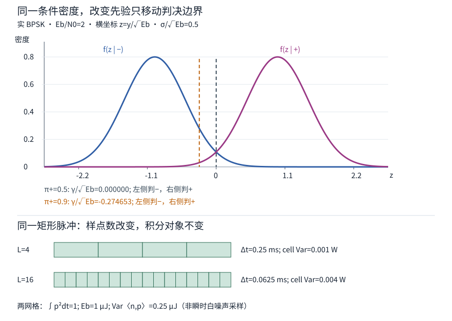

# 数字通信：波形、检测、同步与均衡

一个比特如何从一段带噪的波形中被恢复？接收机不是逐点投票：它先把整段波形压成一个保留判别信息的数，再按明确的损失和先验行动。这个数怎样构造，正是物理能量与概率判决相接的地方。

本页先完成**理想同步、已知增益的实 BPSK 一次发送与判决**，用同一矩形脉冲核对采样网格和先验变化。随后把网络的4+3位 CRC 码字接到账本。一般脉冲成形、零ISI、载波/定时恢复、两抽头均衡与衰落仍是本课后续范围；本页假设同步已经完成，没有模拟取得同步的过程。

## 从目标存在检测到正负符号

已有[[信号与系统/30-随机信号与推断/02-匹配滤波检测与未知到达时间#Gaussian 似然比为什么只剩一个内积|目标检测]]在比较“只有噪声”和“正模板加噪声”。通信里的两个候选都含信号。固定本页位序映射：发送位 $b=1$ 对应 $a=+1$，$b=0$ 对应 $a=-1$。一位就是一个符号；在已知的区间 $0\le t<T$ 内发送

$$s_a(t)=a\sqrt{E_b}\,p(t),\qquad a\in\{-1,+1\},\quad
\int_0^T p(t)^2\,dt=1.$$

$p$ 是实的单位能量基函数，两波形互为相反数，信号空间中只有一条轴。BPSK 的同相/反相载波经理想相干接收以后，用这一条实轴描述；这里不把 I/Q 两个分量的方差混到实模型中。

先固定单位：$t,T$ 用 s，$p$ 用 $\mathrm{s}^{-1/2}$，$E_b$ 用 J，$s_a$ 用 $\sqrt{\mathrm W}$；于是 $\int s_a^2dt=E_b$。这是一种功率归一化的等效波形。若实际观察的是实负载 $R$ 上的电压 $v(t)$，且该电压确为负载两端瞬时值，可取 $s=v/\sqrt R$，把 $\int v^2/R\,dt$ 记为 J。源端可用功率、端口入射波功率和负载耗散功率需要各自的参考面与匹配条件，不能仅把 ADC 数值标成伏特就称 $E_b$。

本页选最便于手算的脉冲

$$p(t)=1/\sqrt T\quad(0\le t<T),\qquad p(t)=0\quad\text{其他时刻}.$$

$T=1$ ms、$E_b=1$ μJ 时，$p=\sqrt{1000}\ \mathrm{s}^{-1/2}$，$s_+=\sqrt{10^{-3}}\ \sqrt{\mathrm W}$，每符号平均功率 $E_b/T=1$ mW。正负号改变相位/符号，能量都为1 μJ；没有“负能量位”。矩形边缘有无限频谱尾，因此它是积分与判决教具，不能据此宣称某个有限模拟带宽或ADC采样率已满足抗混叠。

## 匹配统计量怎样把波形变成一次判断

接收 $r(t)=s_a(t)+n(t)$。假设符号边界、极性、载波参考和增益已知，没有多径/ISI；噪声与发送符号独立，是零均值实 AWGN，**双边**功率谱密度 $S_n(f)=N_0/2$，$f$ 用 Hz，$N_0$ 单位 W/Hz=J。理想白噪声是广义过程，没有有限方差的“瞬时 $n(t)$ 样本”；可定义的是滤波/积分后的随机变量。

沿已知基函数取内积

$$Y=\langle r,p\rangle=\int_0^T r(t)p(t)\,dt
=a\sqrt{E_b}+W,\qquad
W=\int_0^T n(t)p(t)\,dt.$$

实 WGN 的积分协方差给

$$\operatorname{Var}W=\frac{N_0}{2}\int_0^T p^2dt=\frac{N_0}{2},\qquad
Y\mid a=\pm1\sim\mathcal N(\pm\sqrt{E_b},N_0/2).$$

$Y$ 的单位为 $\sqrt{\mathrm J}$，方差的单位为 J。$E_b/(N_0/2)=2E_b/N_0$ 是**这一实坐标**的均值平方/噪声方差；通常画图用的 $E_b/N_0$ 相差因子2，别把两种横轴都简称成“SNR”。[MIT 6.450 第7章 §7.7，印刷页224–225，式(7.63)–(7.65)](https://ocw.mit.edu/courses/6-450-principles-of-digital-communications-i-fall-2006/49163236e20779bae41639ff9dec1ac4_book_7.pdf#page=26)给出积分方差、协方差和正交投影独立性的承重条件。

直觉上，把接收波形中“像 $p$”的部分累起来：真正的符号沿这条轴同向积累；与 $p$ 正交的分量在两个假设下都只有同分布 Gaussian 噪声。选一组含 $p$ 的正交基展开，它们在密度比中消掉，因此 $Y$ 是本二元模型判别所需的充分统计量。这里说的是指定假设族，不是说一个数可以估计未知信道、到达时刻和噪声谱。[第5章 §5.3，式(5.13)及投影定理](https://ocw.mit.edu/courses/6-450-principles-of-digital-communications-i-fall-2006/90bcfef40894c3a17214902ff29c3d98_book_5.pdf#page=10)核对几何投影；原有匹配检测页继续解释一般已知模板与白化。

它也能由滤波器产生：取 $h(t)=p(T-t)$，在 $T$ 采样，卷积输出就是上面的积分。对这个矩形例，它是带归一化系数的 integrate-and-dump；先整合一个符号的证据，再清空进入下一个符号。

## 从两个密度推阈值与误码率

令 $A=\sqrt{E_b}>0$、$\sigma^2=N_0/2>0$。两个密度为

$$f_\pm(y)=\frac{1}{\sqrt{\pi N_0}}
\exp\!\left[-\frac{(y\mp A)^2}{N_0}\right].$$

相除再取对数，公共系数与 $y^2,A^2$ 项消掉：

$$\log\frac{f_+(y)}{f_-(y)}
=\frac{(y+A)^2-(y-A)^2}{N_0}
=\frac{4Ay}{N_0}.$$

先验 $\pi_+=\pi_-=1/2$，两种误判代价均1、正确代价0，最小总体误判概率的 MAP 规则是选后验较大者，所以 $Y>0$ 判 $+$（位1），$Y\le0$ 判 $-$（位0）。连续分布边界概率0；代码明确把相等归负，以固定接口。

发送正号时，错误为 $W\le-A$；发送负号时，错误为 $W>A$。标准化 $Z=W/\sigma\sim\mathcal N(0,1)$，用对称性得两个**条件**错误率相等：

$$P(e\mid +)=P(e\mid -)=Q(A/\sigma),\qquad
Q(x)=\frac{1}{\sqrt{2\pi}}\int_x^\infty e^{-z^2/2}\,dz.$$

一位一符号且没有纠错，条件误符号与该发送位误码事件相同；总体按先验加权，故

$$P_b=\pi_+P(e\mid+)+\pi_-P(e\mid-)
=Q\!\left(\sqrt{2E_b/N_0}\right).$$

取 $E_b=1$ μJ、$N_0=0.5$ μJ（即实双边噪声 PSD 为0.25 μJ），$E_b/N_0=2$ 为**线性比值**，约3.0103 dB。$A=0.001\sqrt{\mathrm J}$，$\sigma=0.0005\sqrt{\mathrm J}$，阈值0；$P_b=Q(2)\approx0.02275013195$。100000次发送的期望错误数约2275，标准差约47.15；观察到不同整数是有限样本波动，不是公式失效。概率模型没有承诺每十万位恰好错2275次。[第8章 §8.3.1，印刷页254–256，式(8.15)–(8.19)](https://ocw.mit.edu/courses/6-450-principles-of-digital-communications-i-fall-2006/f6c75b427b022503f5c605db7de4d46f_book_8.pdf#page=6)支持不等先验条件错误率与等先验特例；以上展开保留了自己的符号与位映射。

## 只改先验，什么会变

仍用同一 $E_b,N_0,p,T$，只把发送先验改为 $0<\pi_+<1$、$\pi_-=1-\pi_+$。最小等代价误判仍比较 $\pi_+f_+(y)$ 与 $\pi_-f_-(y)$，于是

$$\log\frac{f_+(y)}{f_-(y)}>\log\frac{\pi_-}{\pi_+}
\iff Y>\gamma,\qquad
\gamma=\frac{N_0}{4\sqrt{E_b}}\log\frac{\pi_-}{\pi_+}.$$

先验偏向正号时 $\gamma<0$，较弱的正号证据也会判正。它降低常见正号的漏判，同时更容易误判少见负号。条件密度和同一观测的似然比保持不变；后验赔率、行动阈值及两种条件错误率改变。若误判代价分别为 $C_{-\mid+},C_{+\mid-}>0$，零正确代价下，把对数中的比值换成 $C_{+\mid-}\pi_-/(C_{-\mid+}\pi_+)$；换目标不能继续说只换先验。

对任意阈值 $\gamma$，现在要分别报告

$$P(e\mid+)=Q\!\left(\frac{A-\gamma}{\sigma}\right),\quad
P(e\mid-)=Q\!\left(\frac{A+\gamma}{\sigma}\right),\quad
P_b=\pi_+P(e\mid+)+\pi_-P(e\mid-).$$

同例 $\pi_+=0.9$ 时，$\gamma/A=\log(1/9)/8\approx-0.2746531$，$\gamma\approx-2.746531\times10^{-4}\sqrt{\mathrm J}$。两种条件错误率约为0.005397与0.073433，总体约0.0122004；实际多位数字以实验的固定解析输出为准。仍用零阈值时两种条件率都是0.0227501，总体也为0.0227501；MAP 改善了总体目标，却牺牲少数负号的条件错误率。因此“BER下降”需要说明发送分布和分母，不能拿多数类获益替代每类改善。

图的横轴 $y/A$ 无量纲，曲线是该坐标的条件密度，未乘先验；两条阈值属于两种发送先验。没有把两条 Gaussian 的形状随着先验偷偷重画。

原[[信号与系统/30-随机信号与推断/02-匹配滤波检测与未知到达时间#用两档检测先看清先验，再返回波形判决|两档检测同例]]的 LR=90来自离散告警，本页为 $\exp(4Ay/N_0)$；两者只共享“似然与先验赔率分开”的原则。去[[AI/10-机器学习与深度学习基础/17-概率校准保形预测与分布偏移#纯标签偏移下的赔率修正|后验赔率修正]]核同一条件分布前提，回来不要把告警 FPR 当作通信 BER。改噪声、衰落或模板后，原 $f_\pm$ 也变了，单改先验阈值就不够。

## 改采样网格，能量和噪声必须一起记账

把一个符号分成 $L$ 个不相交小格，$\Delta t=T/L$。本矩形例的 $p_i=1/\sqrt T$、$s_i=\pm A p_i$ 在格内为常数，所以

$$\Delta t\sum_{i=0}^{L-1}p_i^2=1,\quad
\Delta t\sum_i s_i^2=E_b,\quad
Y_L=\Delta t\sum_i r_i p_i.$$

这里 $r_i$ 是**小格平均值**，不是理想 WGN 瞬时样点。定义 $n_i=(1/\Delta t)\int_{i\Delta t}^{(i+1)\Delta t}n(t)dt$，由积分协方差得到

$$\operatorname{Cov}(n_i,n_j)=\frac{N_0}{2\Delta t}\,\delta_{ij},\qquad
\operatorname{Var}\left(\Delta t\sum_i n_i p_i\right)
=\Delta t^2\sum_i p_i^2\frac{N_0}{2\Delta t}=\frac{N_0}{2}.$$

网格更细时，每格平均的噪声方差增大，但积分权重减小；最后同一坐标的方差不变。等价的欧氏坐标是 $u_i=\sqrt{\Delta t}\,p_i$、$x_i=\sqrt{\Delta t}\,r_i$，此时 $\sum u_i^2=1$、坐标噪声协方差为 $(N_0/2)I$、$Y_L=\sum x_i u_i$。这两种合同都合法，不能从第一种取波形幅值，再从第二种拿固定每样噪声方差。

对 $L=4$ 与16，$\Delta t$ 为0.25和0.0625 ms，$f_s=L/T$ 为4和16 ksample/s；脉冲能量仍1 μJ，输出噪声方差仍0.25 μJ。小格平均噪声方差分别为0.001和0.004 W。用同一16格噪声每4格取平均得到4格噪声，两个 $Y_L$ 在本矩形例中对**每次实现**相等，误判也相同。一般非恒定脉冲需要保留格内投影或控制数值积分误差；不能把本例精确相等宣称为任意波形、任意网格的定理。

**反例：** 若在波形幅值 $r_i$ 上固定每样噪声方差 $v$，又沿用 $\Delta t$ 内积，则 $\operatorname{Var}W_L=vT/L$；点数翻4倍，模型噪声降4倍。代码确实会显示更低BER，但它模拟了变弱的噪声。若漏掉 $\Delta t$，$\sum s_i^2=E_b/\Delta t$ 也不是 J。多打印12个数组元素不会让电台多发电，也不会让热噪声自觉打折。

真实限带噪声由前端滤波器及采样时刻给出协方差，过采样后相邻样点通常相关；不能默认上述独立小格模型就是ADC模型。需要时返回[[信号与系统/30-随机信号与推断/02-匹配滤波检测与未知到达时间#有色噪声：先白化两个对象|有色噪声]]核模板和协方差。[[信号与系统/10-连续与离散系统/05-同一波形的采样误认|采样误认]]继续承担混叠与可辨识性；本页比较网格没有修复它。

## 净载荷 编码与符号账本

采用[[计算机知识/35-计算机网络/10-系统课程/02-链路层交换与差错检测#CRC取余怎样变成商映射|网络唯一CRC教具]]的消息1101，生成式1011、校验001、码字1101001；最左位最高次，**发送也按从左到右**。这里只消费它，不平行实现另一套 CRC 算法。

| 对象 | 本帧数值与口径 |
| --- | --- |
| 净消息 | 4 bit：1101 |
| CRC检错冗余 | 3 bit：001，码字共7 bit |
| 额外前向纠错 | 无；额外信道编码率1，CRC检查本身没有执行纠错 |
| 调制 | 实BPSK每符号1个码字位，共7 symbol，符号为 $+,+,-,+,-,-,+$ |
| 符号时间与率 | $T=1$ ms，$R_s=1000$ symbol/s，发送码字位率1000 bit/s |
| 网格 | 4或16 sample/symbol，共28或112个小格平均样点 |
| 持续时间 | $7T=7$ ms；同一帧细化网格不延长物理时间 |
| 净载荷率 | $4/(7T)\approx571.429$ bit/s，只含本7符号窗口，无前导/帧头/等待/重传 |
| 能量 | 每发送码字位 $E_b=1$ μJ，帧总能量7 μJ，折合每净消息位1.75 μJ |

本页公式的 $E_b$ 是**送入BPSK的每个发送位能量**；若改称每净信息位能量，便要乘7/4，不能再无说明代入原BER横轴。若额外加纠错，应另给 CRC→编码→调制的顺序、码率、尾位与解码后的检查对象。改成 $M$ 阶调制时，每符号 $k=\log_2M$ 只有在固定满 $k$ 位标签、填充与编码开销已说明的合同下才能用 $R_{\rm mapped}=kR_s$；并非所有调制都有BPSK这条BER公式。

BER 的分母是所比较的发送码字位数；帧错误率的分母是已定义边界的帧数；CRC未检出率要说明是所有帧中的“有错且通过”，还是条件于有错帧中的通过比例；同步失败还须独立计入，不能从已同步符号样本中消失。本首包没有模拟完整帧随机信道，因此不从单符号MC捏造测得的FER或CRC漏检率。

原码字加错误0001011会变成1100010，syndrome仍000。校验通过没有恢复原位，也没有证明无错，更没有主动攻击下的认证；额外假设至多一错并建立定位表是另一种译码器。返回[[计算机知识/35-计算机网络/10-系统课程/02-链路层交换与差错检测#余式压掉了哪一些错误方向|余式的核]]核这个反例，再去同页[[计算机知识/35-计算机网络/10-系统课程/02-链路层交换与差错检测#短突发保证约束跨度，不约束任意翻转数|短突发跨度]]区分跨度与翻转数；真实文件参数及认证边界回[[计算机知识/60-数据编码与媒体系统/03-二进制文件格式魔数字节序对齐与校验#从TINY参数返回多项式检错模型|TINY参数对照]]。

## 从端口预算返回判决，保留未完成的条件

从[[电子电路/46-电磁射频与高速/04-射频收发与非线性指标#线性链的Friis噪声式由功率逐级记账|RF噪声预算]]带回同一接收参考面的信号功率 $P_s$ 和输入等效噪声PSD，不把发射端 $E_b$ 与接收端 $N_0$ 拼在一起。接收能量 $E_b=P_s/R_s$ 需要本页一位一符号、无额外开销且符号功率平均的条件。如果声明等效噪声带宽 $B$、噪声总功率 $P_n=N_0B$，同参考面下 $\mathrm{SNR}=P_s/P_n=(E_b/N_0)(R_s/B)$；这条 $B$ 的单/双边或实通带定义必须先使 $P_n=N_0B$ 成立，不能拿任意ADC Nyquist带宽替换。实际SSB/DSB混频与I/Q尺度继续按RF原页及[[电子电路/12-交流与变换域/19-复数包络IQ与FFT频移#一个载波参考，三个不同对象|复包络的峰值约定]]核，不从本实模型自动推复模型的每分量方差。

硬件验证需要接收功率/噪声参考面、阻抗、模拟滤波与噪声带宽、增益校准、单/双边PSD、symbol/sample rate、已知发送位序列与位映射、同步成功/失败、对齐后的错误分母、载波/定时/增益/多径失配和独立记录。此处只留下接口，不连接硬件。后续先去掉矩形/理想同步的便利，依次解释合成脉冲的零ISI、定时及载波误差、两抽头通道的ZF/MMSE与深衰落代价；这些未交付部分不被AWGN的一条Q曲线代替。

## 撤去提示，检查你在改哪个对象

先自己完成，再展开答案；接受清楚声明同一模型的等价推导。

1. 保持 $E_b,N_0,T$，把 $\pi_+$ 从0.9改到0.1。写阈值的符号、两种条件错误率的变化和总体率，不借助仿真。
2. 把网格从4格变16格。有人保持 $p_i=1/\sqrt T$、每样噪声方差不变，仍乘 $\Delta t$；为什么输出更干净？给出方差比，并说明应改什么。
3. 同一7位码字以16 sample/symbol发送。只告诉你“112个样点”，能否确定发送时间？补最少的时间参数，然后算净载荷率。
4. 收到一帧CRC通过。能否由本页 $P_b=Q(2)$ 和一次通过推出原消息正确？指出缺的事件/分布条件，并用既有错误串反驳绝对断言。

> [!answer]- 推导与边界
> 1. 阈值反号为 $+A\log9/8$；$P(e\mid+)$ 变大、$P(e\mid-)$ 变小，数值交换，总体与先验0.9情形相同。这依赖信道及等代价关于正负对称。
> 2. 错误模型的输出方差 $vT/L$ 降为原1/4；应在小格平均合同令每样方差随 $1/\Delta t$ 增大4倍，或整体换到 $\sqrt{\Delta t}$ 欧氏坐标并保持其方差 $N_0/2$。两套单位不能混搭。
> 3. 不能；还需 $T$ 或 $f_s$。给 $T=1$ ms即7 ms、$4/0.007\approx571.429$ bit/s；只数样点不能推吞吐，也不能据此推带宽。
> 4. 不能。BER是位事件，CRC是帧上的确定检查；需要完整错误向量分布和条件分母，另有同步/对齐前提。0001011把1101001变1100010仍通过，是明确的非零漏检。没有认证也不能抵御攻击者重算CRC。

完整固定输入、规范源码、两seed有限MC、失败判据与未验层在[[信号与系统/80-实践/11-BPSK波形与判决/README|BPSK波形与判决实验]]。它验证有限实现的约定，不能代替上述概率推导、非作者独核或真人学习结果。
