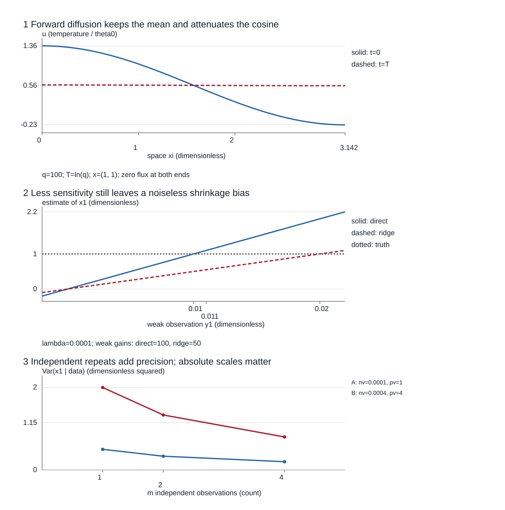

# 前向算子、反卷积与正则化重建

**读者问题：** 已知热扩散怎样抹平温度，为什么倒着算还会出错？压低噪声放大是否就恢复得更准？两次得到相同重建，能否据此说不确定性也相同？

本课先走完一个完整而有限的单元：绝热杆的两个模态 → 同一观测的直接逆与岭 → 同一 Gaussian 模型的后验与独立重复。它给后续反卷积一个可检查的起点；一般卷积边界、二维 PSF、伴随实现及参数选择实验仍需后续单元。初读按下文顺序跟算；回访可直接看“同一二模态数据的增益与偏差”与“同一 MAP，后验尺度仍不同”。

## 先写前向算子与观测

反演的未知是初始温度场的系数，观测是扩散后的系数。先规定杆、边界、观测时刻和系数单位，再写 $y=Ax+\epsilon$；否则这个字母 $A$ 没有可检查的物理含义。

### 从有量纲杆到两个正交归一模态

设均匀杆长 $\ell>0$（m），位置 $r\in(0,\ell)$（m），物理时间 $s$（s），相对固定参考温度的偏差 $\theta(r,s)$（K）。热扩散系数 $\alpha>0$ 的单位为 m²/s；无源、常系数模型为

$$
\partial_s\theta=\alpha\partial_{rr}\theta,\qquad
\partial_r\theta(0,s)=\partial_r\theta(\ell,s)=0.
$$

两端绝热即零通量，温度偏差可为负；这不是热量可以凭空增加的模型。选温度尺度 $\theta_0>0$（K），令

$$
\xi=\frac{\pi r}{\ell},\qquad
 t=\frac{\alpha\pi^2s}{\ell^2},\qquad
 u(\xi,t)=\frac{\theta(r,s)}{\theta_0}.
$$

于是 $u_t=u_{\xi\xi}$、$\xi\in(0,\pi)$、$u_\xi(0,t)=u_\xi(\pi,t)=0$，$\xi,t,u$ 均无量纲。观测时刻 $T=\ln100$ 是无量纲时间，物理时间为 $s_T=\ell^2\ln100/(\alpha\pi^2)$ 秒；不能写成“$\ln100$ 秒”。

只允许初始状态在

$$
\phi_0(\xi)=\frac1{\sqrt\pi},\qquad
\phi_1(\xi)=\sqrt{\frac2\pi}\cos\xi
$$

张成的二维空间中。它们满足零通量，$\phi_0''=0$、$\phi_1''=-\phi_1$，且 $\int_0^\pi\phi_i\phi_j\,d\xi=\delta_{ij}$。写初始场为 $u(\xi,0)=x_0\phi_0+x_1\phi_1$，将其代入 PDE 得

$$
u(\xi,t)=x_0\phi_0(\xi)+e^{-t}x_1\phi_1(\xi).
$$

常数模态保留平均温度，第一余弦逐渐消失。边界谱与分离变量的来源定位见 [Ivrii §4.2 的 Neumann–Neumann 例及零特征值](https://www.math.toronto.edu/courses/apm346h1/20181/PDE-textbook/Chapter4/S4.2.html) 和 [§6.1 的时间因子、其他边界与零特征值推论](https://www.math.toronto.edu/courses/apm346h1/20181/PDE-textbook/Chapter6/S6.1.html)；这里的归一化和尺度由上式直接核验。

本单元**假定仪器提供两个空间投影系数** $\int_0^\pi u(\xi,T)\phi_i(\xi)d\xi$，再加系数坐标中的误差；它不是两点温度计读数。对列向量 $x,y,\epsilon\in\mathbb R^2$，因此有

$$
y=Ax+\epsilon,\qquad A=\begin{pmatrix}1&0\\0&1/100\end{pmatrix},
\qquad T=\ln100.
$$

$x_i,y_i,\epsilon_i$ 均无量纲，$A\in\mathbb R^{2\times2}$ 是从初始模态到终态模态的映射。正交归一化使 $\|u(\cdot,0)\|_{L^2(d\xi)}^2=x_0^2+x_1^2$；相应物理积分为 $\int_0^\ell\theta(r,0)^2dr=\theta_0^2\ell\|x\|_2^2/\pi$（K²·m），它不是实际储热（J）。

### 弱方向与零方向分别阻挡什么

本 $A$ 的奇异值为 $1,1/100$，$\kappa_2(A)=100$，且 $\ker A=\{0\}$。二维模型中的精确无噪声数据唯一决定两个系数；弱方向的信息很小，却没有完全丢失。$\kappa_2=100$ 属于这组基和范数的有限模型，不能替代 [[数学/46-数理方程/04-建模分类初边值条件与适定性|适定性主课]] 中允许无限空间频率的逆热不稳定证明。

若**另改采集模型**为 $A_0=\operatorname{diag}(1,0)$，则 $x=(1,1)$ 与 $(1,2)$ 都产生无噪声数据 $(1,0)$；第二模态完全不被观测。有限时刻的本热衰减因子 $e^{-T}$ 始终非零，$A_0$ 表示丢弃第二投影的观测协议，不能冒充同一有限时刻的热方程。先验可选择一个答案，但这些数据本身不能区分这两个真值。

**先预测，再计算：** 给真值 $x=(1,1)$，无噪声数据应是多少？在第二坐标加 $0.01$ 后，直接逆的第二坐标改多少？为何只有第一模态时无法描述温度振荡？答案分别为 $(1,0.01)$、改 $1$、常数模态不携带空间起伏；下面保持这一个真值继续。

## 同一二模态数据的增益与偏差

固定 $x=(1,1)$，主观测为 $y=(1,0.02)$，所以本次误差 $\epsilon=(0,0.01)$。直接逆是 $A^{-1}=\operatorname{diag}(1,100)$，得到

$$\hat x_{\rm inv}=(1,2).$$

它把所有数据精确拟合，却把弱方向的本次误差放大了100倍。数学上的唯一解解决了“有没有多个精确答案”，没有解决“误差会放大多少”。

岭在本无量纲系数的欧氏范数中最小化**平方和**

$$J(x)=\|Ax-y\|_2^2+\lambda\|x\|_2^2,\qquad\lambda=10^{-4}.$$

由 [[数学/20-线性代数与几何/14-最小二乘伪逆与正则化#正则化把不适定性与偏差交换|正规方程与奇异坐标因子]]，这里可逐坐标复算

$$
\hat x_{\lambda,i}=\frac{a_i}{a_i^2+\lambda}y_i,
\qquad(a_0,a_1)=(1,1/100),
\qquad
\hat x_\lambda=\left(\frac{10000}{10001},1\right).
$$

第一坐标为 $1/(1+10^{-4})$；第二坐标为 $0.01\times0.02/(0.01^2+10^{-4})=1$。第二方向观测到估计的增益从100降到50，但无噪声时它也把真实系数1缩成 $1/2$。一般在该坐标有

$$
\hat x_{\lambda,i}-x_i
=\underbrace{-\frac{\lambda}{a_i^2+\lambda}x_i}_{\text{无噪声收缩偏差}}
+\underbrace{\frac{a_i}{a_i^2+\lambda}\epsilon_i}_{\text{观测误差响应}}.
$$

主观测中弱方向偏差 $-1/2$ 与误差响应 $+1/2$ 恰好抵消，不能把这一巧合当成普遍保证。只改变本次第二观测为 $y'=(1,0.011)$，保持 $A,x,\lambda$：直接逆为 $(1,1.1)$，岭为 $(10000/10001,0.55)$。

| 固定真值下的观测 | 估计 | 第一坐标误差平方 | 第二坐标误差平方 | 误差平方和 $\|\hat x-x\|^2$ | 两坐标 MSE（平方和/2） |
| --- | --- | ---: | ---: | ---: | ---: |
| 主 $y$，直接逆 | $(1,2)$ | 0 | 1 | 1 | 0.5 |
| 主 $y$，岭 | $(10000/10001,1)$ | $1/100020001$ | 0 | $\approx9.998\times10^{-9}$ | $\approx4.999\times10^{-9}$ |
| 改 $y'$，直接逆 | $(1,1.1)$ | 0 | .01 | .01 | .005 |
| 改 $y'$，岭 | $(10000/10001,.55)$ | $1/100020001$ | .2025 | $\approx.202500010$ | $\approx.101250005$ |

所有误差单位均为无量纲系数平方。正交归一化又使平方和等于初始场的无量纲 $L^2$ 重建误差平方。这里降低噪声增益却增大本次误差；不能把总平方误差与除以2的 MSE 混称。

残差也须单独报告：直接逆两次均为0；主岭的 $y-A\hat x$ 为 $(1/10001,0.01)$，改观测后的岭残差为 $(1/10001,0.0055)$。主岭的重建误差明显更小，残差反而更大；改观测的直接逆重建误差更小且仍零残差。没有已知真值时，残差只检查与观测相容，不能自行认证恢复了初始信息。

对固定真值、零均值且方差为 $\sigma^2$ 的该坐标噪声，期望平方误差才是偏差平方加 $\sigma^2a_i^2/(a_i^2+\lambda)^2$；它与一个实现的误差不同，且依赖真实系数和噪声尺度。本文用给定 $\lambda$ 展示这个区别，未用评估真值选择参数。

## 同一 MAP，后验尺度仍不同

现在补上概率前提：$x\sim N(0,\tau^2I_2)$，$\epsilon\sim N(0,\sigma^2I_2)$，$\tau^2,\sigma^2>0$，两者独立。两个先验坐标独立，两个噪声坐标也独立；$A$ 与观测协议已知。固定真值的上述两次误差比较仍是教学构造，不宣称该真值或误差由真实设备验证。

忽略与 $x$ 无关的归一化常数，负对数后验为

$$
-\log p(x\mid y)=\frac{\|Ax-y\|^2}{2\sigma^2}+\frac{\|x\|^2}{2\tau^2}+C.
$$

乘正数 $2\sigma^2$ 不改极小点，因而**平方和目标**的 $\lambda=\sigma^2/\tau^2$。若只把数据项换成 $\frac1N\|Ax-y\|^2$（本次 $N=2$），保留同一 MAP 需要把惩罚系数改为 $\lambda/N$；若两项一起乘同一正数则无需改比例。损失的 sum/mean 口径不能漏掉。

展开二次项，令

$$
Q=\tau^{-2}I_2+\sigma^{-2}A^TA,\qquad h=\sigma^{-2}A^Ty.
$$

$Q$ 正定，$\frac12x^TQx-h^Tx=\frac12(x-Q^{-1}h)^TQ(x-Q^{-1}h)+C'$。由此得到完整后验

$$
x\mid y\sim N(\mu,\Sigma),\qquad
\Sigma=Q^{-1},\qquad
\mu=Q^{-1}h=(A^TA+\lambda I_2)^{-1}A^Ty.
$$

这次 MAP 等于均值，因为后验是正定 Gaussian；一般 MAP 不必等于均值，也不是后验预测分布。上述配方对照 [Rasmussen–Williams 第2章 §2.1.1，式(2.3)–(2.8)](https://gaussianprocess.org/gpml/chapters/RW2.pdf)：该书设计矩阵以列存样本，本页以行存观测，比较时先转置，避免把其精度矩阵字母 $A$ 与本页前向 $A$ 混同。

继续固定同一主观测 $y=(1,.02)$：

| 条件 | 噪声方差 $\sigma^2$ | 先验方差 $\tau^2$ | $\lambda$ | 后验均值／MAP | 后验协方差 $\Sigma$ |
| --- | ---: | ---: | ---: | --- | --- |
| A | $1/10000$ | 1 | $1/10000$ | $(10000/10001,1)$ | $\operatorname{diag}(1/10001,1/2)$ |
| B | $1/2500$ | 4 | $1/10000$ | $(10000/10001,1)$ | $\operatorname{diag}(4/10001,2)$ |

条件 A 的第二精度为 $1+10000\times.01^2=2$；条件 B 为 $1/4+2500\times.01^2=1/2$。噪声与先验方差同步放大4倍，使 $Q,h$ 同时缩小4倍，均值不变，协方差却放大4倍，标准差放大2倍。因而一个正则参数、一个 MAP 数字都不能单独给出区间宽度。第二系数的边际区间若取 $\mu_1\pm1.96\sqrt{\Sigma_{11}}$，是该模型下约95%的后验可信区间，不是已认证的仪器覆盖保证。

回 [[AI/10-机器学习与深度学习基础/20-贝叶斯学习概率图模型与近似推断#高斯线性反演与 Tikhonov|Bayes 理论出口]]，带回“精度相加”和“均值与完整分布”的不同对象，再回本节解释 A/B 表。改变绝对噪声尺度、先验或遗漏模态都会改变模型；数值稳定和模型内后验变窄都不能覆盖这些偏差。

## 再观测一次，究竟增加什么

条件 A 下，保持一个固定未知 $x$、同一 $A$，采集 $y^{(k)}=Ax+\epsilon^{(k)}$，$k=1,\dots,m$。各次误差彼此及与 $x$ 独立，每次协方差都是 $10^{-4}I_2$。联合似然相乘，精度相加：

$$
Q_m=I_2+m\,10^4A^TA,
\qquad
\Sigma_m=\operatorname{diag}\left(\frac1{1+10000m},\frac1{1+m}\right).
$$

均值为 $Q_m^{-1}10^4A^T\sum_k y^{(k)}$，不能只有 $m$ 就编出数据均值。弱方向 $m=1,2,4$ 的后验方差分别为 $1/2,1/3,1/5$。同一算式也可使用平均观测 $\bar y$：它的噪声方差为 $10^{-4}/m$，对应平方和单平均观测目标的有效 $\lambda=10^{-4}/m$。

复制同一个存档行 $m$ 次，其误差完全相关，联合数据并未增加信息；若强行乘独立似然会虚构精度。共同校准误差使跨次协方差含非对角块，也须重新计算，不能继续套 $1/(1+m)$。正向模型错了，更多重复也不自动消除系统偏差。

若改为前述 $A_0=\operatorname{diag}(1,0)$，第二精度始终为先验精度1，后验方差始终为1；$x_1=1$ 与2仍不可由这些数据分辨。本结论利用独立先验坐标：若先验相关，第一方向观测可通过先验关系影响第二方向，但那是额外关系假设。本节的“零”指奇异值 $a_1=0$，不是噪声标准差 $\sigma=0$；上面的密度配方要求 $\sigma^2>0$，无噪声观测需另用精确约束或极限，不能直接除以零。

## 改单位时，模型也要跟着改写

沿 [[数学/20-线性代数与几何/17-矩阵范数条件数与数值稳定性#换坐标时，预测、惩罚与误差度量要一起带走|坐标与度量主解释]]，令 $x=Dz$、$\widetilde y=Sy$，$D,S$ 可逆，保持同一物理与概率问题需要

$$
\widetilde A=SAD,\quad
\widetilde\Sigma_\epsilon=S\Sigma_\epsilon S^T,\quad
\Sigma_z=D^{-1}\Sigma_xD^{-T},\quad
Q_z^{\rm prior}=D^TQ_x^{\rm prior}D.
$$

本页条件 A 取 $D=S=\operatorname{diag}(1,100)$，只是把第二参数与第二观测坐标换尺度：$\widetilde A=\operatorname{diag}(1,100)$、$\widetilde y=(1,2)$，噪声协方差为 $\operatorname{diag}(10^{-4},1)$，先验协方差为 $\operatorname{diag}(1,10^{-4})$。新后验均值为 $(10000/10001,.01)$，协方差为 $\operatorname{diag}(1/10001,1/20000)$；乘回 $D$ 恢复原均值与协方差。

新坐标一般不再是各向同性噪声／先验，裸 $\lambda\|z\|^2$ 不能保持原偏好。即使字面 $\lambda$ 未改，也必须明确它乘哪一个矩阵、使用什么残差权重。换单位不能增加秩；前向矩阵裸条件数的变化也不证明实际测量更可靠。

## 从预测到可改输入的复算

*图：同一固定输入与方程。上图位置 $\xi$、温度比 $u$、时间 $t$ 均无量纲，零通量两模态真值 $(1,1)$，$T=\ln100$；中图横轴为第二观测 $y_1$，纵轴为第二系数估计，实线直接逆、虚线岭、点线真值，两个方法斜率不同且岭在无噪声观测 .01 处仍有偏差；下图比较 A/B 模型独立重复数 $m$ 与第二系数后验方差（无量纲平方），同一 $m$ 的 B 方差是 A 的4倍。连线仅连接整数 $m$，不表示复制旧数据。图由规范源码实际生成；结果和检查入口在实验页。*

[[信号与系统/80-实践/10-两模态热反演/README|两模态热反演实践]]保留固定输入、规范源码及全文镜像，精确有理数 JSON/CSV 与同源 SVG。先手算主观测，再只改一次观测或一个先验尺度并用新的输出目录复算；检查输出中的各坐标误差、平方和、MSE、残差和协方差，不能只看曲线更平滑。

### 撤去方法提示后的迁移

1. 保持真值、边界和观测协议，只将无量纲观测时刻改为 $T=\ln10$，仍用 $\lambda=10^{-4}$；给观测 $y=(1,.11)$。计算 $A$、条件数、两种重建及各自误差平方和。你可以继续称第二方向在无噪声时恰好缩成一半吗？
2. 对条件 A 再获得两次独立观测，合计 $m=3$，但未告诉你新读数。第二后验方差能确定吗？第二后验均值能确定吗？若两次只是复制原行，分别怎样回答？
3. 保持主观测和 $A$，只把先验方差从1改4，噪声方差仍为 $10^{-4}$。现在 MAP 和第二方差是什么？它是否还是 A/B 表里的条件 B？

> [!question]- 可核答案
> 1. $A=\operatorname{diag}(1,.1)$、$\kappa_2=10$；直接逆 $(1,1.1)$，误差平方和 $.01$。岭为 $(10000/10001,110/101)$，误差平方和 $1/100020001+81/10201\approx.00794041$。无噪声第二系数缩为 $100/101$，不是 $1/2$；观测时刻改变了前向信息量。
> 2. 独立条件下方差 $1/(1+3)=1/4$，均值还需要 $\sum_k y^{(k)}$，仅有观测次数不足。复制原行不增加信息，方差仍 $1/2$、均值仍1；把副本当独立会虚构变窄。
> 3. $\lambda=1/40000$、MAP 为 $(40000/40001,8/5)$，协方差为 $\operatorname{diag}(4/40001,4/5)$。这只改变先验，条件 B 则连噪声方差也改4倍；两者不同。

## 往返后的覆盖边界

回 [[数学/46-数理方程/07-热方程分离变量与扩散机制#两个模态的正向扩散与反演|热边界出口]]带回观测时刻、基和尺度；回数学14检查目标及偏差；回 AI20 检查后验及概率前提，再用本页同一观测复算。迁移到真实材料时，先列未知场／参数、边界与接触、观测映射和噪声，再判断弱方向、零方向与模型偏差。当前两模态算例没有替真实材料校准这些对象。

本单元交付有限二维前向模型、直接逆／二次正则、Gaussian 后验与独立重复的解释链；[原 #183](https://github.com/EunsonZ/WWL/issues/183) 及 [原两模态评论](https://github.com/EunsonZ/WWL/issues/183#issuecomment-6080572955)、[单位接续评论](https://github.com/EunsonZ/WWL/issues/183#issuecomment-6087501489) 的完整范围仍保留。下面是真正后续课程工作，具有数学／软件任务，不归为统一的“硬件待验”：

- 一般一维卷积／欠采样与二维 PSF、像素尺度、PSF 归一化、至少一种采集几何。
- 零边界与周期边界、裁剪及前向／伴随的独立内积核对，边缘脉冲、FFT 线性与循环卷积责任。
- 截断与二次正则之外的边缘／稀疏先验，优化收敛和先验伪影。
- 独立于评估真值的参数选择与保留数据协议，残差、重建误差及图像指标的完整实验。
- 更广物理前向映射中的材料参数、接触／边界、模型误差和实际数据验证。

实践中的程序执行、来源核对、静态路径、实际显示、真实测量与真人理解各有自己的证据；有限单元不代表反卷积课程或 [#209 的 PH07](https://github.com/EunsonZ/WWL/issues/209) 已完整验收。
