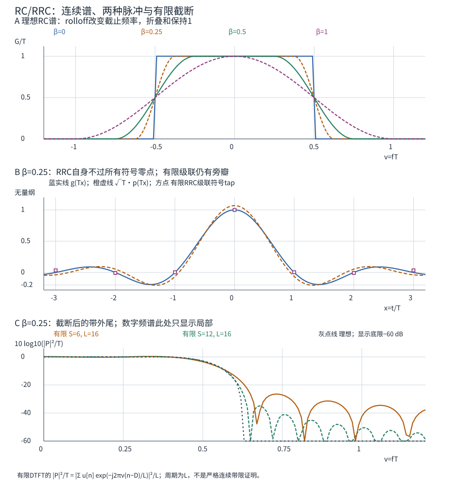
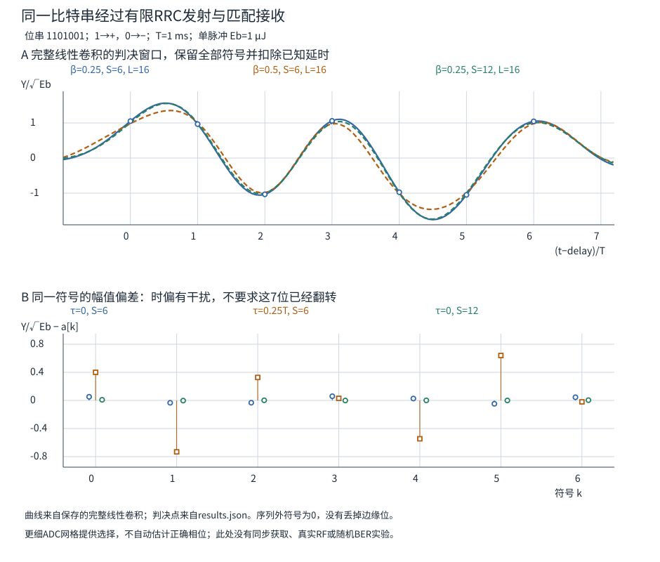

# RC与RRC：脉冲可以重叠，符号为什么不必互相干扰

上一单元的矩形脉冲容易积分，但突然跳变的边缘需要无限频谱尾。若把边缘变平滑、压窄频带，脉冲通常会拖长，前一位还没结束，后一位就来了。接收机为什么仍可能分开它们？关键是让**发射、信道、接收滤波的合成响应在指定判决时刻互不串扰**，不要求波形在所有时刻互不重叠。

本单元继续使用位1→正号、位0→负号，$T=1$ ms、$E_b=1$ μJ和码字1101001。先构造理想无限支撑的 RC/RRC，再实现有限截断的数字 FIR；最后把同一7符号序列放进去，检查能量、延时、残留 ISI 和时偏。信道仍为已校正增益/延时的单位通道，载波参考与符号时钟已知。这里注入时偏来暴露条件，没有实现时钟获取或恢复。

## 零ISI管的是哪一条响应

记 $A=\sqrt{E_b}$，$a_k\in\{-1,+1\}$，先发送有限个符号，序列外取0：

$$s(t)=A\sum_k a_kp(t-kT),\qquad\int_{-\infty}^{\infty}|p(t)|^2dt=1.$$

仍沿用上一单元的功率归一化：$s$ 用 $\sqrt{\mathrm W}$、$p$ 用 $\mathrm{s}^{-1/2}$、$A$ 用 $\sqrt{\mathrm J}$。理想相干实接收令 $r=s+n$，实白噪声双边 PSD 为 $N_0/2$，与符号独立。暂用零中心时间，接收滤波器 $q(t)=p(-t)$；实际有限实现稍后加因果延时。接收输出与合成脉冲为

$$Y(t)=(r*q)(t)=A\sum_k a_kg(t-kT)+\eta(t),\qquad
g=p*q,\quad\eta=n*q.$$

$q$ 的单位也是 $\mathrm{s}^{-1/2}$，因此 $g$ 无量纲，$Y$ 用 $\sqrt{\mathrm J}$。在正确时刻 $t=mT$：

$$Y_m=Aa_mg(0)+A\sum_{k\ne m}a_kg((m-k)T)+\eta(mT).$$

第一项是希望符号，第二项是符号间干扰（ISI）。若 $g(0)=1$ 且 $g(\ell T)=0$ 对所有非零整数 $\ell$ 成立，便有 $Y_m=Aa_m+\eta_m$。它保证任意有限符号串的无噪声判决样值都不受其他符号影响；只验证一个恰好相消的串不能证明零ISI。一般可允许已知增益 $g(0)=c\ne0$ 后再归一化，本页选择1以接回既有BPSK的统计量。

请看对象：条件约束在 **$g$**，而非发射脉冲 $p$。发射脉冲本身在 $T,2T$ 处不为0，仍可与匹配滤波共同构成零ISI链。[MIT 6.450 第6章 §6.2.4–6.3，印刷页175–176及定理6.3.1](https://ocw.mit.edu/courses/6-450-principles-of-digital-communications-i-fall-2006/1e8d60eb6c0a68cc48e81af039fd4af6_book_6.pdf#page=9)支持合成脉冲及其样点条件；下面保留本页的单位与符号。

## 频域Nyquist条件怎样对上那些零点

采用以 Hz 为频率的 Fourier 约定

$$G(f)=\int_{-\infty}^{\infty}g(t)e^{-j2\pi ft}dt,\qquad
g(t)=\int_{-\infty}^{\infty}G(f)e^{j2\pi ft}df.$$

$G$ 的单位为 s，不能把角频率 $\omega$ 的公式直接贴来漏掉 $2\pi$。本页的谱有紧支撑，分段连续且可积；将频轴切成宽 $1/T$ 的格子，重排有限个非零谱副本，得到

$$g(\ell T)=\int_{-1/(2T)}^{1/(2T)}
\underbrace{\sum_{m\in\mathbb Z}G(f-m/T)}_{S(f)}
e^{j2\pi f\ell T}\,df.$$

若折叠和 $S(f)=T$（几乎处处），上述积分在 $\ell=0$ 为1，其他整数 $\ell$ 为0。反过来，这些样点正是周期函数 $S$ 的 Fourier 系数除以 $T$；在本页函数类里，系数为 $\delta_{\ell0}$ 对应 $S=T$。所以本页的零ISI频域条件是

$$\boxed{\sum_{m\in\mathbb Z}G(f-m/T)=T.}$$

它要求相邻谱边缘**加起来为常数**；允许它们重叠。这里的叠加用于计算符号样值，不是说ADC混叠把不同波形信息自动保住了。[同章式(6.12)–(6.14)](https://ocw.mit.edu/courses/6-450-principles-of-digital-communications-i-fall-2006/1e8d60eb6c0a68cc48e81af039fd4af6_book_6.pdf#page=10)给出一般 Nyquist 定理的收敛条件；本页只在上述明确谱类中用这个短证明。

## 升余弦RC用额外带宽换较短的尾

令 $0<\beta\le1$ 为 rolloff，$\nu=fT$ 为无量纲频率。定义 $G_\beta(f)=T R_\beta(fT)$，其中

$$R_\beta(\nu)=
\begin{cases}
1,&|\nu|\le(1-\beta)/2,\\
\frac12\left[1+\cos\!\left(\frac{\pi}{\beta}(|\nu|-(1-\beta)/2)\right)\right],
 &(1-\beta)/2<|\nu|<(1+\beta)/2,\\
0,&|\nu|\ge(1+\beta)/2.
\end{cases}$$

过渡带两侧关于 $1/(2T)$ 互补，所以副本相加恰为 $T$。$\beta=0$ 的极限是 $G_0(f)=T\operatorname{rect}(fT)$，边界可取半高而不影响积分。理想实基带的单侧截止频率为

$$B=\frac{1+\beta}{2T},\qquad R_s=\frac1T;$$

全频谱支撑是 $[-B,B]$。本例 $R_s=1000$ symbol/s，$\beta=0,0.25,0.5,1$ 对应 $B=500,625,750,1000$ Hz；这还不是某台射频仪表的噪声带宽或任意通带带宽定义。

逆变换得升余弦（RC）的合成脉冲，令 $x=t/T$：

$$g_\beta(t)=\operatorname{sinc}(x)\frac{\cos(\pi\beta x)}{1-4\beta^2x^2},\qquad
\operatorname{sinc}(x)=\frac{\sin\pi x}{\pi x}.$$

$g(0)=1$，$x=\pm1/(2\beta)$ 是可去奇点，极限为 $(\beta/2)\sin[\pi/(2\beta)]$；$\beta=0$ 取 sinc。正确补极限后，$g(\ell T)=\delta_{\ell0}$。正 rolloff 使谱边缘平滑，RC尾按 $O(|t|^{-3})$ 衰减，比 sinc 的 $O(|t|^{-1})$ 快；代价是 $B$ 增大。它仍有无限时间支撑，不能实现为严格有限延时的理想滤波器。[第6章式(6.17)–(6.18)、§6.3.1](https://ocw.mit.edu/courses/6-450-principles-of-digital-communications-i-fall-2006/1e8d60eb6c0a68cc48e81af039fd4af6_book_6.pdf#page=11)核对这一谱形、零点及带宽/尾部取舍。

还有一个常见归一化陷阱：**峰值1不等于单位能量**。这里

$$\int g_\beta(t)^2dt=\int G_\beta(f)^2df
=T\int R_\beta(\nu)^2d\nu=T(1-\beta/4).$$

平段贡献 $1-\beta$，两侧过渡段平方的总贡献 $3\beta/4$，合起来才是 $1-\beta/4$。$g$ 是无量纲合成响应，不能直接冒充单位能量的发射基函数 $p$。

## 为什么发收各用根升余弦RRC

选择实、非负的发射谱 $P(f)=\sqrt{G_\beta(f)}$，接收谱 $Q(f)=P(f)^*$，便有 $P Q=|P|^2=G_\beta$。平方根取在**频域幅度响应**上；$p(t)$ 不是逐点 $\sqrt{g(t)}$，后者遇到负旁瓣就已经暴露出对象不对。

由 Parseval 和 $g(0)=1$，

$$\int |p(t)|^2dt=\int|P(f)|^2df=\int G_\beta(f)df=1.$$

$P$ 单位 $\sqrt{\mathrm s}$，$p$ 单位 $\mathrm{s}^{-1/2}$。一份方便检查的闭式是 $p_\beta(t)=r_\beta(t/T)/\sqrt T$，其中

$$r_\beta(x)=\frac{\sin(\pi(1-\beta)x)+4\beta x\cos(\pi(1+\beta)x)}
{\pi x[1-(4\beta x)^2]}.$$

对 $\beta>0$，在0取 $r(0)=1+\beta(4/\pi-1)$；在 $x=\pm1/(4\beta)$ 取

$$r_\beta=\frac{\beta}{\sqrt2}\left[(1+2/\pi)\sin\frac{\pi}{4\beta}
+(1-2/\pi)\cos\frac{\pi}{4\beta}\right].$$

$\beta=0$ 时 $r_0=\operatorname{sinc}$。例如 $\beta=0.25$ 时 $r(1)\approx-0.06424$，RRC自己在一符号处没有零点；RRC与其匹配滤波级联后才得到 RC 的符号零点。[MathWorks Receive Filter 的 Filter Characteristics](https://www.mathworks.com/help/comm/ref/raisedcosinereceivefilter.html)给RC/RRC闭式；本页额外列出极限与物理能量尺度。可在页面搜索“Filter Characteristics”定位。

匹配滤波也有噪声上的理由。先只看一个孤立符号，或其他符号贡献已知并扣除；若用另一个实模板 $v$ 作积分，信号均值为 $Aa\langle p,v\rangle$，输出白噪声方差为 $(N_0/2)\|v\|^2$；Cauchy–Schwarz 给均值平方/方差不超过 $2E_b/N_0$，等号在 $v$ 与 $p$ 成比例时成立。回到零ISI链的符号时刻，我们选单位能量匹配模板，则单次方差仍为 $N_0/2$，接回上一页的实轴判决。

不同符号时刻的输出噪声并非无条件独立：

$$\operatorname{Cov}(\eta(mT),\eta(nT))
=\frac{N_0}{2}\int p(u-mT)p(u-nT)du
=\frac{N_0}{2}g((m-n)T).$$

理想RRC的符号移位正交，故上式为 $(N_0/2)\delta_{mn}$；联合 Gaussian 下进一步得到独立。理想链的每位边缘错误率可以复用上一页等先验的 $Q(\sqrt{2E_b/N_0})$。[MIT §6.3.2 式(6.19)–(6.20)](https://ocw.mit.edu/courses/6-450-principles-of-digital-communications-i-fall-2006/1e8d60eb6c0a68cc48e81af039fd4af6_book_6.pdf#page=12)给移位正交的证明；噪声积分协方差继续按[[信号与系统/50-通信与反演/01-数字通信波形检测同步与均衡#匹配统计量怎样把波形变成一次判断|上一页N0/2合同]]及其第7章来源。

**反例：发收都用RC。** 即使把RC发射脉冲另归一化到单位能量，匹配后的谱也正比 $G_\beta^2$，而不是 $G_\beta$。$\beta=1$ 时，$R=(1+\cos\pi\nu)/2$（$|\nu|\le1$），$\int R^2d\nu=3/4$，而 $\int R^2\cos(2\pi\nu)d\nu=1/8$；归一化后的相邻符号相关为 $1/6$，不为0。发射RC本身的零点不能阻止后面的匹配RC把它重新填起来；$\beta=0$ 的矩形谱是这个反例的特殊退化情形。

图中的RC是合成响应，RRC是单位能量发射脉冲去掉 $1/\sqrt T$ 后的无量纲形状；纵轴不能拿来当同单位的电压比较。

## 有限FIR怎样落到代码与判决时刻

理想RRC两边无限延伸。令每符号 $L$ 个样点、$\Delta t=T/L$，取偶数 span $S$ 个符号的对称窗，数字 FIR 长度为 $SL+1$。索引 $i=0,\ldots,SL$，单滤波器延时 $D=SL/2$ 个样点，先计算

$$\widetilde p_i=p_\beta((i-D)\Delta t),\quad
E_{S,L}=\Delta t\sum_i\widetilde p_i^2,\quad
u_i=\frac{\sqrt{\Delta t}\,\widetilde p_i}{\sqrt{E_{S,L}}},\qquad\sum_i u_i^2=1.$$

这里 $u_i$ 无量纲，是**能量坐标中的数字tap**，不再直接拿物理波形幅值作无权点积。$E_{S,L}$ 是采样求积的能量，不冒称连续截断积分的精确值。两种 $L$ 会得到略有差异的截断近似；它们不像上一页常数矩形的嵌套小格平均那样逐次统计量严格相等。若把 $u_i/\sqrt{\Delta t}$ 嵌入等宽分格常值函数，可精确保留离散能量，但这个函数是另一个近似脉冲，也不严格带限。

代码先构造插零的符号冲激数组 $d[n]=A\sum_k a_k\delta[n-kL]$，然后

$$x=d*u,\qquad y=x*u_{\rm rev},\qquad
g_d=u*u_{\rm rev},\quad u_{\rm rev}[i]=u[SL-i].$$

这里都是完整线性卷积；$x$ 是 $\sqrt{\mathrm J}$ 坐标，近似物理幅值为 $x/\sqrt{\Delta t}$，$y$ 用 $\sqrt{\mathrm J}$。接收时刻为 **$n=2D+kL=SL+kL$**；不是从输出下标0直接隔 $L$ 个取一次。由于有限截断，

$$g_d[SL]=1,\qquad g_d[SL+mL]\ \text{一般不为0 }(m\ne0).$$

中心增益1来自能量归一化，旁瓣不为0来自有限脉冲的非正交移位；归一化没有权力把所有旁瓣一键清零。[MathWorks rcosdesign 的有限级联比较](https://www.mathworks.com/help/signal/ref/rcosdesign.html)明确区分有限RRC级联与理想RC，同时给出单位数字能量及 $SL+1$ tap合同；本实验自己实现，不需要MATLAB。

**同例：** $\beta=0.25,S=6,L=16$ 得97个tap，单滤波器延时48个样点，发收总延时96个样点=6 ms。7符号的无噪声判决下标为96、112、128、144、160、176、192；发送数组长193，完整接收数组长289。首末tap**坐标**相差 $ST=6$ ms，不能把97个离散坐标同时当作“每个占满一格”再报同一个精确连续支撑时长；DAC保持、重建与半格端点需要另给合同。有限卷积保留尾部，按已知延时取出全部7个判决，序列外符号取0；若实际前后还有符号，就需要它们或足够的保护区。不能把丢掉首尾判决后的有利分母继续叫完整帧。

该配置的最大非主符号tap约0.0339664，固定码字判决最大 ISI 幅值约 $0.0597156A$。把span增到12，二者在本配置降为0.00823876及 $0.00908104A$；这只是指定截断/网格的比较，不是所有span、rolloff和误差指标都单调改善的定理。有限时间截断也会把理想频谱与窗谱卷积，产生带外尾，故有限实现不再严格局限于上面的理想 $B$。

## 噪声与整帧能量不能用一个归一化标签代替

在上一页的实白噪声合同下，能量坐标的输入噪声为独立 $w[n]\sim N(0,N_0/2)$；等效小格平均幅值噪声方差为 $N_0/(2\Delta t)$。当每个报告输出都覆盖完整接收滤波器，

$$\operatorname{Var}(w*u_{\rm rev})[n]=\frac{N_0}{2}\sum_i u_i^2=\frac{N_0}{2},\qquad
\operatorname{Cov}(\eta_n,\eta_{n+mL})=\frac{N_0}{2}g_d[SL+mL].$$

两种 $L$ 均保持相同单脉冲 $E_b$、中心增益和输出方差；有限ISI及符号噪声相关的具体数值允许随求积改变。$\beta=0.25,S=6,L=16$、$N_0=0.5$ μJ时，完整支持的输出方差为0.25 μJ，相邻符号协方差约0.00102715 μJ；不能因“匹配滤波”就把有限输出噪声直接当作独立样本。

如果代码仅从 $n=0$ 才生成噪声，把此前都补0，最初的输出只叠加少数噪声tap，方差会小得多。本例下标0的启动方差约 $2.20\times10^{-11}$ J，而完整支持是 $2.5\times10^{-7}$ J。它是启动窗口变了，不是接收机凭边缘样点获得几万倍降噪。

同时，固定帧的发送能量为

$$\sum_n x[n]^2=E_b\sum_{k,j}a_ka_jg_d[SL+(k-j)L],$$

超出 $g_d$ 支撑的项取0。理想RRC移位正交时，这严格等于 $K E_b$；有限单位能量tap只固定对角项，交叉项仍与码字有关。本例完整7位数组能量约7.17664 μJ，不是7 μJ；span12时约7.00691 μJ。iid等先验使交叉项在期望中为0，但固定码字不能用期望替代；偏先验一般还有非零均值交叉项。上一单元[[信号与系统/50-通信与反演/01-数字通信波形检测同步与均衡#净载荷 编码与符号账本|矩形7符号的7μJ、7ms账本]]仍在其不重叠矩形条件下成立，不能原封不动搬给有尾脉冲。

再犯一次故意的错：直接把未归一化的 $r_\beta((i-D)/L)$ 当数字tap。本例其平方和约15.966；若仍标输入每位1 μJ，发送的单脉冲实际是15.966 μJ，匹配输出噪声方差也被乘同一平方和。数组画得更高不代表编码增益，更密采样也不能白领15倍发射能量。

## 时偏与抗混叠，是两种不同的失败

即使理想合成脉冲零ISI，偏离采样时刻 $\tau$ 后仍有

$$Y(mT+\tau)=Aa_mg(\tau)+A\sum_{k\ne m}a_kg((m-k)T+\tau)+\eta(mT+\tau).$$

$g(\tau)$ 不必为1，其他项也不必为0。只有先声明邻符号或其分布，才能写这个观测的条件密度；随机邻符号一般产生混合分布，不能无条件沿用上一页的两个 $N(\pm A,N_0/2)$。

本例有限链把时偏改为 $\tau=T/4$，即 $L=16$ 时晚4个样点，全部7个符号仍保留。对1101001，最大无噪声偏差从 $0.05972A$ 变成 $0.73179A$，虽然这7个无噪声符号的正负号仍正确。这已经是ISI/幅值失配反例；没有有限错误不等于一般BER为0。本实验没有根据接收数据估计或修正时偏。

把rolloff从0.5缩到0.25时，理想带宽750→625 Hz，而同样span6、L16的最大残留符号tap约0.0130851→0.0339664；缩带宽让有限尾更难收完。理想无限链两者仍零ISI，这个差异来自实现近似。

还要与ADC采样条件分开。$\beta=0.5,T=1$ ms时，理想信号带宽 $B=750$ Hz。先在模拟域完成匹配滤波，再每1 ms取一个符号判决，可以没有ISI；但若先让原始带限波形以 $f_s=1000$ sample/s进入ADC，则 $f_s<2B=1500$ Hz，不满足该波形类的一般重建条件。400 Hz与600 Hz的实余弦在 $t=n/1000$ 上样值相同，且都在 $[-750,750]$ Hz内；这是一条明确的波形不可辨认反例。这里能从符号时刻恢复系数，是因为输入已限制为已知合成脉冲的平移生成子空间；它不是任意750 Hz带限波形都可在1000 sample/s重构。符号率1000不是原始ADC所需采样率的通用答案。

实验用 $L=8,16$，即8/16 ksample/s，对本页理想带宽留有余量；有限FIR自身的归一化/零点检查仍不能认证真实模拟抗混叠、DAC重建或时钟。先修[[信号与系统/10-连续与离散系统/05-同一波形的采样误认|采样误认]]继续负责波形类别与时刻条件。Nyquist零ISI约束整条合成脉冲在符号时刻的贡献；抗混叠约束ADC前的频谱与采样率，修好其中一项不会自动修好另一项。

## 撤去滤波器名字，再判断哪条条件坏了

1. 某发送脉冲单位能量，在 $T$ 处不为0。能否据此判它不适合零ISI通信？写出你真正需要检查的对象。
2. $\beta=1$ 的RC在整数符号处过零。为何发射RC、接收其匹配RC后相邻项仍为 $1/6$？不给“软件误差”当答案。
3. 有限 $u$ 的平方和已等1，为何1101001仍可能不是7 μJ？若换成另一个7位码字，什么必须重新算？
4. 把 $L$ 从8变16、保持 $T,E_b,N_0$，写出物理幅值坐标和噪声幅值方差怎样缩放；哪些量应保持，哪些有限近似量不保证完全相等？
5. 合成脉冲已经零ISI，却在1000 sample/s ADC中把400/600 Hz混为同一串。这是否矛盾？若接收端采样晚 $T/4$，单纯提高ADC采样率会自动修正吗？

> [!answer]- 参考推理与边界
> 1. 不能；需检查 $g=p*q$（有信道时为 $p*c*q$）的 $g(0)$ 和非零整数 $g(kT)$。RRC是直接反例，它自己不在每个符号处过零，匹配后的RC可以。
> 2. 匹配合成谱变成RC谱的平方；单位能量缩放只改整体常数。$\int R^2=3/4$、lag1积分1/8，比例为1/6；频域平方没有保留原谱互补和。
> 3. 非正交移位留下 $a_ka_j$ 交叉能量。重算同一 $g_d$ 与新码字的Gram二次型，或完整发送数组的平方和；不必重新设计tap，但不能继续写所有码字都7 μJ。理想正交或iid等先验的期望须单独声明。
> 4. 正确tap约随 $1/\sqrt L$ 缩放；换回幅值 $u/\sqrt{\Delta t}$ 近似相同。幅值小格平均噪声方差随 $1/\Delta t$ 加倍；能量坐标噪声方差固定 $N_0/2$。单脉冲能量、匹配中心增益、完整支持输出方差应保持；有限旁瓣、码字能量与具体样值可能随求积变。
> 5. 不矛盾，原始波形一般重建和指定合成脉冲的符号判决是不同目标。更高采样率能提供更细的选择/插值网格，但须有定时估计和相应取样，固定错误相位不会因数组更长自动消失；本实验仅注入失配，没有实现恢复。

[[信号与系统/80-实践/12-RRC成形与有限ISI/README|有限RRC实验]]提供固定输入、规范源码、频域积分对照、完整线性卷积、二阶噪声有限枚举、实际结果与失败判据。后续再接载波/定时恢复、两抽头信道、ZF/MMSE及深衰落；本页没有做这些实验，也没有连接RF或声称 #181 整课已完成。
