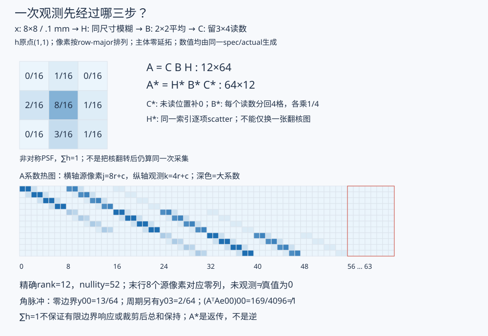
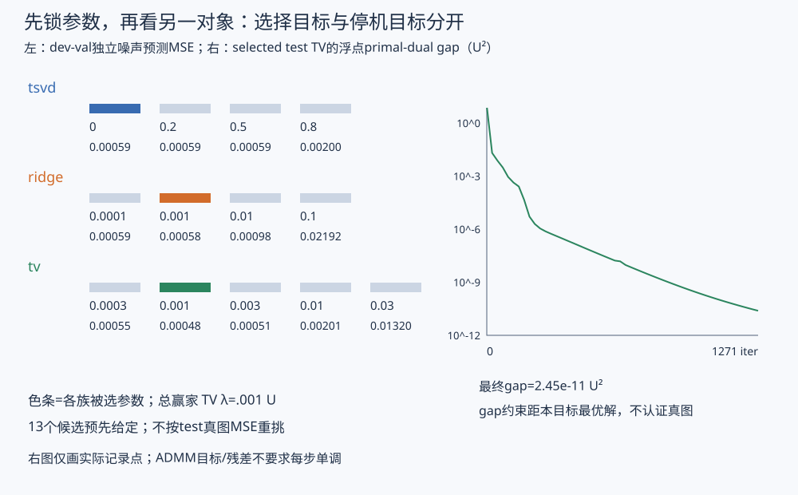
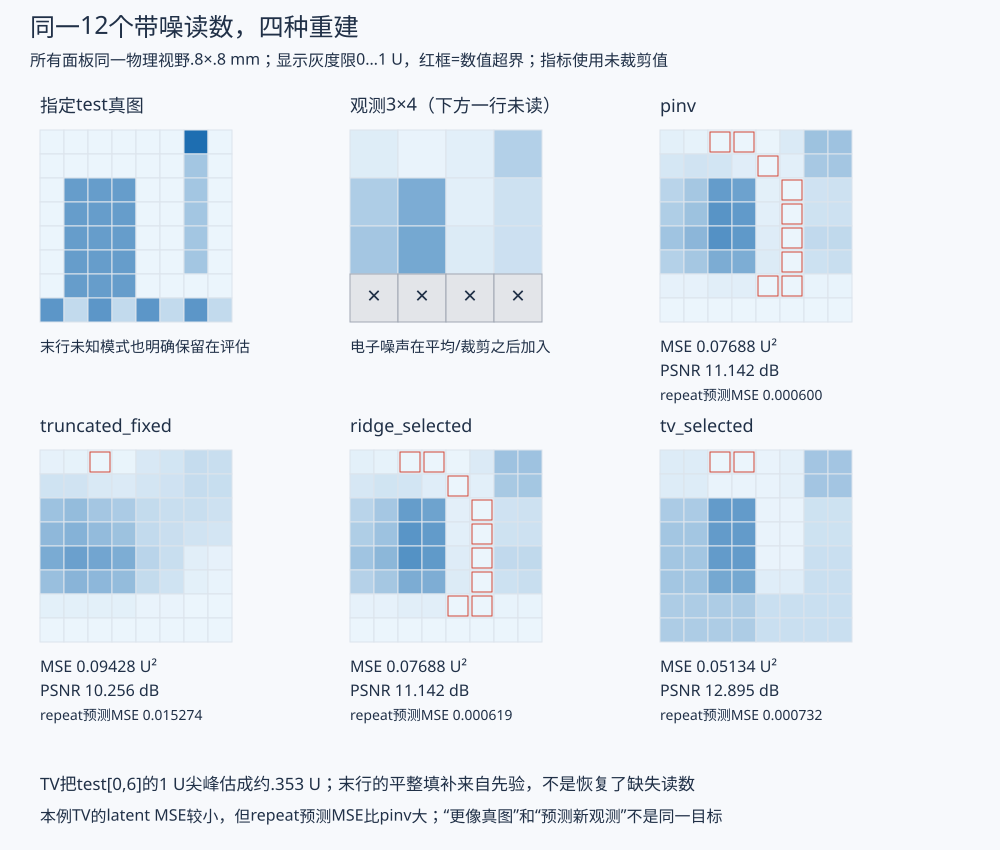

# 二维成像、伴随与正则选择

读数只有12个，算法却交出64个像素：新增的细节来自哪里？本课从一次规定清楚的采集出发，逐步写出模糊、平均、裁剪、伴随和重建，再用另一对象检查参数选择的代价。读完应能辨认四件不同的事：程序实现了所写算子、优化器解好了所写目标、目标适合这批合成对象、物理模型适合真实仪器。

[[信号与系统/50-通信与反演/02-前向算子反卷积与正则化重建|前课的热反演]]保留满秩弱方向、偏差和 Gaussian 后验的完整主例。本课换成二维欠采样，不重建那套后验；先预测下文角脉冲，再看同一输入的重建图。[[信号与系统/80-实践/17-二维PSF与保留评估/README|实践17]]含固定输入、全部数组、双变量证书、可改条件及命令；[[信号与系统/80-实践/17-二维PSF与保留评估/QUESTIONS|无答案题纸]]可以先单独打开。

## 一次采集究竟观测什么

连续空间中的一个理想平移不变模型是 $g(s)=\int p(s-r)f(r)\,dr$；再对探测器的面积与响应积分，才得到读数。$p$ 的单位、像素平均还是像素积分、放大率、曝光和探测器响应都会进入离散系数。有限矩阵不是把连续积分符号改成求和就自动校准好了。

本课**直接声明一个有限合成模型**。未知 $x[r,c]$ 是物方 .1 mm×.1 mm 方格上的平均灰度，单位 U，$r,c=0,\ldots,7$；取 row-major 列向量 $x_{8r+c}$。它不是光子计数，也没有在运行时从连续光场测出。固定高分辨率视野 .8 mm×.8 mm，先模糊，再对不重叠2×2块平均，最后只读前三行粗像素：

$$
h=\frac1{16}\begin{pmatrix}0&1&0\\2&8&1\\0&3&1\end{pmatrix},\quad
(Hx)[r,c]=\sum_{i,j=0}^2h[i,j]\,x[r-(i-1),c-(j-1)],\qquad A=CBH.
$$

核的原点为 $(1,1)$。主体越界 $x$ 取0；另一个**不同模型**把索引对8取模。$H:64\to64$，$B:64\to16$ 是每块四项除4，$C:16\to12$ 留粗行0、1、2与全部四列；观测也按 row-major 排列，$k=4r+c$。粗像素间距 .2 mm、面积 .04 mm²，最后一条粗行未读。这里的 $h$ 已是无量纲、包含像素化的权重，$\sum h=1$；不要再乘 .01 mm²，否则换了增益和单位。

电子噪声声明在 **B/C之后** 加入，$y=Ax+\eta$，$\eta_k$ 独立 $N(0,\sigma^2)$，$\sigma=.02$ U。若噪声发生在四个细像素上、彼此独立且方差相同，平均后才会有另一个方差计算；本模型没有那四个前端噪声，不能机械地把 .02 再除2。原始向量已保存在输入 JSON，固定种子只用于复建这次实现，不证明实际设备噪声独立或 Gaussian。

*图中的矩阵和核来自同一固定输入。热图横轴为64个源像素、纵轴为12个读数；红框是零边界模型完全看不见的末行。深浅表示系数，不表示图像或仪器曝光。*

### 先在三像素上抓住边界

用一维核 $h=(-1{:}1)=(1/4,1/2,1/4)$，输出仍留三个位置：

$$
H_0=\begin{pmatrix}1/2&1/4&0\\1/4&1/2&1/4\\0&1/4&1/2\end{pmatrix},\qquad
H_{\rm per}=\begin{pmatrix}1/2&1/4&1/4\\1/4&1/2&1/4\\1/4&1/4&1/2\end{pmatrix}.
$$

对 $e_0=(1,0,0)^T$，前者给 $(1/2,1/4,0)$，后者给 $(1/2,1/4,1/4)$。区别是模型是否把左边的能量绕回右边。长度3的 FFT 乘法求循环卷积；线性卷积须补到至少 $3+3-1=5$，用按位置 $0,1,2$ 存储的核数组 $(1/4,1/2,1/4)$ 得完整长度5结果，再留位置1、2、3。周期版本则把中心核嵌为 $(1/2,1/4,1/4)$ 后做长度3 FFT。程序实际保存两种输出，而不是只注释“注意边界”。

二维零边界同理补到 $(8+2)\times(8+2)$，完整卷积留 `[1:9,1:9]`。周期版把 $h[i,j]$ 加到 `[(i-1)%8,(j-1)%8]` 再变换；对小尺寸相撞的位置须相加。实现使用 NumPy 默认 `backward`：正变换不缩放，逆变换按长度缩放，多维逐轴执行；不能另乘或漏乘一次64。[NumPy FFT 官方归一化说明](https://numpy.org/doc/stable/reference/routines.fft.html)支持这一接口；补零、折回与裁剪的机制回 [[信号与系统/10-连续与离散系统/06-Fourier四种表示与FFT卷积#补零 折回与裁剪|Fourier主解释]]，本课不另造 FFT 算法。

二维左上角脉冲在零边界下影响 $H$ 的 $(0,0),(0,1),(1,0),(1,1)$，系数为 $(8,1,3,1)/16$，所以 $y_{00}=13/64$，其余11项为0。周期版另有 $y_{03}=2/64$，保留观测和为 $15/64$；裁剪仍丢了其他项。归一化核使无限或周期常量响应为1，却不保证零延拓边缘的常量响应为1：本核左上角为 $11/16$。采集又包含平均和裁剪，不能要求最终像素和等于源像素和。

## 伴随按操作倒序，系数不能凭感觉补

主实现用 Euclidean 求和内积。把前向求和中的 $x$ 收集出来：

$$
\langle Hx,z\rangle
=\sum_{r,c,i,j}^{\rm 有效} h[i,j]x[r-(i-1),c-(j-1)]z[r,c].
$$

因此每条有效前向连接 $(a,b)=(r-(i-1),c-(j-1))$，在伴随中执行 `out[a,b] += h[i,j]*z[r,c]`。前向 gather、伴随 scatter 使用**同一连接**；零延拓时不把越界连接绕回来，周期时先对尺寸取模。实系数下不需共轭，复数模型需共轭。

$C^T$ 在未读粗行补0；$B^T$ 把一个粗残差分给四个细位置，每项乘 $1/4$。于是

$$
A^*=A^T=H^TB^TC^T,\qquad
\langle Ax,z\rangle=\langle x,A^Tz\rangle.
$$

少掉 $1/4$，可能仍画出同样形状，却使梯度差4倍。将“翻转核”当成全部伴随也会漏掉裁剪及平均。独立核查用逐源像素列出有理数 $A$，只取矩阵转置作参照，既查内积又逐元素查 scatter；还含角脉冲与非方形、小尺寸变式。内积通过支持当前离散实现，不认证物理 PSF。

伴随不是逆：对上述角脉冲，$(A^TAe_{00})_{00}=(13/64)^2=169/4096\ne1$；它将读数按敏感性返回未知空间，没有解开模糊或补回信息。

若改用面积内积 $\langle x,v\rangle_X=x^TW_Xv$、$\langle y,z\rangle_Y=y^TW_Yz$，则

$$
A^\dagger_{X,Y}=W_X^{-1}A^TW_Y.
$$

本例 $W_X=.01I$、$W_Y=.04I$（mm²），得到 $4A^T$。这里 $\dagger_{X,Y}$ 只标带权伴随，**不是**伪逆记号。代码保留两套内积的核对，重建目标始终使用第一套 Euclidean 求和；不在目标中途偷偷切换面积权重。更一般的换坐标、噪声和先验精度一起变换，复用 [[数学/20-线性代数与几何/17-矩阵范数条件数与数值稳定性#换坐标时，预测、惩罚与误差度量要一起带走|坐标与度量合同]]。

## 12个读数没有64个独立答案

显式有理矩阵精确秩为12，零空间维数 $64-12=52$。例如只改源图 row7，$A$ 完全不变：它最多影响模糊图的行6、7，B归入粗行3，随后被C丢弃。故 $x$ 与 $x+t e_{7,3}$ 对任意实数 $t$ 产生相同读数。非负约束也不自动区分两个非负的末行。

12个非零奇异值在 .288617 与 .469160 之间，比值约1.626。这只是从行空间到观测空间的非零方向比；`cond(12×64)` 给出的此比值不能把 $A$ 变成可逆的64维映射。本例主要断点是大量零方向，前课热模型则是非零弱方向；[[数学/16-数学分析/20-泛函分析/01-有界算子紧性与逆的稳定性|紧算子与不稳定逆]]另解释无限维逆为何可能无界。不要用一个有限矩阵的比值代替无限维证明。

薄 SVD 写 $A=U\Sigma V^T$，含12个正奇异值。复用 [[数学/20-线性代数与几何/14-最小二乘伪逆与正则化|伪逆与岭推导]]：

$$
\widehat x_{\rm pinv}=\sum_i\frac{u_i^Ty}{s_i}v_i,\quad
\widehat x_{\rm TSVD}=\sum_{s_i>\tau s_{\max}}\frac{u_i^Ty}{s_i}v_i,\quad
\widehat x_{\rm ridge}=\sum_i\frac{s_i}{s_i^2+\lambda}u_i^Ty\,v_i.
$$

伪逆选最小 Euclidean 范数的解，零空间分量设0，并非证明真图那里为0。岭最小化 $.5\|Ax-y\|^2+.5\lambda\|x\|^2$，$\lambda>0$ 给唯一解，代价是收缩偏差。截断是相对阈值而非岭的同单位参数；本谱下 $\tau=.5$ 一个方向也不去掉，$.8$ 才保留5个。正式比较选 $.8$ 来展示真正的截断；这一显示修改依据已知 $A$ 的谱，原 $.5$ 运行也保留在作者过程区，没有按 test MSE挑一个好看的截断值。

## 边缘先验改变了谁的偏好

平方范数倾向小灰度，却没有直接表达相邻像素接近。令 $D\in\mathbb R^{112\times64}$ 为所有水平、垂直相邻差：每条边一行，一端−1、另一端+1，**不除 .1 mm**，不跨对侧、不加到图外0的边。TV取 anisotropic 的 $\|Dx\|_1=\sum|\Delta_x x|+\sum|\Delta_y x|$，不是每格平方和开根的 isotropic TV。

本课实际求

$$
F(x)=\tfrac12\|Ax-y\|_2^2+\lambda\|Dx\|_1+\tfrac\epsilon2\|x\|_2^2,
\qquad\epsilon=.001>0.
$$

目标各项单位 U²，$D$ 无量纲、$\lambda$ 单位 U，$\epsilon$ 无量纲。TV惩罚边的数量和幅度，允许少量大跳变，比二次相邻差更能容纳边缘；也会抹掉小孤立亮点、把平滑渐变拼成平台。$\epsilon$ 除了轻微偏好小灰度，还使目标 $\epsilon$ 强凸：其余两项凸，二次项保证严格凸且随 $\|x\|\to\infty$ 趋于无穷，连续有限维目标有且仅有一个极小点。这里没有非负、上界1或单调约束，出现负值须如实报告。

**二次先验的唯一性条件不能直接搬给TV。** 对 $\|Ax-y\|^2+\lambda\|Dx\|^2$，$\ker A\cap\ker D=\{0\}$ 使 Hessian 正定；裸TV不严格凸，即使这个核交为0也可能多解。下方第4题给连续一族等价最优点。加入 $\epsilon>0$ 的论证才是本程序唯一性的依据。得到唯一像素数组说明偏好选定了一个答案，不能消灭52维的观测不可辨识。

前向采用零延拓、先验却只罚域内相邻，这不矛盾：前者是探测模型，后者是对未知的偏好，必须分别命名。把先验外边界也连到0会新增边缘收缩，把D改周期又会偏好左右/上下接缝；都不是无害的实现优化。

### 将不可微部分拆开，仍须证明自己解对了目标

令 $z=Dx$，采用 scaled ADMM，初值 $x,z,u=0$，$\rho=.2>0$：

$$
\begin{aligned}
x^{k+1}&=(A^TA+\epsilon I+\rho D^TD)^{-1}
 [A^Ty+\rho D^T(z^k-u^k)],\\
z^{k+1}&=\operatorname{soft}(Dx^{k+1}+u^k,\lambda/\rho),\\
u^{k+1}&=u^k+Dx^{k+1}-z^{k+1},\\
\operatorname{soft}(v,a)&=\operatorname{sign}(v)\max(|v|-a,0).
\end{aligned}
$$

第一式来自对x的二次目标求导；矩阵因 $\epsilon I$ 正定。第二式逐坐标最小化 $\lambda|z|+\rho(z-v)^2/2$：正支解 $v-\lambda/\rho$、负支解 $v+\lambda/\rho$，跨0时取0。小例为了透明，预计算64阶线性系统的逆作用于基；大图不应照抄成稠密逆矩阵，应另比较分解或迭代解的精度与代价。

[Boyd等 ADMM 原文](https://web.stanford.edu/~boyd/papers/pdf/admm_distr_stats.pdf) §3.1–3.3给 scaled 更新、闭适当凸函数及鞍点条件下的残差/目标/对偶收敛和停机依据。本例目标连续、强凸、约束可行，满足该有限凸问题的条件；不能泛化成非凸去噪器或任意近似子问题都收敛，更不能声称每步目标或每个残差单调下降。

程序同时记录 $r^k=Dx^k-z^k$ 与 $s^k=\rho D^T(z^k-z^{k-1})$，固定绝对阈值均 $10^{-7}$ U，最多10000步；所有候选若未收敛则拒绝选择。还用不依赖ADMM轨迹的对偶下界检查是否接近本目标最优。

令 $p\in\mathbb R^{12}$，$q\in\mathbb R^{112}$ 且 $|q_j|\le\lambda$。由平方损失与L1的共轭表示，对x取最小得

$$
G(p,q)=-\tfrac12\|p\|^2-y^Tp
 -\frac{\|A^Tp+D^Tq\|^2}{2\epsilon}\ \le\ F(x^*).
$$

具体地，$.5\|Ax-y\|^2=\sup_p[p^T(Ax-y)-.5\|p\|^2]$，$\lambda\|Dx\|_1=\sup_{|q|\le\lambda}q^TDx$；剩余 $\epsilon\|x\|^2/2+(A^Tp+D^Tq)^Tx$ 的最小值是式中负平方项。输出选择 $p=Ax-y$、$q=\operatorname{clip}(\rho u,-\lambda,\lambda)$，故始终对偶可行。精确算术下

$$
0\le F(x)-F(x^*)\le F(x)-G(p,q),\qquad
\|x-x^*\|_2\le\sqrt{\frac{2[F(x)-G(p,q)]}{\epsilon}}.
$$

停机另要求 gap≤$10^{-6}$ U²。完整p/q和历史保留给不同实现复核；独立者另用显式有理A、图关联D与 box-dual 坐标优化核 selected dev/test 解。本例 test TV在1271步，浮点gap约 $2.45\times10^{-11}$ U²，对应上述数值约 $2.21\times10^{-4}$ U的模型内距离界。实际计算不是区间算术认证；舍入也会影响极小gap。这个界只距所声明目标的最优解，距真实图仍可很远。

## 参数选择先看什么，最后才看什么

输入拆为 `development.json` 与 `evaluation.json`。dev有一幅指定块状对象和两次独立噪声实现；test换成带窄竖条、孤立亮点及末行交替的对象，另两次独立实现。所有文件公开，所以这是可检查的合成协议，不是秘密测试集，也不是对作者未见结果的证明。生成观测和重建假定同一个A，存在刻意的模型匹配优势；两个错模型变式检查这种优势的边界，不把它冒称实拍泛化。

协议是：

1. 先固定13个候选：TSVD相对阈值0/.2/.5/.8，岭 $\lambda=.0001/.001/.01/.1$，TV $\lambda=.0003/.001/.003/.01/.03$ U；$\epsilon$ 和求解器阈值固定，不随评估挑选。
2. 每个候选只在 dev-fit观测上拟合，用 $\operatorname{mean}(A\widehat x-y_{\rm dev,val})^2$ 评分。同分按原声明顺序选，分族与总赢家都落 `selection.json`。
3. 文件落盘之后，driver才读取另一 evaluation 文件，用锁定参数拟合 test-fit；最后用 test真值及 test-repeat评分。选择函数接口没有真图或evaluation参数。

对一个**尚未拿验证集挑选的固定估计**，给定fit且验证噪声独立零均值，有

$$
\mathbb E\big[\|A\widehat x-y_{\rm val}\|^2\mid y_{\rm fit}\big]
=\|A\widehat x-Ax_{\rm true}\|^2+12\sigma^2.
$$

这支持预测风险的比较，不能推出 latent 图像MSE最小；零方向在左侧看不见。对13个候选取最小又产生选择乐观偏差，不能把被选 dev-val 分数当无偏泛化估计；所以还留独立 test-repeat。换对象的单次结果只支持这两个规定对象上的有限迁移，不是对象总体最优保证。若用 test真图挑参数，再把这张test报为独立评估，就让答案参与了考试出题。

实际总赢家为 TV $\lambda=.001$ U；岭为 .001，TSVD为0。TSVD的0/.2/.5在本谱下输出相同，同分优先0。图右是测试TV实际记录的浮点gap，不是运行时间或噪声误差。

### 真图误差、预测误差与先验伪影一起读

MSE按64个未知像素平均，PSNR=$10\log_{10}(1\ {
m U}^2/\mathrm{MSE})$，固定MAX=1 U；不随输出最大值重设，不先裁剪到[0,1]。显示可限幅，但图中用红框标出超界。观测预测MSE按12个读数平均；二者单位均U²，比较对象不同。

| test-fit重建 | 残差范数 U | latent MSE U² | PSNR dB | 独立test-repeat预测MSE U² |
| --- | ---: | ---: | ---: | ---: |
| 伪逆 | 约 $7.91\times10^{-16}$ | .076881 | 11.142 | .000600 |
| 固定TSVD $\tau=.8$，保5方向 | .378111 | .094284 | 10.256 | .015274 |
| dev选择的岭 .001 | .005347 | .076882 | 11.142 | .000619 |
| dev选择的TV .001 | .025847 | .051345 | 12.895 | .000732 |

伪逆可拟合全部12个带噪读数，残差约0却不恢复零空间。TV的真图MSE较小，**独立repeat预测MSE却比伪逆大**；验证选择在另一对象上不是万能冠军。TV把真图 $(0,6)$ 的1 U孤立峰压到约 .353 U；完全不可见末行被填成约 .301与 .166两段，真实末行为 .7/.2交替。这些平整结构来自惩罚偏好。其末行MSE约 .113875，小于伪逆的 .265，也不能说数据证实这次猜测。

有限MSE、PSNR及条件均值的损失前提回 [[数学/30-概率与统计/11-条件期望与最小均方估计#两像素逆问题：均值最优，为什么仍不是真图？|有限后验例]]；成像质量与下游/感知目标的差别回 [[计算机知识/60-数据编码与媒体系统/16-媒体质量评估PSNR-SSIM-VMAF与听感边界|媒体质量指标]]。本课未计算SSIM或宣称人看起来更好。

保持正确模型生成的数据及锁定TV参数，只把重建A改掉：

| 重建假定 | 对假定模型残差 U | 对真实A残差 U | latent MSE U² |
| --- | ---: | ---: | ---: |
| 正确zero/原PSF | .025847 | .025847 | .051345 |
| 错periodic/原PSF | .024053 | .062661 | .061355 |
| zero/错180°翻核 | .025356 | .102829 | .049705 |

翻错核在这次指定真图上反而得到稍低MSE，数据照留。它不是物理校准成功：独立真实A残差更大，且只有一幅合成对象。用“谁一次MSE低谁就是正确PSF”会把偶然误差补偿当成仪器定律；拟合残差小也不能挑出真实边界。

## 将前向与辨识问题带回一个物理对象

从前课“先写前向算子与观测”出发，去 [[物理/20-电磁学/02-静电边值与电介质|静电边值与同轴介质主解释]]，带回该页已经推导的理想同轴对象：内半径 $a=1$ mm、外半径 $b=4$ mm、长 $\ell=.1$ m，内导体1 V、外导体0 V，端面取 $\partial_z\phi=0$，均匀正线性介质。这样静电边值给

$$
C_{\rm ideal}=\kappa\epsilon_r,\qquad
\kappa=\frac{2\pi\epsilon_0\ell}{\ln(b/a)}\approx4.013036795\ {\rm pF}.
$$

这里 $\epsilon_r$ 无量纲，$\kappa$ 为每单位相对介电常数的pF。程序沿既有教学模型取 $\epsilon_0=1/(4\pi10^{-7}c_0^2)$、$c_0=299792458$ m/s，不把该教学常数约定当成重新计量标定。

真实测量要再规定端口和读出。本有限接口增加非负寄生 $C_p$ 与加性读数误差：

$$
y_C=C_p+\kappa\epsilon_r+e_C.
$$

未知是 $\epsilon_r$ 和 $C_p$；几何若未校准，$\kappa$也未知。边界/接触条件包括固定导体电位、端部场是否受控、引线和屏蔽寄生、介质是否均匀线性且处于准静态。观测是端口电容或已知电压下的 $Q/V$，不是直接读材料 $\epsilon_r$。本课只生成pF读数，未连接电桥、接触或材料，也没有验证频率色散与损耗。

单个样品读数只有一个方程；$(\epsilon_r,C_p)=(4,2\ {
m pF})$ 与 $(4.25,.996740801\ {
m pF})$ 都非负、给同样 $18.052147181$ pF。局部敏感度为 $(\kappa,1)$，沿 $\delta C_p=-\kappa\delta\epsilon_r$ 完全不可辨识；正则或更精细的场网格不能增加这个方向的信息。

若同一读出链可以作已校准“open”、已知 $\epsilon_r=1$ 的参考与样品三次测量，并保证同一几何增益及同一个加性寄生，可写

$$
y_o=C_p+e_o,\quad y_r=C_p+\kappa+e_r,\quad
y_s=C_p+\kappa\epsilon_r+e_s,\qquad
\widehat\epsilon_r=\frac{y_s-y_o}{y_r-y_o}.
$$

“open”在这里指读出模型的寄生基线，不能把一段有空气电容的空夹具不经修正就当0信号。固定真参数 $(4,2)$，无误差三读数为 $(2,6.013036795,18.052147181)$ pF；加 $(.01,-.02,.03)$ pF 得比值约4.035149。读出噪声模型可声明独立零均值、标准差 .05 pF，这组手定扰动只是一次受控实现，不是从三点估计出设备分布。

这也给弱方向：$\Delta=y_r-y_o$ 小时，比例对读数噪声敏感，$\partial\widehat\epsilon_r/\partial y_s=1/\Delta$、$\partial/\partial y_r=-\widehat\epsilon_r/\Delta$、$\partial/\partial y_o=(\widehat\epsilon_r-1)/\Delta$。共同漂移使三次误差相关，不能照搬独立误差公式。参考与样品改变了接触寄生、端部边界或有效几何，比例式还会有系统偏差；小残差/网格收敛只说明某模型内部一致。回 [[电子电路/52-测量不确定度与辨识/04-实验设计可观测与可辨识|实验设计与辨识]]检查新增观测是否真的脱离旧等价族，再回本课区分数值收敛、信息增加和模型校准。

## 先预测，再改变条件

1. 二维左上角脉冲：求零/周期 $y_{00}$、保留观测总和及 $(A^TAx)_{00}$。伴随是逆吗？
2. 将内积权重改 $W_X=.01I,W_Y=.04I$，伴随改什么？PSF已含像素化，还要再乘.01吗？
3. 只改输入row7，数据怎样变？若重建出平整末行，这证明什么？12个非零奇异值比有限意味着64未知可逆吗？
4. 三像素 $A(x_0,x_1,x_2)=(x_0,x_2)$，$y=(0,1)$，$D$为两相邻差，$0<\lambda<.5$。裸TV目标有唯一解吗？加 $\epsilon\|x\|^2/2$ 后依据是什么？
5. 本课未白化目标、D未除pitch，把x/y/σ数值都放大1000倍，$\lambda,\epsilon$怎样变？本模型bin后σ是否还自动除2？
6. dev-fit/独立dev-val选好参数锁定到另一test对象，能否推断真图MSE最小或新对象普遍最佳？若看test真图重新挑λ，怎样重新组织可执行评估？

### 可复算答案

1. 零模型仅 $y_{00}=13/64$，总和13/64；周期 $y_{00}$仍13/64，另 $y_{03}=2/64$，总和15/64。$A^TA$对应角分量169/4096，非1。周期有绕边连接，不能用zero的末行零方向结论替它作证。
2. $A^\dagger_{X,Y}=4A^T$。面积内积与前向积分权重是不同对象；不能既声明h是面积积分权重、又二次乘面积。若原始PSF是密度，须先推其离散积分系数及单位，不能照抄本h。
3. zero模型观测完全不变，有无噪声都无法区分。末行是先验选择；它偶然更接近指定真图也不增加可辨识性。52维核仍在，非零谱比只描述其补空间，A没有64维逆。
4. 将两端暂记a≤b，中间t∈[a,b]时 $|t-a|+|b-t|=b-a$。目标变 $.5a^2+.5(b-1)^2+\lambda(b-a)$，最优 $a=\lambda,b=1-\lambda$，符合a≤b；任意 $t\in[\lambda,1-\lambda]$ 最优。对任意a,b，最小TV为|b−a|，其凸二元目标在这两端满足全局最优条件，故没有漏掉更小的反序解。尽管 $\ker A\cap\ker D=\{0\}$，仍多解。加ε>0后二次强凸、coercive，存在唯一最优点；唯一性来自目标条件，不是新增数据。
5. 令 $x'=s x,y'=s y$、s=1000。残差和ε项都乘s²，TV项若 $\lambda'=s\lambda$也乘s²；故λ乘1000，ε不变，岭λ不变，σ乘1000。若D改成除pitch或目标改除σ²，应重做单位推导。本噪声定义在bin后，无额外÷2。
6. 验证只估计可见预测风险，还含候选选择偏差；零空间不受它检查，两个对象不代表总体。保留当前test供本次公开分析，把新的对象/独立重复预留为下一轮评估，先固定新规则和候选再开结果。没有真图时仍可对同一稳定对象取得独立观测、核共同校准误差、用独立噪声重复评分；它验证预测和模型一致性，不认证隐变量真图。若只有同一条读数副本，不能把它假装成独立重复。

## 带什么返回主线

从 [[信号与系统/50-通信与反演/02-前向算子反卷积与正则化重建#先写前向算子与观测|前向与观测起点]] 带来物理条件，沿本课求解，再回旧课看同一MAP为什么仍有不同后验。TV点解和双gap没有输出本课的完整后验；如需不确定性，必须另外声明噪声/先验分布及计算对象，不能把gap当置信区间。

换成节点信号可到 [[信号与系统/60-空间与方向信号/02-图信号频谱采样与稳定恢复|图滤波后采样]] 继续追问SH的零/弱方向，再到 [[信号与系统/60-空间与方向信号/03-图平滑正则恢复与迭代证书#一个全节点目标，仍用同一采集合同|二次图平滑]]，带回kerA∩kerL与分量覆盖条件。那里惩罚x^TLx是二次型，满足核交条件即可唯一；本课裸TV的三像素反例恰说明不能将这个二次结论直接搬到L1惩罚。两者的求解证书都只量化离各自极小点的距离，另需先验/噪声/模型预算才谈真值。

本课与旧课共同覆盖有限前向、两种边界/FFT、二维采集/伴随、弱方向/零方向、伪逆/截断/二次及边缘先验、收敛证书、参数选择与保留评估，以及物理辨识返回。真实相机PSF/暗场/平场/噪声校准、真实材料读出、GPU/大规模矩阵自由求解、非凸学习先验和真人效果没有在本合成实验中检验；它们按实际应用另定输入和验收，不能反向冒称本程序已经执行。Stanford [EE367课程范围](https://web.stanford.edu/class/ee367/)用于定位计算成像主题，不充当上述推导的证明。下一步若换设备，先交实践页列出的标定输入与独立观察，再决定该改A、噪声还是先验。
