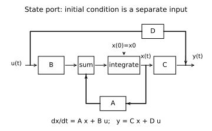
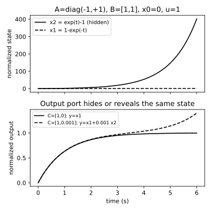
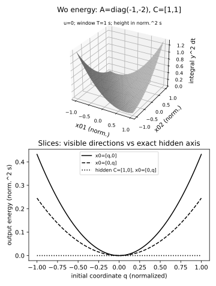

# 状态实现与隐藏模态实验

读者问题：零初值传递函数相同，为什么有的状态失稳，甚至改变初值后输出也失稳？**基础入口**先到 [[信号与系统/40-状态控制与辨识/01-状态实现可控可观与最小性#两状态手算：同一个端口漏掉了什么|两状态手算]]填t=1的两数并预测t=6的输出。**快进入口**从 [[信号与系统/40-状态控制与辨识/01-状态实现可控可观与最小性#可控、可观的精确数学条件|R/O的有限rank条件]]与IC解进入。同一实验检查状态/输出/边界，不能仅凭绘图给稳定结论。

## 可执行合同与命令

仅使用既有Python/NumPy；绘图另用已有Matplotlib与CairoSVG，不安装依赖，不用SciPy。命令从此实验目录执行，显式`--output`指向库外；以下路径可替换成自己的库外目录，不能指向冻结候选或课程assets。

```bash
python3 -B -m unittest -v test_state_lab.py
python3 -B state_lab.py --output /private/tmp/wwl-state-qa/data
MPLCONFIGDIR=/private/tmp/wwl-state-qa/mpl python3 -B plot_state.py --output /private/tmp/wwl-state-qa/plots
```

1. 先填写A=diag(−1,+1)、B=[1,1]ᵀ、C=[1,0]、D=0的阶跃状态与输出，再预测哪一模态漏出端口。
2. 运行数据与本次实际发现的测试；记录命令、源码版本、退出码和数量，再检查R/O奇异值及声明阈值，分别回答“精确rank”和“数值返回rank”。停点：ε=0、ε=10⁻¹²及仅坐标缩放三者不可混同。
3. 看初值端口图，手写完整解的两项；对B=[1,0]、C=[1,1]构造x0=[0,1]，解释G未变而y=eᵗ。
4. 到 [[信号与系统/40-状态控制与辨识/02-内部稳定与输入输出稳定#极零消除不能消除实现里的不稳|精确消零与扰动]]，检查级联解析式、ε非零和IC反例。程序只是已知模型，没有接控制器。
5. 看两个初始坐标的输出平方积分曲面，再用切片与最小特征值解释短窗口/噪声风险。收尾交付迁移答案和未知证据层。

[规范数值真源](state_lab.py)、[独立测试](test_state_lab.py)、[可编辑绘图真源](plot_state.py) 与 [[信号与系统/80-实践/04-状态实现与隐藏模态/04-源码与验证|三块正式code-sync镜像]]是同一变更单元。

## 计算对象与数值方法

$\dot x=Ax+Bu,y=Cx+Du$，A/B/C/D均有限实数组，n,m,p≥1，形状分别n×n/n×m/p×n/p×m；x0长度n、常值u长度m，t≥0且有限。此脚本仍仅支持n≥1动态模型；正文最小性比较允许n*=0纯直通y=Du，不能把脚本域限制冒充理论域。归一化状态/输入/输出无量纲，时间s，A/B单位s⁻¹。拒绝复数模型（包括object容器中的NumPy复标量、零虚部及复类型子类）、非有限值、空维度、错误shape、负/非有限时间与超浮点范围结果；传函允许有限复数s，但sI−A奇异时拒绝，此时可另算精确约分后的G，不向完整resolvent偷偷添加逆。

`expm` 对A缩放至∞范数≤0.5，有限Taylor和再平方，兼容Jordan块，不依赖特征向量对角化。它是教学浮点算法，未给任意恶劣条件数误差认证。常值输入使用增广 $\exp\left(\begin{bmatrix}A&B\\0&0\end{bmatrix}t\right)$，避免求A⁻¹（A=0积分器也合法）。一般时变u的解析公式在正文，本脚本不实现任意波形积分器。

有限Gramian用块指数：$F=\exp(\begin{bmatrix}A&BB^T\\0&-A^T\end{bmatrix}T)$，$W_r=F_{12}F_{11}^T$；块微分/积分给 $F_{12}=\int_0^T e^{A(T-s)}BB^Te^{-A^Ts}ds$，乘 $e^{A^TT}$ 并换元得到正确的Wr。Wo由(Aᵀ,Cᵀ)对偶求得。浮点末尾对称化仅去掉舍入反对称部分，不能把数值负小特征值自动宣称“理论正定”。没有用增加微小对角线来制造通过。

`rank_report` 明示threshold=max(atol,rtol·σmax)，严格数σ>threshold；没有从该返回值推断未知系统结构。不同坐标下相对阈值也会变，正文给精确det反例。时间T=0代码合法返回零矩阵，但不满足理论“任意正窗口”的可观/可控定理。

## 三图、数据与复算





三张图分别承担端口关系、隐藏模态、双初值能量关系；图例、线型、数字与文字说明共同编码，不只靠颜色。曲面真实自变量为x01/x02，固定T=1 s、u=0，height为归一化输出幅度平方·s。下方hidden曲线用不同C作对照，不是同一曲面截线。状态图固定A=diag(−1,+1)、x0=0、u=1；C从[1,0]改[1,0.001]只改变输出读取，不改变上图状态。每张425px PNG都由所交SVG字节直接Cairo渲染，不以另一次Matplotlib PNG冒充SVG呈现。

| 数据 | 列与单位 | 能检查什么 |
| --- | --- | --- |
| [trajectories.csv](assets/trajectories.csv) | t_s、x1/x2、隐藏y、ε=0.001的y、不可控但IC可见y | t=0..6共301点，最后一列x0=[0,1]且u=0 |
| [energy.csv](assets/energy.csv) | x01、x02、对应Wo能量，归一化幅度平方·s | 31×31点曲面，A=diag(−1,−2)、C=[1,1]、T=1 |
| [gramians.csv](assets/gramians.csv) | rowmajor_index与两个Wo，秒 | Observable A=diag(−1,−2)/C=[1,1]；hidden A=diag(−1,+1)/C=[1,0] |
| [results.json](assets/results.json) | 模型、时间/单位、奇异值/阈值、Gramian、边界声明 | 没有日期、机器路径或虚构现场辨识 |

指定t=6得到隐藏x2≈402.428793、y≈0.997521、ε=0.001读出y≈1.399950；IC可见另例y≈403.428793。可观Gramian在T=1的特征值约0.00863940/0.66911405；hidden Wo的第二行列严格零。正文负责全时间/全部输入/全部IC的结论，不能以301个采样点代替证明。

## 测试的责任与当前发现范围

测试采用独立2×2/3×3闭式oracle：对角模型的逐分量指数、旋转的sin/cos、二阶Jordan的t e⁻ᵗ、三阶nilpotent的有限指数/输入多项式、三阶积分链Gramian的t⁵/20等单项积分、对角Gramian的标量积分，避免把生产函数自身当期望。还覆盖同G/奇异完整resolvent、初值可见误用、级联精确消零/扰动、真零/近零与坐标尺度、相似变换/Gramian合同、正窗口与T=0、错误shape/非有限值/数值溢出、所有端口object复数的warning-free拒绝及合法实object输入、纯直通的冗余动态版本。测试不生成或更新assets，未验证全部可能矩阵的误差。

## 撤去方法提示的迁移交付

仍为两状态A=diag(−1,+1)，设备声称只通过一次u=0、y=0的窗口测量就认证“所有状态稳定”。允许你联合选择输出读出C、已知IC和观察时间，但输入通道B保持[1,0]。给一组区分两种内部行为的方案、其支持边界及不能仅靠传感器修复的部分。

> [!question]- 答案与接受标准
> 例如C=[1,1]、IC=[0,δ]且已知δ≠0、比较两个t>0得到y=δeᵗ，可检验已知模型下的+1增长；需要量程/噪声与可靠IC设置条件，不能声称任意短窗口或真实仪器必能检出。若IC只能为零且第二通道不可控，新增C也无法通过u激发第二态，原数据不能排除它。增加传感器没有改变x2′=x2，不能对任意IC稳定化；应增加执行能力/结构并重新验证控制律，或限定不再承诺全部IC。接受Gramian/解析解/其他有条件设计；报告无法设置IC或未知模型是合法边界。一次零输出可能是读出隐藏、IC为零或低于精度，不能倒推内部Hurwitz。

## 当前证据层

“交付CPU已知模型运行、11相关测试”是本 README 既有交付批次的历史运行摘要，适用当时的版本与冻结输入；它不证明当前文件的测试执行。当前 `test_state_lab.py` 静态定义为14个 `test_` 方法，其中包含后加入的非有限值/对象容器边界；静态计数也不等于通过。本轮新字节 not_run；若重跑，须另记命令、源码版本、环境、退出码和实际发现数。可复算图/CSV与三镜像、来源条件定位见正文和候选source-notes。作者预检与独立签收分开。S05/C01整个方向保持partial，未给描述系统、完整反馈互联、模型辨识、鲁棒控制等未写课程占位。未验证实际控制器/传感器/执行器、SPICE或其他设备、真实辨识/噪声记录、客户端与真人学习；没有部署、安装或常驻服务。
