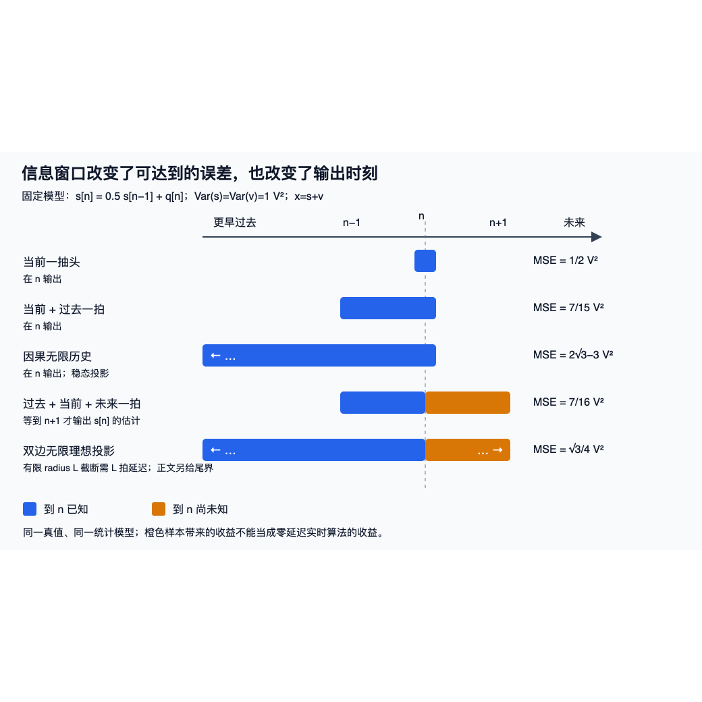

# Wiener实验：从固定观察返回信息集

2026-10-10，独立执行者对冻结V2完成8项测试、一次预跑、标准16次重复及两个独立oracle；五个数值子进程均实际退出0，无超时。作者没有执行课程代码。这页解释已发生的结果；完整原报告是 [REPORT.md.txt](results/2026-10-10-v2/REPORT.md.txt)，复制并不是新运行。

从 [[信号与系统/80-实践/07-Wiener估计与预测/README|输入和目标]] 带固定噪声模型、允许观测窗、共同测试窗进来。读完返回 [[信号与系统/30-随机信号与推断/03-Wiener滤波线性预测与创新#投影到线性张成与投影到全部观测函数|线性投影与条件期望]]：哪部分收益来自更多信息，哪部分来自估计更好的参数？改变噪声后，为什么旧权重不再满足原正规方程？

## 同一测试窗比较的实际结果

标准规格train4096/test8192/repeats16。第r次训练seed179000+r，独立测试179100+r；共同窗n∈[128,8160)，共8032拍。三拍平滑使用n+1，双边截断使用n±32，全部在原记录内；不能把它们当无延迟实时算法。数据按1 V归一，恢复电压后下列MSE乘1 V²。散布是16次样本标准差。

| 方法 | 总体解析参照 V² | 实际均值 V² | 样本标准差 V² |
| --- | ---: | ---: | ---: |
| 只取当前的理论最优权 | 0.500000000 | 0.500602515 | 0.009812639 |
| 当前和过去，理论权 | 7/15≈0.466666667 | 0.467126382 | 0.008691283 |
| 当前和过去，训练拟合权 | 随训练变化 | 0.467356084 | 0.008693904 |
| 三拍平滑，含一拍未来 | 7/16=0.437500000 | 0.438068712 | 0.008412893 |
| 无限因果模型的递推 | 2√3−3≈0.464101615 | 0.464296643 | 0.008592990 |
| 双边半径32截断 | 无限参照√3/4≈0.433012702 | 0.433689289 | 0.008311122 |
| 相关噪声仍用旧两拍权 | 119/225≈0.528888889 | 0.530351928 | 0.007774123 |
| 相关噪声改用新权(.5,0) | 0.500000000 | 0.501929057 | 0.006267023 |

理论权、经验权用同一测试记录比较；拟合权的目标依赖独立训练，不能给它强填单一理论常数。这组样本均值没有被强迫等于总体，也没有为统计波动临时选PASS容差。双边列用无限模型作参照；radius32的独立二次型值0.433012701892219与无限值在当前浮点显示一致，不代表数学截断尾误差为零。

这些观察与各信息集的总体投影结论相容；一般最优性仍来自 [[信号与系统/30-随机信号与推断/03-Wiener滤波线性预测与创新#正交性、正规方程与奇异矩阵|残差正交证明]]。噪声相关改为ρv=.5后旧误差矩总体为−1/15、−7/30 V²；新权(.5,0)恢复为0。这是前提改变后的正规方程改变，不能只看一张曲线继续沿用旧“最优”标签。各次误差矩和MSE在 [标准原JSON](results/2026-10-10-v2/standard/results.json)；首次完整训练/测试/相关噪声/输出分别在 [train.csv](results/2026-10-10-v2/standard/train.csv)、[test.csv](results/2026-10-10-v2/standard/test.csv)、[correlated_test.csv](results/2026-10-10-v2/standard/correlated_test.csv)、[estimates.csv](results/2026-10-10-v2/standard/estimates.csv)。

## PSD观察为何不能单段读出确定谱

固定seed179300生成128组，每组8个独立64拍白Gaussian段，取内部bin5。独立用实sin/cos DFT重算1024个periodogram，并检查全部64bin的Parseval。

| 观察量 | 本次均值 | 本次样本方差 | 总体参照 |
| --- | ---: | ---: | --- |
| 每组第一段 | 0.946843046 | 1.089273744 | 均值1、方差1 |
| 每组8段平均 | 0.972541281 | 0.123696950 | 均值1、方差1/8 |

平均减少散布的机制来自独立段；有限观察没有等于精确期望。预跑也用了同一PSD seed，不能算额外独立128组。这里是归一角频率θ(rad/sample)的双边Sθ，方差为(1/2π)∫Sθdθ；没有物理采样率，不填V²/Hz。若指定fs，才按θ=2πf/fs、Sf=Sθ/fs转换；内部bin5也没有混入单边DC/Nyquist倍增规则。返回 [[信号与系统/30-随机信号与推断/03-Wiener滤波线性预测与创新#谱和相关要从哪段记录估|相关与PSD]] 对照谱对象和估计对象。

## 独立核对的覆盖与限制

[主oracle](results/2026-10-10-v2/oracle-results.json) 1529项、[直接CSV Fraction oracle](results/2026-10-10-v2/csv-oracle-results.json) 93项均match；这是比较项数量，测试套件仍为8项。两oracle均不导入业务源。前者独立重建全部预跑/标准17次seed、2×2正规解、误差矩和DFT；后者把首次训练浮点按精确二进制有理数转Fraction，独立累加R/p再用行列式求w，并直接从CSV算输出损失。确定性abs/rel容差1e−10在运行前固定，主oracle标量最大差1.776e−15。

因果递推用64抽头独立卷积核，r⁶⁴≈2.485e−37，有限记录输出差在固定容差内；这不是严格无限历史相等证明。DC零谱例另从独立创新系数展开精确误差：N=1/2/7/32的三角加权逆MSE=1/N，直接截逆恒为1。返回 [[信号与系统/30-随机信号与推断/03-Wiener滤波线性预测与创新#单点零、整带零与奇异谱各改变什么|单点DC零反例]] 解释log可积、均方可恢复和BIBO逆的不同条件；本有限实验不认证一般outer/log定理。

## 图的真实显示记录

原图是信息窗口的解析示意，曲线表格来自上面的实际结果。最终本机Quick Look可读预览如下，方形留白是预览输出，不是原SVG改动。



[可编辑原SVG](assets/information-windows.svg) 与执行快照同SHA。首次Cairo退出0却有中文方框，[原失败PNG](results/2026-10-10-v2/information-windows-cairo.png) 和 [stderr](results/2026-10-10-v2/svg-cairo-stderr.txt) 保留；不能凭退出码判显示成功。普通sandbox Quick Look退出255，原 [stderr](results/2026-10-10-v2/svg-quicklook-stderr.txt) 保留Operation not permitted；之后正常批准单一原SVG的本机Quick Look退出0，未安装字体或改系统配置。执行者实际查看中文、五行信息窗、时刻、MSE和图例完整可读，见 [visual-observations.json](results/2026-10-10-v2/visual-observations.json)。这是静态图证据；Obsidian和真人理解未验。

## 版本、复制与重新执行

[identity.json](results/2026-10-10-v2/identity.json) 绑定五文件运行前后；数值业务源SHA为`ed74d2ff722889ca6756e646115ad5bb14fe573233d63b656031e74c94a541ca`，测试SHA为`e4c9fc4c213e5f4c4216ad5352748258a793ded2763a831759ae192120509c58`。V3只补读者解释，当前业务源/测试/图源仍匹配；历史README快照保留运行时字节，不冒充现阅读说明。源真值与 [[信号与系统/80-实践/07-Wiener估计与预测/04-源码与验证|code-sync]] 不变。

原manifest [artifact-hashes.json](results/2026-10-10-v2/artifact-hashes.json) 字节保留；[copy-receipt.json](results/2026-10-10-v2/copy-receipt.json) 映射原路径到本目录，61个原件共3,015,910字节（含原manifest，另有receipt），无manifest条目省略。顶层.md改名.md.txt只改变名称，同SHA；原命令、真实exit、环境、CSV/JSON、失败图与最终PNG保留原字节；四份同版源码/镜像/图输入改从固定提交恢复，历史README仍留在包内。原manifest和copy receipt记载当时61份复制，不重新解释为当前包内文件计数。[all-instances.json](results/2026-10-10-v2/all-instances.json) 和各execution.json给真实子进程argv/cwd/time/RSS；[environment.json](results/2026-10-10-v2/environment.json) 给Python3.14.7/macOS和线程环境。最大数值child RSS39,337,984 bytes是观察，不是OS硬资源限制或两任务聚合峰值。

当前复建入口 [replay.py](results/2026-10-10-v2/replay.py) 从本地 WWL Git 的固定提交 `03f07ed66d478db56b8d60fdaade19fed7f02bb2` 取回 `wiener_lab.py`、`test_wiener_lab.py`、`04-源码与验证.md` 和 `assets/information-windows.svg`，在库外新目录恢复原 `snapshot/` 相对布局；它不读取当前工作树里的这四份输入。运行时旧版 [snapshot/README.md](results/2026-10-10-v2/snapshot/README.md) 与当前阅读说明不同，仍从包内按原字节复制。先取得含该提交的本地 WWL Git 仓库，再用标准库 Python 在本实践目录指定全新、绝对路径的输出目录；`--repo` 可以指向该仓库子目录，驱动会解析实际 Git 顶层：

```sh
PYTHONDONTWRITEBYTECODE=1 python3 -B results/2026-10-10-v2/replay.py --repo /绝对路径/WWL --output /private/tmp/wwl-179-replay-01
```

新执行者运行此命令会实际执行8项测试、预跑1/128/256、标准16/4096/8192和两oracle。驱动在创建目标前核固定提交、五份输入与原 identity/copy receipt 的 SHA/字节数，以及固定配置、运行前预期和独立工具身份；缺提交/输入、身份不匹配、库内目标、已存在目标或输出最终节点为符号链接（含悬空链接）均拒绝。准备阶段失败的结构化 receipt 输出到 stderr，目标保持未创建；可以由调用者把 stderr 保存到另一个库外文件。创建后先写准备 receipt，子进程的 stdout/stderr、环境、execution.json 和最终 `fresh-receipt.json` 留在新目录，失败立即停止。收据先序列化再写；八测试必须报告完整8项与末尾OK，两oracle须均all_match且无failed_checks，才能记录五子进程完成。

线程环境请求1线程，测试/预跑/CSV oracle各60秒，标准CLI与完整oracle各300秒；这些是工作预算而非OS硬cap，也不观测两任务聚合峰值。驱动顺序执行数值任务；协调者仍须控制总并发至多2个。PNG不会自动重渲染，新显示证据须另记录。这里完成有限合成模型，现实端口、硬件、一般平稳/遍历前提与真人迁移仍分别未验。

原 [REPLAY.md.txt](results/2026-10-10-v2/REPLAY.md.txt)、`replay-static.json` 和原报告的 **驱动NOTRUN** 描述的是当次旧入口，仅静态审阅的历史事实保留；当前驱动的恢复和执行需由新运行的 stdout/stderr、五份execution和fresh receipt核对，旧五个真实执行不能替代它。原 [artifact-hashes.json](results/2026-10-10-v2/artifact-hashes.json) 与 [copy-receipt.json](results/2026-10-10-v2/copy-receipt.json) 不因换入口而重写，旧哈希仍用于查旧字节。
