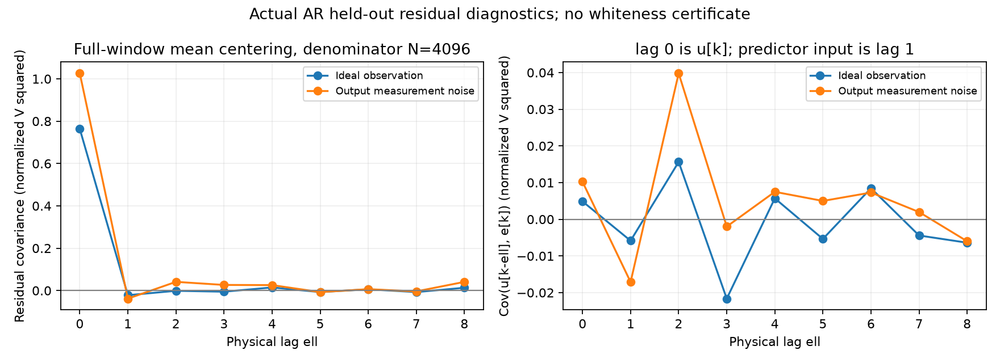
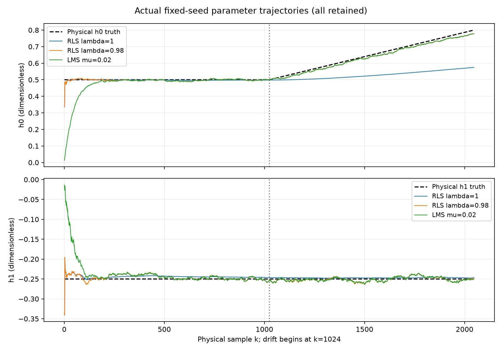
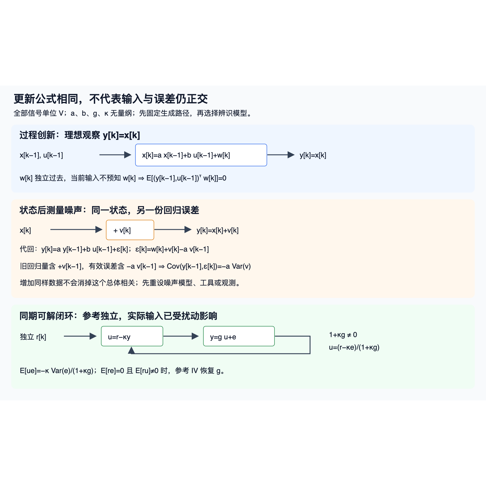

# 动态辨识实验：识别对象、预测对象与遗忘目标

2026-10-10，独立执行者对V2完成9项测试、标准CLI和完整CSV oracle，三个相应child实际exit0；解析预期在运行前固定，附加精确反例也完成。作者没有执行源码或测试。完整 [原报告](results/2026-10-10-v2/REPORT.md.txt) 和全部较差结果保留；复制已有输出不是新运行。

从 [[信号与系统/80-实践/08-动态辨识与自适应/README|固定输入、划分与目标]] 带回归量的物理时刻和R₀/λ进来。读完返回 [[信号与系统/40-状态控制与辨识/03-动态回归持续激励与LMS-RLS#参数结构与激励序列|可识别与持续激励]]、[[信号与系统/40-状态控制与辨识/03-动态回归持续激励与LMS-RLS#ARX回归量与当前扰动|噪声改变回归对象]] 和 [[信号与系统/40-状态控制与辨识/03-动态回归持续激励与LMS-RLS#RLS保存的是哪个目标的逆信息|RLS的加权目标]]：同一拟合为何可能是好预测，却不是物理参数的一致估计？

## FIR阶次由验证选择，测试只报告

seed180000产生4096拍±1输入，y[k]=.5u[k]−.25u[k−1]+e[k]，u[−1]=0，e标准差.05。训练[3,1024)、验证[1024,2048)、测试[2048,4096)。只按验证MSE比较1/2/3抽头，本次选择2；冻结训练参数后的测试MSE为0.002522960847335672。二抽头与三抽头的验证值很接近，不能从本次选择推出每次有限噪声记录都选2，也没有用测试回挑阶次。独立oracle从 [fir.csv](results/2026-10-10-v2/output/fir.csv) 重构全部候选R、b与2/3维Cramer解。

## 同一个物理AR，只改变测量噪声

seed180100的状态x[k]=.5x[k−1]+.25u[k−1]+w[k]，w标准差√.75；理想y=x和叠加独立测量噪声v（标准差.5）的y共享同一x/u。弃[0,256)，训练[256,2304)，测试[2304,6400)。一步预测使用实际上一拍，自由运行只以训练末y[2303]初始化，之后用自身历史。

| 观察 | 拟合â | 拟合b̂ | 一步MSE | 自由运行MSE | 旧输出×真参数有效误差样本矩 |
| --- | ---: | ---: | ---: | ---: | ---: |
| 理想观察 | 0.512387060 | 0.245567884 | 0.763528622 | 1.004889473 | −0.007416589 |
| 白测量噪声观察 | 0.407049803 | 0.264025084 | 1.026526057 | 1.215758727 | −0.125356100 |

数据除1 V归一，表中MSE/误差矩恢复电压后乘1 V²，系数无量纲。真参数(.5,.25)有效误差矩的总体预期分别0、−1/8；有限样本不强迫等期望。这里含输入激励，Var(x)=13/12，测量噪声下总体aOLS=13/32=.40625、bOLS=.25；不能套无输入AR的2/5特例。â向.40625附近移动符合测量误差进入回归量的机制，不能解释为物理状态转移a真的变小。全部原记录在 [ar.csv](results/2026-10-10-v2/output/ar.csv)。



全部lagℓ取u[k−ℓ]与e[k]，lag0为u[k]，lag1才是AR预测器输入；测试窗各自全窗均值、分母4096，边界配对从2304+ℓ开始，不引入训练窗。两观察的残差自相关和输入互相关全部保留，独立oracle从原CSV逐项重算。有限小相关不证明白噪声、外生性或一致性；用拟合残差的训练正交性也不能自证原噪声假设。

## 漂移时，不同λ在解不同目标

seed180200记录2048拍，h₀前1024拍=.5，后1024拍线性到.8，h₁=−.25；RLS的R₀=.01I、θ₀=0，λ=1/.98，LMS μ=.02。图保留全部算法和真值，不删较差曲线。



最终参数冻结后，另用seed180300在h=(.8,−.25)生成1024拍验证（损失窗[1,1024)），而非用训练误差挑胜者。

| 算法 | 最终h₀ | 最终h₁ | 后续独立验证MSE |
| --- | ---: | ---: | ---: |
| RLS λ=1 | 0.574684875404 | −0.246443555754 | 0.0532143224062 |
| RLS λ=.98 | 0.777749917593 | −0.248852132056 | 0.00290984690526 |
| LMS μ=.02 | 0.777977331599 | −0.249991906033 | 0.00290139361479 |

λ=1仍积累较多早期信息；λ=.98向近期目标倾斜，收益与遗忘代价必须一起解释。本次LMS比λ=.98的MSE低约8.45e−6，只有一个固定实例，不能推广哪种算法普遍更好。[drift.csv](results/2026-10-10-v2/output/drift.csv)、[later_validation.csv](results/2026-10-10-v2/output/later_validation.csv) 和 [results.json](results/2026-10-10-v2/output/results.json) 留全部时刻、目标与轨迹。

## 独立核覆盖何处

[独立CSV oracle](results/2026-10-10-v2/independent-oracle.json) 与 [逐项比较](results/2026-10-10-v2/independent-comparisons.json) 的35,783是字段/数值比较项，套件仍为9项。最大记录差2.0463630789890885e−12，比较容差1e−10属于确定性重算，不是对统计误差设置通行阈值。oracle不导入业务代码，从完整CSV重建R/b、阶次选择、冻结损失、两个观察的物理lag和自由初史，并独立核四个seed全记录。

两种RLS各2047个目标前缀由λ加权信息目标独立求解，不复用业务batch或gain公式；最大参数差分别2.6645352591003757e−15和3.774758283725532e−15。LMS2047步按前一迭代的平方损失梯度核对，最大差0。源函数短例观察另放 [source-probes.json](results/2026-10-10-v2/source-probes.json)，没有把业务观察冒作独立oracle。

[运行前Fraction预期](results/2026-10-10-v2/analytic-expected.json) 与 [附加精确核](results/2026-10-10-v2/additional-analytic-checks.json) 确认λ1短例(9/32,−3/32)、λ.5短例(31/79,−13/79)，非零中心每前缀、DᵀR₀D坐标惩罚、常值rank1与有限冲激，以及一步/自由初史反例。闭环四格κ1的OLS−.25与参考IV.5、iid四轴LMS μ1.5的均值因子−.5但均方因子2.5，只针对明示有限模型；不能移给复用时间回归量或所有闭环。一般推导仍由主课证明，运行不认证全部步长/真实噪声/控制稳定。

## 原图显示失败与可读恢复



[原SVG](assets/noise-paths.svg) 保持执行版SHA；该图是生成路径示意，上面两图才来自实际CSV/结果。Cairo首次渲染中文方框，[失败PNG](results/2026-10-10-v2/plots/noise-paths-cairo-tofu.png) 和 [原stderr](results/2026-10-10-v2/render-evidence.stderr) 保留；只读现有字体的局部fontconfig重试仍方框，[重试PNG](results/2026-10-10-v2/plots/noise-paths-local-fonts.png)、[重试stderr](results/2026-10-10-v2/render-chinese-local.stderr) 和原配置保留。没有安装字体或更改系统字体。

普通sandbox Quick Look退出255，[原stderr](results/2026-10-10-v2/qlmanage.stderr) 保留Operation not permitted；正常批准的单一原SVG本机Quick Look退出0，[真实记录](results/2026-10-10-v2/qlmanage-approved-observation.json) 绑定argv/RSS/exit。执行者实际查看中文、公式、IV条件和反馈箭头可读，方形留白属于预览。Matplotlib首次使用临时缓存的警告保留；未复制无关缓存。此静态预览不冒充Obsidian或真人理解。

## 原件身份与便携复建接口

[SOURCE_FREEZE.json](results/2026-10-10-v2/SOURCE_FREEZE.json) 绑定运行前后五文件；业务源SHA为`3365f8a19bf7f46c1881e7d1da77e3abc7850cc838339a2456a4f66d3a4a098d`，测试为`da4e3f63592e79e7c6fceee163d9c3b2e952feb2802502b222d03592d20106c6`。当前源码/测试/图源及 [[信号与系统/80-实践/08-动态辨识与自适应/04-源码与验证|code-sync]] 不变，历史README快照保留当次字节。固定seed/切分见 [INPUTS.json](results/2026-10-10-v2/INPUTS.json)，完整真实child命令、cwd、exit、耗时和Darwin RSS见 [process-observations.json](results/2026-10-10-v2/process-observations.json)，Python3.14.7/环境见 [environment.json](results/2026-10-10-v2/environment.json)。数值child最大RSS47,923,200 bytes、线程环境各1，是观察和请求，不是OS硬cap或两任务聚合峰值。

原 [artifact-hashes.json](results/2026-10-10-v2/artifact-hashes.json) 字节保留；[copy-receipt.json](results/2026-10-10-v2/copy-receipt.json) 逐项绑定原路径/现路径/SHA。70个原件共5,318,210字节（含原manifest，另有receipt），无manifest条目省略；顶层.md只更名.md.txt，内容同字节。原 [REBUILD.md.txt](results/2026-10-10-v2/REBUILD.md.txt) 与monitor.py记录历史执行来源，其中绝对恢复路径不构成通用复建承诺。

新的 [replay_actual.py](replay_actual.py) 和 [工具hash表](replay-input-hashes.json) 只完成静态检查，**新驱动NOTRUN**。它改为从本页携带的原快照和四个helper取输入，核SHA后只复制源码/输入工具，绝不复制旧output。可用标准库Python、POSIX macOS/Linux，在本实践目录给全新不存在的目录：

```sh
PYTHONDONTWRITEBYTECODE=1 python3 -B replay_actual.py --output /private/tmp/wwl-180-replay-01
```

顺序为独立解析预期、9test预跑、标准CLI、业务观察、独立CSV oracle、附加Fraction核；任一真实child exit非0/超时或输入漂移即停，最后要求三份解析/oracle结果status=PASS。新stdout/stderr、环境、真实命令/exit/time/RSS和输出仅写新目录。预跑60秒、常规300秒和线程环境各1是工作预算；不提供OS硬cap。不自动生成新图；若另用原render_evidence.py，需要相应现有依赖和新目录内MPLCONFIGDIR，并另记录运行和查看，不能把旧PNG冒新图。

设备时间戳、实际激励、测量、闭环控制、Obsidian和真人迁移分别未验；本次只交付明示合成模型和其实际有限结果。
