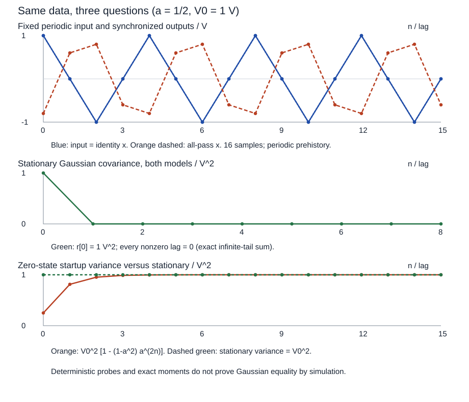

# 全通、创新与物理辨识的精确复算

读者要核的是三个对象：平稳 Gaussian 输出的二阶量、同一已知输入的物理响应、撤去 Gaussian 后的高阶量。完整论证和唯一参数表在 [[信号与系统/30-随机信号与推断/03-Wiener滤波线性预测与创新#创新表示不等于物理输入的恢复|Wiener主解释]]；此页保存可改输入与精确算术接口，不将 CPU 检查冒充一般概率证明。

## 固定输入与可复算输出

[fixed-inputs.json](fixed-inputs.json) 固定 $a=1/2,1/3$、$V_0=1$ V、$f_s=4$ Hz、九个冲激系数和九个协方差 lag、16拍周期输入。随机模型是全整数 iid Gaussian 从无限过去已平稳；脚本只计算其精确总体协方差，没有从零开始随机模拟它。另一输入是全整数已知周期 $(1,0,-1,0)$ V，用来核同步物理复响应，它不是 Gaussian 噪声样本。

[allpass_lab.py](allpass_lab.py) 仅需 Python 3 标准库，以 `Fraction` 算冲激、协方差有限前缀与几何余尾、$\theta=\pi/2$ 的复数商、周期递推、零状态启动方差、Rademacher四阶矩；图从落盘后的同一 [same-data.csv](data/same-data.csv) 读取，坐标映射才用浮点。没有第三方依赖、无随机 seed、无硬件动作。输入卡中 `periodic_u_over_V0` 固定为四项 `(1,0,-1,0)`，实际电压乘 `unit_V`；它是已知相位的四周期探针。图显示参数表的第一个模型，并将实际参数、幅值范围和样本数带到标题／坐标／图注；其余模型仍完整写进 CSV 与结果。所有路径相对于此实验目录。

```bash
python3 -B allpass_lab.py --inputs fixed-inputs.json --output /private/tmp/allpass-replay
```

输出目录可自选；避免覆盖自己的旧实验。输出 `same-data.csv`、`results.json`、`same-data.svg`。本库附图 [assets/same-data.svg](assets/same-data.svg) 与本次生成的 [data/same-data.svg](data/same-data.svg) 同字节，读者重新实验应打开自己输出目录的图。规范源码在 `.py`，[[信号与系统/80-实践/09-全通创新与物理辨识/04-源码与验证|源码镜像]] 仅供 Obsidian 阅读。

## 一次计算回答哪些问题

1. 平稳自协方差用 $\sum_{j=0}^{K-1}h[j]h[j+m]$ 加精确余尾 $(1-a^2)a^{2K+m-2}$，$m\ge0,K\ge1$；所有模型返回 $r[0]=1$ V²、$r[m]=0$ ($m=1,\ldots,8$)。正文另给任意 $m$ 的证明，九个检查不是无限命题本身。
2. 冲激前九项截掉的能量为 $(1-a^2)a^{16}$：$a=1/2$ 时 $3/262144$。仅保首五项则为 $3/1024$；截断数组自身不再严格全通，不能用有限滤波尾的近白输出替代正文。
3. 已知全部周期过去的输入使稳定周期输出满足 $x[n]=a x[n-1]+u[n-1]-a u[n]$。$a=1/2$ 的四拍为 $(-4/5,3/5,4/5,-3/5)$ V；$a=1/3$ 为 $(-3/5,4/5,3/5,-4/5)$ V。脚本逐拍精确核递推，非零过去条件随 CSV 一起固定。
4. 若 Gaussian 输入只从 $n=0$ 开始、物理状态为0，$\operatorname{Var}x[n]=[1-(1-a^2)a^{2n}]$ V²；$a=1/2$ 第0拍1/4、第1拍13/16 V²，逐渐趋1。该启动方差是另一个协议，不能套“所有时刻都是同律”的平稳命题。物理差分式的启动还需令 $u[-1]=0,x[-1]=0$。
5. 单位 Rademacher 的精确高阶矩，$a=1/2$ 有 $E[X^4]=11/5$、$E[X_nX_{n-1}^3]=-3/20$；$a=1/3$ 对应 $77/45$、$-16/45$。它们检验正文非 Gaussian 边界，未宣称高阶矩一般足以唯一辨识任意系统。



图第一幅蓝线同时表示物理输入和直通输出，橙线为全通输出；第二幅两模型的理论协方差完全重合，第三幅橙线为零状态启动，虚线为平稳方差。上方输入波形不同输出与下方 Gaussian 同自谱不矛盾：两个图所给输入信息与随机协议不同。

## 改条件再返回正文

先把 $a$ 改为1/3独立算极点、零点、复谱比，再与结果核对；不要仅拿相干模回答。可在 `(0,1)` 另选有理 $a$，保持本白输入及单位合同，再决定输出完整律是否相同。若改成非Gaussian，返回主解释核条件创新；若增加或撤去输入观测，去 [[信号与系统/40-状态控制与辨识/03-动态回归持续激励与LMS-RLS#同一全通例增加同步输入后识别什么|辨识信息集]]；核相位符号则去 [[电子电路/38-随机噪声与测量/05-互谱FFT与噪声测量#同一全通例的共轭核查与返回|电子互谱]]，最后返回 [[信号与系统/20-数字信号处理/04-IIR设计二阶节与幅相取舍#阶数 群延迟与实时资源|IIR稳定逆与幅相]]。输入卡允许1至8个不同的有理 $a\in(0,1)$（如 `"2/4"` 会规范成 `"1/2"`）；`unit_V` 与 `sampling_rate_Hz` 也必须为正有理字符串。冲激项数与协方差 lag 数为1至64的整数，记录长度为4至256的整数；bool不是计数。有理数约分后的分子绝对值与分母最多16 bit，限制是教学算术／输出预算，不是理论条件。空参数、越界计数、非正单位／采样率和错误周期模式均显式报错，`python -O` 不会撤去检查。更换固定四拍的周期模式需改探针模型；卡片的 Gaussian／Rademacher 描述是模型说明，不是用文本字段切换随机机制。

## 验证与证据边界

2026-10-12在候选目录用 Python 3.14.7、单线程与60秒进程上限实际运行，精确协方差、冲激余尾、复商、周期递推、启动方差和四阶矩自查均通过，生成82行 CSV；详细数值是 [results.json](data/results.json)。接口修正后同源重跑通过；另在 `-O` 下实际核了 `a=1/4,V_0=2,f_s=8,N=12,lag数=1` 的动态绘图、`a=2/4` 的规范化，以及八组非法卡的显式拒绝。该记录是作者执行，重要论证与行为仍须非作者独立核对，签收由本项最终交付记录承接。静态链接、公式／图显示、真实采集和真人撤提示迁移各有自己的责任；本页不代填后四层的完成状态。
