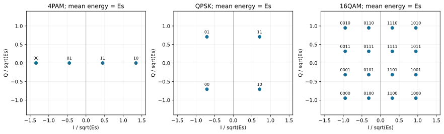
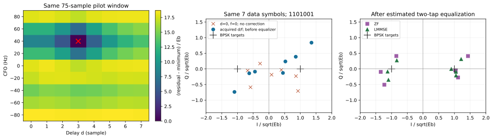

# 从前导到CRC：训练获取与两抽头均衡的有限实验

这次需要接收机自己从候选中找到时延与频偏，而后估计两抽头，再决定求逆要付多少噪声代价。先读[[信号与系统/50-通信与反演/05-复基带星座能量与传播接口|复基带尺度与星座]]，再带每I/Q分量 $N_0/2$、样点/符号和完整尾部去[[信号与系统/50-通信与反演/06-训练同步两抽头均衡与帧错误|训练接收机主解释]]。本实验沿用原1101→1101001，不重跑实践11已核的矩形BPSK单符号MC，也不把实践12有限RRC的有色噪声改名为当前白噪声。

## 固定输入与有限前向模型

[fixed-inputs.json](fixed-inputs.json)是唯一正式卡。$T=1$ ms、每符号L=4、$f_s=4000$ sample/s、$E_b=1$ μJ；16位前导1110010110100001、3个零符号守卫、7位CRC码字、1个尾守卫时隙。BPSK位1→+，位0→−；零守卫幅度0，区别于位0。

在无量纲数字tap $p[n]=1/\sqrt L$（L格，范数1）上发 $x[n]=\sum_k\sqrt{E_b}a_kp[n-kL]$。x用 $\sqrt{\mathrm J}$，是带 $\sqrt{\Delta t}$ 的能量坐标。代码内部除 $\sqrt{E_b}$，所有信号坐标无量纲，噪声复方差为 $\nu=N_0/E_b$，每I/Q分量 $\nu/2$。物理坐标乘回 $\sqrt{E_b}$；JSON记录Eb与T，星座/均衡图用无量纲坐标，不把数组当ADC电压。

信道块内恒定，真时延d=3样点，频偏40 Hz，固定相位0.45 rad并入 $h=e^{j0.45}[0.9,0.6e^{j0.4}]$。实际生成

$$r[n]=e^{j2\pi40 n/f_s}\{h_0x[n-3]+h_1x[n-3-L]\}+w[n].$$

复proper白Gaussian噪声由两份独立标准正态乘 $\sqrt{\nu/2}$ 产生。3个案例每例12000独立帧，分别用固定不同seed；每帧均匀抽16种4位消息之一，再附原3位CRC，帧间噪声独立。normal为 $\nu=.4,\rho=1$，noisy为 $\nu=1.2,\rho=1$，deep为 $\nu=.4,\rho=.12$，实际系数再乘ρ。三例是指定确定性块信道下的随机帧，不是已拟合的Rayleigh/真实衰落分布。

另有固定1101的一帧展示，噪声比.04、独立demo seed；以及一个独立seed的12000帧**已知真实H**均方误差检查。后三个正式案例与两种均衡器共享各自同一帧/噪声，是成对比较，不能把ZF与LMMSE输出算成两倍独立样本。前导搜索、均衡和CRC都不使用未知消息真值；真值只用于评分。

## 接收算法与不会被图藏起来的边界

规范源码[receiver_lab.py](receiver_lab.py)使用如下合同：

1. 对d=0..7、f=−80:20:80 Hz的72候选，全部使用相同75样点训练窗，构造两列训练矩阵并最小化拟合残差。最早未知数据样点76，最晚候选训练尾末样点74，既不漏尾也不混数据。LS估计包含未知固定相位的两抽头；并列按候选顺序取第一项。
2. 先按绝对n去旋转，再按估计起点把每4格匹配积分；7个未知数据位使用**8个**完整符号观察。有效H是8×7线性卷积矩阵，无循环前缀、无循环卷积，完整尾保留。
3. ZF使用 $(\widehat H^*\widehat H)^{-1}\widehat H^*$；复线性LMMSE使用 $(\widehat H^*\widehat H+\nu I)^{-1}\widehat H^*$，最后实部>0判1。此LMMSE设计只承诺复线性Wz类的已知H均方目标；BPSK的widely-linear或有限码本后验译码不在实现中。
4. 合成真值事后给出同步标签：d/f任一个没有命中真值就记失败，下游BER/FER/CRC只在命中的帧中统计。获取器总会返回候选，**没有实现真实接收机拒收门限**，因此这里的失败是oracle诊断标签，不是实际丢弃/检测概率。失败帧可能造成的真实交付错误仍未模拟。

原CRC的余式列 $[5,7,6,3,4,2,1]$ 存在输入卡中，对7位中1所在列异或即syndrome；4位消息的余式直接生成末3位。位序从 $x^6$ 到 $x^0$、生成式1011、无反射/初末异或全按[[计算机知识/35-计算机网络/10-系统课程/02-链路层交换与差错检测#余式压掉了哪一些错误方向|原网络主解释]]，没有另写长除法或改用某个库默认CRC。全部16码字及其±1二阶矩保存在JSON；均值0、二阶矩I，不冒称7位独立。0001011非零错误的原漏检保持。

## 先于正式运行确定的预期与失败判据

下面的高/中/低由结论影响决定。低重要性并非可以不验，而是它不替代前面的数学/行为证据。

| 重要性、原因 | 独立于本次随机计数的预期与容差/失败 |
| --- | --- |
| **高：坐标和尾部错会改变整个接收问题。** | 范数1的L格脉冲使每分量噪声投影方差为 $\nu/2$；两位[1,−1]经[1,1/2]完整输出[1,−1/2,−1/2]。无噪声正式卡必须找到d=3、f=40，信道/7符号最大误差< $10^{-10}$；否则失败，不能裁边缘位。 |
| **高：同步真值若泄入估计便失去获取实验。** | 所有候选用相同75格，训练波形在数据位置前结束；16种消息仅改变payload，应有完全相同的无噪声前75格。不得用真值选argmin或CRC替它挑最好的一项。 |
| **高：ZF噪声增强与LMMSE折中是主断言。** | 已知H的任意复线性W应满足MSE/$E_b=\|WH-I\|_F^2/K+\nu\|W\|_F^2/K$；ZF应有WH=I（有限误差≤$10^{-12}$），LMMSE应允许偏差。独立12000帧MC的平均损失与该解析值差在 $6s/\sqrt N+10^{-12}$ 内，s由每帧7符号平均损失算；这是预定诊断带，非精确覆盖保证。 |
| **高：不同分母不能互换。** | 每案例尝试N，成功S，位比较数7S，失败N−S；帧错E、漏检U满足0≤U≤E≤S，CRC通过=S−E+U。分别报B/(7S)、E/S、U/N、U/S、U/E，分母0记未定义；不预定某次随机错误数。 |
| **中：深谷与有限矩阵单射是不同结论。** | 完整h=[1,−.98]应有 $\sigma_{min}^2=1+.98^2-1.96\cos[\pi/(K+1)]$；K=7,31,127观察病态增加。h=[1,−1]有限full H仍满列秩，禁止报成精确零奇异值。 |
| **中：码本与星座标签会改变判决对象。** | 原1101编码成1101001，错误0001011余式0；均匀16码字±1矩阵均值0、二阶矩I恰可有限枚举。4PAM/QPSK/16QAM的平均能量1、最近邻标签一位差。 |
| **低：图能否正确传达同一数据。** | 两SVG均由固定CSV/JSON生成，坐标归一化、单位、候选格/7数据点清楚；有title/desc、颜色之外的点形标记。实际图渲染另验，不以源码存在当显示证据。 |

数值比较和获取搜索是作者实现；[test_receiver_lab.py](test_receiver_lab.py)的字面两位卷积、手算逆矩阵、单奇异方向、原CRC反例、有限正弦谱、训练窗隔离和分母回归是作者自查。非作者需另建推导/实现，不能只运行这些测试就宣称独核。发生失败保留原目录/输出，查单位、绝对相位、完整支持、候选窗口及统计事件；不靠改输入或放宽阈值擦掉失败。

## 本次真实环境、命令与文件

2026-10-17本机macOS27.0.1 arm64，Python3.14.7、NumPy2.5.3、Matplotlib3.11.2。只用CPU；NumPy/绘图已有，未安装SciPy，也不需要它。预跑300帧验证输入和预算后正式每案例12000帧，正式数值命令约1秒（本机观察，非性能保证）。所有数值/绘图经既有两槽runner，线程1、禁写pyc；候选中原运行与测试输出分别为[author-run.txt](author-run.txt)、[author-tests.txt](author-tests.txt)、[author-plot.txt](author-plot.txt)。首次绘图字体缓存有只读系统目录提示，Matplotlib改用自有临时缓存后实际生成两图；未改变系统权限。

本次真实调用路径在候选区，源码及输入最后按相同字节交付。下列用`LAB`表示本实验目录，`PY`表示仓库`.venv/bin/python`的绝对路径；同一输出目录不可已存在：

```bash
python3 -B /private/tmp/wwl-next-context/run_local.py --timeout 60 -- "$PY" -B -m unittest discover -s "$LAB" -p test_receiver_lab.py -v
python3 -B /private/tmp/wwl-next-context/run_local.py --timeout 300 -- "$PY" -B "$LAB/receiver_lab.py" --inputs "$LAB/fixed-inputs.json" --output /private/tmp/receiver-replay-new
python3 -B /private/tmp/wwl-next-context/run_local.py --timeout 60 -- "$PY" -B "$LAB/plot_receiver.py" --results /private/tmp/receiver-replay-new
```

正式调用与上式相同，数值输出目录为候选`formal-results`，再将3个同字节结果文件放入本实验results后生成图；没有重跑旧BPSK/RRC。runner是本机当时的设施，不是分发依赖；其他机器可用已装NumPy/Matplotlib的Python直接运行相应脚本。源码拒绝已有输出目录，绘图拒绝覆盖已有SVG；只读固定卡可复制后改变 `T_s`(.5–2 ms)、`Eb_J`、双tap、消息、相位、网格内真值、噪声/衰减和不同seed，先300帧、正式最多50000帧，输出到新目录。L=4/训练长16/guard3/候选集合/原CRC列是本实验明确固定合同；不是正文一般理论的定义域限制。网格外真值由CLI拒绝，正文迁移题仅提出进一步实验接口，未冒称实际运行。

结果：

- [results.json](results/results.json)：实际环境/输入、16码字/矩、无噪声核对、同一展示帧的复坐标、三个正式案例全部计数、已知H的bias/noise/MSE和独立seed MC。
- [acquisition.csv](results/acquisition.csv)：同一展示帧72候选的原始残差/$E_b$，不删未胜出候选。
- [constellations.csv](results/constellations.csv)：4PAM/QPSK/16QAM的显式位标签及I/Q除 $\sqrt{E_s}$；这是确定性几何表，不是该调制的随机BER。
- [plot_receiver.py](plot_receiver.py)：只读取上述结果，生成[constellations.svg](results/constellations.svg)与[receiver.svg](results/receiver.svg)，无第二份均衡器/CRC实现。

## 实际观察与解读

无噪声找到d=3、f=40，信道最大误差 $2.00\times10^{-16}$、7符号误差 $8.98\times10^{-16}$；训练残差的约 $-7.1\times10^{-15}E_b$ 是投影相减的浮点消差。8项作者回归通过。带噪展示帧也找到3/40，$\widehat h\approx[.820874+j.404186,\ .425319+j.480041]$；它仅是一个实现，原始符号坐标全部保留。

每案例N=12000；表内B/E/U分别为成功帧内的位错数、帧错数、漏检帧数，不把失败帧算成全对：

| 案例 | 同步失败F / 成功S | 均衡器 | B / 7S | E / S | U / N | U / E |
| --- | --- | --- | --- | --- | --- | --- |
| normal | 230 / 11770 | ZF | 4428 / 82390 | 3365 / 11770 | 26 / 12000 | 26 / 3365 |
| normal | 同上 | LMMSE | 2753 / 82390 | 2391 / 11770 | 3 / 12000 | 3 / 2391 |
| noisy | 3540 / 8460 | ZF | 10746 / 59220 | 6103 / 8460 | 182 / 12000 | 182 / 6103 |
| noisy | 同上 | LMMSE | 7806 / 59220 | 5324 / 8460 | 69 / 12000 | 69 / 5324 |
| deep | 11662 / 338 | ZF | 1024 / 2366 | 333 / 338 | 32 / 12000 | 32 / 333 |
| deep | 同上 | LMMSE | 1001 / 2366 | 329 / 338 | 41 / 12000 | 41 / 329 |

normal的条件BER约.053744/.033414、条件FER约.285896/.203144；deep多数帧获取失败，成功帧仍保留约.43的条件BER。deep中LMMSE的条件符号MSE较低，却有41个漏检，超过ZF的32个；这个固定seed反例足以反驳“MSE下降必使每一种错误指标都下降”，不证明两算法的总体排序。$U/S$与CRC通过数、LS条件RMSE均在JSON，任何层都不填虚假的0。

| 已知真实H的解析对照 | ZF MSE/$E_b$ | LMMSE失真项 | LMMSE噪声项 | LMMSE总MSE/$E_b$ |
| --- | --- | --- | --- | --- |
| normal | .688812 | .144796 | .187286 | .332082 |
| noisy | 2.066437 | .344971 | .213822 | .558793 |
| deep | 47.834181 | .922449 | .037707 | .960155 |

这些对照先固定真实H，**不是**训练估计后的保证。独立seed的已知H normal MC分别得.693722/.334112，对照期望.688812/.332082；按每帧损失的6个经验标准误差诊断带约.020760/.007232，均在带内。训练接收机normal的实际条件MSE则为.785618/.356017，条件RMSE of LS h约.158736。deep估计器在胜出搜索后可能高估信道幅度、实际缩小输出，不能要求它等于已知小H的47.834181；筛选与plug-in估计本来是另一个随机过程。

谱谷 $[1,-.98]$ 的K=7/31/127，最小奇异值为.386777/.099186/.031469；ZF平均噪声增益为1.527808/5.461327/15.898301。完整有限H仍满列秩，正文的正弦谱解释它怎样逐渐接近无限长序列的频谱谷。每个案例只有一组有限样本；未拟合总体置信区间，更不把同帧7位当7个独立Bernoulli样本。





第一图检查标签和每轴尺度；第二图左侧72个残差共同支持argmin，右侧只显示7数据点，求解仍使用第8个尾观察。原数据、teacher推导与图用途不同，谁也不能冒充另一个证据层。

## 无提示迁移与未验接口

先完成[[信号与系统/50-通信与反演/06-训练同步两抽头均衡与帧错误#先手算，再撤去方法提示|接收机五题]]和[[信号与系统/50-通信与反演/05-复基带星座能量与传播接口#撤去星座名字后再算一次|星座四题]]。下一次改变输入前，预测哪个量因保持能量不变而固定、哪个量因训练/噪声/边界变化而改变，再运行到新目录；模型走读和标准答案不等于真人已经掌握。

| 重要性与外部对象 | 继续所需输入、命令/协议接口与失败记录（当前未执行） |
| --- | --- |
| **高：真实RF/ADC参考面与限带噪声。** | 记录同一端口的阻抗/功率、接收增益、模拟带宽/噪声带宽、IQ峰值或功率包络约定、每轴PSD/交叉谱、采样率/符号率/脉冲tap。导出时间戳与已知发送帧，先测噪声协方差和单位转换，独立回放到接收器；有色噪声应改加权LS和均衡协方差，不能给当前独立模型硬盖章。设备/仪器命令须按实际型号确定，不杜撰已运行CLI。 |
| **高：真实获取、连续时钟与交付。** | 需前导起点/频偏独立真值、频偏范围/漂移、分数时延、无信号记录和实际拒收门限；记录全尝试中的漏获取/假获取、拒收与错误交付，保留失败帧而非只导出CRC通过帧。当前oracle标签不能验证这些行为。 |
| **中：更广信道与制式。** | 从测得/明确定义的时变H、路径时延/极化/噪声或新增QAM输入，另定训练/保留数据、插值和跟踪误差；分布/码率/净吞吐要各自固定。当前确定性两tap案例不代验Rayleigh总体、纠错编码、真实传播和所有制式。 |
| **低：原生阅读与真人迁移。** | 在实际客户端检查新两页/两SVG与目的链接落点；真人撤提示完成变边界/变频偏题并保留原答。当前数值和模型独答不能替代真实阅读表现。 |

本机数值与绘图已执行；真实DAC/ADC/RF、真实时钟/连续跟踪、硬件传播/拒收交付、原生Obsidian与真人学习层未验。原#181是否达到它声明的教学范围，要对01/03与本两页的完整原目标逐项独核；无需把未声称的所有平台或真人试验增加为新关卡，也不能因有限模拟通过就宣布真实电台已验收。
