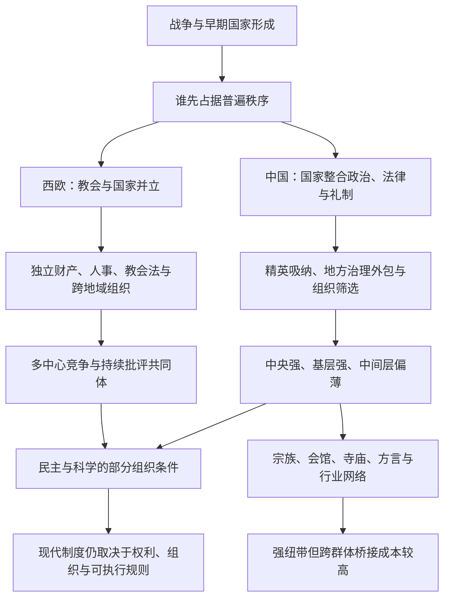

# 文化政治与组织结构 · MOC

> [!caution] 证据状态
> 本专题是尚未完成外部逐条核验的原始对话材料综合。`research-map` 表示结构可用于阅读和继续研究，不表示历史概括与因果命题已经证实；优先命题的材料脚注、候选来源和核验状态见 [[哲学与文化/90-资源/01-原始材料与参考来源索引#优先命题证据台账|优先命题证据台账]]。

## 阅读钥匙：先看一个最小例子

设想 A、B 两个社团都宣称同一条高尚规范。A 能自己任命负责人、持有场所、收取会费、裁决内部争议，并在某地被打压时迁到另一法域；B 的负责人、财产和活动范围都要由外部权力随时批准。两者的理念可以同样普遍，但只有 A 更可能把理念变成跨代存续的公共约束。

因此，本专题问的不是“哪套思想更崇高”，而是：**谁能把规范变成可持续的人员、财产、规则和行动？** 如果想先从具体社会关系进入，也可以把 [[哲学与文化/10-主题/01-文化政治与组织结构/06-宗族语言与纽带桥接|宗族、语言与纽带—桥接]] 作为第一篇，再回到理论框架。

## 六个关键词

| 概念 | 本专题中的含义 | 首要入口 |
| --- | --- | --- |
| 规范 | 用来判断最高权力正当与否的价值或规则 | [[哲学与文化/10-主题/01-文化政治与组织结构/01-问题重述与四层分析框架#1. 规范层：什么可以判断最高权力有错\|规范层]] |
| 组织 | 能持续招募、持产、任命、裁决和传承的行动载体 | [[哲学与文化/10-主题/01-文化政治与组织结构/01-问题重述与四层分析框架#2. 组织层：谁能持续解释并执行规范\|组织层]] |
| 自治 | 组织在财产、人事和内部规则上拥有的实际空间与受保障权利 | [[哲学与文化/10-主题/01-文化政治与组织结构/05-宗教思想组织的自治困境#自治门槛不是单一变量\|自治门槛]] |
| 普遍性 | 声称规则适用于跨地域、跨群体对象的范围，以及谁有能力执行它 | [[哲学与文化/10-主题/01-文化政治与组织结构/02-普遍性竞争与组织载体#核心问题：谁先占据“普遍秩序”\|普遍秩序]] |
| 纽带 / 桥接 | 群体内部的密切互助 / 不同群体之间的横向合作 | [[哲学与文化/10-主题/01-文化政治与组织结构/06-宗族语言与纽带桥接#先区分两种团结\|两种团结]] |
| 理想型 | 为比较而突出若干机制的分析模型，不是对全部时期和地区的原样描述 | [[哲学与文化/10-主题/01-文化政治与组织结构/01-问题重述与四层分析框架#方法上的边界\|方法边界]] |

## 这个专题在问什么

原始问题把中西差异概括为：基督教让人服从上帝而不是国王，因此产生质疑、民主和科学；中国缺少宗教中心，因此更服从权威、内部更一致，却也更容易顺从和突然崩解。材料认为，这个直觉抓住了“超越权威能否限制政治权力”的一部分，却把宗教、组织、国家形成、社会网络与现代制度压成了一条过度简单的因果链。

专题由三个递进问题组成：

1. **比较问题**：真正影响政治文化的，是宗教教义本身，还是承载规范的组织结构？
2. **生成问题**：为什么欧洲出现了跨地域、非血缘、相对独立的教会，而中国的普遍秩序更多由国家承载？
3. **持续问题**：这种差异怎样通过战争、精英吸纳、地方治理和组织筛选变成路径依赖，又如何影响侨民社会、民主、科学和现代国家？

## 核心结论

本专题的中心解释不是“有宗教/无宗教”，也不是固定的“民族性格”，而是：

> **规范能否形成公共约束，取决于谁拥有持续执行它的组织能力。**

一套能够长期限制最高权力、维持批评共同体的条件可写成：

```text
超越性规范
× 独立组织
× 财产与人事自主
× 可执行的内部规则
× 跨地域网络
× 多中心竞争或外部庇护
```

这里的 `×` 不是数学计算，也不表示历史只有“全有/全无”两种状态；它用来提醒读者，各条件会相互加强，而且最短的短板可能显著压低整体自治能力。

材料进一步把欧亚大陆两种理想型概括为：

- **高峰中世纪拉丁西欧的理想型**：逐步形成的普遍教会与多个领土有限的王国、诸侯领和城市政体并存；
- **帝制中国的长时段理想型**：普遍国家与多个特定地方共同体并存。

这些理想型抽取的是长期形成的成熟结构，不表示 5 世纪教会或两千年帝制中国始终保持同一形态。它也不是说欧洲教会天然自由、中国社会没有宗教或自治，而是说：欧洲部分时期形成了国家之外的普遍组织执行者；中国则常见“国家介导大范围整合、地方与宗族承担密集治理”的组合。由此提出一个需要分时期检验的格局：

> **民间纽带型社会资本较强；国家介导的跨地域整合较强；国家之外的横向桥接能力因时期、组织和制度环境而异。**

## 候选机制图

读图时从左到右追踪“国家形成—组织条件—社会连接—现代后果”，但不要把箭头读成已经识别出的净因果。它只是待按命题台账核验的研究路线；反馈、竞争解释和反例仍可能改变每一段关系。



这张图是压缩后的理想型，不是充分因果模型。尤其“民主与科学”“当代组织”还需要各自的法律史、组织史、知识史和当代证据，不能由古代结构直接推出。

## 关键概念横向导航

同一关键词在不同文章中承担不同工作。下面的链接故意跨越章节，把“定义—历史案例—现代含义—可检验命题”串成横向阅读路径。

| 关键词 | 横向阅读路径 |
| --- | --- |
| 规范与组织 | [[哲学与文化/10-主题/01-文化政治与组织结构/01-问题重述与四层分析框架#四层分析框架\|四层定义]] → [[哲学与文化/10-主题/01-文化政治与组织结构/02-普遍性竞争与组织载体#“组织自治”的稀有组合\|自治组合]] → [[哲学与文化/10-主题/01-文化政治与组织结构/07-民主科学与现代转型#科学同样依赖知识共同体\|知识共同体]] |
| 普遍性与执行者 | [[哲学与文化/10-主题/01-文化政治与组织结构/02-普遍性竞争与组织载体#核心问题：谁先占据“普遍秩序”\|谁占据普遍秩序]] → [[哲学与文化/10-主题/01-文化政治与组织结构/05-宗教思想组织的自治困境#真正稀缺的“第三执行者”\|第三执行者]] → [[哲学与文化/10-主题/01-文化政治与组织结构/08-路径依赖反例与可检验命题#命题 1：外部庇护提高组织自治的存续率\|外部庇护命题]] |
| 团体自治与公共法权 | [[哲学与文化/10-主题/01-文化政治与组织结构/01-问题重述与四层分析框架#3. 法律—物质层：自主是否有可执行的保障\|法律—物质层]] → [[哲学与文化/10-主题/01-文化政治与组织结构/04-两头强中层薄的生成机制#实际自治不等于受保障的公共法权\|实际自治与法权]] → [[哲学与文化/10-主题/01-文化政治与组织结构/08-路径依赖反例与可检验命题#命题 3：地方公共品与最终管辖权可以分离\|可检验命题]] |
| 组织筛选与路径依赖 | [[哲学与文化/10-主题/01-文化政治与组织结构/03-国家形成科举与文化整合#思想市场为何没有变成独立组织市场\|思想市场]] → [[哲学与文化/10-主题/01-文化政治与组织结构/04-两头强中层薄的生成机制#组织筛选：允许什么样的组织长大\|组织筛选]] → [[哲学与文化/10-主题/01-文化政治与组织结构/08-路径依赖反例与可检验命题#偶然性与结构性如何同时成立\|路径依赖]] |
| 纽带、横向桥接与国家整合 | [[哲学与文化/10-主题/01-文化政治与组织结构/01-问题重述与四层分析框架#4. 横向社会层：连接是纽带型还是桥接型\|概念区分]] → [[哲学与文化/10-主题/01-文化政治与组织结构/06-宗族语言与纽带桥接#侨民社会是一种“压力测试”\|侨民压力测试]] → [[哲学与文化/10-主题/01-文化政治与组织结构/08-路径依赖反例与可检验命题#命题 4：国家介导整合退场时，既有身份分段可能显露\|退场命题]] |
| 批评共同体 | [[哲学与文化/10-主题/01-文化政治与组织结构/01-问题重述与四层分析框架#从二分法改写为条件组合\|存续条件]] → [[哲学与文化/10-主题/01-文化政治与组织结构/07-民主科学与现代转型#科学同样依赖知识共同体\|知识生产制度]] → [[哲学与文化/10-主题/01-文化政治与组织结构/08-路径依赖反例与可检验命题#证据强弱分层\|证据边界]] |
| 反决定论 | [[哲学与文化/10-主题/01-文化政治与组织结构/02-普遍性竞争与组织载体#反例为何重要\|同一宗教的不同结果]] → [[哲学与文化/10-主题/01-文化政治与组织结构/06-宗族语言与纽带桥接#制度与文化共同演化\|共同演化]] → [[哲学与文化/10-主题/01-文化政治与组织结构/08-路径依赖反例与可检验命题#对照案例与反决定论检验\|对照案例]] |

## 推荐阅读顺序

| 顺序 | 笔记 | 回答的主要问题 |
| --- | --- | --- |
| 1 | [[哲学与文化/10-主题/01-文化政治与组织结构/01-问题重述与四层分析框架\|问题重述与四层分析框架]] | 为什么不能用“宗教决定文化”解释全部现象？ |
| 2 | [[哲学与文化/10-主题/01-文化政治与组织结构/02-普遍性竞争与组织载体\|普遍性竞争与组织载体]] | “谁占据普遍性”为什么比教义标签更重要？ |
| 3 | [[哲学与文化/10-主题/01-文化政治与组织结构/03-国家形成科举与文化整合\|国家形成、科举与文化整合]] | 中国的统一结构如何生成并复制？ |
| 4 | [[哲学与文化/10-主题/01-文化政治与组织结构/04-两头强中层薄的生成机制\|两头强、中层薄的生成机制]] | 中央与基层为什么可以同时强？ |
| 5 | [[哲学与文化/10-主题/01-文化政治与组织结构/05-宗教思想组织的自治困境\|宗教与思想组织的自治困境]] | 中国是否缺少宗教？组织为何难以跨过自治门槛？ |
| 6 | [[哲学与文化/10-主题/01-文化政治与组织结构/06-宗族语言与纽带桥接\|宗族、语言与纽带—桥接]] | 地方社会与海外华人为什么既能合作又容易分群？ |
| 7 | [[哲学与文化/10-主题/01-文化政治与组织结构/07-民主科学与现代转型\|民主、科学与现代转型]] | 古代组织差异如何影响现代，又在哪里不能直接外推？ |
| 8 | [[哲学与文化/10-主题/01-文化政治与组织结构/08-路径依赖反例与可检验命题\|路径依赖、反例与可检验命题]] | 作为防止决定论的最终复核：哪些判断较可靠，哪些只是反事实推测，怎样继续验证？ |

## 三条阅读原则

1. **不要把规范等同于组织**：天、道、理、天命和民本思想都能批评权力，但能否持续约束权力还取决于财产、人事、规则与继承。
2. **不要把国家强与社会弱当作同义词**：中国地方社会常常很强，只是其组织更容易地方化、亲族化、服务化或与国家合作。
3. **不要把历史结构当作命运**：早期分岔具有偶然性；结构在反馈中变得稳定，但反例与现代制度变迁说明它并非不可改变。

## 来源与证据状态

本专题忠实重组 [[Clippings/分析文化政治影响|原始对话材料]] 的问题、论点、反例和置信度区分，并通过 [[哲学与文化/90-资源/01-原始材料与参考来源索引|来源索引]] 保存三轮论证与 58 条参考链接。`review_status: source-synthesis` 的含义是“已整理原始材料、尚未完成独立证据核验”；它是一份研究地图，不是一篇已经完成同行评审的历史学论文。

## 怎样使用这套论证，而不把它读成结论清单

每一篇都应同时按四个槽位阅读。这样既能保留一段连续的比较论证，也能明确哪一步可以被新材料改写。

| 槽位 | 在本专题中应写清什么 | 最低限度的反证或比较 |
| --- | --- | --- |
| 描述性主张 | 特定年代、地区与组织实际有什么规范、资产、人事或法权 | 同期异地、同地异期，或同类组织的材料 |
| 机制假说 | 哪个条件经由什么中介改变了组织的存续或行动空间 | 至少列出一个竞争机制，并说明什么观察会使原假说变弱 |
| 理想型比较 | 为比较而突出哪些结构，而哪些差异被暂时压缩 | 不将理想型回投为任何时期、所有人的实况 |
| 现代外推 | 古代结构与当代现象之间还缺哪些法律、经济、迁移和国际因素 | 不能以历史相似性代替当代数据或净因果估计 |

因此，专题中的“相对强”“中等”和“较弱/反事实”不是对文明或群体的评分，而是对**当前材料能承受多强表述**的分级。先从 [[哲学与文化/10-主题/01-文化政治与组织结构/08-路径依赖反例与可检验命题#证据强弱分层|证据强弱分层]] 复核，再回读各篇的具体机制与反例；只有完成来源索引规定的命题级摘证，才能升级某条判断的证据状态。

### 与 AI 知识域的真实交叉：证据与边界，而非历史类比

以下链接只共享研究和治理方法，不主张文化史机制等同于模型机制：

- 把流畅、整齐的叙事与可核验的命题分开，可参照 [[AI/20-LLM/10-原理/06-幻觉不确定性与模型边界|幻觉、不确定性与模型边界]] 中“高置信表述不是现实证据”的区分。
- 将来源、变换、版本、谁能接触材料与何时停止外推写入研究记录，可参照 [[AI/20-LLM/30-训练/09-数据污染评测泄漏与训练治理|数据污染、评测泄漏与训练治理]] 的 provenance、评测隔离与治理账本；它帮助管理证据链，不验证历史命题本身。
- 做现代比较或更新本专题时，可借鉴 [[AI/20-LLM/70-工程应用与工具链/04-评测回归与可观测性|评测、回归与可观测性]]：冻结比较对象、分层报告失败类别、明确回退到哪一版判断；这不是把历史研究降格为软件测试。
- 若把专题用于辅助检索、摘要或资料整理，参照 [[AI/20-LLM/70-工程应用与工具链/06-Agent工具调用状态与最小循环|Agent 工具调用、状态与最小循环]]：生成的研究建议不构成访问材料、改写结论或扩张任务范围的授权。

## 导航

- 上一层：[[哲学与文化/00-开始/00-哲学与文化-首页|哲学与文化首页]]
- 第一篇：[[哲学与文化/10-主题/01-文化政治与组织结构/01-问题重述与四层分析框架|问题重述与四层分析框架]]
- 来源：[[哲学与文化/90-资源/01-原始材料与参考来源索引|原始材料与参考来源索引]]
