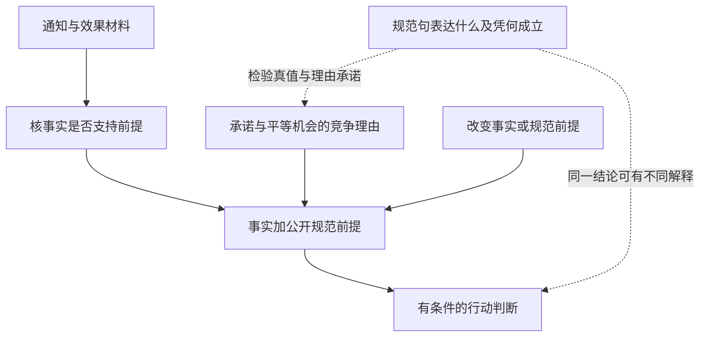

# 道德分歧、规范理由与元伦理：事实查清以后，还在争什么

> [!question] 读者问题
> 两人已经接受同一组效果、代价和程序事实，仍对一项规则是否正当有分歧。这是某个人没有看懂事实，还是有些争论必须转向原则？如果原则也说清了，“这项规则是错的”究竟在声称什么？

本单元接续[[哲学与文化/20-论证知识与规范/02-伦理与政治正当性#基础入口：先看少数人被要求做什么|阅读室的多数与公开书目规则]]。原课比较福利、人格与正当强制；这里追问**怎样辨认理由的层次，以及道德评价是否能为真、凭什么为真、怎样约束行动**。它们相互关联，但不是一个问题。没有读过原课也可从下节的完整材料进入；快进入口在“从一个句子拆出三个问题”，熟悉三层区别的读者可直接进入原典争论，最后完成同一迁移题。

本页围绕一个有限争点重建四条代表路线，不裁定整套伦理学。德性、关怀、契约论、完整分配正义、集体及代际责任仍需各自完整论证；不能由这一个元伦理单元宣称上述分支已经覆盖。

## 基础入口：同一阅读室，多加一项留位规则

以下是原创合成变体，不是调查或原典案例，也不改写原课尚未识别的书目公开效果。仍是100名成年会员管理的免费阅读室；某日只有20个座位，24人申请同一两小时时段。所有申请者的阅读需要相当，没有同等可及的替代场所。馆方此前依公开的预约办法抽出4人，明确答应为他们留位；他们合理相信承诺有效。其余20人后来提出申请。题目给定两个都能安排20人的方案，行政成本、阅读效果和其他后果相同：

- A：兑现4人的留位承诺，剩余16席在其余20人中抽签。
- B：撤销该批留位，全部24人一起抽20席。

材料没有指定任何现实法域，也没说早期预约制度整体正当；“承诺明确、信赖合理”是本题事实，“这个承诺应当压过重新分配的理由”还不是事实。题目固定效果，只为了让原则分歧显出来，不表示现实研究可以穷尽所有后果。

先听三段不同的争论：

**争论甲。** 甲说4人已收到确认，乙认为他们只收到申请回执。需要查通知版本、发送记录与当时说明。此时没有必要先判哪种伦理理论正确；两人对行动对象的理解还不同。

**争论乙。** 读过记录后，两人都接受上述完整事实。甲认为规则使人可以可靠安排生活，因此应兑现合理承诺；乙认为稀缺公共机会要让当下具有相同需要者平等竞争，因此应撤销留位。双方都知道会有4人受挫，也都承认其他20人的机会会改变。还需问承诺的取得方式、可预见性、信赖负担及何种例外可以取消；再次发送同一记录不能单独决定哪个原则优先。

**争论丙。** 甲说“即使全部会员赞成撤销，只要理由不够，它仍可能是错的”；乙说“我也反对随意毁约，但这表达我们支持的合作态度，不需要一个独立于态度的道德属性”。他们可能选同一个A，却对这项判断的含义与成立根据不同。行动一致不代表元伦理一致；行动不同也不证明双方采用不同元伦理。

## 从一个句子拆出三个问题

考虑“我们应当兑现这次留位”。把理由写成三步：

```text
F：馆方作出明确承诺，相关者合理信赖；兑现仍可行。
N：这样的承诺具有支持兑现的理由，除非存在足够强的相反理由。
C：本例存在支持兑现的理由；最终选择还要比较相反理由。
```

**事实理由**支持F：记录、证词和比较证据说明发生了什么、可能产生什么。**规范理由**支持N及优先关系：为什么某种利益、地位、承诺或负担应被考虑，为什么它在此处足以支持行动。规范理由不等于一个人实际行动的心理原因；“怕管理员”可解释行为，却尚未辩护规则。**元伦理承诺**追问F、N、C中规范用语的语义与地位：N是可真可假的断言吗？如果为真，凭自然事实、非自然的价值属性、某种态度或其他根据？何种意义上的理由能约束不赞成它的人？



图中的元伦理问题不是在行动结论之后再盖一个“已证真”章。它可以改变我们怎样理解整个论证。与此同时，研究道德真值也不能跳过实际承诺是否存在。

三个元伦理问题还要分开：**认知主义**认为道德判断至少主要具有表达信念、承载真假的功能；它不自动保证存在真的道德判断。**实在论**在这里指有道德事实，至少一些道德判断的真不由实际个人或群体赞同来决定；不同实在论对自然性、心灵依赖和理由要求仍会分歧。**自然主义**把相关道德事实理解为自然世界中的属性或关系，而非另设一种价值实体。自然主义不等于“自然发生的都应做”，也不等于从任意统计规律直接推出应然。下面的错误理论接受道德话语的真值企图，却否认它所要求的那类客观价值；情感意义路线则主要解释态度表达和引导。不能把“非实在论”一律改写成“每个人说的都对”。

这三层分析与[[社会科学/10-共同工具/01-事实模型与价值判断#事实与价值会相互影响，但不能混成一团|事实约束价值实现]]相接：查证可能改变选择。将F与N分开，是为了看清哪个理由被击中，不能据此宣布事实不重要。

## Moore：把“善”定义成另一件事，会不会漏掉问题

实际阅读 Moore《伦理学原理》（1903）第一章[§13，三个连续段落](https://fair-use.org/g-e-moore/principia-ethica/s.13)。他讨论的对象是“善”的定义，不是本例哪种分配最公平。以下为论证译述：

1. 如果“善”的意义可完整分析为某个复合概念P，理解该分析后，问“P本身是否善”应不再提出独立的伦理问题。
2. 可是，即使P取为“我们愿意愿意得到的东西”，人仍能理解并认真追问：这种愿望是否善？这不是再问有没有该愿望。
3. 因而这个分析没有给出“善”的完整意义；Moore据此支持善是简单、不可定义的概念。他也以我们确实能理解该问题反对“善完全没有意义”。

给每步一个承重位置：第1步把完整意义分析与问题能否保持开放相连，第2步依赖读者对问题的理解，第3步从这种区别支持其概念结论。Moore还明确区分：P与善也许总是同时成立，但这不等于两个概念是同一个。[同一§13第2—3段](https://fair-use.org/g-e-moore/principia-ethica/s.13)。

**用于阅读室的检验，属于本课构造。** 如果有人定义“正当就是多数喜欢”，我们仍可问：所有人喜欢毁约，它就正当吗？这至少要求他说明为何赞同具有规范根据，而非把结论藏进定义。这里从“善”借用辨析方法，不把Moore的结论直接移植成“正当”一词的已证定理。

**能改变推理的强反方。** 概念上可区分，不必推出对象在世界中永远不同。设有两个词，使用者凭不同线索识别对象，后来经研究发现它们指同一个东西；“两种描述指同一物吗”曾经开放，并不使身份结论不可能。若道德自然主义提出的是后验的属性识别，而非同义词替换，第1步的检验就没有独自驳倒它。这是本课对论证形式的反驳，不声称Moore在§13已经回应后来的所有自然主义。

Moore路线可回应：身份主张仍须说明为何相关自然事实承担善的功能，不能只说“以后可能发现相同”。因此开放问题可对草率定义施加解释压力；它既没有证明一切自然主义都假，也没有自动给我们认识非自然善的可靠方法。对本例，揭穿“喜欢＝正当”的快捷定义，还没有证明A或B。

## Mackie：句子想说客观的事，却可能系统地错

实际阅读 Mackie《伦理学：发明正确与错误》（1977）第一章的[17页删节PDF](https://static1.squarespace.com/static/592b5bbfd482e9898c67fd98/t/5d04218b546f150001b5b1e0/1560551819689/mackie.pdf)：§1—2及§7—10；此处依据§1—2、§7—9，文件在§2之后跳段，不能称为完整第一章。

他的**错误理论**把两项主张分开：日常道德判断企图声称某种客观、内在的规范性；世界却没有这种价值，所以这种客观规范性声称失败。它不是把道德句翻译成“我不喜欢”，也不是命令人人抛弃关切。§1—2区分一阶实践立场与二阶价值地位；§7要求给反常识的错误理论实质论据。

两条理由具有不同结构：[§8—9，PDF第8—12页](https://static1.squarespace.com/static/592b5bbfd482e9898c67fd98/t/5d04218b546f150001b5b1e0/1560551819689/mackie.pdf)。

- **相异论证**比较解释：长期道德差异若更易由生活方式塑造态度来解释，而非对共同客观价值的严重失真认知，就支持怀疑客观价值。承重前提是“哪种解释更好”，不是“存在分歧”。Mackie明确承认科学中的分歧不取消客观问题，也考虑了共同原则配不同环境产生不同规则的反方。
- **奇异性论证**问客观规范性需什么本体与认识方式：若价值本身带有不依愿望的行动要求，怎样认识这种特性，以及它与自然特征之间的关系？缺少可信解释会削弱这一设定。§9还讨论数学、因果等知识可能构成“同伴难题”的反驳；他承认这里没有完整完成所有相关知识的经验主义说明。它不只是一句“仪器测不到，所以没有”。

**本课用同一对象检验相异论证。** 社区甲长期允许可靠提前预约，社区乙只实行当天抽签，分别倾向A、B。两种生活方式可解释倾向，却还不能确定倾向是否追踪好的理由。支持共同原则的人可以说：两个社区都重视可预期、公平获取，只是预约条件和信赖程度不同。要让Mackie式解释占优，就需要说明在查清这些事实、利益和推理偏差以后，哪些分歧仍不能由共同根据更好解释。本题只有一个合成分歧，提供不了跨社会的经验比较。

**强反方及回应。** 出生环境能解释我相信某事，不足以证明某事假；同一社会训练也可教出正确判断。相异论证应被读为可争论的最佳解释推断。对奇异性论证，反方可拒绝“道德事实必须天然驱动所有理性者”的前提，或给出自然关系与学习机制；下一节就是这样一条路线。Mackie式回应则会追问：被保留的是原来那种客观权威，还是只剩满足愿望的条件建议？要反驳他，应回答这项追问，不能只把道德改名成自然事实。

即使接受错误理论，也不能由它推出“依各地习俗，相反规则都客观为真”，更不能推出法律无效或什么行动都可接受。上述是不同命题，需要额外论证。对于阅读室，仍可从实际关切、合作和受影响者的理由讨论规则；讨论者须说清自己保留了何种规范承诺。

## 自然主义的竞争路线：Railton保留什么，付出什么

Railton《道德实在论》（1986）[第一节，印刷页164—165；第三节173—175；第四节190—191；第五节201—203](https://r.jordan.im/download/philosophy/railton1986.pdf)给出实际竞争立场。其思路可重建为：

1. 一个人当下想要什么可能受无知影响。设想对本人和环境充分知情、有充分想象与工具理性能力的本人，再问他置身现实自我处境时愿让现实自我追求什么；这是辨认其利益的工具，相关自然事实才是根据，不是理想人的投票创造事实。
2. 再把所有潜在受影响者的这种利益平等计入，在充分、生动信息下建立社会评价标准；如果它能参与解释不满、调整与学习，就可支持自然的道德事实。个人利益与道德正确不能在这一步被合并。
3. 他允许道德义务适用于某人，而此人的特殊欲望不给他服从的工具性理由；故保留实在性，同时放弃所有理性者必有服从理由的要求。

**把争点搬回阅读室，是本课推演。** 相比统计当前24人赞成什么，这条路线要求考察可信安排生活、失去公共机会等利益与实际条件；它不直接把4人的偏好或多数票当规范真理。但从“对每个人什么有益”到“平等计入所有人”，仍有具体的道德标准与跨人比较负担。它不是用自然科学中立地证明任何权重。

这给Moore与Mackie两种不同回应：对前者，自然属性识别不必是善的同义定义；对后者，道德事实不必是自动推动意志的奇异实体。**代价也正落在理由上：** 一个只在乎自己获座的管理员，可能承认规则按该标准不正当，却毫无改规则的工具性动机。批评者可主张这遗漏道德理由的无条件约束力，或质疑理想化为何保持了这个人的利益。Railton路线的回应是把规范适用与个人动机分开；它承担“为何这个社会标准值得采用”的辩护，而不许愿证明人人必服从。

因此不能把该路线缩成“理想观察者喜欢就好”，也不能从A、B效果相同推导它必选B：承诺的信赖利益、机会分配与自然利益如何比较仍承重。原文提供的是理论与解释方案，本页没有估计24人的利益，也没有把社会学习可能性写成已发生的道德进步。

## 非认知路线：Stevenson为什么还需要事实理由

Stevenson《伦理词的情感意义》（1937）[第一、二节，印刷页16—19；第四、五节25—30](https://sites.ualberta.ca/~francisp/NewPhil448/StevensonEmotiveEthics1937.pdf)区分信念分歧和利益／态度分歧。简化成“我喜欢A，你喜欢B”只报告两人的心理，可以同时为真，反而没解释双方为何争执。其实际分析让道德话语兼有态度表达、影响对方的功能，也承认描述性成分。经验理由可改变人怎样看对象，因而改变态度；态度分歧没有全来自事实无知时，经验方法不能独自解决它。这是一个非认知方向的代表，不能用它概括所有后来的表达主义。

**本课构造的对话：** “兑现是对的”在此路线下不是只报“我赞成兑现”，还试图使共同合作采用这个方向；“撤销才对”提出竞争要求。若原来信赖4人会受很重损失，后来发现没人安排额外事情，经验理由可能削弱原先支持兑现的态度。事实即使不自动演绎出道德评价，也能实质改变争论。

**强反方：** 说服成功与理由正当不同。羞辱、谎言和宣传也能改变态度，如果这里只说明话语怎样影响人，就还没解释为什么某种影响值得接受。Stevenson第五、六节也保留“我们寻求真而不只是影响”的反对意见；他的路线继续质疑那种特殊真理的可理解根据。本课据此留下待解接口：态度路线要解释诚实、一致与可纠正的理由实践为何有约束，不能把善于煽动当伦理胜利。认知路线则须解释道德知识怎样可能、为什么它能够指导行动，不能只凭“我觉得是真”取胜。

回看四条路线，它们改变的是哪一步？

| 路线 | 核心解释压力 | 对本例不能直接代答的事 |
| --- | --- | --- |
| Moore的概念论证 | 自然／心理定义能否保留善的意义 | 开放问题不证明A正当，也未排除所有后验自然识别 |
| Mackie的错误理论 | 道德话语的客观规范性声称能否成立 | 一次分歧不证明价值不存在，更不证明法律无效 |
| Railton的自然实在论 | 自然利益、社会标准和学习能否承担真值 | 理想化不等于实际资料，义务适用不保证每人有动机 |
| Stevenson的情感意义 | 怎样说明态度冲突、引导功能与事实作用 | 态度被改变不等于理由已被辩护 |

## 完整示范：每次只改变一项，结论怎样移动

先给A最强的理由：明确且合理信赖的承诺使人可安排生活，在兑现仍可行、无足够严重反方时，支持兑现。给B最强的理由：同需要者对公共稀缺机会具有平等地位，馆方先前的安排不能无限让后来者承担负担，应按公开条件重开分配。前者不能只说“说过就永不能改”，后者不能只说“当下人数更多就压倒承诺”。

**固定事实，只改规范承诺。** 原先采用N甲：“合理留位承诺有优先理由，除非严重损害他人基本机会。”改为N乙：“每次公共分配都应让当下同需要者重新平等抽签，提前承诺只有可撤销地位。”在给定无其他后果差异的材料下，N甲较支持A，N乙较支持B。应辩护为何信赖或平等在此优先，并回应另一理由。这个变化发生在规范前提；没有任何事实记录被改动。两项原则是本课供比较的完整有限标准，不冒称已证明的普遍定律。

**固定N甲，只改一项事实。** 查到原通知明确写“仅收到申请，留位须在全体报名后抽签确认”，四人也读过它；题目相应取消“明确承诺与合理信赖”这一事实。F不再满足N甲的适用条件，原先用N甲支持A的这条理由消失。A仍可能有其他理由，不能从一条理由消失推出所有理由都不存在。此处下一步是查证和重新应用原则，不必先改元伦理立场。

**两个变化都不能裁定道德客观真值。** 它们说明特定行动论证怎样依赖前提。自然实在论者、错误理论者与情感路线支持者，都可能据上述变化调整实际选择；他们对这次调整的含义仍可不同。反过来，立场变化也不能让伪造通知变成真实通知。哲学分歧不取消材料约束。

## 撤去提示的迁移：另一项预约服务的退出条件

以下是全新合成材料，无现实法律效力或实际干预证据。一个免费的咨询预约服务有30个时段和36名需要相当的成人申请者。方案P要求所有人公开咨询原因，以便管理；方案Q只向有职责的工作人员提交最少必要信息。可靠比较显示两方案完成咨询人数、缺席率和行政成本相同。题目给定P会使6人因不愿暴露原因而退出；未测量其他满意度。管理员说：“大家有自由选择，不接受公开就失去预约资格；大多数人喜欢透明，所以公开一定正当。”另有人说：“既然你们争论，就没有任何真的道德判断，更无须理会规则。”

请独立给出一份可以向受影响者解释的决定，须写出其理由、对最有力异议的回应，以及哪种新材料会改变决定。再分别处理两个变体：仅将“退出即失去资格”改为“退出公开后仍能经等效私密渠道取得服务”；仅将原来效果相同改为“Q每月只能完成20次咨询，P仍完成30次”。用本课至少两条元伦理路线解释你决定中一项道德句的含义与根据，并指出现有材料不足以解决的争点。

> [!success]- 完整参考答案与评分：核推理，允许不同结论
> **对象与材料（2分）。** 比较的是有相同咨询目标、不同披露条件的规则。30/36及6人退出是合成给定事实；尚未知退出者能否获得别处服务、满意度差异和适用法律。“多数喜欢”纵使属实，也只是一项心理／程序事实。“等效私密渠道”在变体中是新增题设，不能偷偷搬回原题。各指出一项事实和决定性未知得1分；保持变体身份得1分。
>
> **可辩护决定（3分）。** 示例暂选Q：同等目标效果与成本下，避免非必要公开并保持实际机会具有支持理由；P的“可以拒绝”以失去服务为代价，不能单凭形式退出就证明负担可接受。强反方可说公共透明、防止私下优待或共同信任有额外价值；回应不能只重复“隐私”，应问能否用规则公开、匿名汇总与独立监督实现它，以及这种收益是否足以承担退出负担。选P仍可得分，但必须提出额外公共价值的可核前提与规范标准，承认目前未测量，回应6人退出并限制结论。明确事实与规范桥梁（1），处理强反方（1），指出改变决定的证据或原则反驳（1）；不能以多数票独自完成辩护。
>
> **两个单条件改变（3分）。** 私密渠道变体降低了披露的实质强迫与失去机会负担，但仍需解释选择压力和公开内容的二次使用；Q仍可被支持，也可考虑真正自愿公开，不自动认证同意或合法（1）。效果变体令Q少10次咨询，原来的同等效果前提消失；须重比较服务损失、披露损害、容量与更少侵入替代，不能机械坚持Q或直接改选P（1）。把每次变化明确归到原来某一承重前提，保留未决原则，得1分。事实变化与价值变化可相互影响，但不是同一修改。
>
> **两条元伦理解释（3分）。** 任选两条，各给真实区别得2分：Moore式检验质疑“大家喜欢”能否定义正当，不直接证明非自然属性；Mackie路线可否认这项句子所声称的客观规范性，却仍支持私密服务这项实践关切，不能从争论直接得出错误理论；Railton路线问受影响者在充分信息下的自然利益与社会评价，义务不以管理员愿意改为适用条件；Stevenson路线把“应该选Q”理解为带描述内容的态度表达与共同行动引导，事实可改变态度，心理报告不能完整替代它。另得1分须指出两条可能选择同一Q，却未解决真值、自然识别或无条件理由的争论，不把行动一致叫理论相同。
>
> **反驳越界（1分）。** 道德分歧本身既不证明无道德真值，也不撤销规则法律效力；法域、时点、主体与有效规则材料缺席，应转入法学方法另核。得1分。总分12，10分且没有“多数／分歧／有效所以必正当或必无法律效力”的跳跃，达到本题目标；合理的不同选择不扣分。评分是课程设计，未代表真人完成。

## 带着理由回到行动

返回[[哲学与文化/20-论证知识与规范/02-伦理与政治正当性#迁移题：一项效果确定的规则仍能被反对吗|原课工坊题]]时，保留原A/B效果资料，给自己的“应当选B”添一句准确说明：是在既定规范前提下推出的有条件选择；自己主张它怎样具有真值或约束力，以及哪项反方仍未解决。原来的福利与人格比较继续承担行动理由，本页不把它们重新抄成阵营标签。

返回[[计算机知识/75-软件工程与人机交互/05-职业伦理利益相关者与责任判断#比较两个可辩护选项|预约服务A/B方案]]，提交一条实际可检查的设计修订，例如“拒绝推广披露仍可预约，保留等效非数字入口”。同时说明它解决哪项实质退出或机会负担，什么证据会使你重审；原页的真实需求未知仍保留。法律问题沿原页的[[社会科学/63-法学/02-主体事实解释与证据程序#谁在请求什么，向谁请求|主体、请求与权限方法]]确定法域与依据，不能把元伦理怀疑当免除责任的许可证。

返回[[哲学与文化/20-论证知识与规范/06-自主性意义与真实机会#自主不是凡事独自组织，也不要求所有事情都有趣|自主与支持]]时，分别写“本人能认可行动”的心理概念、“机构应让拒绝者保留机会”的规范理由及其真值承诺；前者的测量不会自动证实后者。政策或AI应用已有事实、机制与行动接口，这次携带的是前提分类与理由辩护，不重复公平指标算例。返回[[哲学与文化/00-开始/00-哲学与文化-首页|哲学与文化首页]]选择下一问题。

## 原典怎样复核，以及本页证据边界

来源于2026-10-12实际核读：Moore为Fair Use Repository原作者文本转录，§13全文；未作首版影印校勘。Mackie为上述带删节的17页文本PDF，§1—2与§7—10；文末数字混有节选文档页和原版页码，不靠它们假定未取得段落已读。Stevenson为《Mind》46(181)，14—31页原论文扫描，本课定位第一、二、四、五及六节；Railton为《The Philosophical Review》95(2)，163—207页原论文扫描，本课核第一节坐标、第二节实践性区别、第三节利益与理想化、第四节社会标准及第五节理由限制的上述连续段。PDF文本抽取存在OCR与字符噪声，关键作者身份、节题和上述页段已据实际PDF文本定位；没有手稿、校勘版或所有后续理论的认证。

复核时各交一件产物：Moore写出第1步为什么承重；Mackie分别指出“更佳解释”和“客观规范性”的前提；Railton标出个人利益如何转到社会标准，并找出他放弃的要求；Stevenson说明心理报告为什么不够，以及事实怎样可能改变态度。再用这些原理由检查本页反方是否真的击中其前提。中文均为译述与教学重建，阅读室、预约材料、推演及评分为原创构造，未复制长引文。

本页没有运行真实政策、心理研究、法律审查、Obsidian显示或真人试读，也没有证明道德实在论或反实在论最终获胜。完成目标是能重建竞争理由、改变前提后限制结论并回到实际行动；实际学习效果另须观察。
