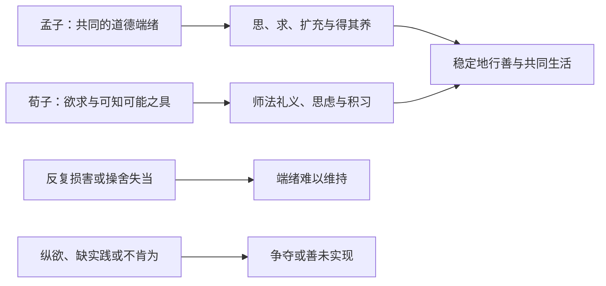

# 先秦人性与教化问题：善从哪里来，为什么还要学

> [!question] 读者问题
> 一个孩子看到别人受伤，会惊慌、心疼；轮到分食物，却又想独占。这说明人本来善、本来恶，还是两个标签都太快了？如果每个人都能成为好人，为什么反复讲道理仍会失败？

孟子与荀子的分歧不能只背成“一个乐观，一个悲观”。本课围绕同一个问题读完整论证：**人具有哪些不待学习的倾向和能力，这些能不能给出善的方向，教化究竟是养成已有端绪，还是通过学习与实践形成礼义？** 两方都肯定人的改变和教化；但他们怎样解释改变、怎样划分“性”与善，确有分歧。正文先解释文本，再重建理由，最后让两种解释面对同一陌生情境。

无需先学哲学史或逻辑符号。若已会区分原话、释义和省略前提，可直接从“孟子：有方向不等于已经完成”开始；仍须读荀子的回应、双方反读和迁移题。[[哲学与文化/20-论证知识与规范/01-论证知识与证据|论证、知识与证据]]提供检查理由的通用方法，本课把方法用于历史文本。

## 先确认读的是谁的话，为什么提出这个问题

《孟子·告子上》先让告子与孟子争论“性”的含义、仁义内外，随后由公都子列出无善无恶、可以善恶、有人善有人恶三种说法。这里的“性”不能未经论证换成遗传指标或现代人格量表，“善／恶”也不是量表高低分：两篇试图解释人为何可以行仁义，为何同样是人却表现悬殊。《荀子·性恶》直接批评“孟子曰人之性善”，追问若善本已有，为什么还要师法、礼义和制度。这里有文本中的明确对手；《性恶》中冠以“孟子曰”的文字，是该篇对对手立场的呈现，不能未经对读《孟子》就当作逐字引文。没有依据把两篇写成两人当场对话的记录。[《告子上》1–6](https://zh.wikisource.org/w/index.php?title=孟子/告子上&oldid=2637004)、[《性恶》“孟子曰人之性善”段](https://zh.wikisource.org/w/index.php?title=荀子_(四庫全書本)/卷17&oldid=622555)

必要背景只取到争论所需。汉代《史记·孟子荀卿列传》把孟子游说齐梁放在诸侯追求富国强兵、合纵连横的叙述中，把荀卿的著述联系到对乱政、巫祝与学说的批评。这是后出的史家叙述，支持理解“怎样使人和政治秩序变好”为何承重；它不证明每句人性论都由某场战争直接造成，也不提供两篇准确写作年份。下文以传世篇章为解释对象，不把全篇每段都认证为作者亲笔定稿。[《史记》卷74“孟子”“荀卿”](https://zh.wikisource.org/w/index.php?title=史記/卷074&oldid=7908177)

本课引用采用如下约定，读者可据此回到相同文本单位：

| 文本与版本入口 | 本课定位方法 | 使用边界 |
| --- | --- | --- |
| 《孟子》维基文库网络转录：《告子上》固定版本2637004；《公孙丑上》2636981 | 篇名及章号；6A.2表示《告子上》第2章，2A.6表示《公孙丑上》第6章 | 网页未明确对应某一影印底本，不将它命名为宋本或校勘本 |
| 朱熹《四书章句集注·孟子集注卷十一》网络转录，固定版本2610605 | “告子章句上”第2、6、7、8章正文及其相邻注语 | 用来对读传世正文和辨别后世注释；朱熹的“性即天理”等是其解释，不当作孟子原话 |
| 《荀子》（四库全书本）卷17，唐杨倞注《性恶篇第二十三》网络转录，固定版本622555 | 篇名加段首，如“不可学不可事而在人者”“涂之人可以为禹” | 原页连载正文与〈注〉；引文删去注语、加现代标点、转为简体。未核影印页、未做传本校勘 |

以下“原文”都是上述古典正文的引文；“译述”由本课用现代汉语说明；编号前提和图是**现代教学重建**，不是古人写过的形式系统。引文采用简体，保留“伪”等关键词；异体字“茍”“噐”“徧”“徴”“逺”分别按现代字形作“苟”“器”“遍”“征”“远”。荀子以段首定位，不杜撰通行统一段号。关于版本字节与意义的区别，可到[[计算机知识/60-数据编码与媒体系统/02-字符编码Unicode-UTF-8与换行#3. 正规化：看起来一样，不代表字节一样|字符正规化]]核对：繁简转换和加标点是编辑处理，不能因此推断译词或概念等价。

## 孟子：有方向不等于已经完成

### 水的争论：能被改变，与原来没有方向，是两回事

**原文，6A.2完整问答：**

> 告子曰：「性，犹湍水也。决诸东方则东流，决诸西方则西流。人性之无分于善不善也，犹水之无分于东西也。」
>
> 孟子曰：「水信无分于东西，无分于上下乎？人性之善也，犹水之就下也。人无有不善，水无有不下。今夫水：搏而跃之，可使过颡；激而行之，可使在山。是岂水之性哉？其势则然也。人之可使为不善，其性亦犹是也。」

出处为[《告子上》2](https://zh.wikisource.org/w/index.php?title=孟子/告子上&oldid=2637004#2)；并对读[《孟子集注》卷十一同章](https://zh.wikisource.org/w/index.php?title=四書章句集註/孟子集注卷十一&oldid=2610605)。独立转录的“决诸西方”，在集注转录写作“袂诸西方”；本课沿前者引文，不据这一网络字形差异建立解释。

**译述：** 告子从水可以被引向东西，推到人性没有固定善恶方向。孟子承认东西未定，却指出向下仍有方向；水可以受击而高过额头，也可以受激而到山上，但那是特定势力造成的状态。人可以被使得为不善，同样不自动推翻性善。

**教学重建M1：**（a）观察到的行为同时受倾向与处境作用；（b）若有一种方向，反方向行为可能来自改变作用条件；（c）所以“有人做恶”本身不足以推出“人没有向善方向”。水喻让这一区分可见，却没有单独证明人确有向善方向。否则把水换成向上生长的火，便能任意证明另一种人性。孟子的正面理由还需下一段。

### 从四种心到仁义：为什么不是外面灌入一套现成行为

**原文，6A.6完整问答：**

> 公都子曰：「告子曰：『性无善无不善也。』或曰：『性可以为善，可以为不善，是故文武兴则民好善，幽厉兴则民好暴。』或曰：『有性善，有性不善，是故以尧为君而有象，以瞽瞍为父而有舜，以纣为兄之子且以为君，而有微子启、王子比干。』今曰『性善』，然则彼皆非欤？」
>
> 孟子曰：「乃若其情则可以为善矣，乃所谓善也。若夫为不善，非才之罪也。恻隐之心，人皆有之；羞恶之心，人皆有之；恭敬之心，人皆有之；是非之心，人皆有之。恻隐之心，仁也；羞恶之心，义也；恭敬之心，礼也；是非之心，智也。仁义礼智，非由外铄我也，我固有之也，弗思耳矣。故曰：求则得之，舍则失之。或相倍蓰而无算者，不能尽其才者也。《诗》曰：『天生蒸民，有物有则。民之秉彝，好是懿德。』孔子曰：『为此诗者，其知道乎！故有物必有则，民之秉彝也，故好是懿德。』」

出处为[《告子上》6](https://zh.wikisource.org/w/index.php?title=孟子/告子上&oldid=2637004#6)。其中“情”在这里指人的实际情状或相应表现，“才”指可以发展的材质、能力；本课不以这两个译述裁定一切古义。6A.6的“恭敬”与2A.6的“辞让”也分别保留，不在引文中替换成同一个词。

**译述：** 公都子没有只举恶行，而是给出三种竞争解释及跨家庭、君主的例子，逼问孟子为何普遍说性善。孟子从人皆有的怜悯、羞耻厌恶、恭敬和是非判断回答，认为道德能力不是外在熔铸进来的；差异与不思、不求、未尽能力相连。末尾引《诗》和孔子是在当时论辩中支持人的共同规范方向；它不是现代抽样统计的又一份独立数据。

**教学重建M2：**（a）人共同具有能够响应他人受苦、可耻行为、尊敬和是非的心；（b）这些心与仁义礼智有内在连接，并非只有中性的学习能力；（c）通过思、求和持续实践，可以发展这些方向；（d）因此，性善可以支持“人的善有内在根基”，不必支持“每个人当下的每个行为都善”。承重争点在（a）的普遍性和（b）的连接：短暂心疼是否足以形成稳定公正？为什么羞恶指向正当对象，而非羞辱弱者？文本提出方向，我们仍可质疑其理由是否充足。

### 端绪为何还必须扩充

6A.6把四种心直接联系到四德；《公孙丑上》6进一步解释起点与完成的关系。**原文，2A.6完整章：**

> 孟子曰：「人皆有不忍人之心。先王有不忍人之心，斯有不忍人之政矣。以不忍人之心，行不忍人之政，治天下可运之掌上。所以谓人皆有不忍人之心者，今人乍见孺子将入于井，皆有怵惕恻隐之心；非所以内交于孺子之父母也，非所以要誉于乡党朋友也，非恶其声而然也。由是观之，无恻隐之心，非人也。无羞恶之心，非人也。无辞让之心，非人也。无是非之心，非人也。恻隐之心，仁之端也；羞恶之心，义之端也；辞让之心，礼之端也；是非之心，智之端也。人之有是四端也，犹其有四体也。有是四端而自谓不能者，自贼者也；谓其君不能者，贼其君者也。凡有四端于我者，知皆扩而充之矣，若火之始然，泉之始达。苟能充之，足以保四海；苟不充之，不足以事父母。」

出处为[《公孙丑上》6](https://zh.wikisource.org/w/index.php?title=孟子/公孫丑上&oldid=2636981#6)。本课“端绪”译述的是起点，未将它读成已经具备一切正确判断。孩子将落井的突然情境排除几种策略性动机，给“不忍人之心”一个可识别的理由；从这个理由推到所有人皆有四端，再到政治治理，是更强的论证步骤。读者可接受其中一步而仍追问后面的普遍化与扩充如何成立。

“苟能充之”与“苟不充之”让培养成为条件。**译述：** 从可见的萌芽发展到稳定德行，要把局部反应推广、持守并用于更多关系；不能把一次同情直接算作仁政。关于孟子怎样限制征服与君主资格，转到[[哲学与文化/10-主题/01-文化政治与组织结构/11-帝国兴亡叙事与君权约束#先做传统内部对照：谁能否定君主，谁能判断|孟子政治约束的具体文本]]，再返回这里问：有善的内在根基，是否已给普通人日常救济程序？答案仍是否定的，两种论证对象不同。

### 牛山反例：秃山能不能证明从未有树

**原文，6A.8完整章：**

> 孟子曰：「牛山之木尝美矣。以其郊于大国也，斧斤伐之，可以为美乎？是其日夜之所息，雨露之所润，非无萌蘗之生焉，牛羊又从而牧之，是以若彼濯濯也。人见其濯濯也，以为未尝有材焉，此岂山之性也哉？虽存乎人者，岂无仁义之心哉？其所以放其良心者，亦犹斧斤之于木也。旦旦而伐之，可以为美乎？其日夜之所息，平旦之气，其好恶与人相近也者几希，则其旦昼之所为，有梏亡之矣。梏之反覆，则其夜气不足以存。夜气不足以存，则其违禽兽不远矣。人见其禽兽也，而以为未尝有才焉者，是岂人之情也哉？故苟得其养，无物不长；苟失其养，无物不消。孔子曰：『操则存，舍则亡。出入无时，莫知其乡。』惟心之谓与？」

出处为[《告子上》8](https://zh.wikisource.org/w/index.php?title=孟子/告子上&oldid=2637004#8)。**译述：** 反复砍伐与放牧会消耗再生，观看者却把最后的秃貌当成原来就没有树。人与之类似：日常反复损害可以使良心难以维持；表现坏不等于从未有道德材质。这里“夜气”处在心与养的论证中，本课不把它当作已验证的睡眠神经机制。

邻近6A.7以丰年、凶年中子弟表现和麦的生长条件解释差异，再由感官共同好尚类推心共同悦理义。它给6A.8一项环境理由，同时暴露另一条需审的类比：口味、声音、美貌的共同好尚不能未经论证推出道德判断一致。现代重建M3的有限结论是：**解释恶行时应查持续损害、生活条件和人的实践；仅凭末端行为，不能倒推原始能力为零。** 这没有单独证明所有恶行都只能由外界造成；6A.6“不思”、6A.8“操舍”也留下主体的责任。[《告子上》7–8](https://zh.wikisource.org/w/index.php?title=孟子/告子上&oldid=2637004#7)

## 荀子：善的能力与现成礼义必须分开

### 从欲望到争夺，中间发生了什么

**原文，《性恶》开篇至“君子／小人”对照完整论证段（删杨倞夹注）：**

> 人之性恶，其善者伪也。今人之性，生而有好利焉，顺是，故争夺生而辞让亡焉；生而有疾恶焉，顺是，故残贼生而忠信亡焉；生而有耳目之欲，有好声色焉，顺是，故淫乱生而礼义文理亡焉。然则从人之性，顺人之情，必出于争夺，合于犯分乱理，而归于暴。故必将有师法之化，礼义之道，然后出于辞让，合于文理，而归于治。用此观之，然则人之性恶明矣，其善者伪也。
>
> 故构木必将待櫽栝烝矫然后直；钝金必将待砻厉然后利。今人之性恶，必将待师法然后正，得礼义然后治。今人无师法，则偏险而不正；无礼义，则悖乱而不治。古者圣王以人之性恶，以为偏险而不正，悖乱而不治，是以为之起礼义，制法度，以矫饰人之情性而正之，以扰化人之情性而道之也。使皆出于治，合于道者也。今之人，化师法，积文学，道礼义者为君子；纵性情，安恣睢，而违礼义者为小人。用此观之，然则人之性恶明矣，其善者伪也。

出处为[四库本卷17《性恶》开篇](https://zh.wikisource.org/w/index.php?title=荀子_(四庫全書本)/卷17&oldid=622555)。这里的“文学”是积累学习的文字与学问，不是现代学科“文学”；“师法”指教师、典范和学习所依据的规范，“礼义”也不只指待人礼貌。

**译述：** 荀子把好利、憎恶与感官欲望连到无约束顺从之后的争夺和秩序破坏，反向指出辞让、条理和治需要师法礼义。曲木与钝金不是对人的实验，而是用来表现形成规范能力所需的加工与训练。

**教学重建X1：**（a）人有未经学习即出现的欲求；（b）当欲求相互冲突，而人顺从、纵任它们时，会发生争夺；（c）礼义师法使欲求受规范组织，形成辞让及可共同生活的秩序；（d）依照这种“治／乱”评价，未受这种形成过程引导的性不能自给善的秩序，所以称性恶、善者伪。这里（b）把多人冲突的处境和“顺是”的条件写明；它是对段落的重建，不能把原文较强的“必”偷换成现代已经证实的概率定律。饥饿是欲求，不等于饥饿者已经犯了罪；但本篇确实对未经礼义引导的自然倾向作负面道德评价，不能用“欲望本身无罪”把性恶消解成没有立场的说法。

### “伪”不是撒谎：定义改变了争论对象

**原文，《性恶》紧接开篇，段首“孟子曰人之学者其性善”中的定义单元：**

> 凡性者，天之就也，不可学，不可事。礼义者，圣人之所生也，人之所学而能、所事而成者也。不可学、不可事而在人者，谓之性；可学而能、可事而成之在人者，谓之伪。是性伪之分也。

出处为[四库本卷17“凡性者”段](https://zh.wikisource.org/w/index.php?title=荀子_(四庫全書本)/卷17&oldid=622555)。“不可学不可事”在此划分不待学习、作为而已有的部分，不是宣判人完全不能学习。**译述：** 学而能、做而成的礼义属于人的有意作为与积累，称“伪”；这项技术用法不能直接换成真伪的“虚假”。人的自然能力是形成这些作为的条件，却不等于已经具有作为的成果。

同篇以饥而欲饱、劳而欲休，与对父兄辞让、替代劳作相对照，借此表明当下欲求和礼义行动可以发生张力。它用特定亲属等级说明善，不能直接等同于现代平等规范。与孟子的真分歧是：孟子从不忍、羞恶等看见道德内在方向；荀子在本篇的性伪区分中，把学而成的礼义排出性。两人都说“人有能力”，能力在论证中的角色却不同。

### 如果性恶，第一位造礼义的人从哪里来

**原文，《性恶》“问者曰人之性恶则礼义恶生”完整问答：**

> 问者曰：「人之性恶，则礼义恶生？」应之曰：「凡礼义者，是生于圣人之伪，非故生于人之性也。故陶人埏埴而为器，然则器生于工人之伪，非故生于人之性也。故工人斵木而成器，然则器生于工人之伪，非故生于人之性也。圣人积思虑，习伪故，以生礼义而起法度，然则礼义法度者，是生圣人之伪，非故生于人之性也。若夫目好色，耳好声，口好味，心好利，骨体肤理好愉佚，是皆生于人之情性者也；感而自然，不待事而后生之者也。夫感而不能然，必且待事而后然者，谓之生于伪。是性伪之所生，其不同之征也。故圣人化性而起伪，伪起于性而生礼义，礼义生而制法度。然则礼义法度者，是圣人之所生也。故圣人之所以同于众，其不异于众者，性也；所以异而过众者，伪也。」

出处为[四库本卷17“礼义恶生”问答](https://zh.wikisource.org/w/index.php?title=荀子_(四庫全書本)/卷17&oldid=622555)；“恶生”在这个问句中是问“从何产生”，不能译成“邪恶地产生”。此处“习伪故”的具体训释本课未裁定；译述仅取后文明确说出的积思虑、作为与形成关系。

**译述：** 荀子拒绝给圣人另配一套天生善性，改用陶工、木工说明成果来自积累的思虑与作为。自然能力使人能开展作为；礼义的形成仍属于作为，不由成果反推它原已完整存在于性中。

**教学重建X2：**（a）普通人与圣人有共同自然条件；（b）能思虑、能行动不等于已有礼义成品，如能加工不等于已经有器；（c）持续作为可以形成礼义及法度；（d）所以圣人的善不反证普通人的性天然已包含现成礼义。这回答“共性怎样容许差异”，仍留下一个强异议：**最初的作为为何选择仁义而不选择高效掠夺？** 器物类比可说明“生产者与产品不同”，不能单独证明产品的道德方向。本篇后文以“正理平治”为善、“偏险悖乱”为恶给评价尺度；是否充分、谁能判定礼义，仍需要继续辩护。[《性恶》“凡古今天下之所谓善者”段](https://zh.wikisource.org/w/index.php?title=荀子_(四庫全書本)/卷17&oldid=622555)

### 普通人可以成为禹，为什么不保证人人会成为禹

《性恶》“涂之人可以为禹”段不是天生精英论的附注，而是对共同能力的完整论证。**译述这一连续段：** 禹成为禹，关键在仁义法正；这些道理可以知、可以实行，而普通人也有可知之质、可能之具。若否认普通人具备这些条件，便无法解释他们能理解父子、君臣关系。持续学习、思索、积善，能改变人成就。但“有条件可以做到”不能直接变成“每个人事实上做成”。[四库本卷17“涂之人可以为禹”至“能不能之与可不可”](https://zh.wikisource.org/w/index.php?title=荀子_(四庫全書本)/卷17&oldid=622555)

**原文，该段的条件与紧接反问回答：**

> 今使涂之人伏术为学，专心一志，思索熟察，加日县久，积善而不息，则通于神明，参于天地矣。故圣人者，人之所积而致也。
>
> 曰：「圣可积而致，然而皆不可积，何也？」曰：「可以而不可使也。故小人可以为君子，而不肯为君子；君子可以为小人，而不肯为小人。小人君子者，未尝不可以相为也，然而不相为者，可以而不可使也。故涂之人可以为禹，则然；涂之人能为禹，未必然也。虽不能为禹，无害可以为禹。足可以遍行天下，然而未尝有能遍行天下者也。夫工匠农贾，未尝不可以相为事也，然则未尝能相为事也。用此观之，然则可以为未必能也；虽不能，无害可以为。然则能不能之与可不可，其不同远矣，其不可以相为明矣。」

引文“县久”保留原转录字；这里表示积累持续，不代填现代训练时长。“可以而不可使”接在肯不肯和实际能不能之后，本课译述为有能力不等于能保证使其实现；不从这一句推出普遍的现代反强制教育原则。X3的重建是：**共同能力＋持续合条件的学习实践，支持可达性；缺少实践或意愿，不能推出已达成。** 性恶并非“坏人永远不可教”，可教也并非“教师按按钮就必然教成”。

## 让双方解释同一件事，才能看见真实分歧

一个原创合成示例：共同生活的孩子都有饥饿感；一次有人跌倒，多人突然不安；数月后，得到稳定饮食、反复练习分配并讨论他人感受的孩子，更常主动分享。以下对照检验解释是否可用，不是古人见过的课堂，也不是已进行的研究。

| 要解释的同一观察 | 沿孟子选段重建 | 沿荀子选段重建 | 还不能推出什么 |
| --- | --- | --- | --- |
| 突然对受伤者不安 | 可作为恻隐端绪的表现；还须排除只是求誉等动机 | 能有相应反应，不等于已有稳定礼义；要查它如何被学习与实践组织 | 一次反应不足以证明所有人皆有四端，或证明所有善都来自训练 |
| 饥饿时争食 | 不善表现可由困境及失养解释，还需查主体如何思、求 | 顺欲且缺规范组织，冲突成为争夺，是本篇的核心解释 | 不能以争食给儿童终身贴恶人标签 |
| 后来主动分享 | 支持培养和扩充可使方向成为行动 | 支持师法与积习形成辞让行为 | 同一结果不能区分两种善的来源解释，也不能确认哪种教学最有效 |
| 教后仍有人不分享 | 检查是否真正扩充、是否反复被损害 | 检查实践、意愿与所学规范；可以不等于实际能 | 不能把每次失败都定义为“没真学”，使理论免疫所有反证 |

图中的箭头表示**本课重建的解释步骤**，不是实验测得的因果效应；两条路线在“需要培养”交会，却不共享前段的善之来源：

**孟子内部的反读。** 强读法依据6A.2“人无有不善”、6A.6“我固有之”，认为善是内在本性，恶是损失与逆势；较克制的教学读法依据“可以为善”、2A.6“端”“苟能充之”，把承诺收紧到共同道德方向及有条件发展。后者不等于告子的无方向能力，因为仍须保留四心与四德的连接；前者也不能删掉扩充和养。哪些词支持哪种力度，正是可以回原文争论的地方。朱熹在6A.6注中以“本体”和性理说明两篇“端／不言端”的区别，那是宋代的有名解释，不能静悄悄放进孟子原话。[《孟子集注》卷十一第6章注](https://zh.wikisource.org/w/index.php?title=四書章句集註/孟子集注卷十一&oldid=2610605)

**荀子内部的反读。** 只读“性恶”和曲木，会得到“人只能由外部压成善”的图像；同篇“伪起于性”和“皆有可以知……可以能……”却要求自然能力参与形成过程，不能把人当作无能动性的木料。反过来，强调共同能力也不能抹掉本篇对纵欲与礼义来源的实质判断。篇末“虽有性质美而心辩知，必将求贤师”进一步显示良好材质并不足以免除学习；它不把一切自然能力都叫作具体恶行。[《性恶》“涂之人”及“夫人虽有性质美而心辩知”段](https://zh.wikisource.org/w/index.php?title=荀子_(四庫全書本)/卷17&oldid=622555)

**双方交锋中的不对称。** 荀子反问：“今诚以人之性固正理平治邪，则有恶用圣王、恶用礼义矣哉？”若善指已完整实现的秩序，这一反问有力；但孟子说的是有端而须充，性善并不排除礼义学习。6A.20“大匠诲人，必以规矩”还给出教师与规范的原文证据。荀子的批评迫使孟子解释由端到德的机制；它若把端当成成品，便未击中所读孟子最强版本。孟子同样可追问荀子：可知可能之具与共同规范倾向，为什么只能把后者归到伪？这不是宣布胜负，而是把反驳所需前提展开。[《性恶》“今诚以人之性固正理平治”段](https://zh.wikisource.org/w/index.php?title=荀子_(四庫全書本)/卷17&oldid=622555)、[《告子上》20](https://zh.wikisource.org/w/index.php?title=孟子/告子上&oldid=2637004#20)

## 迁移任务：删去一句后，解释改变了吗

现在撤去上面的对照表。一个合成救援社团观察到：成员见到陌生人遇险，常会立刻担心；但领取有限补给时，多人想多拿。社团同时提供稳定补给、练习分配、讨论受助者感受。半年后争夺减少；同期也增加了处罚，且没有对照组。某成员仍经常多拿。这里只给这些材料，不额外假定心理实验或真实历史事实。

1. 分别用孟子和荀子选段重建解释，各写“前提→理由→有限结论”，各给一个会使自己的解释受挑战的观察。不要只把“不安”分给孟子、“多拿”分给荀子。
2. 一份摘要保留2A.6的“四端”，却删去“苟能充之……苟不充之……”；另一份保留《性恶》的“涂之人可以为禹”，却删去“能为禹，未必然也”。各指出摘要会诱发什么错误。删句后，搜索“四端”或“可以为禹”的命中数可以不变吗？
3. 社团负责人说：“荀子证明了严格处罚最有效；孟子证明了只要善待，人人半年都会改善。”分别指出原文和本题材料缺哪一步。你可以理解某理论而不赞同它吗？
4. 把题设只改一处：那位多拿者在无人看见时，反复冒风险帮助陌生人，并能说明理由。这能直接裁定性善或性恶吗？重写你对他的判断，并列出下一项有区分力的材料。

> [!success]- 可核答案：以限定词和理由评分
> **1（4分）** 孟子链可从突然不安作为恻隐的候选表现，经扩充、得养以及主体的思求，解释为何有内在方向仍会争夺；荀子链可从欲求与共同可学能力，经师法、思虑、积习形成规则行动，解释为何可改变而未保证每人实现。每条保留至少一个条件并收紧结论各1分。挑战孟子可以是：在充分说明动机和培养条件后，反应长期只随声誉利益改变，所谓非策略性的端绪仍无独立支持；挑战荀子可以是：有可靠成长过程材料显示，未受特定礼义训练者也稳定自发地按可辩护理由辞让。各指出该观察挑战哪条前提，而非宣布一次观察推翻整书，各1分。等价有条件反例可接受。
>
> **2（2分）** 删孟子限定易把道德起点读成无需扩充的成品；删荀子限定易把可达性读成每个人必然实现。各1分。关键字仍在，命中数可以不变；词频、字节处理成功不能保证论证结构被保留。
>
> **3（2分）** 荀子本篇确谈君上、法正、刑罚，但没有比较现代社团不同方案的净效果；本题同时改变补给、练习、讨论和处罚，不能识别单一原因，也不能证明“最有效”。孟子没有给半年时限、无条件保证，善待之外还有思、求、扩充。各1分。理解要求准确重建理由与反方；赞同还要求自己接受承重前提和理由，两者可分。
>
> **4（2分）** 新材料削弱“此人没有任何道德反应”或“所有助人都是求誉”的简单判断，但不能显示这些行为的形成过程，故不直接裁定两种来源理论（1分）。下一材料可查早期反应、实际学习经历、同类条件下动机及持续实践如何变化，并明确怎样区别“已有方向的扩充”和“学而成的具体礼义”（1分）。不得把无人看见等同于从未受过社会学习。
>
> 满分10分；8分且没有把自然能力等同现成德行、把可达性等同必然实现，表示这份作答达到本题目标。只评分实际提交的论证，不代填个人掌握度，也不以模型答案证明真人已经理解。

## 带着哪一个问题往返

- 到[[哲学与文化/20-论证知识与规范/01-论证知识与证据#基础入口：三份通知到底支持什么|论证与证据的合成案例]]，问同一观察支持几种解释，回来标出M2、X2仍需的前提。类比顺畅与前提可信是两件事。
- 到[[哲学与文化/20-论证知识与规范/02-伦理与政治正当性#从道德评价走向强制权力：还缺一层理由|正当强制还缺的理由]]，检查“人需要教化”能否推出“任何教化手段都正当”。本课的人性论不能代替具体负担、替代手段及异议资格的论证。
- 到[[哲学与文化/10-主题/01-文化政治与组织结构/11-帝国兴亡叙事与君权约束#一组有限接受史：Filmer与Locke如何使用共同的经典|有限接受史范例]]，学会分开文本命题、后人调用和制度后果，回来检查是否把两篇的可教化论证冒称真实教育效果。

本轮于2026-10-12实际读取《告子上》完整篇，重点引述2、6、8并解释7、20；《公孙丑上》第6章；《孟子集注》卷十一2、6、7、8章及相邻注语；四库本《荀子》卷17《性恶》完整正文与夹注，重点使用开篇、性伪定义、礼义来源、善恶标准、涂人可禹及篇末师友段；《史记》卷74两传段。使用的是可访问网络转录，未影印校勘，未追查两篇全部成书层次与异文。中国哲学史从先秦到近现代、其余先秦诸子及西方、马克思主义、印度、伊斯兰等传统仍需分别建立连续正文；本课不代表这些范围已完成。

下一阶段可继续问：朱熹怎样解释性、才与气质，又怎样改写孟荀争点？比较前须先读对应原典，不能用本页已指出的注语代替整个宋代理学。返回[[哲学与文化/00-开始/00-哲学与文化-首页|哲学与文化首页]]或[[哲学与文化/20-论证知识与规范/00-论证知识与规范-MOC|论证、知识与规范三问入口]]。
