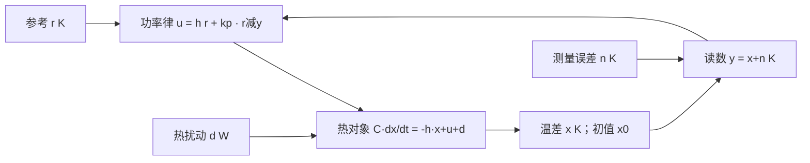

# 热模型：从物理约束到连续反馈

读者问题：加热器功率明明向上调了，为什么温度还会有误差？功率先进入能量守恒，再经过物体的热容量积累为温度；控制动作与输出没有瞬时相等关系。我们先写清一个物理小对象，再按照误差、速度和幅度要求选择增益。

## 先固定对象和每个端口

设物体内部温度均匀，环境温度固定20 °C，热容量C=10 J/K，向环境散热的系数h=1 W/K，加热器理想功率P∈[0,20] W。用线性散热近似，外部净热扰动d以W计，正值加热、负值冷却：

$$C\dot T=-h(T-T_{\mathrm{amb}})+P+d.$$

左边 J/K×K/s=W；右边每项也为W。此为假设模型，参数不是某个真实盒子的测量结果。均匀温度、固定环境、线性散热和即时功率需要在真实设备另外验证；空间温度梯度、辐射非线性、功率执行器动态没有藏进“控制器足够聪明”的前提里。

选无扰动工作点T₀=30 °C、P₀=10 W，它满足h(T₀−Tₐₘᵦ)=P₀。令x=T−T₀（温差K）、u=P−P₀（功率偏差W），于是

$$C\dot x=-hx+u+d,\qquad y=x+n.$$

温差的1 K与1 °C数值相同；绝对温度仍不能任意混用。允许u∈[−10,10] W，负u意味着少加热，实际P仍不小于零。参考r的单位K，本例r=2 K代表目标32 °C；测量误差n单位K，可表示噪声或常值偏置，其概率模型尚未规定。初值x(0)=0 K，功率对环境之外的热输入单独承担d。

箭头表示信号依赖，u、d注入热对象，n只注入读数。控制器看见y，不能从一条箭头假设它已知道d或n。

## 状态、传函和初值分别承担什么

状态方程是一维：A=−h/C=−0.1 s⁻¹，B=1/C=0.1 K/(W·s)，测量矩阵Hₘ=1，直通项为0。这里C已用作热容量，故不用同一个字母再表示测量矩阵。x∈ℝ、u∈ℝ、y∈ℝ；本节的状态模型先取已知d=0、n=0。

对局部可积功率，直接积分得

$$x(t)=e^{-ht/C}x_0+\frac1C\int_0^t e^{-h(t-\tau)/C}[u(\tau)+d(\tau)]\,d\tau.$$

零初值功率到温差的传函为G(s)=1/(Cs+h)，单位K/W；s单位s⁻¹。有初值时单边Laplace还有Cx₀/(Cs+h)，并须满足输入的变换存在条件。去 [[数学/46-数理方程/01-一阶常微分方程与初值问题#一阶线性方程的积分因子|积分因子]] 可自己得到这一步；去 [[信号与系统/40-状态控制与辨识/01-状态实现可控可观与最小性#完整状态解不能丢初值项|一般状态解与ROC]] 核对变换条件，回来保留初温项。

本模型n=1状态，rank[B]=1，rank[Hₘ]=1，因此在**已知模型/输入、无测量噪声、无动作幅度约束**的线性定义下可控可观。可控允许任意正时间内使用足够大的输入，并不保证实际功率0–20 W能达到任意温度。可观不表示未知偏置或未知热扰动已辨别清楚。一般rank/Gramian证明沿用 [[信号与系统/40-状态控制与辨识/01-状态实现可控可观与最小性#可控、可观的精确数学条件|状态结构主解释]]。

若B=0，无法改变温度动态，不过A<0时齐次状态仍稳定，故它是“不可控但可稳定”的例子；若Hₘ=0，这个已稳定的模态不可观却可检测。“可稳定/可检测”只要求不稳定模态可以控制/检测，不能据此承诺未知扰动下的精确跟踪。为所有极点指定任意位置需要更强条件；带状态/目标条件去 [[AI/45-机器人与具身智能/10-LQR与约束控制/02-无限时域稳定化解残差与极点#哪些条件挑出稳定化解|可稳定与可检测]]，回来区分连续左半平面与离散单位圆。

## 从前馈瓶颈走到比例反馈

已知模型且无扰动时，平衡功率偏差u=hr=2 W可让温度最终达到r。但初温到目标的时间常数仍为C/h=10 s；d=−2 W时实际净偏差功率为0，温度停在x=0。这是按名义平衡计算前馈的瓶颈：它不根据实际偏差修正未知冷却。

加上比例反馈，保持同一个平衡前馈：

$$u=hr+k_p(r-y),\qquad k_p\text{ 单位 W/K}.$$

当r为常数、无饱和且n=0，令q=x−r，则

$$C\dot q=-(h+k_p)q+d.$$

对齐次误差，q(t)=q(0)e^{-(h+k_p)t/C}，**h+kₚ>0**才渐近稳定；kₚ≥0在这个即时一阶模型下满足条件。常值d给平衡误差q∞=d/(h+kₚ)。名义时间常数τcl=C/(h+kₚ)，不是简单凭“负号”推出来的结论。

现在设设计要求：对常值|d|≤2 W，稳态温差误差≤0.5 K；名义时间常数≤2.5 s；从x₀=0到r=2 K的名义功率始终允许。前两项要求h+kₚ≥4 W/K，即kₚ≥3 W/K。名义响应单调到r，最大u是起始值(h+kₚ)r，因此(h+kₚ)×2≤10，要求kₚ≤4 W/K。选kₚ=3可同时满足这组条件。

此时τcl=2.5 s，连续齐次极点−0.4 s⁻¹；名义u(0)=8 W，即实际P(0)=18 W。连续响应

$$x(t)=2(1-e^{-0.4t})\ \mathrm K$$

在1 s为0.659360 K。初始变化率为8/10=0.8 K/s。d=−2 W时

$$x(t)=1.5(1-e^{-0.4t})\ \mathrm K,$$

稳态u=3.5 W、实际P=13.5 W，额外功率补了一部分冷却，仍留0.5 K温差误差。上面的幅度证明只针对指定名义初值/阶跃；不同初值、噪声、时变参考或扰动不能凭它认证全域约束。

## 改进代价：快、抗扰与测量误差相连

上述设计把低频扰动影响从1/h减到1/(h+kₚ)，响应也加快；代价是更大的初始功率、更高的噪声动作以及对采样/延迟的更严格要求。固定r、零初值的小信号传函为

$$\frac{X(s)}{D(s)}=\frac1{Cs+h+k_p},\qquad
\frac{X(s)}{N(s)}=-\frac{k_p}{Cs+h+k_p}.$$

温度的热容量衰减高频测量误差引起的温度变化，却不能阻止执行器命令直接抖动：

$$\frac{U(s)}{N(s)}=-k_p\frac{Cs+h}{Cs+h+k_p}.$$

高频幅值趋向kₚ，单位W/K。名义参考到输出为(h+kₚ)/(Cs+h+kₚ)，−3 dB角频率为(h+kₚ)/C=0.4 rad/s；这只是无延迟一阶模型的带宽，不是设备允许的闭环速度。未声明噪声谱时不能由这些传函计算实际方差，也不能声称Gaussian最优。

常值偏置n=b时，稳态真实温差

$$x_\infty=r+\frac{d-k_pb}{h+k_p}.$$

d=0、b=0.5 K时x∞=1.625 K，显示越接近目标不保证真实温度越准。

## 只看到读数时，估计器也有条件

本例Hₘ=1且读数无误差时已经直接得到状态，不需为了形式完整强加估计器。若要研究估计误差，可用名义连续观测器

$$\dot{\hat x}=-(h/C)\hat x+u/C+\ell(y-\hat x),\quad \ell=0.2\ \mathrm{s^{-1}}.$$

令ε=x−x̂，则ε̇=−0.3ε+d/C−ℓn。d=n=0时估计极点为−0.3 s⁻¹。再将反馈中的y换为x̂，在常参考附近的(q,ε)增广齐次矩阵是

$$\begin{bmatrix}-0.4&0.3\\0&-0.3\end{bmatrix}\ \mathrm{s^{-1}}.$$

三角结构给控制与估计两组稳定极点；未知常值扰动仍持续驱动估计误差，不能把齐次稳定当无偏估计。到 [[AI/45-机器人与具身智能/20-状态估计与LQG/03-LQG分离原理与闭环极点#最优分离与稳定分离不要混淆|分离的两种责任]]，回来检查噪声、时序与统计最优性条件。本页ℓ由误差极点选定，没有声称是Kalman增益。

## 换条件，自行重新设计

保持C=10、h=1、r=2及u∈[−10,10]，把扰动界改为|d|≤3 W，要求误差仍≤0.5 K。原设计能满足吗？是否有kₚ同时满足同一名义幅度要求？

> [!question]- 答案
> 抗扰要求h+kₚ≥6，即kₚ≥5；名义初始功率要求kₚ≤4，因此该类“hr+比例”控制器无法同时满足这两项要求。不能只调大增益再剪裁、却沿用未饱和推导。可放宽指标、重设参考过程、增加动作能力或改变控制器；下一课研究积分怎样改变稳态误差与动态条件。

模型、前馈/反馈的一般设计参照 [Feedback Principles](https://fbswiki.org/wiki/index.php/Feedback_Principles)；状态反馈与积分的架构参照 [State Feedback](https://fbswiki.org/wiki/index.php/State_Feedback)，观测器架构参照 [Output Feedback](https://fbswiki.org/wiki/index.php/Output_Feedback)。这里的热模型、单位、参数和算例为独立教学推导；作者站的章节介绍只支持方法定位。下一课 [[控制论/10-系统课程/03-采样保持积分调节与实现边界|从连续律到实际一拍程序]]；返回 [[控制论/00-控制论-MOC|课程入口]]。
