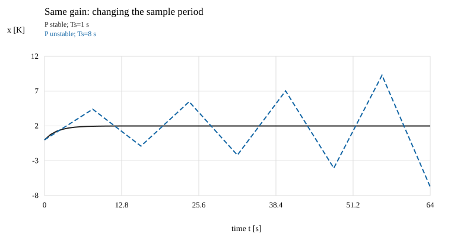
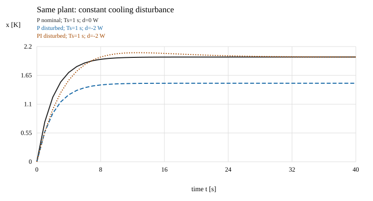

# 采样保持、积分调节与实现边界

读者问题：连续纸面设计已稳定，为什么程序跑起来还能振荡？纸面u(t)随温度连续改变，数字控制器只在某些时刻看到温度，随后保留一个功率。把输入保持和更新时间写进模型，才能知道实施的究竟是哪一个闭环。

## 先规定测量、计算、保持和更新

沿用C=10 J/K、h=1 W/K、kₚ=3 W/K、r=2 K，x₀=0。Ts为采样周期，k为整数样本索引，xₖ=x(kTs)。本节理想顺序为：

1. 在kTs读取yₖ=xₖ+nₖ；
2. 用该读数与旧控制器状态计算uₖ；
3. 在[kTs,(k+1)Ts)保持这个新uₖ；
4. 同一更新步记录下一控制器状态，下一拍才能使用它；对象则在保持区间内连续演化，到(k+1)Ts才得到下一次测量。

这里假设计算/更新即时，采样无抖动。Ts不是可随意填进公式的“程序大约循环周期”；实际设备若有计算耗时、执行器滞后或丢更新，必须写新时间模型。电路的旧命令/寄存时序另见 [[电子电路/44-嵌入式采集与控制/06-带延迟执行器的采样控制#先写原ODE，再规定保持与索引|一拍延迟合同]]。

## 保持积分得到对象的精确离散模型

在kTs读取yₖ并计算uₖ以后，控制器已经选定本拍功率；此后即使温度改变，也要等到下一拍才重新计算功率。将前课的初值解改写在当前区间，用τ表示从kTs起经过的秒数：

$$x(kT_s+\tau)=e^{-h\tau/C}x_k+\frac1C\int_0^\tau e^{-h(\tau-v)/C}[u_k+d(kT_s+v)]\,dv,\quad 0\le\tau\le T_s.$$

假设本区间内d=dₖ也恒定，把uₖ+dₖ移到积分号外。在τ=Ts时，核的积分为

$$\frac1C\int_0^{T_s}e^{-h(T_s-v)/C}\,dv=\frac{1-e^{-hT_s/C}}h.$$

它把保持的净功率W变成下一拍新增温差K，得到：

$$x_{k+1}=a x_k+b(u_k+d_k),\qquad
a=e^{-hT_s/C},\quad b=\frac{1-a}{h}.$$

a无量纲，b单位K/W；这是**给定保持输入假设下的对象精确离散**。若d在区间内变化，它应留在带核的积分中，不能把任意一个瞬时值dₖ称作精确代表。控制器的离散递推还要另外定义，精确对象不等于精确连续控制器。

比例律uₖ=hr+kₚ(r−yₖ)，令qₖ=xₖ−r。在常参考、无饱和时

$$q_{k+1}=f q_k+b(d_k-k_p n_k),\qquad f=a-bk_p.$$

零扰动与测量误差下qₖ=fᵏq₀；所以该标量数字闭环渐近稳定当且仅当|f|<1。这是所有k的证明，有限曲线只展示它的结果。

Ts=1 s时a=0.904837418、b=0.095162582 K/W、f=0.619349672。手算第一步u₀=2+3×2=8 W，x₁=b×8=0.761300656 K；第二步u₁=8−3x₁≈5.716098033 W，x₂=a x₁+b u₁=1.232811967 K。两步均使用刚测到的温差。

为什么第一步高于连续反馈的0.659360 K？数字实现整整1 s保持8 W，连续反馈在温度升高时已减小功率。**先闭环再离散**给e⁻⁰·⁴ᵀˢ；**先保持对象再加样本反馈**给a−bkₚ，它们描述不同控制动作，不能互换。去 [[电子电路/10-电路基础/04-同一RC从物理到离散实现#数值层：保持输入后再谈精确离散|保持的精确积分]] 回补原理，回来指出本控制器的输入区间。

## 同样的负反馈，换采样周期就失稳

写α=kₚ/h>0，则f=(1+α)e⁻ʰᵀˢ/ᶜ−α。对Ts>0，f<1自动成立；若α≤1，下界f>−1对所有有限Ts也成立。若α>1，则须

$$T_s<\frac C h\log\frac{\alpha+1}{\alpha-1}.$$

本例α=3，界限为10 log 2=6.931472 s。Ts=5 s时f=−0.573877，仍收敛但会越过平衡两侧；Ts=8 s时f=−1.202684，误差正负交替并放大。等号处f=−1，一般误差维持两拍振荡，不能称渐近稳定。

图横轴t单位s、纵轴x单位K，C=10、h=1、kₚ=3、r=2、x₀=0、d=n=0；虚线为8 s采样，实线为1 s采样。折线连接的是采样值，区间内真实温度仍按保持ODE指数变化。本图为**未限幅线性模型**，失稳曲线后段的功率会超出已声明动作范围，用于暴露线性保证失效；真实设备饱和后须用新的非线性闭环分析。

若加入恰好一拍命令延迟，且r恒定、d=n=0，记上一拍误差qₖ₋₁，实际功率为hr−kₚqₖ₋₁，则

$$\begin{bmatrix}q_{k+1}\\q_k\end{bmatrix}
=\begin{bmatrix}a&-bk_p\\1&0\end{bmatrix}
\begin{bmatrix}q_k\\q_{k-1}\end{bmatrix}.$$

特征多项式λ²−aλ+bkₚ。本例Ts=5 s时复根模√(bkₚ)=1.086466>1，而同周期无延迟比例闭环稳定。Ts=1 s的两根约0.452419±0.284262i、模0.534311；这是该齐次延迟模型的检查，尚未规定真实命令初态。更复杂执行器和全部状态的完整例沿用 [[电子电路/44-嵌入式采集与控制/06-带延迟执行器的采样控制#手算一步与稳定反例|执行器延迟反例]]，回来保持热模型的时间常数与功率单位，不照搬RC数值。

## 恒定扰动为什么需要额外记忆

比例只根据当前误差补功率。若稳态误差为零，它的修正也为零，因此无法维持未知常值冷却所需的额外功率。积分增加“过去累计误差”的状态z：

$$\dot z=r-y,\qquad u=hr+k_p(r-y)+k_i z,$$

z单位K·s，kᵢ单位W/(K·s)，本例kᵢ=0.4 W/(K·s)。先看无饱和、n=0、r和d恒定的连续模型。平衡须x*=r、z*=−d/kᵢ，功率u*=hr−d。令q=x−r、ζ=z−z*，则

$$\begin{bmatrix}\dot q\\\dot\zeta\end{bmatrix}
=\begin{bmatrix}-(h+k_p)/C&k_i/C\\-1&0\end{bmatrix}
\begin{bmatrix}q\\\zeta\end{bmatrix}.$$

各矩阵块带不同单位，kᵢ/C单位s⁻²、第二行−1把K变为K·s的每秒变化。特征多项式s²+0.4s+0.04=(s+0.2)²，两个根均在左半平面，矩阵指数虽可能带t因子仍趋零。于是本连续线性模型收敛到零稳态温差误差。

对d=−2 W、x₀=z₀=0，x*=2 K、z*=5 K·s，直接解得

$$x(t)=2\ \mathrm K+\left[-2\ \mathrm K+(0.2\ \mathrm{K/s})t\right]e^{-(0.2\ \mathrm{s^{-1}})t},$$
$$z(t)=5\ \mathrm{K\cdot s}+\left[-5\ \mathrm{K\cdot s}+(1\ \mathrm K)t\right]e^{-(0.2\ \mathrm{s^{-1}})t},$$

t以秒计，指数无量纲，两个括号分别保持K与K·s。初始ẋ=0.6 K/s，响应在10 s穿过目标、15 s达到约2.049787 K，随后回到2。积分改善稳态误差，同时改变瞬态与控制器状态；不能用“多加积分总更稳”替代根检查。

## 数字积分用旧状态，另外证明稳定

本实验按当前zₖ计算uₖ，然后更新zₖ₊₁=zₖ+Ts(r−yₖ)，并保持uₖ。即使在同一程序循环中先写出了zₖ₊₁，也不能将它提前代回本拍功率而仍使用下面矩阵。

对无噪声、常r/d、无饱和的误差，数字增广矩阵为

$$F_I=\begin{bmatrix}f&bk_i\\-T_s&1\end{bmatrix}.$$

这是对象精确保持加上矩形积分的**数字PI设计**，不是整个连续PI闭环的矩阵指数。特征多项式λ²−(1+f)λ+f+bkᵢTs。对实二阶多项式λ²−tλ+δ，单位圆内根条件为1−t+δ>0、1+t+δ>0、1−δ>0；可由双线性变换λ=(1+s)/(1−s)将单位圆映到左半平面，再检查二阶实多项式的系数得到。代入本矩阵成为

$$bk_iT_s>0,\quad 2+2f+bk_iT_s>0,\quad 1-f-bk_iT_s>0.$$

Ts=1 s时，三项约0.0380650、3.2767644、0.3425853，均正；极点0.809675±0.042911i、模0.810811。所以该数字齐次闭环渐近稳定，同样的恒定扰动平衡x*=r、z*=−d/kᵢ成立。有限60 s CPU轨迹x≈2.000006 K只与证明相符，不替代全时结论。

图中所有案例Ts=1 s、C=10、h=1、kₚ=3、r=2、x₀=z₀=0，点线PI另取kᵢ=0.4；实线比例d=0，虚线比例与点线PI均d=−2 W。横轴s、纵轴K；均取n=0、无限幅理想律。曲线显示比例残差与PI恢复，配合矩阵和动作范围判断，不能凭曲线相近省略条件。

## 积分抵抗哪种误差，哪些条件会破坏它

这里积分状态包含常值信号的记忆。它消掉未知常值热扰动的温差误差，须同时满足闭环稳定、参考/扰动常值、模型与时序一致以及平衡功率可实现。它没有证明时变扰动误差为零；斜坡参考需要另检查内部模型与输入范围。到 [[控制论/10-系统课程/20-稳态MIMO调节与积分内模#积分增加了记忆，也增加了原点模态|常值MIMO积分增广]] 检查一般稳态方程与原点秩；更广外系统、数字及约束调节仍由完整C01继续承担。

读数到了目标，不等于传感器顺便通过了体检。若n=b=0.5 K为恒定传感偏置，稳定PI平衡只能保证r−y=0，所以**真实x*=r−b=1.5 K**。d=−2 W时u*=h×1.5−d=3.5 W，与读数“达到目标”一致而与真实32 °C目标不同。增加积分无法辨别传感器高报还是对象真实偏冷；需要独立校准/信息模型。

若目标改成r=12 K、d=n=0，平衡需要u*=12 W，超过u≤10 W。实际最大P=20 W只能平衡在x=10 K；矩形积分仍累计至少约2 K的误差，z持续增大。这是windup。实际150 s复算x≈9.999997 K、z≈405.083 K·s；不能由限幅后的曲线有界就认证原线性PI的目标实现。去 [[AI/45-机器人与具身智能/03-配置空间轨迹与反馈控制#用估计误差形成PID动作|条件积分anti-windup]]，带回饱和方向/误差方向与旧状态时序；回来先检查目标可达，再选择恢复策略。anti-windup不能把12 W的必要平衡功率变成10 W以内。

## 从保持模型返回语言中的时间与状态

现在已能手算一拍、检查采样周期与延迟，并区分旧积分状态和下一状态。下面的项目用于核对记录身份、时间单位和状态传递；读完后回到本页“先规定测量、计算、保持和更新”，把程序各步对应到同一时序。顺序读控制课程时，可先做后面的撤提示题再进入04。

Rust 的迁移返回题见 [[计算机知识/10-编程语言/04-Rust/10-系统课程/12-Cargo组件工程与测量任务流#失败之后返回哪一层：内存、任务、恢复与控制|测量任务的时间与状态合同]]：SampleIndex 在首次构造时按位置编号，分块保留原序号；例中序号乘1 s只是声明的相对时刻，不是设备采样时间戳。两个批沿用同一个 Fir2 保存前值，也不决定本节何时读yₖ、使用旧控制器状态计算uₖ、保持输入或更新积分器。返回这里逐项标出测量、计算、保持和更新的先后，并说明缺样后重新编号为何改变时间对象；move、FIFO和await保证各自的对象/执行合同，不能据此断言闭环稳定、真实采样或deadline已验。

C/Python的返程题分别见[[计算机知识/10-编程语言/03-C语言/10-系统课程/12-测量流工具的完整工程#位置时间返回控制动作|C位置与声明Δt]]、[[计算机知识/10-编程语言/01-Python/10-系统课程/15-同码迁移中的身份单位与恢复边界#显式时刻返回控制与物理观测|Python身份与tick_ms]]：C的i×interval_s只给声明的相对秒，Python的tick_ms/1000转换秒但按ID排序不保证真实时间顺序。缺样后重新编号或把0.5 ms写成0.5 s都会改时间对象。返回本节先规定每拍读数、旧状态计算、保持区间和下一状态更新；热温差K与功率W不能直接接mV统计，须给传感器V/K和执行器W/V映射。[[计算机知识/10-编程语言/02-C++/10-系统课程/15-同码记录的类型资源与统计语义#三种物理观测怎样实际进入公开API|有限离线消费者]]使用1 V/K的明示模拟读出核当前热轨迹，只有分析调用，没有改变本节闭环或认证真实采样/期限。

## 撤提示迁移与返回

C=20 J/K、h=2 W/K、kₚ=6 W/K、Ts=5 s，无延迟、无饱和。检查数字比例稳定性；若加入一拍延迟，结论是否变化？说明单位变化中哪些比值不变。再说明持续传感偏置会怎样改变积分的真实稳态目标。

> [!question]- 答案
> h/C=0.1 s⁻¹、kₚ/h=3仍相同；a=e⁻⁰·⁵，b=(1−a)/2 K/W，bkₚ=3(1−a)，故无延迟f=−0.573877仍稳定。一拍延迟特征根积bkₚ=1.180408，复根模1.086466，失稳。积分稳定且可实现时只保证y=r，若y=x+bias，真实x=r−bias。这里改变的是物理单位系数，不能把b仍写成0.393469 K/W。

到这里可以停下：你应能说明第一拍为何保持8 W、为什么Ts=8 s使该线性比例律失稳，以及积分为何不能消除传感偏置或实现超出功率范围的目标。自己复算 [[控制论/80-实践/01-热调节/README|源码与解析对照]]。

顺序学习下一课 [[控制论/10-系统课程/04-耦合热对象状态与端口能力|耦合热对象：状态与端口能力]]：本页的第二个状态z是控制器的累计误差；04新增的是第二个物体的温度x₂，具有自己的热容量并与x₁交换热量。原来一个温度读数已直接给出对象状态，现在只有一个读数、一个可调功率，能否恢复和影响两个温度？即使某一时刻能到达，是否能长期保持两项目标？带着这两个问题进入04的能量平衡与端口检查。

带明确目标和温度/功率尺度去 [[AI/45-机器人与具身智能/10-LQR与约束控制/01-从Bellman配方到Riccati递推|LQR]]，回来解释极点配置与最优权重选择的不同责任；带测量/动作时点去 [[AI/45-机器人与具身智能/20-状态估计与LQG/03-LQG分离原理与闭环极点|LQG]]，回来说明未知偏置、饱和和时延为何改变其假设。返回 [[控制论/00-控制论-MOC|课程入口]]。
