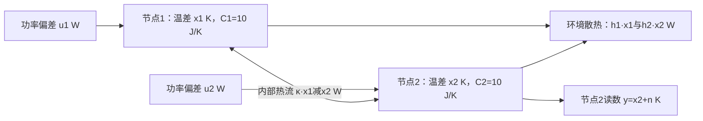

# 耦合热对象：状态与端口能力

读者问题：只有一个加热器、一个温度读数，能控制或估计两个物体吗？不能按执行器/传感器数量直接数状态。耦合会把一个位置的行动和记忆传到另一个位置，但传得慢、耦合退化和长期目标约束分别带来不同问题。

## 先从两个能量平衡式建立同一模型

沿用前课的环境20 °C、各自工作点30 °C、基准功率各10 W。现在有两个内部温度均匀的物体，各C₁=C₂=10 J/K，各对环境散热h₁=h₂=1 W/K，两者间导热系数κ=1 W/K。温差x₁、x₂以K计，功率偏差u₁、u₂及净热扰动d₁、d₂以W计：

$$C_1\dot x_1=-(h_1+\kappa)x_1+\kappa x_2+u_1+d_1,$$
$$C_2\dot x_2=\kappa x_1-(h_2+\kappa)x_2+u_2+d_2.$$

κ(x₁−x₂)表示从较热节点流向较冷节点的功率；两式相加时内部导热项抵消。每式左边为W，模型假设仍是集中参数、线性散热、固定环境和理想即时功率。真实装置参数/量程不由本例认证。

本段先把u₂固定为0：第二个加热器维持基准10 W，只有第一个允许改变偏差u=u₁∈[−10,10] W；先取d₁=d₂=n=0，以检查已知模型的能力。状态x=(x₁,x₂)ᵀ∈ℝ²，输入u∈ℝ，输出y∈ℝ：

$$\dot x=Ax+Bu,\quad y=Hx,$$
$$A=\begin{bmatrix}-0.2&0.1\\0.1&-0.2\end{bmatrix}\ \mathrm{s^{-1}},\quad
B=\begin{bmatrix}0.1\\0\end{bmatrix}\ \mathrm{K/(W\cdot s)},\quad H=[0\quad1].$$

H为1×2的无量纲测量矩阵。这里用H以免与物理热容量C混名；直通D=0，温度不会随功率瞬时跳变。两节点同单位、同基准，可比较坐标数值；异单位的多变量对象应先写各列尺度。初值明确给x(0)，不能只给传函。

## 热耦合怎样把状态传到唯一端口

从x(0)=(1,0) K、u=0开始，初始导数为(−0.2,0.1) K/s。传感器在t=0读零，却会随后看到第二节点升温；“此刻看不见第一节点”不等于“看整个时间窗都无法确定第一节点”。

定义共同/差分温差m=(x₁+x₂)/2、v=(x₁−x₂)/2，则

$$\dot m=-0.1m+0.05u,\qquad \dot v=-0.3v+0.05u,$$

t以s计、m/v以K计、u以W计。共同温差只靠环境散热，差分还受内部热流加速衰减；开环极点为−0.1、−0.3 s⁻¹。对无输入初值(1,0)，

$$x_1(t)=\tfrac12(e^{-(0.1\,\mathrm{s^{-1}})t}+e^{-(0.3\,\mathrm{s^{-1}})t})\ \mathrm K,$$
$$x_2(t)=\tfrac12(e^{-(0.1\,\mathrm{s^{-1}})t}-e^{-(0.3\,\mathrm{s^{-1}})t})\ \mathrm K.$$

y=x₂包含两个不同衰减速率的信息。初值为零时，u到y的传函为

$$G_{yu}(s)=\frac{0.01\ \mathrm{K/(W\cdot s^2)}}{(s+0.1\ \mathrm{s^{-1}})(s+0.3\ \mathrm{s^{-1}})},$$

直流增益1/3 K/W。有限时间初值响应仍是Hx的齐次项，不能由零状态传函删去。

## 手算rank，再检查真实量词

在连续LTI、已知模型和输入、无限精度无噪声正时间观测的条件下：

$$\mathcal R=[B\ AB]=
\begin{bmatrix}0.1&-0.02\\0&0.01\end{bmatrix},\qquad
\mathcal O=\begin{bmatrix}H\\HA\end{bmatrix}=
\begin{bmatrix}0&1\\0.1&-0.2\end{bmatrix}.$$

矩阵中不同列/行有不同时间幂单位，数值采用上面固定K、W、s的基准；detR=0.001、detO=−0.1非零，故两状态可控可观。数学可控允许在任意正时间用不受幅度约束的功率达到任意状态，数学可观使用全时间窗的输出及已知输入；有限幅动作和带噪样本不自动符合这些定义。

rank/Gramian等价的主证明沿用 [[信号与系统/40-状态控制与辨识/01-状态实现可控可观与最小性#可控、可观的精确数学条件|状态实现主解释]]。去那里带回正时间、输入已知和幅度条件；回来对上面的实际B/H逐项代入。[Stanford状态估计讲义](https://ee363.stanford.edu/lectures/011_observ.pdf)给连续时间观测能量的来源对照，这里的耦合热算例为独立构造。

## 撤去耦合，失去什么又保留什么

保持Cᵢ=10、hᵢ=1，将κ改为任意κ≥0，则

$$A_\kappa=\begin{bmatrix}-(1+\kappa)/10&\kappa/10\\\kappa/10&-(1+\kappa)/10\end{bmatrix}.$$

系数按上述物理单位取数。仍只从第一节点施力、第二节点读数，detR=κ/1000，detO=−κ/10。任何κ>0在精确模型下均可控可观；κ=0时A=−0.1I，R/O均秩1。第一个输入不进入第二节点，第二节点读数也不包含第一节点初温，此时零状态Gyu=0。

κ=0的两模态仍稳定。它虽不可控、不可观，却可稳定、可检测：无需去控制/看见一个会自行衰减的隐藏模态才能实现齐次稳定。它无法任意配置全部极点，也无法让u₁改变第二温度的稳态目标。κ很小但非零时，短窗口里第二节点变化很小，重建可能对噪声敏感；非零行列式不能充当仪器精度或控制功率充足的证明。

## 可控不代表任意两目标都能长期保持

仍取κ=1、u₂=0、d=0。要求保持固定x*时，第二节点方程强制

$$0=0.1x_1^*-0.2x_2^*,\qquad x_1^*=2x_2^*.$$

例如x*=(1,2) K不在这条平衡线上：第二节点导数为−0.3 K/s，无论瞬时u₁选多少，都不能让第二式为零。系统仍数学可控，某个时刻达到(1,2)后继续运动，并不与“长期无法保持”矛盾。

若只要求输出y*=r，则合法平衡是x*=(2r,r) K、u*=3r W。允许u∈[−10,10]还要求|3r|≤10 W；真实工作点与温度线性范围另有条件。下一课从这个平衡关系设计跟踪前馈，不先随意指定两温度再求一个不存在的功率。

若给第二节点也配可调功率，B₂=0.1I成为2×2、测量两节点H₂=I。任意指定平衡x*可通过

$$u^*=\begin{bmatrix}2&-1\\-1&2\end{bmatrix}x^*,\quad\text{矩阵单位W/K}$$

计算，再检查每路功率幅度。例如(1,2) K需u*=(0,3) W。增加端口改变了可实现的稳态目标集合；这不表示原rank计算错误。

## 撤提示迁移

C₁=C₂=10、h₁=h₂=1、κ=0，输入仍仅在节点1，但把唯一传感器改为y=x₁+x₂。给可控/可观、可稳定/可检测判断。若κ=1、测量仍为y=x₁+x₂，结论有什么变化？

> [!question]- 答案
> κ=0时R秩1，O两行成比例，秩1；不可控不可观，但两模态−0.1均稳定，故可稳定可检测。κ=1时输入对共同/差分模态均有作用，R满秩；y=2m仅见共同模态，差分模态−0.3不可观。仍可检测，但无法由此读数恢复任意初始差分温度，也不能任意配置观测器全部极点。接受rank、模态或不变子空间的等价判断。

下一课 [[控制论/10-系统课程/05-状态反馈观测器与平衡目标|设计反馈与观测器]]；随后 [[控制论/10-系统课程/06-多变量互联矩阵顺序与实现条件|多变量互联]]；返回 [[控制论/00-控制论-MOC|控制论入口]]。
