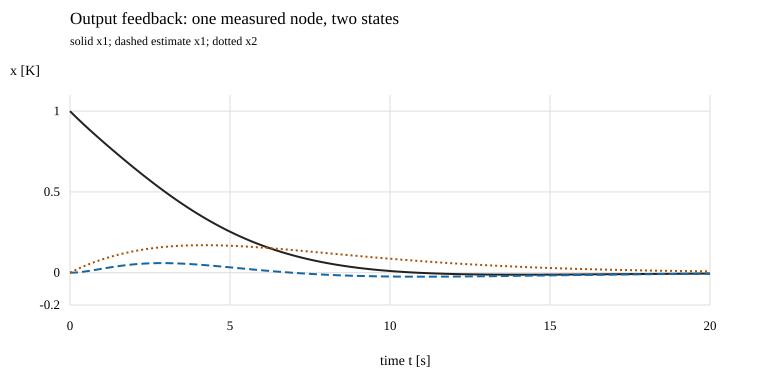

# 状态反馈、观测器与平衡目标

读者问题：已知道两状态可控可观，下一步怎样真正写出控制器？rank只说明存在能力，没有选择速度、控制幅度、估计误差或稳态目标。本课逐步给出同一个热对象的反馈、前馈与观测器，然后检验它们组成的四状态闭环；再用正定 CARE 与对偶设计扩展到一般有限连续 MIMO，保留稳定隐藏模态，并核完整观测器闭环。

## 先选误差动态，再反推状态反馈

沿用A=[[-0.2,0.1],[0.1,−0.2]] s⁻¹、B=[0.1,0]ᵀ K/(W·s)、H=[0,1]，先目标为工作点x=0、无扰动噪声/饱和/延迟，并暂时假设两状态均可读。输入

$$u=-Kx,\qquad K=[k_1\quad k_2]\in\mathbb R^{1\times2},$$

每个增益单位W/K。状态闭环

$$F=A-BK=
\begin{bmatrix}-0.2-0.1k_1&0.1-0.1k_2\\0.1&-0.2\end{bmatrix},$$

数值均按K、W、s的固定基准代入。希望两个实极点为−0.3、−0.5 s⁻¹：一个保持原差分速度，另一个把慢共同模式从−0.1加速。目标多项式为s²+0.8s+0.15，分别与trace/det对照：

$$-\operatorname{tr}F=0.4+0.1k_1=0.8,$$
$$\det F=0.03+0.02k_1+0.01k_2=0.15.$$

于是k₁=k₂=4 W/K，

$$F=\begin{bmatrix}-0.6&-0.3\\0.1&-0.2\end{bmatrix}\ \mathrm{s^{-1}}.$$

固定连续无输入线性模型下，两个根都在开左半平面，任意初值的齐次状态指数衰减。初值(1,0) K时u(0)=−4 W，实际第一功率6 W。这里选极点而非最小化代价；到 [[AI/45-机器人与具身智能/10-LQR与约束控制/01-从Bellman配方到Riccati递推#先把优化对象和单位写全|LQR权重与单位]] 后，回来先定义温度/功率基准和权重，不能声称本K已经最优。

## 前馈必须匹配可保持的目标

唯一测量目标y*=r时，前课求得x*=(2r,r)、u*=3r。将原点反馈改写为偏差反馈

$$u=u^*-K(x-x^*)=-4x_1-4x_2+15r,$$

r单位K，15的单位W/K。前馈15r包含平衡功率3r以及反馈对目标状态的补偿12r，不能把它错写成只给3r后仍反馈整个x。

对名义r=0.5 K、x₀=(0,0)，初始u=7.5 W，目标x*=(1,0.5) K、u*=1.5 W。直接求解得到

$$x_1(t)=\left[1+1.25e^{-(0.3\,\mathrm{s^{-1}})t}-2.25e^{-(0.5\,\mathrm{s^{-1}})t}\right]\ \mathrm K,$$
$$x_2(t)=\left[0.5-1.25e^{-(0.3\,\mathrm{s^{-1}})t}+0.75e^{-(0.5\,\mathrm{s^{-1}})t}\right]\ \mathrm K,$$
$$u(t)=\left[1.5+6e^{-(0.5\,\mathrm{s^{-1}})t}\right]\ \mathrm W.$$

在t=0它们分别为0、0、7.5；导数为0.75、0 K/s，与原ODE对照。x₂单调上升，x₁会越过平衡，最高约1.096225 K；功率单调从7.5降到1.5 W，故这个**特定名义阶跃和初值**满足±10 W偏差限幅。其他初值、噪声或参考更大时不能复用该幅度结论。

若实际第二节点有恒定热扰动d₂，平衡的第二式变成κx₁*=(h₂+κ)r−d₂；本例即x₁*=2r−d₂/(1 W/K)。原前馈没有这份扰动信息，不自动精确跟踪。首段 [[控制论/10-系统课程/03-采样保持积分调节与实现边界#恒定扰动为什么需要额外记忆|积分调节]] 解释为何增添记忆；到 [[控制论/10-系统课程/20-稳态MIMO调节与积分内模#稳态方程先问有没有地方可停|常值MIMO调节]] 先检查平衡方程与增广可稳定性，再核普通观测器在未知恒扰动下的偏差；本页合法热目标继续复用。

## 一个传感器怎样驱动两状态估计

现在恢复只读y=x₂，使用名义观测器

$$\dot{\hat x}=A\hat x+Bu+L(y-H\hat x),\qquad L=[\ell_1\quad\ell_2]^\mathsf T.$$

L为2×1，每项单位s⁻¹，创新y−Hx̂为K；已知施加的实际u进入估计器。令ε=x−x̂。无噪声、无未建模扰动、同一模型下

$$\dot\varepsilon=(A-LH)\varepsilon.$$

希望估计极点为−0.4、−0.6 s⁻¹，略快于状态闭环：

$$A-LH=\begin{bmatrix}-0.2&0.1-\ell_1\\0.1&-0.2-\ell_2\end{bmatrix}.$$

trace给0.4+ℓ₂=1，det给0.03+0.2ℓ₂+0.1ℓ₁=0.24，因此L=(0.9,0.6)ᵀ s⁻¹。矩阵为[[-0.2,−0.8],[0.1,−0.8]] s⁻¹。观测器利用热动态传播读数，没有靠对带噪y反复微分直接恢复第一温度。

初值x=(1,0) K、x̂=(0,0) K时，初始读数为0、观测器导数也为0，尚无法在t=0准确知道第一温度；输出随时间变化后创新开始纠正。ε的渐近衰减不等于“第一拍立刻知道全部状态”。

更快极点需要更大的L，会把测量误差更强地注入估计动态。固定L只是极点设计，不是Kalman统计最优；到 [[AI/45-机器人与具身智能/20-状态估计与LQG/01-线性Gaussian条件化到Kalman递推|Kalman条件化]]，带回噪声协方差与时点，再判断是否符合它的模型。

## 真正闭环有四个状态

用u=−Kx̂代替不可用的−Kx。因x̂=x−ε，

$$\dot x=(A-BK)x+BK\varepsilon,$$
$$\frac d{dt}\begin{bmatrix}x\\\varepsilon\end{bmatrix}
=\begin{bmatrix}A-BK&BK\\0&A-LH\end{bmatrix}
\begin{bmatrix}x\\\varepsilon\end{bmatrix}.$$

每块2×2，整个4×4；温差与估计误差均单位K，所有块s⁻¹。本例BK=[[0.4,0.4],[0,0]] s⁻¹。三角矩阵特征多项式分解为两对角块的乘积，极点并集是−0.3、−0.5、−0.4、−0.6 s⁻¹，故本齐次连续线性闭环稳定。ε虽不影响自身方程，却会驱动真实x；控制与估计极点分别稳定不意味着没有瞬态代价。

横轴s、纵轴K，固定上述A/B/H/K/L，x₀=(1,0)、x̂₀=(0,0)，d=n=0、r=0，无饱和、无延迟，采用RK4 0.05 s数值积分**连续即时律**。实线是真实x₁，虚线为x̂₁，点线是真实x₂；图展示估计如何迟后恢复隐藏初温。积分步长不是数字控制的采样周期，不能由它宣称实际程序同样稳定。

一般分离结构的主解释复用 [[AI/45-机器人与具身智能/20-状态估计与LQG/03-LQG分离原理与闭环极点#稳定性分离来自块三角结构|离散观测—控制分离]]，回来保留本课连续ε定义，不混用离散后验/先验索引。

## 可稳定、可检测足够做什么

对有限维连续LTI、无限幅线性反馈，存在K使A−BK Hurwitz，当且仅当不可控部分原本Hurwitz；这就是可稳定。存在L使A−LH Hurwitz，当且仅当不可观部分原本Hurwitz；这就是可检测。

为什么不能漏掉条件？把可达子空间作为前几列基，A/B可写为[[Aᶜ,A¹²],[0,Aᵘ]]与[Bᶜ,0]ᵀ。任意反馈只能改上块，不可控Aᵘ始终是闭环特征块；不稳定或虚轴模态因此不能被放进开左半平面。若Aᵘ已Hurwitz，在可控块配置稳定极点即可使整个三角矩阵稳定。观测器结论由(Aᵀ,Hᵀ)的对应可控分解转置得到。此处使用可控块极点配置定理。下一节以正定 CARE 和对偶算法设计一般多输入反馈/观测器，给出一组稳定化增益；它不承诺任意指定谱。

[Stanford EE363不变子空间讲义6–13至6–18](https://ee363.stanford.edu/archive/lectures/inv-sub.pdf)提供可控/不可观分解与PBH判据；[状态反馈作者章节](https://fbswiki.org/wiki/index.php/State_Feedback)提供极点配置方法定位。本页从分解解释稳定化条件，再在热模型显式算K/L，没有把非最小传函稳定等同全部状态稳定。

κ=0的热退化例满足两条件，可以对可控/可观部分做稳定设计，并让隐藏稳定模态自行衰减；无法任意重设隐藏极点。若把未被输入或读数看到的模态改为+0.1 s⁻¹，条件失败，不能由剩余一条正常曲线证明全闭环安全。去 [[信号与系统/40-状态控制与辨识/02-内部稳定与输入输出稳定#三个同G盒子：端口看不到的状态不同|隐藏不稳主解释]] 对照，不在新课程复制整套反例。

## 一般 MIMO：用正定 CARE 设计反馈与观测器

上一节回答“增益是否存在”，这里回答“带着 $A,B,C,D$ 怎样实际求一组增益”。对象是有限维、实系数、连续 LTI：

$$
\frac{dx}{d\tau}=Ax+Bu,\qquad y=Cx+Du,
$$

其中 $x\in\mathbb R^n,u\in\mathbb R^m,y\in\mathbb R^p$，$A,B,C,D$ 的 shape 依次是 $n\times n,n\times m,p\times n,p\times m$。允许 $m\ne p$，也允许不完全可控、不可观；要求 $(A,B)$ 可稳定、$(C,A)$ 可检测。这里只设计无外扰、无噪声、无饱和和时延的原点稳定化。保持非零目标先回本页的平衡方程；未知常值扰动和全输出积分内模由 [[控制论/10-系统课程/20-稳态MIMO调节与积分内模#积分增加了记忆，也增加了原点模态|20 的积分增广条件]] 另行承担。

先归一化，后选权重。令 $\tau=t/t_0$，状态、输入和读数也分别除以声明的基准；下面的矩阵与增益均作用于这些无量纲坐标。物理时间下，$\dot x=(Ax+Bu)/t_0$，观测器变化率同样除以 $t_0$。输出 CSV 的间隔是连续轨迹的记录间隔，不是数字控制器的采样周期。若要回到带单位的热对象，沿第 06 课的 [[控制论/10-系统课程/06-多变量互联矩阵顺序与实现条件|归一化与保持模型]] 恢复尺度和实际时序。

### 两次求解，每次都有明确的前提

选择对称正定的 $Q\in\mathbb R^{n\times n},R\in\mathbb R^{m\times m}$，求连续代数 Riccati 方程（CARE）的稳定化解：

$$
A^TP+PA-PBR^{-1}B^TP+Q=0,\qquad
K=R^{-1}B^TP\in\mathbb R^{m\times n}.
$$

它设计 $u=-Kx$ 的全状态反馈，代价为 $\int_0^\infty(x^TQx+u^TRu)\,d\tau$。配方思想可回 [[AI/45-机器人与具身智能/10-LQR与约束控制/01-从Bellman配方到Riccati递推#先把优化对象和单位写全|LQR 的代价与尺度]]；该旧页使用离散递推，这里的 CARE 不能直接用 DARE 替换。

观测器采用同一算法的对偶。另选对称正定 $W\in\mathbb R^{n\times n},V\in\mathbb R^{p\times p}$，把 $(A,B,Q,R)$ 换成 $(A^T,C^T,W,V)$：

$$
AS+SA^T-SC^TV^{-1}CS+W=0,\qquad
L=SC^TV^{-1}\in\mathbb R^{n\times p}.
$$

$W,V$ 在这里是对偶设计权重。没有另建随机过程、白噪声与协方差模型，就不能称为 Kalman 统计最优估计；用 $\hat x$ 替代 $x$ 后，也不能把全状态 LQR 的成本最优性搬给任意初始估计误差的输出反馈。

正定权重使辅助检测性自动满足。因此本方法在可稳定、可检测条件下给出一组稳定化 $K,L$，包括隐藏稳定模态；它没有提供任意指定谱、瞬态/噪声/幅度的联合最优设计。半正定权重的更广 CARE 存在条件需另核，不能删掉“正定”后沿用以下证明。[MPI 的矩阵方程讲义 §II.3、定理 II.24–26 与算法 4](https://www.mpi-magdeburg.mpg.de/3971319/skript.pdf)给出稳定化分支、Hamiltonian 子空间与 Schur 求解的条件；本段下面另说明正定情形为什么成立。

### 从有限时域到稳定化解：隐藏稳定模态不会挡住极限

这里明确使用一个外部标准结果：有限时域连续 LQR 在 $Q\succeq0,R\succ0$、零终端代价下，对每个有限时域 $T$ 有全时存在的对称半正定 Riccati 解和二次值函数；以时域长度为自变量写成

$$
\Pi'(T)=A^T\Pi+\Pi A-\Pi G\Pi+Q,
\quad \Pi(0)=0,\quad G=BR^{-1}B^T,
\quad J_T^*(x)=x^T\Pi(T)x.
$$

有限时域 Bellman/HJB 推导见 [MIT Underactuated 的有限时域 LQR 小节](https://underactuated.mit.edu/lqr.html)。下面仅在本段的正定假设下延伸到无限时域；不引用该网页对一般半正定权重的简略唯一性表述。

先借用上一节已给出的可稳定性结论：存在某个 $K_0$ 使 $F_0=A-BK_0$ Hurwitz。沿这一个可行反馈的总成本有界：

$$
J_T^*(x)\le x^TH_0x,\qquad
H_0=\int_0^\infty e^{F_0^Ts}(Q+K_0^TRK_0)e^{F_0s}\,ds.
$$

延长时域增加非负成本，故 $0\preceq\Pi(T_1)\preceq\Pi(T_2)\preceq H_0$（$T_1\le T_2$）。每个二次型值单调有界，利用极化恒等式得到矩阵各元素收敛到 $P$。又因 $\Pi'(0)=Q\succ0$，小正 $T$ 时 $\Pi(T)\succ0$，单调性给 $P\succ0$。

Riccati 右端是矩阵元素的连续多项式，因此 $\Pi'(T)\to A^TP+PA-PGP+Q$。如果极限的某个元素非零，该元素的导数最终保持同号且绝对值有正下界，积分后不可能收敛；所以极限右端必须为零，得到 CARE。证明中的 $K_0$ 只提供存在性上界，数值算法不需要先求出它。

令 $F_K=A-BK$，由 CARE 得

$$
F_K^TP+PF_K=-Q-K^TRK\prec0.
$$

沿 $\dot x=F_Kx$，正定函数 $x^TPx$ 严格衰减；也可对复特征向量直接代入上式，推出每个特征值实部为负。于是得到稳定化分支。沿该反馈积分 Lyapunov 恒等式可得总成本正好为 $x_0^TPx_0$；任何其他控制的无限时域成本都不小于每个有限时域最优值 $x_0^T\Pi(T)x_0$，令 $T\to\infty$ 即不小于 $x_0^TPx_0$。这说明本段所提的全状态成本最优性范围。若 $P_1,P_2$ 都是对称稳定化解，差 $\Delta=P_1-P_2$ 满足

$$
(A-GP_1)^T\Delta+\Delta(A-GP_2)=0.
$$

因此 $e^{(A-GP_1)^Tt}\Delta e^{(A-GP_2)t}$ 恒等于 $\Delta$；两侧指数又都趋零，故 $\Delta=0$。这证明稳定化解唯一。对偶系统按相同步骤给 $S\succ0$ 与 $A-LC$ Hurwitz，因为原检测性恰是 $(A^T,C^T)$ 的可稳定性。

注意观测器的对偶恒等式方向：令 $E=A-LC$，则

$$
ES+SE^T=-W-LVL^T\prec0.
$$

这是转置系统的 Lyapunov 形式，不应直接说 $e^TSe$ 衰减。原误差可以用 $e^TS^{-1}e$：左、右乘 $S^{-1}$ 后得

$$
E^TS^{-1}+S^{-1}E
=-S^{-1}WS^{-1}-C^TV^{-1}C\prec0.
$$

### 从矩阵解到可实现的完整闭环

按下面的顺序实施，而不是先看模拟曲线再宣布设计成功。用旧页的检测性顺序 $(C,A)$，本算法的精确 PBH 判据是：对每个 $\operatorname{Re}\lambda\ge0$，

$$
\operatorname{rank}\begin{bmatrix}\lambda I-A&B\end{bmatrix}=n,
\qquad
\operatorname{rank}\begin{bmatrix}\lambda I-A\\C\end{bmatrix}=n.
$$

两式分别检查可稳定、可检测。只有 $A$ 在闭右半平面的特征值需要实际检验；其余 $\lambda I-A$ 本身可逆。稳定隐藏模态无需满足全 rank。此处复用上一节的分块理由，不重新证明一般 PBH 等价。

1. 核模型、尺度和上面的闭右半平面 PBH 条件；不可控/不可观的稳定模态可以留下，隐藏不稳定模态必须先改变端口或模型。
2. 选 $Q,R,W,V\succ0$，分别求两次 CARE 的稳定化分支，再用线性方程 $RK=B^TP$、$LV=SC^T$ 得到 $K,L$，无需显式求逆。
3. 核对 $P,S$ 的对称性与正定性、两条 CARE 残差、$A-BK$ 与 $A-LC$ 的极点、两条 Lyapunov 恒等式；求解器返回矩阵本身不构成稳定化证明。
4. 将它们接到实际输入和读数，写出全 $2n$ 状态闭环，再检查初态和记录输出。

具体实现为

$$
u=-K\hat x,\qquad
\dot{\hat x}=A\hat x+Bu+L(y-C\hat x-Du),
$$

点表示对 $\tau$ 求导。已知实际 $u$ 必须减掉 $Du$，这样 innovation 正好是 $C(x-\hat x)$。如果执行器另有限幅，观测器要使用实际施加输入；本段稳定性证明仍需重新核。此控制器输出只依赖自己的连续状态 $\hat x$，没有从当前 $y$ 到 $u$ 的静态直通，所以这里的 $D\ne0$ 不产生即时代数环；若另加静态测量反馈，则回第 06 课核适定条件。

令 $e=x-\hat x$，完整物理状态矩阵与误差坐标矩阵分别是

$$
M=\begin{bmatrix}A&-BK\\LC&A-BK-LC\end{bmatrix},\qquad
M_e=\begin{bmatrix}A-BK&BK\\0&A-LC\end{bmatrix}.
$$

坐标变换 $\mathcal T=\begin{bmatrix}I&0\\I&-I\end{bmatrix}$ 满足 $\mathcal T^2=I$ 与 $\mathcal T M\mathcal T=M_e$。块三角结构给完整极点为两个设计块极点的并集，包括重数。这把本页的四状态证明延伸到一般 $n$；它证明内部渐近稳定，不保证有限时间内每个坐标或欧氏范数单调下降，更不规定噪声放大和动作峰值。[SciPy 官方 CARE 文档](https://docs.scipy.org/doc/scipy/reference/generated/scipy.linalg.solve_continuous_are.html)说明生产求解器使用 QZ 稳定子空间以及可能的隔离/病态失败；数值 PBH 阈值、残差与负实部裕量只是有限精度诊断，接近秩退化或虚轴时需更精确核对，不能称区间证书。

### 真正两输入、两读数，却只有两个可控可观方向

取 $n=4,m=p=2$，所有坐标无量纲、$t_0=1\,\mathrm s$：

$$
B=\begin{bmatrix}1&0\\0&1\\1&1\\0&0\end{bmatrix},\quad
C=B^T,\quad
A=-I_4+\tfrac12BB^T
=\begin{bmatrix}-.5&0&.5&0\\0&-.5&.5&0\\.5&.5&0&0\\0&0&0&-1\end{bmatrix},\quad
D=\begin{bmatrix}.1&.2\\-.1&0\end{bmatrix}.
$$

输入和读数都是两路，第三状态同时连接两个端口。$B^TB=\begin{bmatrix}2&1\\1&2\end{bmatrix}$ 的特征值为 $3,1$，所以活动子空间上的 $A$ 极点是 $.5,-.5$。与 $B$ 的列空间正交的两个方向是 $h=(-1,-1,1,0)^T$ 和 $e_4=(0,0,0,1)^T$；其 $A$ 极点都是 $-1$，又有 $Ch=Ce_4=0$。故可控与可观秩都只是 $2<4$，但隐藏模态稳定，原对象可稳定且可检测。

选 $Q=W=2I_4,R=V=I_2$，直接代入两条 CARE 就有

$$
P=S=I_4,\quad K=B^T,\quad L=B,\quad
A-BK=A-LC=-I_4-\tfrac12BB^T.
$$

两块极点均为 $-2.5,-1.5,-1,-1$，完整八状态极点为该列表重复两次。隐藏两个 $-1$ 仍保留原速率，这正是“可稳定而非完全可控”允许的处理。取 $x(0)=(1,-.5,.25,1)^T,\hat x(0)=0$，第四状态和第四估计误差分别满足 $x_4=e_4=e^{-\tau}$，$\hat x_4=0$；观测器没有凭空读出这个坐标，它的未知初态靠稳定动力学自行消退。

先预测再看图：提高动作权重 $R$ 会怎样改变活动极点？提高对偶 $W$ 会怎样改变误差极点？图中三类范数从同一次八状态轨迹计算；等价尺度分支恢复到公共坐标再比较，所以换单位不能制造性能改善。预测答案与可复现入口见 [[控制论/80-实践/12-MIMO反馈与观测器设计/README|实践 12]]。

### 换条件时，应保留哪一层结论

第一种迁移是把 $R$ 改成 $4I_2$，其余不变。对 $\lambda\in\{3,1\}$ 的活动方向，$a_\lambda=-1+\lambda/2$、$Q=2$，稳定化反馈极点为

$$
-\sqrt{a_\lambda^2+2\lambda/4}
\in\{-\sqrt7/2,-\sqrt3/2\}.
$$

隐藏极点仍为 $-1$；观测器权重未变，误差极点也未变。若改成 $W=8I_4,V=I_2$，活动误差极点变成 $-\sqrt{97}/2,-\sqrt{33}/2$，隐藏误差仍为 $-1$。两种变化都保持这里的稳定性条件，但不能据极点快慢保证全部动作峰值或含噪性能改善。

第二种迁移是只换坐标。令 $x=Tz,u=Uv,y=Yw$，$T,U,Y$ 为可逆正对角尺度矩阵。必须一起变换：

$$
A'=T^{-1}AT,\ B'=T^{-1}BU,\ C'=Y^{-1}CT,\ D'=Y^{-1}DU,
$$

$$
Q'=T^TQT,\ R'=U^TRU,\ W'=T^{-1}WT^{-T},\ V'=Y^{-1}VY^{-T}.
$$

代回 CARE 可核 $P'=T^TPT,S'=T^{-1}ST^{-T}$，从而 $K'=U^{-1}KT,L'=T^{-1}LY$。注意对偶权重的方向与状态代价相反。实践取 $T=\operatorname{diag}(2,.5,3,4),U=\operatorname{diag}(2,.5),Y=\operatorname{diag}(.5,2)$；还要变换初态，再将轨迹乘回尺度。只改 $A,B,C$ 而把权重保持原数值，是另一个设计问题。

第三种迁移撤掉隐藏稳定性。将 $A_{44}$ 改成 $.2$，其他 $A$ 元素不变。若仍保留 $B$ 的第四行为零，而在 $C$ 第二行加入第四坐标，系统可以检测这个不稳定模态，却不能控制它：任意 $K$ 的闭环第四方程仍是 $\dot x_4=.2x_4$。反过来，给 $B$ 第二列加第四坐标，保持 $C$ 的第四列为零，则可以控制，却不可检测；任意 $L$ 都有 $(A-LC)e_4=.2e_4$。这两个例子分别破坏反馈与观测器的存在条件，不是 CARE 调参失败。

失败图使用 $x(0)=e_4$ 的零输入开环 $x_4=e^{.2\tau}$；程序拒绝声称已设计稳定观测器反馈。它没有给失败卡伪造一个 $K,L$ 再用轨迹当成算法答案。回到旧热对象，可以选择原来的手算极点配置，也可以归一化后用本段的正定 CARE 求一组增益；目标可保持性仍由本页平衡方程负责，常值拒扰由 20 负责，鲁棒输出反馈性能由 19 的完整外扰闭环重新核。

## 撤条件之后，原证明为何停止

若y=Hx+n，误差式变为ε̇=(A−LH)ε−Ln；常值n不消失。r=0、n=0.1 K时，本例误差平衡ε*=(-0.1,−0.0875) K，真实状态x*=(-0.1,−0.05) K；观测器稳定依然存在，但真实温度和估计不再收敛到同一个工作点。100 s实际CPU结果与此解析平衡相符。

若控制器计算ucmd、执行器实际限幅uactual，且观测器只收到ucmd，则ε方程多出B(uactual−ucmd)，并依赖整个闭环状态；原来的齐次三角分离证明已不适用。让观测器知道实际u可以恢复这一已知输入抵消，但饱和状态闭环仍是非线性，稳定/目标和恢复过程要重查。模型参数错误、延迟、额外执行器动态同样需要新方程。

## 撤提示迁移

仍取κ=1、单输入B、仅测H=[0,1]。要求状态反馈极点−0.2、−0.4 s⁻¹，以及估计极点−0.3、−0.5 s⁻¹，求K/L。对输出参考r=0.5 K求合法平衡和前馈；若改为长期要求x*=(1,2) K，是否有某个K能突破原限制？

> [!question]- 答案
> 反馈trace要求k₁=2，det要求0.03+0.04+0.01k₂=0.08，故K=[2,1] W/K。观测trace要求ℓ₂=0.4，det要求0.03+0.08+0.1ℓ₁=0.15，故L=[0.4,0.4]ᵀ s⁻¹。平衡仍是(1,0.5) K、u*=1.5 W，前馈系数为3+2k₁+k₂=8 W/K。长期(1,2)违反未控制第二节点的平衡式，任何K都不能更改物理等式；可以改变输入结构、目标或引入别的实际热源。

把本页名义分离结论迁移到不确定模型和带噪性能时，沿 [[控制论/10-系统课程/19-动态输出反馈与鲁棒性能证书#估计误差为何重新依赖真实状态|完整误差动态]] 核对模型失配、过程扰动与传感噪声；带回固定四状态公共证书，不能由两套名义稳定极点继承原鲁棒能量界。19使用第18课合成对象，热模型的平衡/单位仍以本页为准。

实践 [[控制论/80-实践/02-耦合热状态/README|标准库复算]]；下一课 [[控制论/10-系统课程/06-多变量互联矩阵顺序与实现条件|多变量端口和采样实现]]；返回 [[控制论/00-控制论-MOC|控制论入口]]。
