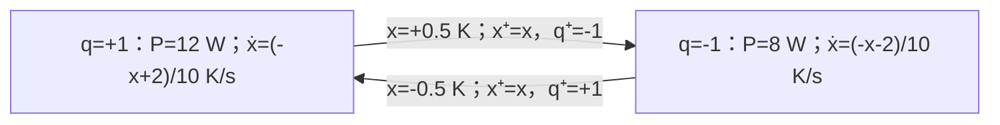

# 混杂事件、切换与驻留保证

恒温器只在温度触碰阈值时换挡，数字控制器只在时钟响时换功率，保护逻辑还可能抢先切断输入。每一挡的微分方程都能解，不等于这些段接起来以后仍保持目标。本课先把同一个热对象做成有记忆的滞回调节，再用一个二维反例说明为什么切换顺序需要自己的稳定证明。

## 状态除了温度，还要记住当前挡位

沿用 [[控制论/10-系统课程/02-热模型从物理到连续反馈#先固定对象和每个端口|热模型端口]]：环境20°C，工作点30°C，$x=T-30°C$，$C=10\,\mathrm{J/K}$，$h=1\,\mathrm{W/K}$，$P=10\,\mathrm W+u$。现在目标是始终保持温差带 $[-\delta,\delta]$，$\delta=0.5\,\mathrm K$，不是要求 $x(t)\to0$。取挡位 $q\in\{-1,+1\}$，功率偏差 $u=qU$，$U=2\,\mathrm W$，即实际功率8W或12W；无扰动、传感误差与执行延迟。

在同一温度 $x=0$，加热挡和减热挡的下一步方向相反，因此单独 $x$ 不能完整描述闭环状态。状态是 $(x,q)$：

$$\dot x=(-hx+qU)/C,\qquad \dot q=0.$$

**流映射**给挡位不变时怎样运动；**guard（跳转条件）**给什么时候允许换挡；**reset（重置映射）**给换挡那一瞬间哪些状态变化。本模型定义如下：

| 挡位 | 允许流的区域 | 必须跳的guard | reset |
| --- | --- | --- | --- |
| $q=+1$ | $x\le\delta$ | $x\ge\delta$ | $(x,+1)\mapsto(x,-1)$ |
| $q=-1$ | $x\ge-\delta$ | $x\le-\delta$ | $(x,-1)\mapsto(x,+1)$ |

在等号处流集与跳集重合，**本实现约定跳优先**。超出当前挡位流域的初值先执行相应跳，再开始流；温度连续、挡位跳变。单纯写流/跳集合而不选优先级可能定义多条解，不能假定程序会替作者选择。本例 $\delta>0$ 使两条相反guard不同时成立；reset后另一guard立即不成立。

若以后加入保护停机，必须扩状态和规则。例如规定“停机锁存优先于调节换挡；同一物理时刻先处理保护，再处理调节，已锁存就忽略后者”，重新分析锁存后的流。仅把两条 `if` 的顺序交换，也可能变成另一个控制器；本例没有执行或认证这样的保护系统。

图中的裸数按K、W、s基准代入；reset不瞬间改变热量。流动消耗物理时间 $t$，跳计数 $j$ 增加但不消耗理想模型时间。混杂轨迹可记作 $(t,j)\mapsto(x,q)$，而不是强迫一个连续可微函数穿过所有事件。

[Liberzon作者讲义§1–2（印刷页3–13）](https://liberzon.csl.illinois.edu/teaching/Liberzon-LectureNotes.pdf)给guards/reset、解与滞回的背景；下述热参数、优先级和解析计算是本页明确指定的教学模型，并非原作者的设备实验。

## 先定位事件，再连接下一段

设一段从 $(x_s,q)$ 开始，$q$ 固定。精确流为

$$x(t_s+\tau)=qU/h+(x_s-qU/h)e^{-h\tau/C}.$$

从下阈值 $-\delta$ 加热到上阈值 $+\delta$，解guard方程得到

$$\tau_+=\frac C h\ln\frac{U/h+\delta}{U/h-\delta}.$$

分母必须正，故需要 **$U>h\delta$**。冷却段因对称有 $\tau_-=\tau_+$。本例两段各 $10\ln(5/3)=5.1082562377$ s，周期10.2165124753s。从 $x(0)=0,q(0)=+1$ 起，第一次事件在 $10\ln(4/3)=2.8768207245$ s，此后每5.1082562377s换挡。到达事件时先记录左极限，再记录相同温度的新挡位，不能在跨过阈值后才假装在旧时间换挡。

实践脚本一条路线用上述对数求事件；另一条路线只调用流公式，在括住guard的区间二分找根，核对事件时刻。固定大步长“步末发现越界再换挡”则是另外的数字控制器：它可能出现阈值外超调，不能算作当前事件模型的精确实现。若对象没有解析流，可用带方向的根定位和积分误差容限；调小步长仍须检查漏检事件与同时事件规则。

## 不变温差带与没有Zeno，分别证明

初值在 $[-\delta,\delta]$ 时，加热流严格向上，最高到 $\delta$ 就换挡；冷却流严格向下，最低到 $-\delta$ 就换挡。流在两阈值间连续，reset保持 $x$，故区间对本闭环正不变。这是每段流及每次跳的归纳，不靠一张有限曲线证明“始终”。实际功率一直是8W或12W，所以本模型也满足既有0–20W边界。

除可能任意接近首次guard的初始短段外，每两个后续跳都间隔固定正数 $\tau_+$。因此任意有限时间内只有有限次跳，物理时间可延伸到无穷；不存在 **Zeno：有限物理时间内累积无穷次跳**。这与“曲线有界”是两件事。

把 $\delta$ 设为0且仍用等号跳优先，$x=0$ 时两挡交替触发reset，温度不变却可以在同一时刻跳无穷次。数值程序若偷偷加最小步长，会掩盖这个模型问题。恢复正滞回可排除本例的立即重复跳；不代表任意混杂系统都排除了Zeno。例如无阻尼空气中弹跳球，地面每次把向下速度 $v^-$ 重置成 $v^+=-ev^-$，$0<e<1$；若首次反弹后向上速度 $v_0>0$，后续飞行时间为 $2v_0e^n/g$，总和 $2v_0/[g(1-e)]$ 有限。需另给静止接触或后Zeno延拓，不能凭无限碰撞理想化宣称真实球无限次完成碰撞。

改变功率会改变结论。若 $U=h\delta$，加热只渐近逼近上阈值，根本没有有限的换挡时刻；若 $U<h\delta$，则停在阈值内的平衡。两种情况下温差带仍可能不变，但“固定周期来回切换”的结论失效。若加恒定未知热扰动 $d$，两挡都能反向推动需要 $U>h\delta+|d|$；只是把原 $U$ 限幅到更小值而不改证明会漏掉这一点。

本恒温器趋向周期运动，不趋向温差0。去 [[数学/46-数理方程/30-非线性动力系统/02-阻尼摆Lyapunov与LaSalle#先证明稳定，再检查是否吸引|稳定与吸引]]，回来先说目标集合是温差带还是单点；不能给周期波动画一条“已收敛到0”的结论。

![[控制论/80-实践/05-混杂与网络/assets/hybrid/thermostat.svg]]

横轴物理秒，纵轴温差K，点标真实guard事件；上下虚线为±0.5K。图回答“相同温度为什么可能沿不同方向走、换挡为什么不跳温度”。事件和曲线来自同一流公式，图仅展示40s。

## 各模式都稳定，为什么切换仍会增长

热恒温器各挡的平衡不同，不能用“每挡趋向0”分析它。下面换成一个**另行归一化的二维数学反例**，两模式共用原点，状态 $z\in\mathbb R^2$、时间 $\tau$ 均无量纲；它不是两个被动热节点的导热模型：

$$A_1=\begin{bmatrix}-1&c\\0&-1\end{bmatrix},\qquad
A_2=\begin{bmatrix}-1&0\\c&-1\end{bmatrix},\qquad z'=A_{\sigma(\tau)}z.$$

取 $c=4$。两矩阵都只有特征值−1，每个固定模式的 $e^{A_i\tau}$ 是 $e^{-\tau}$ 乘一次多项式，最终趋零。可是模式1把第二分量暂时转到第一，模式2再把第一转回第二；切换可以在这种暂态尚未耗散前接力。

先模式1运行1单位，再模式2运行1单位，周期矩阵按时间顺序右乘早段：

$$M=e^{A_2}e^{A_1}=e^{-2}\begin{bmatrix}1&4\\4&17\end{bmatrix}.$$

括号内迹18、行列式1，特征值 $9\pm4\sqrt5$，所以

$$\rho(M)=e^{-2}(9+4\sqrt5)\approx2.42849>1.$$

选 $z_0=(1,2+\sqrt5)^T$，恰为最大根方向。每两个时间单位 $z(2n)=\rho(M)^nz_0$，指数增长；归一化 $z_0$ 到范数1不改变结论。这是一个无限时间的解析反例，脚本只核对前12周期。单个mode的特征值、轮流查看两张衰减曲线，都漏掉了矩阵乘积的作用。

## 同一把尺：共同Lyapunov函数的充分条件

令有限模式均为局部Lipschitz向量场 $f_i$，共用平衡0；切换信号右连续、分段常值、任意有限区间仅有限次切换，状态切换时不重置。若有同一个 $C^1$ 函数 $V$ 和常数 $m,M,\lambda>0$，对所有状态和模式

$$m\|z\|^2\le V(z)\le M\|z\|^2,\qquad
\nabla V(z)f_i(z)\le-\lambda V(z),$$

则每段 $V(t_b)\le e^{-\lambda(t_b-t_a)}V(t_a)$。切换时状态和同一个 $V$ 都连续，逐段相乘给

$$\|z(\tau)\|\le\sqrt{M/m}\,e^{-\lambda\tau/2}\|z_0\|.$$

界对所有允许切换一致，并把轨迹留在有界集，配合局部Lipschitz、有限模式和局部有限切换可延拓到所有时间。于是得到全局一致指数稳定。若证明只在域内成立，还必须证明轨迹不离域；若reset会改状态，则另需 $V(z^+)\le V(z^-)$，不能省掉跳时检查。

在同一矩阵族改成 $0\le c<2$，取 $V=z_1^2+z_2^2$。任一模式都有

$$V'=-2(z_1^2+z_2^2)+2cz_1z_2\le-(2-c)V.$$

因此 $c=1$ 时任何上述切换都满足 $\|z(\tau)\|\le e^{-\tau/2}\|z_0\|$。$c=2$ 时这条严格证明停住；不能由证书失败就断言一定不稳定。$c=4$ 则已有具体不稳序列，所以不可能存在满足上面全局严格条件的共同函数。

## 换尺有代价：多Lyapunov与驻留时间

$V_1$ 和 $V_2$ 各自下降时，切换会把同一状态换成另一把尺下的更大读数。对有限模式，假定每个 $V_i$ 满足共同上下界 $m\|z\|^2\le V_i\le M\|z\|^2$、沿模式i有 $V_i'\le-\lambda V_i$，且所有允许切换 $i\to j$ 满足 $V_j(z)\le\mu V_i(z)$，$\mu\ge1$。无状态reset；若有reset，比较必须改成 $V_j(R_{ij}(z))\le\mu V_i(z)$。

令 $N_\sigma(s,t)$ 是 $(s,t]$ 内切换次数。逐段流下降、逐次跳乘 $\mu$，得

$$V_{\sigma(t)}(z(t))\le\mu^{N_\sigma(0,t)}e^{-\lambda t}V_{\sigma(0)}(z_0).$$

若对**任意** $0\le s\le t$ 都有平均驻留约束

$$N_\sigma(s,t)\le N_0+(t-s)/\tau_a,$$

则

$$\|z(t)\|\le\sqrt{(M/m)\mu^{N_0}}\,
 e^{-[\lambda-(\ln\mu)/\tau_a]t/2}\|z_0\|.$$

因而 $\tau_a>\ln\mu/\lambda$ 是充分条件；等号只留下不增长上界，不证明收敛。最小驻留时间 $\tau_d$（相邻切换至少隔 $\tau_d$）给 $N_0=1,\tau_a=\tau_d$ 的特例。平均驻留允许少数密集切换，但必须满足每个时间窗口的计数界，不能只算整次试验“平均很慢”。这条允许序列自身也排除了有限时间无限次跳。

对 $c=4$ 反例，选择

$$P_1=\begin{bmatrix}1/2&1\\1&9/2\end{bmatrix},\qquad
P_2=\begin{bmatrix}9/2&1\\1&1/2\end{bmatrix},\qquad V_i=z^TP_i z.$$

直接相乘可核 $A_i^TP_i+P_iA_i=-I$。两P的特征值均为 $m=(5-2\sqrt5)/2$、$M=(5+2\sqrt5)/2$，故可用 $\lambda=1/M$、$\mu=M/m=9+4\sqrt5$。于是保守充分驻留界为 $\tau_d>M\ln(M/m)\approx13.674$，取14满足。它不声称13.674就是实际临界值；因为用统一谱界比较不同二次型，通常损失精度。

[Liberzon讲义§8.1–8.2、定理5.2（印刷页43–46）](https://liberzon.csl.illinois.edu/teaching/Liberzon-LectureNotes.pdf)给多Lyapunov慢切换条件；原文衰减写为 $2\lambda_0$，本页用 $\lambda$，所以阈值没有丢掉2。上面矩阵P、谱界和逐段乘积证明可不依赖数值求解器单独检查。

![[控制论/80-实践/05-混杂与网络/assets/hybrid/switching.svg]]

图用同一无量纲二维对象、相同单位范数初值，纵轴 $\log_{10}\|z\|_2$，横轴归一化时间。$c=4$、每1时间换挡增长；$c=4$、每14时间换挡衰减；$c=1$ 可用共同证书。三条曲线不是同一个热温度轴。实际有限轨迹与一般证明分别承担展示和保证。

## 撤提示迁移与答案

1. 热对象不变，阈值改为 $\delta=1$ K、功率仍 $U=2$ W。求周期、功率界和无Zeno依据。如果执行器实际只能给 $U=0.8$ W，原周期结论怎样变化？
2. 保持 $c=4$，改为每 $s=2$ 归一化时间换挡。只给出 $\tau_d=2<13.674$ 是否足以断言不稳定？请直接求两段乘积的最大根。
3. 某控制器流中满足 $V'\le-V$，每次reset却把状态翻倍，且每0.1时间跳一次。流稳定够不够？

> [!question]- 可核答案
> 1. 每半周期 $10\ln3$ s，全周期 $20\ln3\approx21.972246$ s，功率仍8/12W，正间隔排除Zeno。$U=0.8<h\delta$ 时固定挡位平衡为±0.8K，不能到相反阈值，温差带可保持，但原周期和对数根失效。
> 2. 不够。一般等长s乘积为 $e^{-2s}\begin{bmatrix}1&cs\\cs&1+c^2s^2\end{bmatrix}$。$s=2,c=4$ 的最大根是 $e^{-4}(33+8\sqrt{17})\approx1.2085545932>1$，这才给不稳证据。证明条件不满足与系统不稳不是同义句。
> 3. 若 $V=\|z\|^2$，reset使V乘4，周期乘子为 $4e^{-0.1}>1$；可选流 $z'=-z/2$ 达到等号，确实不稳定。必须把reset代入跳条件，或增加足够长驻留。

按顺序继续 [[控制论/10-系统课程/14-网络采样时延与允许更新序列|网络采样、时延与允许更新序列]]：把“状态含挡位、事件改变后续流”的检查方法带到分布式更新；14会逐一分开采集、收到、计算完成和执行器更新时间，并把旧命令及成功更新间隔写入状态和证明。它的准确新鲜更新、有限间隔主线及固定延迟扩展各有条件，不能据此认为饱和、任务调度或真实时限已经解决。实践 [[控制论/80-实践/05-混杂与网络/README|05]] 核对事件表、矩阵与源码；返回 [[控制论/00-控制论-MOC|控制论入口]]。本课给滞回不变性与一类切换稳定主线；一般非线性混杂可达性、接触摩擦、故障保护和真实执行时限仍需各自模型与证据。
