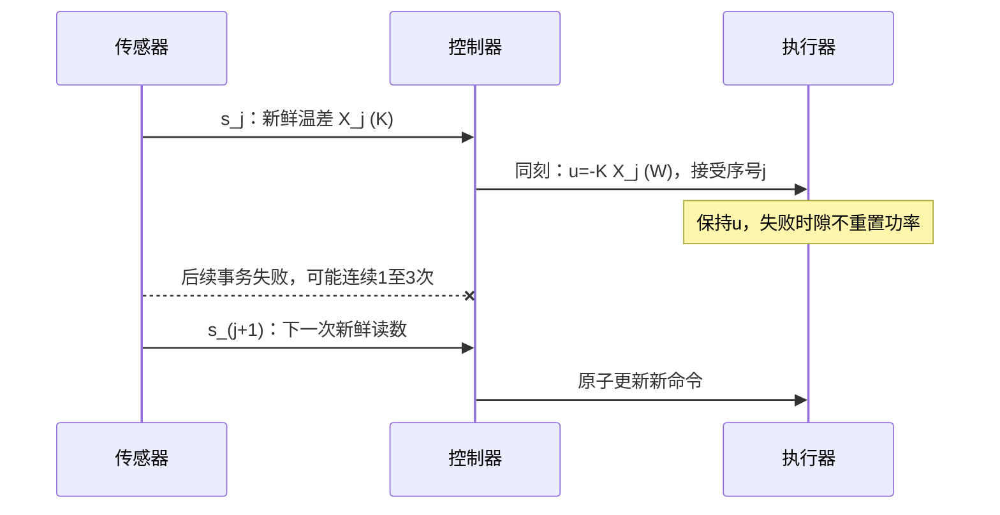

# 网络采样、时延与允许更新序列

本地程序按时算出功率，不表示执行器按同一时刻使用了它。网络可能晚到、丢失、乱序；“每秒循环”也不等于每秒获得一条新鲜读数。延续同一个热对象，本课把持有的旧命令纳入状态，给一条有界更新间隔的完整稳定证明，再说明迟到样本为何不自动符合它。

## 把每个时刻和每个信息集写开

沿用 $C=10\,\mathrm{J/K},h=1\,\mathrm{W/K}$、$x=T-30°C$、$u=P-10\,\mathrm W$：

$$C\dot x=-hx+u,\qquad u\in[-10,10]\,\mathrm W.$$

先取目标 $x=0$、准确参数、无扰动、无测量噪声。连续即时律 $u=-Kx$ 取 $K=4\,\mathrm{W/K}$；它的极点是 $-(h+K)/C=-0.5\,\mathrm{s^{-1}}$。这里K与03的教学增益3不同，是本课重新指定的设计。

对消息 $i$，区分采集时间 $s_i$、控制端收到时间 $r_i$、算完命令时间 $c_i$、执行器真正更新时间 $a_i$。总链延迟 $a_i-s_i$ 包括测量运输、计算与命令运输。执行器侧 **age（时龄）** 是当前保持命令所依据样本的采集时刻到当前时刻的差，不能用最近收到包的时间替代。

| 位置 | 可以使用的信息 | 不能自动假定知道的量 |
| --- | --- | --- |
| 传感器 | 当次读数与本地采集序号/时戳 | 实际动作何时生效。 |
| 控制器 | 已收到读数、参考、自己算出的命令 | 丢失命令是否施加、当前真实温度。 |
| 执行器 | 已收到命令、已接受序号、实际保持值 | 未收到的更新和最新物理状态。 |
| 离线合成器 | 真状态、全部事件与模型参数 | 这些核对列不能偷偷作为在线控制信息。 |

确认回执只能提供其协议承诺的信息；没有实际施加时间戳时，发送成功不等于热输入已经更新。单一源的单调序号可排序，但跨设备时间戳相减还要求同步/偏差界和时钟速率假设。本课证明使用同一理想单调时钟，未认证现实同步协议。

[Hespanha/Naghshtabrizi/Xu《A Survey of Recent Results in Networked Control Systems》作者稿§I、§III-A与§III-B](https://www.ece.ucsb.edu/~hespanha/published/ncs_v15p.pdf)分别讨论采样、延迟、保持及丢包模型；它不是“任何网络都可以”的定理。本页下面的标量系数、序列界和数值由本热模型另行推导。

## 先固定一种可以兑现的网络策略

基础时隙 $T_s=10\ln(10/9)\,\mathrm s\approx1.0536051566$ s，因此 $a=e^{-hT_s/C}=0.9$。每个时隙端点执行如下**理想事务**：若本次完整读数—计算—动作事务成功，准确读取当前 $x_k$、当拍立即施加 $u_k=-Kx_k$；若失败，执行器保持旧命令。迟到或乱序包直接丢弃，不在区间中途另改输入；成功事务的延迟在这条主线假设为0。失败可以代表整次更新未完成，不能把非零延迟成功包偷偷算成新鲜事务。

令 $s_j$ 为成功更新时刻（此处与样本采集同刻），$X_j=x(s_j)$。初时刻 $s_0=0$ 必须成功，初始化 $u=-KX_0$；相邻成功更新的间隔是

$$H_j=s_{j+1}-s_j=m_jT_s,\qquad m_j\in\{1,2,3,4\}.$$

因此最多连续3次失败，随后第4个时隙更新。网络序列可以对状态有依赖、可以任意非随机；唯一限制是每段的m属于这个集合。命令保持直到下个成功时刻，控制器不需要提前知道下个m。空跑一个时隙、把缺失样本删掉再重新编号，都不会把真实 $H_j$ 变回 $T_s$。

图说明主线的理想事务时序；箭头不表示已测网络耗时。后面用增广模型单独处理非零执行延迟。

## 从区间内流推出成功时刻的精确递推

在 $s_j$ 到 $s_{j+1}$ 内，输入固定为 $-KX_j$。令 $\kappa=K/h$，由保持积分

$$x(s_j+\theta)=\left[(1+\kappa)e^{-h\theta/C}-\kappa\right]X_j
=:F(\theta)X_j,\quad0\le\theta\le H_j.$$

特别是

$$X_{j+1}=F(H_j)X_j,\qquad
F(mT_s)=(1+\kappa)a^m-\kappa.$$

成功索引j不同于基础时隙k；两个轴的间隔不相同。本例 $\kappa=4$，四种成功间隔的精确系数为

| m | 连续失败次数 | $H_j$（s） | $F(mT_s)$ |
| --- | --- | --- | --- |
| 1 | 0 | 1.0536051566 | $1/2$ |
| 2 | 1 | 2.1072103132 | $1/20$ |
| 3 | 2 | 3.1608154697 | $-71/200=-0.355$ |
| 4 | 3 | 4.2144206263 | $-1439/2000=-0.7195$ |

例如 $X_0=1$K、先漏3次，则整个首区间保持 $u=-4$W，四个基础时隙的温差依次为0.5、0.05、−0.355、−0.7195K；第四时隙端点才更新为 $u=2.878$W。若把每个时隙都误算成 $u=-4x_k$，则四拍后是0.0625K，模拟的已经是无丢包控制器。

## 一条覆盖所有允许序列和区间内部的证明

设一般有限允许集合 $\mathcal H\subset[H_{\min},H_{\max}]$，$H_{\min}>0$，每次新鲜准确更新后零阶保持。若

$$\rho=\max_{H\in\mathcal H}|F(H)|<1,$$

则对任意允许序列逐次相乘得

$$|X_j|\le\rho^j|X_0|.$$

有限集合不意味着只证明有限条轨迹；它使每一个无限序列的每一个乘子都有同一个界。若改用连续间隔区间，同样需要整个区间的上确界严格小于1，不能只验几个网格点。

还须接回物理时间。$F(\theta)$ 对 $\theta\ge0$ 单调下降，$F(0)=1$。本例最迟4时隙处仍有 $F>-1$，所以整个区间内 $|F(\theta)|\le1$。因此 $|x(t)|\le|X_j|$（$s_j\le t<s_{j+1}$）。又 $s_{j+1}\le(j+1)H_{\max}$，故 $j>t/H_{\max}-1$，从而得到保守物理时间界

$$|x(t)|\le\rho^{-1}\exp\!\left(\frac{\ln\rho}{H_{\max}}t\right)|X_0|.$$

本例 $\rho=1439/2000$、$H_{\max}=4T_s$，指数衰减率 $-\ln\rho/H_{\max}>0$；初时的额外常数 $\rho^{-1}$ 是换算造成的保守性，实际首段仍满足 $|x(t)|\le|X_0|$。基础时隙正且无穷次成功更新，使物理时间不在有限点积累。

实际幅度也能兑现一个明确域：若 $|X_0|\le2.5$K，则每次 $|u|=K|X_j|\le10$W，保持区间内温差不超过初始幅度。因此没有触发执行器饱和，证明对这一区间内的初值也适用于既有0–20W实际功率界。任意大初值在线性数学模型中仍收敛，但实际饱和模型不能直接沿用这句全域结论。

这是 [[控制论/10-系统课程/13-混杂事件切换与驻留保证#同一把尺：共同Lyapunov函数的充分条件|共同尺]] 的离散标量版本：$V(X)=X^2$ 每次成功更新乘至多 $\rho^2$。它只需要有界成功间隔，不需要假设独立丢包概率或平均丢包率。

## 多一次丢包，就可能破坏哪一步

若允许连续4次失败，即 $m=5$，

$$F(5T_s)=5(0.9)^5-4=-20951/20000=-1.04755.$$

永远每5时隙才成功是该放宽模型的一条合法序列。于是 $X_j=(-1.04755)^jX_0$，任意非零初值的无限幅线性模型均交替增长。这一个解析序列足以推翻“所有放宽序列都稳定”。持续增长后会超出真实功率范围；实际限幅可能改变轨迹，不能拿未限幅增长曲线预测硬件无限温升。

一般 $\kappa>1$ 时，$|F(H)|<1$ 的必要充分标量条件是

$$0<H<\frac C h\ln\frac{1+\kappa}{\kappa-1}.$$

本例临界 $10\ln(5/3)=5.1082562377$ s，所以 $4T_s$ 在内，$5T_s$ 在外。边界等号是乘子−1，无衰减保证。若 $0<\kappa\le1$，每个有限正H都满足单段严格收缩；为了得到统一指数率，仍需声明允许间隔范围，不能从“每段都小于1”直接推无限乘积趋零。

![[控制论/80-实践/05-混杂与网络/assets/network/updates.svg]]

曲线包含成功节点与区间内精确指数流，实线是重复4时隙更新，虚线是重复5时隙更新，起点0.5K。横轴物理秒、纵轴K；两条在各自第12次成功后停止。它展示允许序列的区别，证明由上面的乘积与区间内界承担。

## 非零执行延迟必须保留旧命令状态

现在改为每 $T$ 秒可靠采样，不丢包；准确样本 $x_k$ 在 $kT$ 采集，但新命令 $u_k=-Kx_k$ 要过固定 $d\in[0,T]$ 秒才生效。区间前d秒仍保持旧命令 $v_k=u_{k-1}$，后 $T-d$ 秒保持新命令。$d=T$ 时新命令恰好下一边界生效，下一边界先执行旧到达，再采样/计算未来命令；单点功率取值不改变积分。

令 $a=e^{-hT/C}$、$E=e^{-h(T-d)/C}$，将两段保持分别积分：

$$x_{k+1}=ax_k+\frac{E-a}{h}v_k+\frac{1-E}{h}u_k,\qquad v_{k+1}=u_k.$$

温差x单位K、旧功率v单位W。用 $w_k=v_k/h$（单位K）统一尺度，得到真正的二维闭环

$$\begin{bmatrix}x_{k+1}\\w_{k+1}\end{bmatrix}
=G_d\begin{bmatrix}x_k\\w_k\end{bmatrix},\qquad
G_d=\begin{bmatrix}a-\kappa(1-E)&E-a\\-\kappa&0\end{bmatrix}.$$

初值必须给 $(x_0,v_0)$，不能拿 $x_0$ 一项恢复全部延迟系统。本实验取 $v_0=-Kx_0$，明确在启动前已持有这个命令。

$G_d$ 的迹 $\theta=a-\kappa+\kappa E$，行列式 $D=\kappa(E-a)$。复用 [[控制论/10-系统课程/03-采样保持积分调节与实现边界#数字积分用旧状态，另外证明稳定|二阶Schur条件]]：

$$1-\theta+D=(1-a)(1+\kappa)>0,$$
$$1+\theta+D=(1+a)(1-\kappa)+2\kappa E>0,$$
$$1-D=1-\kappa(E-a)>0.$$

三式同时严格成立，当且仅当这个固定延迟线性映射全部根在单位圆内。这里T/d/K固定，无饱和；不能逐个延迟验根以后就称任意时变延迟稳定，13已经给出了这种推理的反例机制。

取 $T=10\ln(10/7)$ s（约3.5667494394s），$a=0.7,\kappa=4$。无延迟 $d=0$ 时非零根−0.5，稳定；整拍延迟 $d=T$ 时 $D=1.2$、根为 $0.35\pm i\sqrt{1.0775}$，根模 $\sqrt{1.2}\approx1.095445$，不稳定。固定分数延迟下第二式在 $E\in[0.7,1]$ 自动为正，第三式要求 $E<0.95$，因此

$$0\le d<T+10\ln0.95\,\mathrm s\approx3.0538164955\,\mathrm s.$$

在上界 $D=1$，不能称渐近稳定。对指定 $d=T/2$，两段积分与增广矩阵一步结果由脚本交叉核对；这条半拍例与无丢包固定延迟相符，不能替代前面任意丢包序列的证明。

去 [[电子电路/44-嵌入式采集与控制/06-带延迟执行器的采样控制#先写原ODE，再规定保持与索引|执行器与一拍延迟]]，带回真实驱动端口和保持规则；回来指出本页 $v_k$ 是旧功率，不是旧温度。去 [[控制论/10-系统课程/12-扰动下的σ修正与数字实现边界#连续积分缩步不能替代数字采样分析|自适应数字保持]]，回来说明附加参数记忆后为什么还要增广，不能把本页二维证书直接套给MRAC。

## 迟到读数、乱序与保持策略怎样改变问题

若在执行时刻 $a_i$ 才应用 $u=-Kx(s_i)$，且 $s_i<a_i$，即使两次执行相隔不超过 $4T_s$，前面的新鲜样本公式仍不成立：$x(s_i)$ 不是区间起点 $x(a_i)$。可以保留有限长状态/输入历史做时延增广，也可以在精确模型和已知实际输入下预测

$$\hat x(a_i)=e^{-h(a_i-s_i)/C}x(s_i)+\frac1C\int_{s_i}^{a_i}e^{-h(a_i-\tau)/C}u(\tau)d\tau.$$

无扰动、无测量误差、时间已对齐且实际输入历史准确时它等于真实当前状态，才可把控制律解释为当前状态反馈。丢失执行确认、未知热扰动或模型误差会使这个等式失效；10课的辨识结果不自动提供零误差模型。

乱序处理也属于控制定义。这里约定单一源、序号唯一且无回绕，在同一执行时刻先汇总已经到达的包，只接受最大序号且比当前已接受序号新的命令，随后保持；重复和更旧序号丢弃。同一序号内容冲突视为输入合同失败，不能任选内容。这使接受序号单调，**不能单独证明时龄有界**。数据可能按序到达但全都很旧；不校准时钟也不能精确判断秒级新鲜度。实践的五包有限表演示“序号2先到后拒绝序号1”，没有冒充全网络协议测试。

不同丢包策略给不同模型：

- 保持上一次命令：需要旧命令记忆；上面更新间隔主线就是此策略。
- 失败后设 $u=0$：这里意味着回到10W工作点功率，失败段满足 $x^+=ax$。它不是“关机”（实际P=0对应u=−10W），也不等于原保持策略。
- 用模型预测或执行缓冲的未来控制序列：需要声明预测器/缓冲状态、错模型及包何时覆盖旧计划；不能只说“补偿延迟”就删掉这些状态。

对于一般离散 $x_{k+1}=Ax_k+Bu_k$、状态反馈 $u_k=-Kx_{k-d_k}$ 且整数延迟 $d_k\in\{0,\ldots,D_{max}\}$，可堆叠 $Z_k=(x_k,x_{k-1},\ldots,x_{k-D_{max}})$，把 $-BK$ 放进第 $d_k$ 个历史块，其余块下移，形成有限矩阵族 $Z_{k+1}=M_{d_k}Z_k$。还须把乱序、允许切换和初始历史写进去；若另有保持旧命令，其状态也要加。一个共同 $P\succ0$ 满足所有模式 $M_d^TPM_d-P\prec0$ 才给任意允许模式的一个充分证书。本页没有求出一般族的P，也没有用逐模式Schur或有限网格替代它。

## 撤提示迁移与答案

1. 主线K改为2W/K，基础 $a=0.9$ 不变。最多可以保证多少连续失败？需否改变原 $|X_0|\le2.5$K 幅度域？
2. 收到包的间隔都小于1秒，是否已经证明 $H_j\le4T_s$ 和新鲜度？请构造不满足主线的时序。
3. 固定延迟例用 $T=10\ln(10/7)$ s、$d=T$，把K改为2W/K。求根模，并说明它是否认证K在2和4之间任意切换。

> [!question]- 可核答案
> 1. $F(mT_s)=3(0.9)^m-2$，要求 $(0.9)^m>1/3$。最大整数m是10（$0.9^{10}\approx0.348678>1/3$，$0.9^{11}\approx0.313811<1/3$），故最多连续9次失败。原域2.5K仍合法，若仅考虑同一无扰动保持模型，可扩大到 $10/K=5$K；更弱反馈对应更慢连续名义极点−0.3s⁻¹，不能据可丢更多包称所有性能更好。
> 2. 例如每0.5秒送到一个十秒前采的样本。接收密集但时龄十秒，执行时没有新鲜 $X_j$；或者执行器始终未收到控制端命令，传感器接收间隔也不约束实际动作间隔。要分别证采集、传输、计算和施加时序。
> 3. 行列式 $2(1-0.7)=0.6$，迹0.7，复根模 $\sqrt{0.6}<1$，固定K=2的映射稳定。K=4已不稳定；即便所有候选K单独稳定，任意切换也仍需共同证书或允许序列条件。

实践 [[控制论/80-实践/05-混杂与网络/README|05]] 保存全部输入序列、实际有限输出与同式图。真实网络延迟分布、同步误差、攻击/认证、设备deadline、传感器校准和硬件温度功率均未由本课CPU复算认证；返回 [[控制论/00-控制论-MOC|入口]]。
