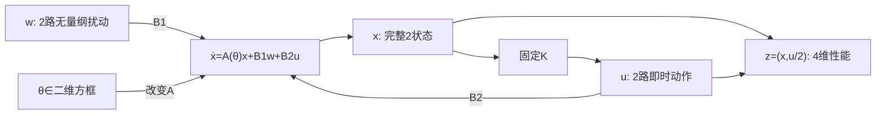

# MIMO不确定性与H∞综合

读者问题：名义模型的两个极点都稳定，换一组参数或两路扰动同时进入，控制器还能满足原性能要求吗？第06课已经说明组合方向的增益不能由单个矩阵元素代替；第09课用逐拍幅度界保护标量约束。本课改问**有限能量扰动能造成多少加权状态与控制代价**，从一个连续二维不确定模型求出固定状态反馈，并用同一储能证明整个连续参数集合的稳定与性能。

第一次读可以先看端口表、能量账和固定例子的证书，再回到变量替换；已有正定矩阵与耗散经验的读者可直达“从分析不等式到可求解的状态反馈”。两条路线消费同一证明。这里的数值模型是合成对象，参数方框是题目给定的集合；它没有冒充前面保温盒的实测参数。

## 先写端口，性能才有对象

时间按 $t_0=1\,\mathrm s$ 归一化，$\tau=t/t_0$。下面 $x,w,u,z$ 各分量均无量纲，点号指 $d/d\tau$。可把物理状态、动作和扰动按预先给定的正尺度矩阵写成 $x=S_x^{-1}x_{\rm phys},u=S_u^{-1}u_{\rm phys},w=S_w^{-1}w_{\rm phys}$；本合成例直接指定归一化系数，没有为未知设备代填 K、W 或 N。物理迁移时 $A=t_0S_x^{-1}A_{\rm phys}S_x$、$B_2=t_0S_x^{-1}B_{u,\rm phys}S_u$ 等也必须一起转换。

$$\dot x=A(\theta)x+B_1w+B_2u,\qquad z=C_zx+D_{zu}u.\tag{1}$$

| 对象 | shape | 作用与尺度 |
| --- | --- | --- |
| $x$ | $2\times1$ | 两个完整可读的状态偏差，目标 $x=0$。 |
| $w$ | $2\times1$ | 两路外部扰动，分别以 $B_1$ 的列进入状态导数。 |
| $u$ | $2\times1$ | 两路连续即时动作；本例不含执行器限幅、时延或保持。 |
| $z$ | $4\times1$ | 前两项为状态，后两项为半尺度动作；这是性能端口。 |
| $A,B_1,B_2$ | $2\times2$ | 动态、扰动与控制映射。 |
| $C_z,D_{zu}$ | $4\times2$ | 将状态/动作映到同一无量纲性能空间。 |

固定

$$A(\theta)=A_0+\theta_1A_1+\theta_2A_2,\quad(\theta_1,\theta_2)\in[-1,1]^2,$$
$$A_0=\begin{bmatrix}-2/5&1\\-1/2&-1/5\end{bmatrix},\quad
A_1=\begin{bmatrix}3/10&0\\0&-1/5\end{bmatrix},\quad
A_2=\begin{bmatrix}0&3/20\\1/10&0\end{bmatrix},$$
$$B_1=I_2,\quad B_2=\begin{bmatrix}1&1/5\\1/10&1\end{bmatrix},\quad
C_z=\begin{bmatrix}I_2\\0_{2\times2}\end{bmatrix},\quad
D_{zu}=\begin{bmatrix}0_{2\times2}\\\tfrac12I_2\end{bmatrix}.\tag{2}$$

图中 $w$ 是外部作用，$u$ 是反馈产生的动作，两者都进入状态导数；性能同时读取状态和动作，控制器不读取参数。名义 $A_0$ 的特征根是 $-0.3\pm0.7j$，已稳定；新问题仍有意义，因为极点稳定没有给出两路扰动到状态/动作的加权增益。性能没有扰动直通项：$D_{zw}=0_{4\times2}$。状态互相耦合，$B_2$ 也非对角；不能分别设计两个标量回路再声称联合保证。控制器取

$$u=Kx,\quad K\in\mathbb R^{2\times2},\qquad
F_\theta=A(\theta)+B_2K,\quad C_K=C_z+D_{zu}K.$$

第05课用 $u=-Kx$；本课把符号吸收进 $K$，恢复控制器时必须按这里的加号。这里要求全部 $x$ 无噪可读，$K$ 不读取 $\theta$；它是对全部模型共用的固定律。

$$z=\begin{bmatrix}x\\u/2\end{bmatrix},\qquad
z^Tz=x^Tx+\tfrac14u^Tu.\tag{3}$$

因此用非常大动作压小状态不能把动作从账本删掉。$1/2$ 是**设计权重**，不是执行器最大值；$\int u^Tu\,d\tau$ 也只是合成平方动作代价，不等于实物电能。改权重或物理归一化会改变要优化的问题，不能在求解后改纵轴单位来宣称更好的控制器。第06课的 [[控制论/10-系统课程/06-多变量互联矩阵顺序与实现条件#范数比较前先给每一路物理尺度|尺度变换]] 给出通用端口变换；带回各路尺度后再比较本课的 $\gamma$。

## 扰动能量与内部稳定是两项责任

定义 $\|w\|_{L^2}^2=\int_0^\infty w^Tw\,d\tau$。零初值 $x(0)=0$ 时，目标是对每个非零有限能量扰动都有

$$\|z\|_{L^2}\le\gamma\|w\|_{L^2}.\tag{4}$$

对固定 $\theta$，若完整闭环内部稳定，$T_\theta(s)=C_K(sI_2-F_\theta)^{-1}B_1$ 是 $4\times2$ 传递矩阵，其诱导 $L^2$ 增益等于

$$\|T_\theta\|_\infty=\sup_{\omega\in\mathbb R}\bar\sigma(T_\theta(j\omega)).$$

输入方向也在最大奇异值中优化；逐个元素的 Bode 幅值或一条扰动波形不够代表这个最坏方向。$s$ 与 $\omega$ 对应归一化时间；换成物理频率要除以 $t_0$。时变参数的闭环一般没有一个固定传函，仍可讨论(4)的诱导增益，但不能给它套一个冻结参数的频率曲线。

内部稳定要求无外扰时所有状态衰减。复用 [[信号与系统/40-状态控制与辨识/02-内部稳定与输入输出稳定#三个同G盒子：端口看不到的状态不同|隐藏状态主解释]]：一个端口完全看不见的 $\dot h=h$ 可以与端口增益0并存。本课将完整两状态放入正定储能，而不是只检查可见传函。

$L^2$ 假设也不同于第09课的每拍幅度界：恒定非零扰动在无限时间上不是 $L^2$；有限能量信号可以在极短时间有大峰值。(4)不直接给逐点动作限幅、硬约束或精确恒扰跟踪。到 [[控制论/10-系统课程/09-有界扰动不变管与模型误差#收紧给实际状态和动作留余量|扰动管的收紧]]，带回的是逐点集合和时序，不要把本课的积分界替换那个集合归纳。

## 储能把所有扰动压进同一个不等式

沿 [[控制论/10-系统课程/17-无源系统耗散与反馈互联#从耗散到无源，严格性究竟严格在哪里|耗散主解释]]，选 $V=x^TPx$，$P=P^T\succ0$。此 $V$ 是无量纲性能储能，不声称它是全部物理焦耳能量。记 $\eta=\gamma^2>0$，希望

$$\dot V+z^Tz-\eta w^Tw<0\qquad\text{对每个 }(x,w)\ne0.\tag{5}$$

代入状态方程、保留交叉项，得到

$$\dot V= x^T(F_\theta^TP+PF_\theta)x+2x^TPB_1w,$$

因而(5)等价于

$$N_\theta=\begin{bmatrix}
F_\theta^TP+PF_\theta+C_K^TC_K&PB_1\\
B_1^TP&-\eta I_2
\end{bmatrix}\prec0.\tag{6}$$

这是 $4\times4$ 对称矩阵的**二次型**负定，不是每个元素小于0。正定/合同变换回补 [[数学/20-线性代数与几何/15-谱定理二次型与正定矩阵#二次型就是不同方向上的能量|二次型与方向]]，回来用 $(x,w)$ 的完整四维方向判断(6)。

这条条件同时承担两个结论。令 $w=0$，(6)给 $F_\theta^TP+PF_\theta\prec0$，所以齐次状态指数衰减；没有靠可见输出的非负积分猜内部稳定。对一般输入积分得

$$V(x(T))+\int_0^Tz^Tz\,d\tau
\le V(x(0))+\eta\int_0^Tw^Tw\,d\tau.\tag{7}$$

零初值并舍掉末储能得到(4)。非零初值则必须保留 $V(x(0))$；例如 $w=0,x(0)\ne0$ 仍会产生性能输出，不能把它写成 $\|z\|\le\gamma\times0$。若严格矩阵在集合上有统一余量 $N_\theta\preceq-\varepsilon I_4$，选 $0<\varepsilon<\eta$，还可得零初值增益至多 $\sqrt{\eta-\varepsilon}<\gamma$。文中给出的 $\gamma$ 是易核对的保守报告上界。

[Boyd等作者教材 §2.7.3、§6.3.2、§7.5.1](https://web.stanford.edu/~boyd/lmibook/lmibook.pdf)定位有界实与状态反馈增益条件。这里按本例 $D_{zw}=0$ 从导数直接证明充分性；不依赖最小实现去猜隐藏状态，更不将公共二次证书宣称为所有不确定控制器的必要条件。

## 从分析不等式到可求解的状态反馈

直接同时搜索 $P,K$，(6)含 $PB_2K$ 和 $K^TD_{zu}^TD_{zu}K$；不能因为“负定”两个字就叫线性矩阵不等式。先用 [[数学/20-线性代数与几何/18-分块矩阵Schur补与矩阵指数#正定性的消元解释|Schur补配方]] 把输出平方拆成一个额外块：

$$\mathcal B_\theta=\begin{bmatrix}
F_\theta^TP+PF_\theta&PB_1&C_K^T\\
B_1^TP&-\eta I_2&0_{2\times4}\\
C_K&0_{4\times2}&-I_4
\end{bmatrix}\prec0.\tag{8}$$

消去 $-I_4$ 后，左上块加 $C_K^TC_K$，恰好恢复(6)；符号加错会奖励大输出。

令 $X=P^{-1}=X^T\succ0,Y=KX$，用可逆矩阵 $\operatorname{diag}(X,I_2,I_4)$ 对(8)左右作合同变换。逐块计算：$X(F^TP+PF)X=XF^T+FX$，$XPB_1=B_1$，$C_KX=C_zX+D_{zu}Y$。结果是

$$M_\theta(X,Y,\eta)=\begin{bmatrix}
\operatorname{Sym}(A(\theta)X+B_2Y)&B_1&(C_zX+D_{zu}Y)^T\\
B_1^T&-\eta I_2&0_{2\times4}\\
C_zX+D_{zu}Y&0_{4\times2}&-I_4
\end{bmatrix}\prec0,\tag{9}$$

其中 $\operatorname{Sym}(L)=L+L^T$，**没有除2**。整体 $8\times8$，三个块维度为2、2、4。固定模型矩阵后，(9)对 $X,Y,\eta$ 仿射；恢复律是 $K=YX^{-1}$，乘法顺序不能交换。实际计算通过解 $KX=Y$ 得到 $K$，不必显式求数值逆。

本例最小化 $\eta$，同时要求全部模型的(9)，并加设计约束 $X\succeq(1/5)I_2$。后者等价于 $P\preceq5I_2$，限制储能曲率，避免恢复 $K=YX^{-1}$ 时使用过度接近奇异的 $X$；它会收窄可行设计，不能被读成 $|u_i|\le1$ 或任意初值动作界。有限精度求解器使用明确的非零负定余量；它报告的最优状态只是产生候选。最后把 $X,Y,\eta$ 写成有理数，重新检查正定性，得到一个可独立复算的可行上界。报告不会把严格不等式的边界、舍入后的控制器或求解器迭代状态叫作已证全局最优。需要核对“可行上界”和“最优性下界”之别时，去 [[数学/40-微积分与优化/08-凸优化对偶与最优性证书#L≤OPT≤U 的两端从哪里来|两端证书主解释]]，带回本例只有经有理检验的可行上界，不能拿软件状态充独立下界。

## 四个顶点为何覆盖无限多个参数

令 $s_1,s_2\in\{-1,+1\}$，$A_s=A_0+s_1A_1+s_2A_2$。对任意方框内的 $\theta$，

$$\lambda_s(\theta)=\frac{(1+s_1\theta_1)(1+s_2\theta_2)}4\ge0,\quad
\sum_s\lambda_s=1,\quad A(\theta)=\sum_s\lambda_s A_s.$$

用**相同** $X,Y,\eta$ 时，仿射性保证

$$M_\theta=\sum_s\lambda_sM_s.\tag{10}$$

对任意非零 $v\in\mathbb R^8$，若四个顶点 $v^TM_sv<0$，它们的凸组合也严格负。故检查四个矩阵充分覆盖所有连续参数点。最小顶点负定余量又给统一余量；经固定合同变换与Schur补，(6)也有统一余量。有限顶点检验在此是**凸组合证明的有限证书**，不是恰好选四个点作网格。

它还覆盖参数随时间改变：若 $\theta(\tau)$ 是任意可测函数，始终在方框中，矩阵有界，$w\in L^2_{\rm loc}$，线性方程有唯一全时绝对连续解。(5)几乎处处成立，固定 $P$ 不产生 $\dot P$ 或 $\dot\theta$ 项；积分仍给(7)。无扰动时从统一余量和 $V\le\lambda_{\max}(P)\|x\|^2$ 得共同指数衰减，允许任意快参数变化。这个论证不包括状态重置、执行器切换或超出集合的时刻。

若四个顶点各自使用不同的 $P_s,K_s$，(10)便没有同一组变量可组合；控制器也不知道应施加哪一个 $K_s$。即使相同 $K$ 在每个顶点的特征根稳定，内部未必稳定。反例

$$F_- =\begin{bmatrix}-1&3\\0&-1\end{bmatrix},\qquad
F_+ =\begin{bmatrix}-1&0\\3&-1\end{bmatrix}$$

两个顶点都只有极点 $-1$，中点 $\tfrac12(F_-+F_+)$ 却有 $1/2,-5/2$。所以“顶点极点稳定”不是本证书；它无法有一个对两顶点严格下降的共同正定 $P$，否则中点不稳与上面的凸组合推导矛盾。

公共二次函数限制了可行设计：一个固定参数族可能满足鲁棒性能，却需要参数相关或更复杂储能才能证明。不可行只表示这组公共二次充分条件、权重和余量没有给出证书，不等于对象不可控制。一般输出反馈、参数调度、动态权重、结构化不确定块或μ综合各需新的信息与证明。

## 固定例子：求解输出如何成为数学证书

实际数值综合采用上述四顶点、$X\succeq I_2/5$ 和 $M_s\preceq-10^{-7}I_8$。把浮点候选舍入到分母 $10^5$，并给性能界留出余量后得到

$$X=\begin{bmatrix}18443/50000&8493/25000\\8493/25000&88347/100000\end{bmatrix},\qquad
Y=\begin{bmatrix}-400073/100000&-20027/50000\\-39999/50000&-399999/100000\end{bmatrix},$$
$$\eta=\frac{32741}{100000},\quad\gamma=\sqrt{\frac{32741}{100000}}\approx0.5721975183,$$
$$K=YX^{-1}\approx\begin{bmatrix}-16.14719848&5.75569772\\3.09843381&-5.71902830\end{bmatrix}.\tag{11}$$

先核一个瞬时动作：在 $\theta=0,w=0,x=(1,0)^T$，(11)给 $u\approx(-16.14719848,3.09843381)^T$。代回 $A_0x+B_2u$，得到 $\dot x\approx(-15.92751172,0.98371396)^T$；第二状态虽初始为0，仍被第一状态和两路动作共同推动。对角反馈的标量直觉不能替代这次完整乘法。显示近似只用于这次数量级核对。

实际施加的数学控制器由有理 $X,Y$ 定义；显示小数只便于阅读，不将舍入小数当成原精确矩阵。实践09保存有理 $P,K$，无需从这行八位小数恢复证书。

令 $\epsilon_M=10^{-6}$。有理运算逐个检查 $X-I_2/5$、$X-\epsilon_MI_2$ 和四个 $-M_s-\epsilon_MI_8$ 的全部顺序主子式为正；也保存相邻主子式之比，即无主元 $LDL^T$ 分解的正对角枢轴。这是精确二次型判别，显示的浮点特征值只作诊断。

| 顶点 $(\theta_1,\theta_2)$ | $-M_s-10^{-6}I_8$ 的最小LDL枢轴（近似显示） | 精确判别 |
| --- | --- | --- |
| $(-1,-1)$ | 0.06114932194 | 八个有理主子式均正。 |
| $(-1,+1)$ | 0.08091848593 | 八个有理主子式均正。 |
| $(+1,-1)$ | 0.05609811011 | 八个有理主子式均正。 |
| $(+1,+1)$ | 0.03861598075 | 八个有理主子式均正。 |

LDL枢轴不是矩阵最小特征值；统一 $10^{-6}$ 余量来自对 **$-M_s-10^{-6}I_8$ 本身** 的精确判别，不能把上表最小枢轴替代它。$X-I_2/5$ 的两个主子式为 $8443/50000$ 与 $5329/5000000000$，所以额外设计约束也在有理化后保留。代入(9)、(10)、(8)、(6)就得到对全部可测方框内参数轨道的共同耗散保证。求解器找到候选与四矩阵有理判别是两种证据。

作为有限数值观察，取 $\theta_1(\tau)=\sin(0.7\tau)$、$\theta_2(\tau)=\cos(1.1\tau)$，$w=(e^{-\tau}\sin2\tau,e^{-\tau}\cos3\tau)^T$，积分到 $\tau=12$。零初值时观测到 $E_w\approx0.475$、$E_z\approx0.10552869$，末储能约 $1.84\times10^{-12}$；预算为 $\eta E_w\approx0.15551975$。这条波形支持实现核对，全集合结论来自证书。

对同一扰动改用 $3K$，$E_x$ 从约0.00815176降到0.00134691，平方动作代价 $E_u$ 从0.38950771升到0.45947815，总 $E_z$ 从0.10552869升到0.11621645。这个情景展示了“状态更小却综合代价更大”；它既没有为 $3K$ 重做共同证书，也不是所有扰动的比较最优性。非零初值 $(1,-1/2)^T$ 时，$V_0\approx6.24993272$ 必须进入预算，不能继续按零初值比值宣称超界。

数值的 [[控制论/80-实践/09-MIMO鲁棒综合/README|实践09]] 保留输入、源码、精确证书、原始耗散形式复算、有限CSV和图。7×7参数、402频点的最大观测奇异值约0.55947904，出现在 $(-1,-1),\omega=0$；它是采样观察，不是全频最大值或保证依据。四个越界参数的同一证书失败只说明不能继续使用它，不证明越界闭环真实失稳。

## 改变前提时，哪一行先失效

测量改为 $y=Hx+n$、动作改为 $u=K\hat x$ 时，(1)的状态必须扩充到估计器；原二阶 $F_\theta$ 与 $C_K$ 已不是真实闭环。第05课的名义三角分离稳定性不自动给这个鲁棒 $L^2$ 性能界，尤其模型误差和噪声会进入估计误差。先恢复 [[控制论/10-系统课程/05-状态反馈观测器与平衡目标#真正闭环有四个状态|完整闭环状态]]，再设计一般输出反馈。

饱和时 $u_{\rm actual}\ne Kx$，(5)中的动态交叉项和动作平方应使用真实动作，原(9)停止承担保证。数字保持也会将即时 $Kx(\tau)$ 改成旧状态动作；RK4步长只属于积分器，不是控制采样周期。带着真实保持/延迟到第06/14课重新建模。

越界参数不再有非负凸组合权重；证书不能外推。若 $B_2,C_z,D_{zu}$ 也随参数变化，必须先核全部块是否仍由同一顶点仿射组合，不能只插入新的 $A$ 顶点。若控制权重被设为0，性能对象改变，可能鼓励无限增益；即使权重非零，也不自动形成逐点限幅或保证严格最优值在有限增益达到。

## 撤去方法提示，携带答案返回

1. 固定本模型和已给控制器。现在扰动能量至多2，初值 $x_0=(1,0)^T$，写对任意有限终点的性能预算。改成零初值时，预算少掉什么？
2. 取 $\theta=(1/2,-1/3)$，交出四个非负权重以及该点证书为何成立。随后改为 $\theta=(6/5,0)$，现有证明是否仍成立？
3. 要求“两状态误差在无限时间最终为0，而且每一时刻 $|u_i|\le1$”，给出本证书能直接兑现与需要补充的部分。
4. 将性能动作权重由 $1/2$ 改成1，能否继续引用原 $\gamma$？先预测状态/动作优化的方向，再按实践接口改变权重、重新综合和验证。
5. 只测 $x_1$，以一个稳定名义观测器代入原控制律。提交新闭环的全部状态与扰动端口；“观测器极点都稳定”是否足以使用原证书？

> [!question]- 可核答案
> 1. $V(x(T))+\int_0^Tz^Tz\le (P)_{11}+2\eta$；舍末储能得到较松预算。零初值少掉 $(P)_{11}$。初值预算不是改变 $L^2$ 增益定义。
> 2. 按 $(-,-),(-,+),(+,-),(+,+)$ 顺序，权重为 $1/6,1/12,1/2,1/4$，和为1，分别重建 $\theta_1=1/2,\theta_2=-1/3$。越界点会出现负权重，旧凸组合证明停止；这不独立证明新对象不稳定。
> 3. 零扰动时已有共同指数收敛；一般有限能量扰动有积分性能界，但不能从这一句推出逐点限幅。持续恒扰不在无限 $L^2$ 类，精确跟踪需平衡/内模；硬动作界需初值/扰动集合和受保护域或约束设计。
> 4. 新 $z^Tz=x^Tx+u^Tu$，使用相同控制器时输出代价增加；旧 $\gamma$ 不自动覆盖它。重新综合倾向更重视动作成本，实际方向和新界由新输入/证书核对，不能只按直觉填写新数值。
> 5. 增广 $(x,\hat x)$ 或 $(x,e)$，含模型误差和测量噪声注入；原 $P$ shape不够覆盖四状态。名义分离极点支持名义齐次稳定，仍须重新核不确定闭环和全部性能端口。

本单元交付的是规范化多变量性能、明确参数多胞体、固定全状态反馈、公共严格有界实证书与有限CPU综合。它没有完成一般输出反馈、鲁棒MPC、实际参数辨识、设备限幅/实时或完整C01–C08。实践改参结果与数学全集合证明分别复核；人的撤提示理解另有观察，不由代码PASS代填。返回 [[控制论/00-控制论-MOC|课程入口]]。
