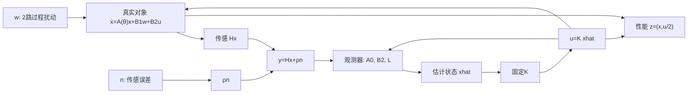

# 动态输出反馈与鲁棒性能证书

读者问题：第18课已经给出一个保护参数方框的 $u=Kx$，现在只读得到一个带噪传感器，可以把 $x$ 换成观测器的 $\hat x$，继续引用原来的性能界吗？这个替换增加了两个内部状态，也改变了扰动进入反馈的路径。我们保留第18课的对象与控制增益，固定一个名义观测器，**对完整四状态闭环重新证明性能**。第05课的热对象、平衡前馈和名义分离结论继续在原页消费，本页处理第18课合成对象的输出反馈接口。

这是一组已给 $K,L$ 的鲁棒性能核验：公共储能与性能界可以用凸问题搜索，精确有理证书负责最后接受。它不交付一般动态输出反馈综合，也不声称名义整定出的观测器最优。先看“估计误差为何重新依赖真实状态”预测失配影响，再看证书怎样同时纳入过程扰动、传感噪声和动作代价。

## 一个读数，两组内部状态，三路外扰

沿用 [[控制论/10-系统课程/18-MIMO不确定性与H∞综合#先写端口，性能才有对象|第18课的规范化对象]]：$\tau=t/(1\,\mathrm s)$，状态 $x\in\mathbb R^2$、动作 $u\in\mathbb R^2$、过程扰动 $w\in\mathbb R^2$ 都无量纲，点号指 $d/d\tau$。矩阵固定为

$$\dot x=A(\theta)x+B_1w+B_2u,\qquad A(\theta)=A_0+\theta_1A_1+\theta_2A_2,$$
$$A_0=\begin{bmatrix}-2/5&1\\-1/2&-1/5\end{bmatrix},\quad
A_1=\begin{bmatrix}3/10&0\\0&-1/5\end{bmatrix},\quad
A_2=\begin{bmatrix}0&3/20\\1/10&0\end{bmatrix},$$
$$B_1=I_2,\qquad B_2=\begin{bmatrix}1&1/5\\1/10&1\end{bmatrix},\qquad \theta\in[-1,1]^2.\tag{1}$$

固定第18课的有理控制器 $K=YX^{-1}$：

$$X=\begin{bmatrix}18443/50000&8493/25000\\8493/25000&88347/100000\end{bmatrix},\quad
Y=\begin{bmatrix}-400073/100000&-20027/50000\\-39999/50000&-399999/100000\end{bmatrix},$$
$$K\approx\begin{bmatrix}-16.14719848&5.75569772\\3.09843381&-5.71902830\end{bmatrix}.\tag{2}$$

小数只显示量级；实际数学控制器由有理 $X,Y$ 定义。符号约定是 $u=K\hat x$，与第05课把负号放在律外的写法对照后再代数运算。

测量与控制器为

$$y=Hx+\rho n,\quad H=\begin{bmatrix}1&0\end{bmatrix},\quad\rho=1/20,$$
$$\dot{\hat x}=A_0\hat x+B_2u+L(y-H\hat x),\qquad u=K\hat x,$$
$$L=\begin{bmatrix}32/5\\507/50\end{bmatrix}.\tag{3}$$

$y,n$ 都为标量。可观矩阵 $[H;HA_0]=[[1,0],[-2/5,1]]$ 行列式为1；名义二阶动态允许一个读数重建两状态。$A_0-LH=[[-34/5,1],[-266/25,-1/5]]$，trace为 $-7$、det为12，故观测器名义极点为 $-3,-4$。这里用名义极点配置固定 $L$；真实参数 $\theta$ 不送入控制器。

| 端口或状态 | shape | 读者应保留的解释 |
| --- | --- | --- |
| $x,\hat x$ | 各 $2\times1$ | 对象真实状态与控制器记忆，初值各自指定。 |
| $y$ | $1\times1$ | 无量纲第一状态读数加传感误差，控制器只读取它。 |
| $w$ | $2\times1$ | 经 $B_1$ 进入真实对象的归一化外部作用。 |
| $n$ | $1\times1$ | 以独立参考尺度归一化的传感误差；经 $\rho L$ 进入观测器导数。 |
| $d=(w_1,w_2,n)^T$ | $3\times1$ | 本页计入预算的完整外扰。 |
| $z=(x^T,u^T/2)^T$ | $4\times1$ | 真实状态与真实线性动作的共同性能，不以估计值替换真实状态。 |

物理迁移先指定 $x=S_x^{-1}x_{\rm phys}$、$u=S_u^{-1}u_{\rm phys}$、$w=S_w^{-1}w_{\rm phys}$、$y=S_y^{-1}y_{\rm phys}$、$n=S_n^{-1}n_{\rm phys}$。于是 $A=t_0S_x^{-1}A_{\rm phys}S_x$、$B_1=t_0S_x^{-1}B_{w,\rm phys}S_w$、$B_2=t_0S_x^{-1}B_{u,\rm phys}S_u$；$H=S_y^{-1}H_{\rm phys}S_x$，本标量传感器的 $\rho=S_y^{-1}S_n$。物理观测器增益与这里的 $L$ 也按 $L=t_0S_x^{-1}L_{\rm phys}S_y$ 转换。改变参考尺度改变了 $\int d^Td$ 的意义，必须重新解释性能要求。

本合成例指定 $\rho=0.05$，表示传感误差参考尺度相对读数参考尺度的比例，**不是噪声标准差，也不是每时刻误差上界**。没有实测设备、统计置信区间或功率单位推断。确定性 $n\in L^2$ 包括有限持续的误差波形；无限时间常偏置和理想白噪声不能未经处理就作为这里的有限能量输入。

图回答“噪声先进入哪里”：它先改变观测器记忆，再经动作影响真实状态；$u$ 没有对当前 $n$ 的代数直通。整个控制器对读数是二阶动态系统，不是 $y$ 乘一个静态增益。

## 估计误差为何重新依赖真实状态

先取 $e=x-\hat x$，逐项相减：

$$\dot e=\dot x-\dot{\hat x}=(A(\theta)-A_0)x+(A_0-LH)e+B_1w-\rho Ln.\tag{4}$$

已知动作 $B_2u$ 抵消；过程扰动没有送入观测器，故仍进入误差。即使 $e=0$，只要 $\theta\ne0$ 或 $w,n\ne0$，误差一般会重新产生。控制器固定使用 $A_0$，不能偷偷把误差动态写成 $(A(\theta)-LH)e$ 并删除 $(A(\theta)-A_0)x$。

用 $\zeta=(x^T,e^T)^T$，完整对象是

$$\dot\zeta=\underbrace{\begin{bmatrix}
A(\theta)+B_2K&-B_2K\\
A(\theta)-A_0&A_0-LH
\end{bmatrix}}_{F^e_\theta\in\mathbb R^{4\times4}}\zeta+
\underbrace{\begin{bmatrix}B_1&0_{2\times1}\\B_1&-\rho L\end{bmatrix}}_{G^e\in\mathbb R^{4\times3}}d,$$
$$z=\underbrace{\begin{bmatrix}I_2&0_{2\times2}\\K/2&-K/2\end{bmatrix}}_{C^e\in\mathbb R^{4\times4}}\zeta.\tag{5}$$

只有名义 $\theta=0$ 的齐次方程才是上三角块；特征根是 $A_0+B_2K$ 与 $A_0-LH$ 的并集。名义分离稳定性在这个条件下成立，但它没有计算三路输入到四路性能的最坏能量比。$\theta\ne0$ 时左下块通常非零，两个“各自稳定极点”的论证也不再描述真实闭环。[Åström/Murray作者的输出反馈章节](https://fbswiki.org/wiki/index.php/Output_Feedback)给出名义观测器与分离的背景；本页的失配/噪声式直接由(1)–(3)推得。

证书和源码采用 $\xi=(x^T,\hat x^T)^T$，因为这与实际两组积分器对应：

$$\dot\xi=F_\theta\xi+Gd,\quad z=C\xi+Dd,$$
$$F_\theta=\begin{bmatrix}
A(\theta)&B_2K\\LH&A_0+B_2K-LH
\end{bmatrix},\quad
G=\begin{bmatrix}B_1&0_{2\times1}\\0_{2\times2}&\rho L\end{bmatrix},$$
$$C=\begin{bmatrix}I_2&0_{2\times2}\\0_{2\times2}&K/2\end{bmatrix},\quad D=0_{4\times3}.\tag{6}$$

检查一个瞬间：$\xi=(1,0,0,0)^T,d=0,\theta=0$ 时 $u=0$，$\dot x=(-0.4,-0.5)^T$，$\dot{\hat x}=(6.4,10.14)^T$，$\dot e=(-6.8,-10.64)^T$。同一真实初态用全状态律时会立即给巨大动作；观测器零初值时先用读数建立记忆，两者显然不是原来的同一个二阶闭环。

坐标关系 $\zeta=T\xi$，$T=[[I_2,0],[I_2,-I_2]]$ 且 $T^{-1}=T$。因此 $F^e_\theta=TF_\theta T$、$G^e=TG$、$C^e=CT$。若(6)的储能是 $\xi^TP\xi$，(5)的同一储能矩阵为 $P^e=T^TPT$；原第18课 $2\times2$ 的 $P$ 不能靠补两个零行列成为正定四状态证书。

## 固定控制器怎样变成可求解的证书

零完整初值 $\xi(0)=0$，目标是对所有非零 $d\in L^2$、所有允许参数轨道满足

$$\|z\|_{L^2}\le\gamma\|d\|_{L^2},\qquad
\|d\|_{L^2}^2=\int_0^\infty (w^Tw+n^2)\,d\tau.\tag{7}$$

这里的零初值同时包括真实对象和观测器；仅写 $x(0)=0$ 而让 $\hat x(0)\ne0$，会有没有外扰也存在的动作/状态响应。性能仍为 $z^Tz=x^Tx+u^Tu/4$。

选公共 $P=P^T\succ0\in\mathbb R^{4\times4}$、$V=\xi^TP\xi$ 与 $\eta=\gamma^2>0$。把(6)代入 $\dot V+z^Tz-\eta d^Td<0$，得到原始耗散矩阵

$$N_\theta(P,\eta)=\begin{bmatrix}
F_\theta^TP+PF_\theta+C^TC&PG\\
G^TP&-\eta I_3
\end{bmatrix}\prec0.\tag{8}$$

整体 $7\times7$，上块4、下块3。保持 $K,L,H,\rho$ 固定时，$F_\theta,G,C$ 都已知，(8)对 $P,\eta$ 仿射。可以最小化 $\eta$，用非零矩阵余量求候选；本例搜索取 $P\succeq10^{-3}I_4$、$N_s\preceq-10^{-7}I_7$，前者是额外储能尺度约束，不是动作幅度界。最后接受候选不靠软件状态，而靠有理矩阵的严格判别。

与Schur补接口对照的三块形式是

$$\mathcal B_\theta=\begin{bmatrix}
F_\theta^TP+PF_\theta&PG&C^T\\
G^TP&-\eta I_3&0_{3\times4}\\
C&0_{4\times3}&-I_4
\end{bmatrix}\prec0,\tag{9}$$

维度 $4+3+4=11$；消去 $-I_4$ 恢复(8)。这两种搭建路线、两种状态坐标都是同一耗散账，适合独立复算发现漏块、噪声符号或错误输出。若未来增加直通 $D\ne0$，(8)应改为上右 $PG+C^TD$、下右 $D^TD-\eta I$；本源码不把它当成已支持功能。

为什么不顺手同时调 $K,L,P$？(8)中的 $PB_2K$、$PLH$，以及输出平方含控制器未知量的乘积；固定控制器时的凸性不会自动保留。一般动态输出反馈有其专门综合理论；这里既没有将这些乘积叫LMI，也没有以轮流固定变量的局部搜索声称全局最优。[Boyd等作者教材 §2.7.3、§6.3.2](https://web.stanford.edu/~boyd/lmibook/lmibook.pdf)提供有界实/输入输出条件定位；本页按(6)的零直通对象直接证明充分性。

## 为什么有限顶点覆盖时变方框

令 $s_1,s_2\in\{-1,+1\}$，保持同一组 $K,L,P,\eta$。对任意 $\theta\in[-1,1]^2$，

$$\lambda_s(\theta)=\frac{(1+s_1\theta_1)(1+s_2\theta_2)}4\ge0,\qquad \sum_s\lambda_s=1.$$

(6)只有左上对象块随参数仿射变化，故 $F_\theta=\sum_s\lambda_sF_s$。$G,C$ 固定，导出

$$N_\theta=\sum_s\lambda_sN_s.\tag{10}$$

四顶点 $N_s\prec0$ 时，对任意非零七维方向 $v$ 有 $v^TN_\theta v=\sum_s\lambda_sv^TN_sv<0$。若精确检查 $-N_s-\epsilon I_7\succ0$，所有点统一满足 $N_\theta\preceq-\epsilon I_7$。这是仿射凸组合证明，不是四点采样经验；让每个顶点各用不同 $P_s$ 会失去(10)。

对任意可测 $\theta(\tau)$ 始终在方框内、$d\in L^2_{\rm loc}$，有界线性系数保证唯一全时绝对连续解。固定 $P$ 不出现 $\dot P$ 或 $\dot\theta$，耗散不等式几乎处处成立；积分到任何有限 $T$：

$$V(\xi(T))+\int_0^T z^Tz\,d\tau
\le V(\xi(0))+\eta\int_0^Td^Td\,d\tau.\tag{11}$$

零完整初值时舍末储能，得到(7)。$d=0$ 时统一余量给 $\dot V\le-\epsilon\|\xi\|^2\le-\epsilon V/\lambda_{\max}(P)$，所以完整四状态共同指数衰减，包括不能只从真实输出看见的控制器记忆。这个证明允许任意快可测参数变化，却不包括状态reset、执行器饱和、采样保持和超出方框的时刻。

固定参数时可用 $C(sI_4-F_\theta)^{-1}G$ 的最大奇异值作频率诊断；时变轨道一般没有单一固定传函。公共二次证书是充分条件，找不到它不能直接断言该固定控制器在所有参数都失稳，更不能断言对象没有任何可用控制器。

## 有限证书与实际复算

对(6)的固定 $K,L,H,\rho$，求解器搜索公共 $P,\eta$。将 $P$ 舍入到分母 $10^6$、给 $\eta$ 留性能余量并精确复核后，取得

$$P=\frac1{10^6}\begin{bmatrix}
5159705&-1608374&-4519132&1937068\\
-1608374&1376449&1636946&-1045110\\
-4519132&1636946&6390509&-2863961\\
1937068&-1045110&-2863961&2032204
\end{bmatrix},\qquad
\eta=\frac{2776339}{10^6},\quad\gamma\approx1.6662349774.\tag{12}$$

这里的 $P$ 针对 $\xi=(x,\hat x)$ 顺序。取 $\epsilon=10^{-6}$，检查 $P-\epsilon I_4$、$P-10^{-3}I_4$ 各四个顺序主子式，以及每个 $-N_s-\epsilon I_7$ 的七个顺序主子式；全部为正有理数。设计下界采用严格判别是更保守的有限接受条件。因此已给的是严格可行证书，不是仅有浮点特征值支持的候选。全部精确矩阵、主子式与输入身份保存在 [[控制论/80-实践/10-动态输出反馈鲁棒证书/README|实践10]]。

| 顶点 | $-N_s-10^{-6}I_7$ 的最小LDL枢轴（近似显示） | 精确结果 |
| --- | --- | --- |
| $(-1,-1)$ | 0.1606513970 | 七个顺序主子式均正。 |
| $(-1,+1)$ | 0.9626752986 | 七个顺序主子式均正。 |
| $(+1,-1)$ | 0.7929887516 | 七个顺序主子式均正。 |
| $(+1,+1)$ | 0.3398258437 | 七个顺序主子式均正。 |

这些LDL枢轴由相邻主子式相除获得，不是最小特征值。统一余量来自对**移除 $10^{-6}I$ 后的完整矩阵**作正定判别；它与(10)(11)共同承担整个可测参数方框的保证。P的非对角块还说明储能计入真实状态与控制器记忆的相关方向，不能把二者分别各算一个漂亮能量界后相加当作这张证书。

第18课的 $\gamma\approx0.5722$ 只属于全状态闭环的两路过程扰动问题；本页是另一条四状态/三外扰的输入输出映射，报告 $\gamma\approx1.6662$。这两个具体证书不能独立证明所有输出反馈都比全状态反馈差，也没有证明新 $L$、$P$ 或性能界是最优的。数值轨迹、冻结参数扫频和改前提反例核实现；一般保证仍来自精确证书与耗散证明。

## 改变前提时先改哪一个块

传感器断开、$H_{\rm actual}$ 改变而控制器仍使用设计 $H$，则(6)下左块变为 $LH_{\rm actual}$，下右仍为 $A_0+B_2K-LH$。令 $H_{\rm actual}=0$、$\hat x(0)=0$、$n=0$，观测器始终为0、$u=0$，真实对象成为 $\dot x=A(\theta)x+B_1w$。它不再是证书核过的 $F_\theta$；“名义观测器有稳定极点”不能替断开的读数恢复反馈。是否真实违反某个性能界需重新计算，不以旧证书失败代替答案。这里可以给一个精确性能反例：冻结 $\theta=(-1,-1)$，取 $n=0,\hat x_0=0$，则

$$A=\begin{bmatrix}-7/10&17/20\\-3/5&0\end{bmatrix},\qquad
-A^{-1}\begin{bmatrix}0\\1\end{bmatrix}=\begin{bmatrix}5/3\\70/51\end{bmatrix}.$$

$A$ 的trace为 $-7/10$、det为 $51/100$，完整断测闭环的对象和控制器块都稳定；但这一路单位输入方向在零频的输出增益平方为 $12125/2601\approx4.66167>\eta=2.776339$。稳定LTI的诱导能量增益至少为这个零频方向增益，故旧性能要求真实失败。恒定输入本身不在无限 $L^2$，可以用越来越长的有限矩形输入逼近此下界；这里没有把恒扰误当成有限能量信号。实践另保存非零频率的数值下界，职责与此精确零频反例一致。

把同一 $n$ 的读数噪声系数由 $\rho$ 放大为 $q\rho$，(6)的 $G$ 第三列同步放大。模型即使保持无外扰时稳定，噪声到性能的能量放大仍会变；旧 $P,\eta$ 要代入新 $G$ 重核。另一种操作是保留 $\rho$、只输入振幅为 $qn$ 的新信号：若它仍在 $L^2$，证书继续适用，预算中 $\int n^2$ 同时乘 $q^2$。不能混淆更强输入与改变输入归一化/注入系数。

越界参数不再有非负顶点权重。证书失败只说明原证明不覆盖；要声称失稳还需完整 $F_\theta$ 的正实部极点或独立论证，要声称性能不够还需真实输入输出下界。实践保存这两类诊断各自的对象。

若 $u_{\rm actual}=\operatorname{clip}(K\hat x)$，应在对象方程和性能中用真实动作。若观测器仍只知道命令 $u_{\rm cmd}$，(4)额外出现 $B_2(u_{\rm actual}-u_{\rm cmd})$；若观测器知道真实动作，这个差项抵消，但(5)/(6)的动作反馈仍是非线性，原矩阵证书停止承担保证。类似地，保持器、延迟和动态执行器会增加状态或改变方程；数值积分输出步距不能解释成控制采样周期。

## 撤提示迁移与答案

1. 初始真实状态为0，估计状态为 $(1,0)^T$，外扰为0。能否用零初值增益界要求 $z=0$？请给完整初始储能预算，并说出立即产生的动作。
2. 在 $\theta=(1/2,-1/3)$、$x=(1,0)^T,e=0,w=n=0$，算出误差瞬时导数。名义稳定观测器是否使这个误差状态保持为0？
3. 假定已经核过共同 $P$ 的四顶点，参数每0.001归一化时间在四角跳变，是否必须再为跳变频率找一个上限？如果对象在跳变时把 $x$ 重置为 $2x$，答案哪里改变？
4. 只有过程扰动，$n=0$。可否把 $G$ 第三列删除后继续使用本页证书？可否顺势换回第18课更小的 $\gamma$？
5. 传感参考尺度加倍；动作权重也从 $1/2$ 改成1。写清新 $G,C$，并指出需要重新核验的对象。若只说“极点没变”，遗漏了什么？

> [!question]- 可核答案
> 1. $\xi_0=(0,0,1,0)^T$，$V_0=P_{33}>0$；$V(T)+E_z(T)\le P_{33}$。动作立即为 $K(1,0)^T\approx(-16.1472,3.0984)^T$；对象和估计器初值都为0才可直接用零初值增益定义。
> 2. $(A(\theta)-A_0)x=(3/20,-1/30)^T$；$e=0$ 在失配下不是一般不变集。$A_0-LH$ 极点没有删除这一强迫项。
> 3. 对无reset的任意可测方框轨道，公共 $P$ 无参数导数项，已有统一保证不需跳变频率上限。若有reset，则必须另核 $V(\xi^+)\le V(\xi^-)$ 或给允许增长/驻留条件；流动证明不约束离散跳变。
> 4. 删除噪声列相当于把原不等式限制在 $n=0$ 子空间，原 $P,\eta$ 仍给有效保守界，也可按新两路输入问题重新搜索更小界。闭环仍有观测器状态与失配耦合，不能换成原全状态反馈的 $\gamma$。
> 5. 若保持 $n$ 定义而读数注入变成 $2\rho n$，$G$ 第三列为 $[0,0,(2\rho L)^T]^T$；$C$ 下两行从 $[0,K/2]$ 改为 $[0,K]$。固定 $F$ 的极点确实不因这两项改变，但有界实矩阵的 $PG,C^TC$ 改了，必须重核整个性能证书。若其实只改变 $n$ 的变量尺度，先把输入预算一起变换，不能报同一数值界为物理性能改善。

本单元闭合第18课“以 $\hat x$ 代替 $x$ 后要重新建模”的有限接口：一组固定观测器与控制增益、部分带噪测量、完整四状态/三路外扰、公共严格有界实证书及连续参数方框证明。一般动态输出反馈最优综合、统计噪声/LQG、动态权重、结构化不确定性、约束/数字实现与真实辨识仍沿课程路线继续；本页不关闭 #246/#209 的完整课程责任。

返回 [[控制论/00-控制论-MOC|控制论入口]]。
