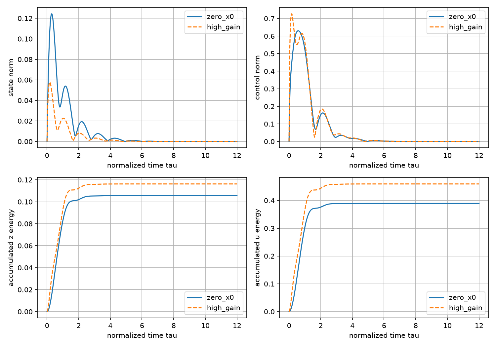
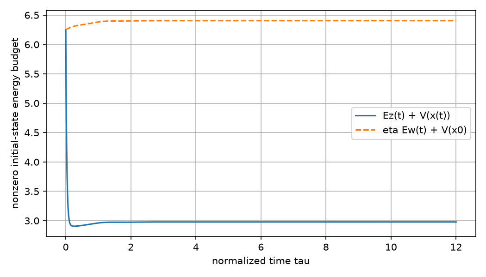
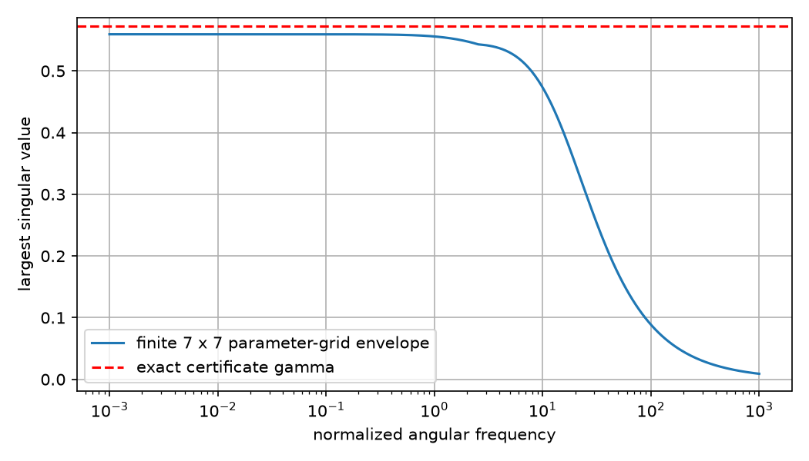

# MIMO鲁棒综合：数值候选与有理证书

本实践复算 [[控制论/10-系统课程/18-MIMO不确定性与H∞综合#先写端口，性能才有对象|第18课固定二维模型]]。运行分三件事：求解器产生 $X,Y,\eta$ 候选；有理运算验证共同负定证书；有限频率/轨迹显示扰动与动作代价。全集合保证来自正文的仿射凸组合和耗散证明，既不由网格最大值认证，也不由软件的 `optimal` 状态认证。

## 先复制到新目录，再运行

[source](run_experiment.py)、[输入](inputs.json)、[有理证书](certificate.json)、[摘要](summary.json) 和 [原式复算](verify_original_form.py) 是当前可复现输入。[真实运行输出](run-output.json) 与 [求解诊断](solver_output.json) 保留执行观察，求解时间/浮点状态不是精确接受依据。脚本以自身所在目录为根；完整运行会覆盖同目录同名生成输出，所以**先复制实践目录到库外一个不存在的新目录**，在那里运行，保留正式交付观察。

下面以 `/private/tmp/wwl-hinf-reproduce-01` 为例，从库根执行；若目录已存在，换新名称。安装只发生在复制目录的 `.venv`，不升级系统环境。

```bash
cp -R '控制论/80-实践/09-MIMO鲁棒综合' /private/tmp/wwl-hinf-reproduce-01
cd /private/tmp/wwl-hinf-reproduce-01
python3 -m venv .venv
.venv/bin/python -m pip install -r requirements-lock.txt
python3 -B numerical_guard.py --threads 1 --timeout 60 --lock-timeout 60 -- .venv/bin/python -B run_experiment.py --preflight
python3 -B numerical_guard.py --threads 1 --timeout 60 --lock-timeout 60 -- .venv/bin/python -B run_experiment.py --verify-only
python3 -B numerical_guard.py --threads 1 --timeout 60 --lock-timeout 60 -- .venv/bin/python -B run_experiment.py
python3 -B numerical_guard.py --threads 1 --timeout 60 --lock-timeout 60 -- .venv/bin/python -B verify_original_form.py
```

先 `--verify-only` 核交付的有理证书，之后完整运行重新综合并生成新证书；`verify_original_form.py` 核新目录中当时的证书。完整求解的候选会随平台/库版本有差异，因此新候选要重新进行精确接受，不要求新求解器按字节重演旧迭代日志。已交付CSV/图和证书仍保留原真实观察。

实际执行环境为 macOS 27.0.1 arm64、Python 3.14.7、NumPy 2.5.4、SciPy 1.18.1、SymPy 1.14.0、CVXPY 1.9.3、Clarabel 0.11.1；全部依赖及间接版本见 [requirements-lock.txt](requirements-lock.txt)，命令和环境边界见 [ENVIRONMENT.txt](ENVIRONMENT.txt)。运行时不访问外部服务，Matplotlib缓存限定在复制目录 `.mpl-cache`。

[numerical_guard.py](numerical_guard.py) 将一次数值进程限定为1线程、60秒、两个共享数值槽之一；这些是进程/并发约束，不能称为内存硬上限或设备实时deadline。缺包先由preflight报错，求解无候选或有理证书失败就停止，不将失败状态改写成数学不可控。输入是本例固定矩阵卡。程序明确拒绝不同的参数方框/维度、非零Dzw、错误矩阵shape、非有限数与非法正余量/有理分母；这不是通用JSON/schema验证器。修改模型时仍须恢复证明合同，不能由字段被读取推断新理论已支持。

## 固定矩阵与综合选择

[inputs.json](inputs.json) 使用有理数字符串保存 $A_0,A_1,A_2,B_1,B_2,C_z,D_{zu},D_{zw}$，维度为 $x/w/u=2,z=4$；时间 $\tau=t/(1\,\mathrm s)$，信号均无量纲。两参数属于 $[-1,1]^2$，控制器 $u=Kx$，$z=[x;u/2]$，没有扰动直通。输入卡是合成假设，没有实验辨识或统计置信包围依据。

综合约束为 $X\succeq I_2/5$、四顶点 $M_s\preceq-10^{-7}I_8$，目标最小化 $\eta$。储能尺度约束防止 $X$ 过度接近奇异，等价于 $P\preceq5I_2$，并非动作限幅。本次浮点候选舍入到分母 $10^5$，对 $\eta$ 加报告余量，再用精确有理算术验证；若舍入使矩阵条件失败，完整综合至多尝试10步每次给X对角加 $1/10^5$，每步重核全部精确条件，通过后才接受。本次默认卡的修补步数为0；`--verify-only` 只检查交付证书，绝不修补。目标是可复算的性能上界，不是无约束或受限问题的精确最优值。

正式证书为

$$X=\begin{bmatrix}0.36886&0.33972\\0.33972&0.88347\end{bmatrix},\quad
Y=\begin{bmatrix}-4.00073&-0.40054\\-0.79998&-3.99999\end{bmatrix},\quad
\eta=32741/100000.$$

这些有限小数是精确有理数，控制器定义为 $K=YX^{-1}$；[certificate.json](certificate.json) 保存全部 $P,K$ 有理元素。显示增益约为 `[[-16.14719848,5.75569772],[3.09843381,-5.71902830]]`，$\gamma=\sqrt\eta\approx0.5721975183$。若按显示的八位小数实现，需要对那个舍入控制器重核，不能把它与有理 $K$ 视作逐字相同。

## 精确接受检验什么

实对称矩阵的全部顺序主子式为正，当且仅当正定。程序用SymPy有理行列式检验 $X-10^{-6}I_2$、$X-I_2/5$ 与每个 $-M_s-10^{-6}I_8$；同时保存相邻主子式比值，即无主元 $LDL^T$ 正枢轴。主子式、矩阵元素和枢轴均有理，不使用浮点特征值容差决定接受。

$X-I_2/5$ 的两个顺序主子式为 $8443/50000$ 与 $5329/5000000000$。四顶点移除 $10^{-6}$ 后的矩阵各八个主子式均正；最小LDL枢轴分别约0.06114932194、0.08091848593、0.05609811011、0.03861598075。枢轴不是最小特征值：余量来自对移除余量矩阵的精确正定判别。回 [[控制论/10-系统课程/18-MIMO不确定性与H∞综合#四个顶点为何覆盖无限多个参数|凸组合证明]]，带回全部顶点共同使用的 $X,Y,\eta$，才可推出整个连续方框。

[verify_original_form.py](verify_original_form.py) 另将有理 $P,K$ 代回 $4\times4$ 原始耗散矩阵，检查 $PX=I,KX=Y$ 与四顶点负定；它绕过 $8\times8$ 综合矩阵搭建路线。对默认卡将性能要求改成 $\eta=1/100$ 时，固定 $K,P$ 四顶点全被拒绝。这个试探只记录诊断：合法改卡如 $B_1=0$ 可以满足更小界，不能因试探通过就拒绝原来有效的证书；实际 $B_1=0$ 原式入口也已通过。这是同一实践的程序自查与负例，不是非作者理论审阅或独立算法正确性认证。[original_form_check.json](original_form_check.json) 保存具体主子式。

同一证书在 $(2,2),(5,5),(10,10),(-5,-5)$ 均失败。它们已越过输入集合，结果仅表示原证书不可继续使用；没有据此报告真实闭环不稳，或证明所有控制器均无解。

## 同一扰动下，状态更小与代价更好分别看

固定参数轨迹 $\theta=(\sin0.7\tau,\cos1.1\tau)$、扰动 $w=(e^{-\tau}\sin2\tau,e^{-\tau}\cos3\tau)^T$。SciPy自适应RK45积分状态及四个累计量到 $\tau=12$，相对容差 $10^{-9}$、绝对容差 $10^{-11}$；每0.01归一化时间导出一个点。输出网格不是控制采样周期，参数/动作在ODE右端按当前时间更新。

[trajectories.csv](trajectories.csv) 含三个情景各1201点，共3603数据行；保存 `x1/x2`、$E_w,E_z,E_x,E_u$ 与 `w1/w2`。$E_z$ 积分 $(C_zx+D_{zu}u)^T(C_zx+D_{zu}u)$；固定卡下它等于 $E_x+E_u/4$。CSV的CRLF由csv.writer产生，属于交付字节。

| 情景 | $E_x$ | $E_u$ | $E_z$ | 预算与证据范围 |
| --- | --- | --- | --- | --- |
| 原 $K$，$x_0=0$ | 0.00815176 | 0.38950771 | 0.10552869 | $E_w\approx0.475$、$\eta E_w\approx0.15551975$；共同证书适用。 |
| 原 $K$，$x_0=(1,-1/2)$ | 0.04102583 | 11.74968428 | 2.97844690 | $V_0\approx6.24993272$，总预算约6.40545247；必须计初始储能。 |
| $3K$，$x_0=0$ | 0.00134691 | 0.45947815 | 0.11621645 | 未为新增益重做共同证书；同激励状态代价下降、动作及总代价上升。 |



图四幅均以归一化时间为横轴；状态/动作范数无量纲，累计平方量也按归一化时间计。原 $K$ 用实线，$3K$ 用虚线并有独立标签，颜色之外保留线型。这个比较是有限情景观察，不是 $3K$ 在所有输入方向上更差的定理。



实线是 $E_z(\tau)+V(x(\tau))$，虚线是 $\eta E_w(\tau)+V_0$；初始实线为 $V_0$ 而非0。末储能约 $1.84\times10^{-12}$，小末值不能使初始账本消失。此积分余量只核有限轨迹与数值实现，严格一般不等式仍由证书承担。

## 扫频观察与全集合保证

[frequency_grid.csv](frequency_grid.csv) 含402个频点：0以及 $10^{-3}$ 到 $10^3$ 的401个对数点。每点取7×7参数网格观测到的最大奇异值，不保存或声称搜索了全部参数/频率。最大观测约0.5594790385，位于 $(-1,-1),\omega=0$；零频点在CSV中，log横轴图无法画0。



图横轴为归一化角频率，纵轴为无量纲最大奇异值；红色虚线是精确证书报告上界 $\gamma$，蓝色实线只是有限网格包络。曲线低于虚线支持当前有限诊断，不能认证漏采频段、漏采参数点或隐藏状态。全集合与全输入方向来自 [[控制论/10-系统课程/18-MIMO不确定性与H∞综合#储能把所有扰动压进同一个不等式|正文耗散不等式]]。

## 改卡迁移与独立核查接口

先完成 [[控制论/10-系统课程/18-MIMO不确定性与H∞综合#撤去方法提示，携带答案返回|正文五题]]。第4题在**另一个新复制目录**将 `Dzu` 后两行的 `1/2` 改成 `1`，同时更新输入卡的人类可读 `performance` 描述，再完整运行与核证；前两个状态权重不改。新的证书对应 $z=[x;u]$，旧界、旧控制器和旧数值不能继续挂在新性能上。

本源码支持这项矩阵权重改卡，但不因此称任意维度/任意模型都支持。程序不处理非零 `Dzw`：那会改变原式有界实矩阵、频响和积分账，需要先扩展理论和代码；也不自动处理随机参数置信区间、动作饱和、部分观察、采样/时延或状态重置。

非作者可以不导入规范源码：直接从有理卡构建四个 $A_s$ 和原式 $F_s^TP+PF_s+C_K^TC_K$，用自己的Fraction/有理消元核正定及 $PX=I,KX=Y$；独立积分器核完整时变ODE与累计账。实际权重1改卡得到 $\eta=58107/50000$、$\gamma\approx1.0780259737$，增益约 `[[-4.652821968,0.480202224],[-0.181467436,-2.688947337]]`；零初值有限波形的 $E_z\approx0.3022110459=E_x+E_u$，其中 $E_x\approx0.02202706054,E_u\approx0.28018398534$。新卡是另一份性能问题，数值不能替换默认卡。两次合法改卡及13个非法主入口、6个非法原式入口均实际运行；失败卡覆盖不支持方框/维度/直通、矩阵shape/非有限值、非法余量/分母与证书身份。

重新运行本脚本属于复现，不单独构成独立理论签收。一般证明、实际数值、图显示、Obsidian客户端、设备与真人层分别报告。

返回 [[控制论/10-系统课程/18-MIMO不确定性与H∞综合|第18课]]，再到 [[控制论/00-控制论-MOC|课程入口]]。
