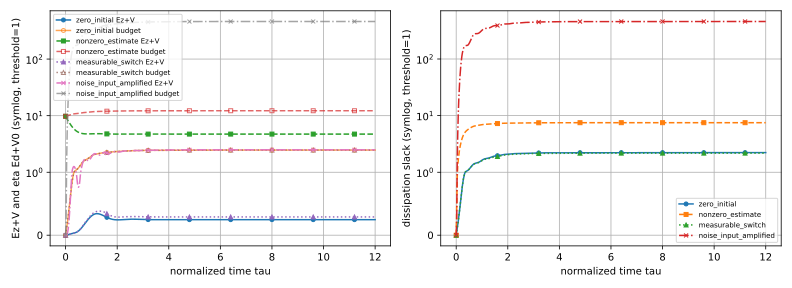
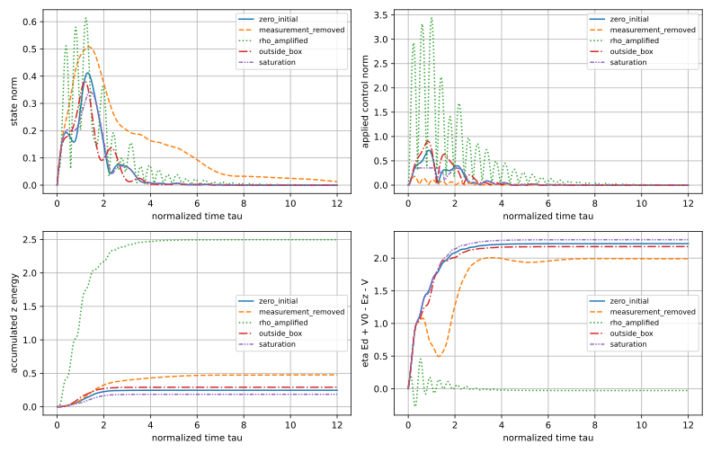
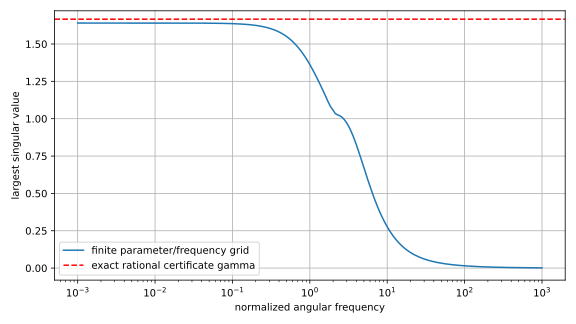

# 动态输出反馈：完整闭环与有理证书

本实践消费 [[控制论/10-系统课程/19-动态输出反馈与鲁棒性能证书#一个读数，两组内部状态，三路外扰|第19课的固定对象与观测器]]。沿第18课的有理控制增益，只测 $y=x_1+\rho n$，名义观测器固定 $L=(6.4,10.14)^T$。运行先搜索一张公共四状态储能，再精确检查原始耗散矩阵；有限轨迹和频率曲线核实现与边界。一般可测参数方框的保证来自正文与有理证书，不由曲线或求解器状态代验。

## 从交付证书进入，再在新目录重算

[规范源码](run_experiment.py)、[输入卡](inputs.json)、[已交付有理证书](run/certificate.json)、[摘要](run/summary.json) 和 [原式复算](verify_original_form.py) 是复现入口。先复制实践目录到库外一个不存在的新目录，以保留正式结果；以下从库根执行，例子目录已存在时换名：

```bash
cp -R '控制论/80-实践/10-动态输出反馈鲁棒证书' /private/tmp/wwl-output-reproduce-01
cd /private/tmp/wwl-output-reproduce-01
python3 -m venv .venv
.venv/bin/python -m pip install -r requirements-lock.txt
python3 -B numerical_guard.py --threads 1 --timeout 60 --lock-timeout 60 -- .venv/bin/python -B run_experiment.py --preflight
python3 -B numerical_guard.py --threads 1 --timeout 60 --lock-timeout 60 -- .venv/bin/python -B run_experiment.py --verify-only --certificate run/certificate.json
python3 -B numerical_guard.py --threads 1 --timeout 60 --lock-timeout 60 -- .venv/bin/python -B run_experiment.py --inputs inputs.json --outdir reproduced
python3 -B numerical_guard.py --threads 1 --timeout 60 --lock-timeout 60 -- .venv/bin/python -B run_experiment.py --verify-only --certificate reproduced/certificate.json
python3 -B numerical_guard.py --threads 1 --timeout 60 --lock-timeout 60 -- .venv/bin/python -B verify_original_form.py --inputs inputs.json --certificate reproduced/certificate.json
```

完整运行要求 `--outdir` 是不存在的新目录，既有目录和符号链接被拒绝；没有覆盖模式。输出卡复制、证书、环境、求解诊断、CSV与图进入该目录。`--verify-only` 不写输出、不修补证书；它重新核当时输入卡与传入证书。`--certificate-only --outdir new-certificate` 只求证书与求解/环境记录，不积分或扫频。`--preflight` 显示当前版本和可用求解器；它支持依赖诊断，不单独认证后续输入卡与数学证书。

实际依赖及版本按 [requirements-lock.txt](requirements-lock.txt)、[环境说明](ENVIRONMENT.txt) 与 [运行环境记录](run/environment.json) 复建。实际生产只读复用实践09的隔离解释器，没有重新安装依赖；上面 fresh `.venv` 安装命令是换机复建接口，本次没有据此声称已做全新安装。安装限定复制目录的 `.venv`。运行无外部服务调用；Matplotlib缓存限定复制目录的 `.mpl-cache`。[numerical_guard.py](numerical_guard.py) 将每次数值进程限定为1线程、60秒、两个共享数值槽之一；这不是内存硬上限、硬件实时deadline或整套课程性能认证。

## 对象与固定控制器核验合同

[inputs.json](inputs.json) 用有理数字符串保存二维 $A_0,A_1,A_2,B_1,B_2$、测量 $H$、观测器 $L$ 与尺度 $\rho$。`controller_X/controller_Y` 从第18课固定证书消费，$K=YX^{-1}$；本程序不重新综合 $K$，也不联合整定 $L$。时间 $\tau=t/(1\,\mathrm s)$，全部信号无量纲，参数方框 $[-1,1]^2$ 是合成给定集合，没有实测或统计置信来源。

规范状态顺序是 $\xi=(x_1,x_2,\hat x_1,\hat x_2)^T$，外扰顺序 $d=(w_1,w_2,n)^T$。完整矩阵为

$$F_\theta=\begin{bmatrix}A(\theta)&B_2K\\LH&A_0+B_2K-LH\end{bmatrix},\quad
G=\begin{bmatrix}B_1&0\\0&\rho L\end{bmatrix},\quad
C=\begin{bmatrix}C_z&D_{zu}K\end{bmatrix},\quad D=0_{4\times3}.$$

默认 $C_z=[I_2;0]$、$D_{zu}=[0;I_2/2]$，因此 $z=(x,u/2)$、$E_z=E_x+E_u/4$。代码支持相同shape的输入/性能矩阵改卡，但模型与端口声明须一起核对，不由字段可读取推断任意模型证明都已成立。观测器只能用名义 $A_0$，真实 $\theta$ 没有送入控制器。$n$ 作为三路归一化有限能量外扰之一计入 $E_d$，不是随机白噪声模型。

搜索变量仅 $P=P^T\in\mathbb R^{4\times4}$ 与 $\eta>0$。四顶点约束为原始 $N_s\preceq-10^{-7}I_7$，另加 $P\succeq10^{-3}I_4$。后者是储能尺度的额外设计限制，收窄搜索集合，不是动作限幅。浮点候选只负责提出一张矩阵；$P$ 舍入到分母 $10^6$，$\eta$ 留出报告余量后，精确接受要求 $P-10^{-6}I_4$、$P-10^{-3}I_4$ 与全部 $-N_s-10^{-6}I_7$ 的顺序主子式严格为正。对设计下界使用严格正定是更保守的有限接受条件；它不把原来的半正定边界候选称为已接受。

源码对固定舍入 $P$ 至多尝试11个明确性能余量：第 $b=0,\ldots,10$ 个候选为求解器 $\eta$ 的 $(1.03+0.01b)$ 倍加0.005后舍入，逐个核全部精确条件，失败便停止。默认接受步数为0。没有对 $K,L$ 做交替优化，也没有以 `optimal` 日志作为精确最优值证明。

## 已交付证书怎样复算

默认有理证书为

$$P=\frac1{10^6}\begin{bmatrix}
5159705&-1608374&-4519132&1937068\\
-1608374&1376449&1636946&-1045110\\
-4519132&1636946&6390509&-2863961\\
1937068&-1045110&-2863961&2032204
\end{bmatrix},\quad \eta=2776339/10^6,\quad\gamma\approx1.6662349774.$$

[certificate.json](run/certificate.json) 保存全部有理元素、四顶点顺序主子式和margin接受结果；[solver_output.json](run/solver_output.json) 保存产生候选的浮点状态与矩阵，职责不同。本文显示的小数 $P$ 元素均由整数矩阵精确指定；$K$ 从有理 $X,Y$ 恢复，不能以显示八位小数偷偷替换。

原式检查的是

$$N_s=\begin{bmatrix}F_s^TP+PF_s+C^TC&PG\\G^TP&-\eta I_3\end{bmatrix}.$$

$P-10^{-6}I_4$ 四个主子式、四个 $-N_s-10^{-6}I_7$ 各七个主子式全正；相邻主子式比值给无主元LDL枢轴。四顶点最小枢轴约为0.1606513970、0.9626752986、0.7929887516、0.3398258437；枢轴不是最小特征值。全集合余量来自移除 $10^{-6}I$ 后的精确判别，回 [[控制论/10-系统课程/19-动态输出反馈与鲁棒性能证书#为什么有限顶点覆盖时变方框|顶点凸组合与可测参数证明]] 才完成连续集合责任。

[verify_original_form.py](verify_original_form.py) 是另一条代数检查入口；上面的命令对原式、Schur11与误差坐标合同复核，只向stdout输出、没有覆写结果。交付当次输出在 [original_form_check.json](run/original_form_check.json)。源码自查和重跑本规范脚本属于复现；非作者应不导入规范源码，从卡片独立构建全部 $F,G,C$，以Fraction/有理消元核 $N_7$、Schur $11$ 和误差坐标变换，再用不同积分算法核完整对象与累积账。它们不能互相冒充独立签收。

## 同一波形的能量账与记忆初值

默认光滑参数 $\theta=(\sin0.7\tau,\cos1.1\tau)$，外扰

$$d(\tau)=\begin{bmatrix}e^{-\tau}\sin2\tau\\e^{-\tau}\cos3\tau\\e^{-0.6\tau}\sin8\tau\end{bmatrix}.$$

积分到 $\tau=12$，每个情景导出601个时点，步距0.02是**输出网格**。ODE内部使用自适应RK45、相对容差 $10^{-9}$、绝对容差 $10^{-11}$、最大积分步距0.02；动作和测量按当时的连续状态计算，没有数字保持。可测切换情景分别每0.75/0.5改变两个参数正负号，在每个已知切换时点分段积分；储能不reset。

| 情景 | $E_z$ | $E_d$ | 完整初值/证书预算 |
| --- | --- | --- | --- |
| 光滑参数、$\xi_0=0$ | 0.2469106270 | 0.8893357992 | $\eta E_d\approx2.4690976633$；默认证书适用。 |
| 光滑参数、$x_0=0,\hat x_0=(1,-1/2)$ | 4.7308606199 | 0.8893357991 | $V_0=9.762521$，预算约12.2316186633；不能按零初值比值判性能。 |
| 方框顶点切换、$\xi_0=0$ | 0.2904698268 | 0.8893357992 | 同一 $P$ 预算约2.4690976633；可测参数定理由证书承担。 |



图例中 `Ez+V` 是 $E_z+V$，`budget` 是 $\eta E_d+V_0$，另一幅为它们的差。四个情景以实线、虚线、点线、点划线和各自标记区分；同一情景的两条账线共用线型/标记，可填充标记的预算线使用空心标记并较浅，阅读时同时核图例。两幅纵轴都采用阈值1的symlog显示：绝对值不大于1的区间线性，更大幅值按对数展开，使初始储能和20倍噪声输入预算约461都可辨认；这只改变显示尺度，没有改变能量定义或预算。非零估计初值的起点含 $V_0$；$\sqrt{E_z/E_d}\approx2.3064$ 大于报告 $\gamma$，恰好说明忽略观测器初始记忆会误报“证书被推翻”。$V_0$ 是有理 $P$ 和明确初值的二次型，不由图估算。

[trajectories.csv](run/trajectories.csv) 保存八个情景共4808数据行，各行保留真实/估计四状态、w/n、参数、读数、实际/命令动作、$E_d,E_z,E_x,E_u,V$ 和预算余量。CSV中任何改前提情景的旧预算只用于对照，须先看 `summary.json` 的 `certificate_applies`。这条有限波形没有证明最坏输入/最坏参数轨迹。

## 从改变前提的诊断辨认真实反例



退去真实状态读数时 $H_{\rm actual}=0$，控制器仍用设计 $H$；噪声仍可能驱动观测器。$n=0,\hat x_0=0$ 时才退化为 $u=0$ 的开环对象。图中的默认退测波形没有超过旧预算，不代表所有输入仍满足旧界；旧公共矩阵在退测对象上已失败，真性能反例需额外下界。冻结 $\theta=(1,-1)$ 时，完整断测闭环最大极点实部为 $-0.25$；在 $\omega\approx0.7079457844$ 已观察奇异值约4.2514184662，高于原界。正文还用 $\theta=(-1,-1)$、过程输入方向 $(0,1)$ 给精确零频下界平方 $12125/2601>\eta$；因此这里有性能确实失败的证据，没有把旧矩阵拒绝冒充它。

把外扰波形中 $n$ 放大20倍而保持 $\rho=0.05$，原证书继续适用，$E_d$ 从约0.8893变为166.2093；把模型中的 $\rho$ 放大20倍、波形 $n$ 保持原样，会得到相同实际噪声注入和相同输出 $E_z\approx2.4964623330$，但 $E_d$ 仍约0.8893。这是两个不同的输入预算。后者的零完整初值有限比值约1.6754428618，已经高于原 $\gamma\approx1.6662349774$；这是改变噪声注入模型后的真实有限性能反例，独立核验还需控制积分误差。冻结名义参数时，在 $\omega\approx4.8977881937$ 观察奇异值约2.7835325223也超过旧界；完整极点仍在开左半平面，所以极点稳定没有保护旧噪声性能。

参数 $(5,5)$ 超出方框，旧证书失败；本例该冻结完整闭环最大极点实部约 $-1.5908$，所以不能把失败写成真实失稳。硬限幅 $|u_i|\le0.25$ 的情景把实际动作同时送入对象与观测器，已知输入失配在估计误差式中抵消；动作反馈本身仍非线性，原线性矩阵证明不适用。图中代价偶然较小也不认证所有初值与扰动的性能。

[summary.json](run/summary.json) 区分原证书判别、冻结极点和改变模型的有限频率下界；看到旧证书被拒绝，只能先报告“这张证书停止覆盖”。若一个内部稳定冻结对象在某个频点的最大奇异值已超过原 $\gamma$，该点就是它的 $H_\infty$ 增益下界；无需把有限网格最大值冒充全频精确最值。这些诊断带回 [[控制论/10-系统课程/19-动态输出反馈与鲁棒性能证书#改变前提时先改哪一个块|改前提块]]。

## 有限扫频与改卡返回

[frequency_grid.csv](run/frequency_grid.csv) 在5×5参数网格、0及 $10^{-3}$ 到 $10^3$ 的201个对数频点观察最大奇异值，共202个频率记录。最大采样值约1.6403108853，出现在 $\theta=(-1,-1),\omega=0$，低于已给可行证书 $\gamma\approx1.6662349774$。这不证明全频精确最大值，也不覆盖时变参数的最坏作用。



图的横轴是归一化角频率、纵轴无量纲奇异值；0频点保留在CSV，log图不显示0。曲线来自已保存CSV，另外两幅轨迹/储能图也读取交付CSV绘制，同源数据不变成全集合证明。

先做 [[控制论/10-系统课程/19-动态输出反馈与鲁棒性能证书#撤提示迁移与答案|正文五题]]。迁移练习是在新的输入卡里将 `rho` 从 `1/20` 改成 `1/10`，保留 $K,L,H$，向另一个不存在的 `--outdir` 求新的公共证书，再核新卡/新证书。也可把 `Dzu` 后两行权重从 `1/2` 改成1；须改人类可读 `performance` 描述，重新搜索与接受。两项改变都不能把旧 $\gamma$ 自动挂到新卡。

已实际做两项合法改卡的证书求解：$B_1$ 全部元素减半、保留传感噪声时得到 $\eta=6979/10000$；将 `rho` 设为0、保留过程扰动时得到 $\eta=2776253/10^6$，两张有理证书都通过精确接受。前者改变过程注入，后者删除噪声注入；它们各自属于新卡，不是原证书下的输入振幅情景，也没有把过程减半近似等同总界必然除4。另有16项非法卡/输出目的地的实际拒绝检查，过程脚本与日志留在生产证据区。

程序明确拒绝不支持方框/维度、非零 `Dzw`、错误矩阵shape、非有限数、非正余量、无效有理分母，以及证书与控制器卡不一致。它没有实现测量直通到动作、动态执行器、任意维度、任意直通、随机噪声最优控制或联合 $K,L$ 综合。这个输入合同提供有限复算入口，不是替代模型推导的通用控制平台。

返回 [[控制论/10-系统课程/19-动态输出反馈与鲁棒性能证书|第19课]]，再到 [[控制论/00-控制论-MOC|课程入口]]。
