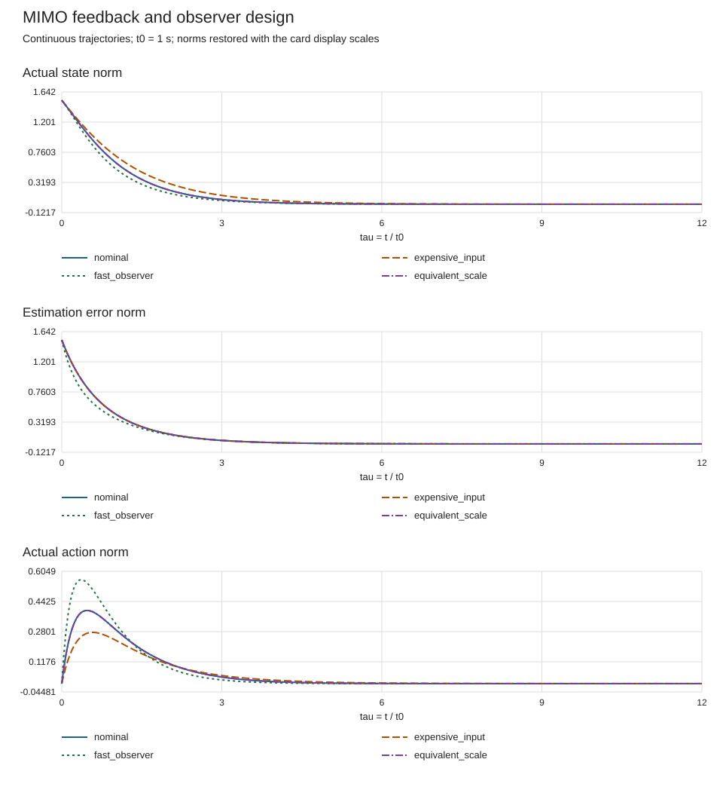
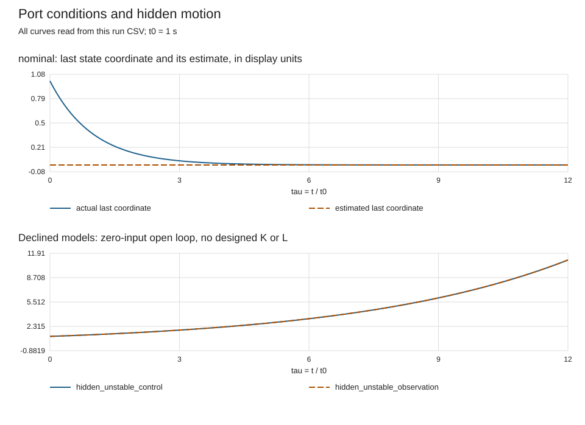

# MIMO 反馈与观测器设计复算

带着有限连续 LTI 的 $A,B,C,D$，先核可稳定/可检测，再以两次正定 CARE 设计 $K,L$，最后检查完整 $2n$ 状态闭环。主解释和一般存在论证在 [[控制论/10-系统课程/05-状态反馈观测器与平衡目标#一般 MIMO：用正定 CARE 设计反馈与观测器|05 的一般设计章节]]；这里把设计过程落实为可以换矩阵的学生入口。

[design_lab.py](design_lab.py) 是计算真源，[inputs.json](inputs.json) 存完整矩阵、初态、权重和尺度。[build_figures.py](build_figures.py) 读取同次 CSV 与 `summary.json` 中的输入快照，画出连续闭环轨迹。[numerical_guard.py](numerical_guard.py) 沿用课程已有的双槽位、线程和时间护栏；三份 `.md` 只作同字节镜像。

## 从空环境运行一次

锁定环境需要 Python 3.12+、NumPy 与 SciPy（两个锁定包的安装元数据均要求 Python ≥3.12）。下面在独立临时目录建环境，安装与计算分开；已有安装不会自动改变。锁文件对应本次实际执行的 NumPy 2.5.4、SciPy 1.18.1，其安装需要支持这些版本的解释器和平台；独立核查实际使用 Python 3.14.7。若当前解释器不支持锁定版本，先选择受支持的解释器，不能把安装失败当作算法失败。

从本 README 所在目录执行：

```bash
python3 -m venv /private/tmp/wwl-mimo-design-student-env
/private/tmp/wwl-mimo-design-student-env/bin/python -m pip install -r requirements-lock.txt
python3 -B numerical_guard.py --threads 1 --timeout 60 --lock-timeout 60 -- /private/tmp/wwl-mimo-design-student-env/bin/python -B design_lab.py --inputs inputs.json --out /private/tmp/wwl-mimo-design-student-run
python3 -B build_figures.py --results /private/tmp/wwl-mimo-design-student-run
```

选未占用的环境名和输出名。程序拒写已有非空计算目录；所有 case 完成后，才把临时输出目录整体发布。图程序也拒绝覆盖已有任一 SVG。常规数值预算最多 300 秒，默认预跑 60 秒、1 线程，护栏在本机同一用户下最多同时允许两个数值任务；它不声明内存限制或其他未经护栏启动的进程总数。POSIX `fcntl`、进程组或安全锁条件不满足时，护栏明确退出。

默认成功后有六份 CSV、`summary.json` 与两份 SVG；正式同模型输出见 [results/summary.json](results/summary.json)、[设计图](results/design.svg) 和 [边界图](results/boundaries.svg)。两张失败卡会输出零输入开环 CSV 并明确拒绝设计；这是一次有效条件诊断，不把该卡写成稳定控制器。非法 JSON、错误 shape 或不正定权重则整次退出 2，保留旧输出。

## 一张卡究竟控制什么

顶层 `schema` 固定为 `wwl-mimo-care-1`；`time_scale_s` 是 $t_0$，`horizon_tau` 与 `output_dt_tau` 是无量纲时域与记录间隔，后者不是离散控制采样周期。所有 `A,B,C,D` 均用于 $dx/d\tau=Ax+Bu,y=Cx+Du$。case 的字段为：

| 字段 | shape 与意义 |
| --- | --- |
| `A,B,C,D` | $n\times n,n\times m,p\times n,p\times m$ 的完整连续模型。 |
| `Q,R` | $n\times n,m\times m$ 的正定状态/动作代价。 |
| `W,V` | $n\times n,p\times p$ 的正定对偶设计权重，不是已声明的噪声协方差。 |
| `x0,hat0` | 两个长度 $n$ 的初态；$e_0=x_0-\hat x_0$。 |
| `state_scale,input_scale,output_scale` | 长度 $n,m,p$ 的正对角显示尺度，将该卡原始坐标乘回比较基准。它们不代替模型与权重变换。 |
| `name` | 唯一安全名称，用来命名 CSV 与图例。 |

一般有限维理论不受这里的预算限制；本轻量程序限定 $2\le n\le6,1\le m,p\le4$、最多八卡、矩阵 $A/B/C/D$ 元素绝对值不超过 20、权重元素不超过 1000。权重需对称，最小特征值至少 $10^{-8}$、条件数不超过 $10^6$；显示尺度在 $[10^{-3},1000]$，初态分量绝对值不超过 1000。$t_0\in[.1,10]\,\mathrm s$，时域 $\tau\in[.1,30]$，记录间隔 $[.005,.2]$，时域须整除记录间隔且不超过 6000 段。这些是可执行实例的资源/数值限制，不是 CARE 定理的必要条件。

数值 PBH 只检查求得的闭右半平面极点（判别阈值 $-10^{-9}$），SVD 秩阈值为 $10^{-8}\max(1,\sigma_{\max})$。例如恰在阈值附近的稳定隐藏极点可能被保守地当作需控制/观察，亦不能声称程序拒绝所有“接近边界”模型；数学上的精确 rank 与浮点诊断必须分开。本次实际将默认隐藏极点改为 $-10^{-10}$ 时，数学条件仍成立，程序因闭半平面阈值而保守拒绝；该结果不能改写成对象不可稳定或不可检测。接受的 CARE 还需对称正定解、相对残差不超过 $10^{-9}$，以及两个闭环块最大实部小于 $-10^{-9}$。残差分母是 1 加 CARE 各项的 Frobenius 范数之和；没有区间误差认证。

## 先预测，再看六张卡

| 默认 case | 条件变化 | 先交出的预测与答案 |
| --- | --- | --- |
| `nominal` | 四状态、两输入/读数，$Q=W=2I,R=V=I$。 | 可控/可观秩都是 2，却仍可稳定/可检测；$P=S=I,K=B^T,L=B$。两设计块谱都是 $(-2.5,-1.5,-1,-1)$。 |
| `expensive_input` | 仅改 $R=4I$。 | 活动反馈极点变成 $-\sqrt7/2,-\sqrt3/2$，隐藏与观测器极点不变；比较实际动作曲线，不能只凭极点宣称所有峰值必然降低。 |
| `fast_observer` | 仅改 $W=8I$。 | 活动误差极点变成 $-\sqrt{97}/2,-\sqrt{33}/2$，隐藏误差仍以 $-1$ 消退；无噪声误差变快不等于已设计噪声性能。 |
| `equivalent_scale` | 按 05 的 $T,U,Y$ 同时变换对象、两套权重与初态。 | 公共坐标的 $K,L$ 和整条 $x,\hat x,e,u,y$ 轨迹应相同；原始矩阵数值不同，不是另一性能。 |
| `hidden_unstable_control` | $A_{44}=.2$，仍不能作用于 $x_4$，却增加读数。 | 可检测但不可稳定，拒绝反馈设计；零输入 $x_4=e^{.2\tau}$，再快的观测器不能增加执行器端口。 |
| `hidden_unstable_observation` | $A_{44}=.2$，增加动作端口，仍看不到 $x_4$。 | 可稳定但不可检测，拒绝观测器反馈设计；原误差有不可移动的 $.2$ 极点，不能靠加大 $L$ 修复。 |



前三个 panel 对应实际状态、估计误差与实际动作的欧氏范数。默认 `nominal` 与 `equivalent_scale` 重叠是等价性预期；图例除颜色外还用不同线型区分，不能把重叠当作少跑了一卡。稳定性是无限时间结论，有限窗口内的峰值和最终非零小量是具体初态的轨迹。



上图第一 panel 从首个接受卡取最后一个状态坐标与估计值；默认是未观测却稳定的第四状态 $x_4=e^{-\tau},\hat x_4=0$。第二 panel 两条零输入开环增长曲线会重叠，它们是不同端口失败的同一 $e^{.2\tau}$ 初态解。换成一般矩阵时，首 panel 只承诺“最后坐标”，不再把该坐标自动称为隐藏模态；若卡中没有失败或没有接受模型，对应 panel 会如实说明。

## 输出怎样把设计与实现连起来

`summary.json` 保存同次输入快照、数值 PBH/rank 诊断、$P,S,K,L$、两个设计块、物理闭环 $M$、误差闭环 $M_e$、CARE/Lyapunov/坐标变换残差与极点。`K_common_coordinates`、`L_common_coordinates` 用显示尺度恢复公共坐标供迁移核对。完整闭环有重根时，直接对 $M$ 求 eig 会出现约 $10^{-8}$ 的小虚部或根分裂；精确块三角分离与变换残差是结构依据，不能把这些浮点重根漂移说成模型真的变成振荡极点。

接受卡的 CSV 记录 `tau,time_s`，随后是 `x_raw*`,`hat_raw*`,`e_raw*`,`u_raw*`,`y_raw*`,`innovation*` 和公共尺度三范数。这里 `u=-Khat`，`y=Cx+Du`，`innovation=y-Chat-Du=Ce`；轨迹由完整 $M$ 的矩阵指数计算，没有用收敛后的估计代替真实初始误差。拒绝卡仅输出 `x_raw*`,`y_raw*` 与状态范数，`trajectory_kind` 明示零输入开环，不输出伪造增益。

## 换矩阵后撤掉提示

先复制输入到新文件，每次只改变一个数学条件，运行到新输出目录。

- 不看默认矩阵答案，把 $m=2,p=1$ 的新 $B,C,D$ 带入，检查每个 shape 和闭右半平面 PBH；正定 CARE 可用于不等输入/输出数，不要求 $B=C^T$。若换成稳定但不可控/不可观的块，也应允许它保留自身衰减速率。
- 做 $x=Tz$ 的状态坐标替换、同步变换 $A,B,C$，却保持 $Q,W$ 原数值，判断这是不是“同一设计问题”。答案是否定的：$Q$ 要随状态代价协变，$W$ 要反向变换，初态/端口也要同步。若仅修改输入卡的 `state_scale` 字段，则计算模型、权重和求出的增益根本没变，只改了报告显示；这既不能证明物理坐标等价，也不能制造性能改善。
- 从实现中删去 $-Du$，自行推误差方程。答案多出 $-LDu$，误差不再单独满足 $\dot e=(A-LC)e$，原分离证明停止；把 $D$ 设成零只能验证另一对象。
- 给输入加限幅或给测量加未知偏置，指出最早失效处。答案是精确线性实际输入/innovation 假设被撤掉；不能继续用本次 $M$ 的稳定极点宣布真实系统稳定或零误差。限幅迁移和常值目标回 [[控制论/10-系统课程/20-稳态MIMO调节与积分内模|20 的调节/偏差/饱和边界]]，外扰性能回 [[控制论/10-系统课程/19-动态输出反馈与鲁棒性能证书|19 的完整耗散核验]]。

## 已实际核到的层次

独立核查没有导入生产设计函数作为答案：以 Hamiltonian 稳定特征子空间另求 CARE，以有限时域 RDE 的 DOP853 解核极限，再从原 $x,\hat x$ 方程显式形成 $y=Cx+Du$、减去 $Du$ 后数值积分，与生产矩阵指数 CSV 对照。默认精确有理 $P=S=I$、隐藏模态和两张失败卡 PBH 秩另行核算。

四个默认设计的 Hamiltonian 增益/解最大差不超过 $3.56\times10^{-15}$，有限 RDE 对照最大差 $1.43\times10^{-11}$；原方程轨迹与 CSV 最大差 $2.11\times10^{-11}$，读数/innovation 对照最大差 $3.88\times10^{-11}$。等价尺度恢复后的整条显示轨迹最大差 $7.36\times10^{-16}$。这些是本次固定有限实例的实际对照误差，不是任意矩阵的误差上界。

另实际运行了一个 $n=3,m=2,p=1$、非对角 $R$、不同 $W$、非零估计初态与 $D$ 的合法矩阵卡，三条独立路线也通过；非法卡和旧输出拒写实际保持既有字节。图曲线逐点独立映射回 CSV，坐标舍入误差不超过 $0.0005$ 像素；默认及合法不等端口图经 Cairo 实际渲染查看。全拒绝卡的图也检查空 panel 行为。以上不认证任意一般矩阵的浮点可靠性，不构成真实设备、Obsidian 实际客户端显示或真人学习结果。
