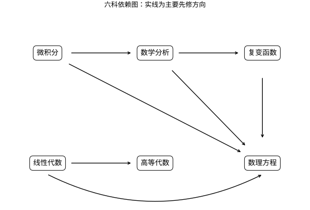

# 数学首页

从 [[../README|知识库总入口]] 进入本域；本页用于在数学域内选择第一条路线。

这里把数学当作一套能解释、估计和验证问题的语言，而不是必须一次背完的公式表。你可以从自己的目标出发：想写出可靠程序，先建立数量、集合、逻辑与函数的直觉；想理解机器学习或大模型，再逐步进入线性代数、概率、微积分、信息论和数值计算；想处理图像、音频或科学计算，则沿信号与并行计算的分支前进。

## 六科系统主线

本目录同时提供六科本科课程笔记与原有 AI 数学应用路线；六科是选定范围，并非数学本科全部课程的覆盖声明。第一次使用，先读课程地图，不必顺序读完所有文件。微积分回答“怎样计算与解释变化”，数学分析回答“为什么这些操作成立”；线性代数建立空间和计算，高等代数研究结构和分类；复变函数与数理方程在这两条基础上展开。



*图中箭头表示主要先修方向，不是全部依赖，也不要求严格串行。微积分与线性代数宜并行，证明能力通过数学分析逐步建立。*

- [[数学/15-微积分/00-微积分-MOC|微积分课程地图]]：从变化率和累积量出发，建立能够计算、解释误差并处理空间场的微积分。
- [[数学/16-数学分析/00-数学分析-MOC|数学分析课程地图]]：数学分析不是微积分公式的重复版，而是追问：对象是否存在，极限是否唯一，运算能否交换，结论依赖哪些条件。
- [[数学/20-线性代数与几何/00-线性代数与几何-MOC|线性代数课程地图]]：本组同时保留应用入门和系统课程。
- [[数学/25-高等代数/00-高等代数-MOC|高等代数课程地图]]：高等代数研究“哪些改变坐标不会改变本质”。
- [[数学/45-复变函数/00-复变函数-MOC|复变函数课程地图]]：复变函数的核心不是把实数换成复数，而是复可微条件带来的强刚性。
- [[数学/46-数理方程/00-数理方程-MOC|数理方程课程地图]]：数理方程将建模、适定性、显式解、弱解与数值解连接起来。

跨科专题与综合题：[[数学/80-跨学科专题与综合练习/00-跨学科专题与综合练习-MOC|专题、证明方法与综合练习]]。范围、深度和验收标准见 [[数学/90-资源/05-六科覆盖矩阵与学习验收|六科覆盖矩阵]]。

原有笔记的文件名和库外目标保留。下方是应用入口，并非六科系统课程的全部目录。

## 六科之外，按问题补齐基础与课程分支

- 量词否定、计数或图的不变量在哪里练？[[数学/12-离散数学与逻辑/00-离散数学与逻辑-MOC|离散数学与逻辑]]连接形式表达、关系与商对象、计数、递推、图和归约方向；不是完整数理逻辑或组合数学专著。
- 样本均值为何集中，检验错误怎样控制？[[数学/30-概率与统计/00-概率与统计-MOC|概率与统计]]的06–10沿联合分布与变换、不等式与大数定律、CLT、检验功效和回归诊断推进；先读01–05建立随机变量与估计的语言。
- 公式怎样成为有误差控制的算法？[[数学/60-数值计算与量化/00-数值计算与量化-MOC|数值课程]]的10–13连接括区间求根、插值、数值ODE和迭代线性求解；收敛结论依赖各页条件，实验只检查给定模型和输入。
- 想学结构与几何？从 [[数学/25-高等代数/11-群同态陪集与商群|群与商群]] 接12–14的环域及Galois桥梁，从 [[数学/80-跨学科专题与综合练习/08-曲线曲面与解析几何补充|解析几何与曲线曲面]] 进入几何补充。它们尚不能替代完整抽象代数、几何或拓扑课程。

六科是本库选定的一组课程范围。完整本科安排还因学校和方向而异；拓扑、抽象代数的更广结构链、连续几何课程以及独立建模、论文和口头表达训练仍有缺口。

## 先选一条入口

| 你的目标 | 建议先读 | 接着去哪里 | 你能回答的第一个问题 |
| --- | --- | --- | --- |
| 重新建立数学信心 | [[数学/01-数学学习路线#路线 A：先会用，再补证明\|路线 A：先会用，再补证明]] | [[数学/10-数学语言与基础/00-数学语言与基础-MOC\|数学语言与基础]] | “这个陈述的条件和结论分别是什么？” |
| 看懂向量、矩阵、嵌入 | [[数学/20-线性代数与几何/00-线性代数与几何-MOC\|线性代数与几何]] | [[数学/02-AI数学应用索引#表示、相似度与线性层\|表示、相似度与线性层]] | “一次矩阵乘法在改变什么？” |
| 理解概率、损失和评估 | [[数学/30-概率与统计/00-概率与统计-MOC\|概率与统计]] | [[数学/40-微积分与优化/00-微积分与优化-MOC\|微积分与优化]] | “不确定性、样本和误差要如何区分？” |
| 理解训练为什么会更新参数 | [[数学/40-微积分与优化/00-微积分与优化-MOC\|微积分与优化]] | [[数学/02-AI数学应用索引#训练、损失与优化\|训练、损失与优化]] | “梯度给出的方向为什么有用？” |
| 做数据压缩、通信或语言建模 | [[数学/50-信息论/00-信息论-MOC\|信息论]] | [[数学/02-AI数学应用索引#不确定性、编码与语言模型\|不确定性、编码与语言模型]] | “比特、熵和概率为何会连在一起？” |
| 写数值程序或关心误差 | [[数学/60-数值计算与量化/00-数值计算与量化-MOC\|数值计算与量化]] | [[计算机知识/10-编程语言/02-C++/00-C++-MOC\|C++ 基础]] | “公式正确时，计算结果仍可能错在哪里？” |
| 处理图像、音频、时序数据 | [[数学/70-信号处理与多模态数学/00-信号处理与多模态数学-MOC\|信号处理与多模态数学]] | [[计算机知识/40-并行与异构计算/01-CUDA/00-CUDA-MOC\|CUDA 基础]] | “采样后的数据与连续信号差别是什么？” |

## 全域地图

```text
数学语言与基础 ──┬── 线性代数与几何 ──────┬── 表示、几何、线性模型
                 │                         └── 数值线性代数与 GPU 计算
                 ├── 概率与统计 ────────────┬── 推断、评估、生成建模
                 │                         └── 信息论与编码
                 ├── 微积分与优化 ──────────┬── 梯度、反向传播、训练
                 │                         └── 数值稳定性与近似
                 └── 信号处理与多模态数学 ──┴── 图像、音频、时序与频域
```

这些分支会相互回流。例如，概率模型常用线性代数表达参数；优化依赖微积分，也必须面对有限精度；信号处理既用线性变换，也用采样与概率的视角。遇到一个陌生公式时，先在 [[数学/03-数学符号表|数学符号表]] 确认它的对象、范围和约定，再回到对应学科页学习定义与推导。

## 七个学科入口

1. [[数学/10-数学语言与基础/00-数学语言与基础-MOC|数学语言与基础]]：集合、逻辑、函数、证明阅读与数量关系。
2. [[数学/20-线性代数与几何/00-线性代数与几何-MOC|线性代数与几何]]：向量、矩阵、线性变换、空间与相似度。
3. [[数学/30-概率与统计/00-概率与统计-MOC|概率与统计]]：随机性、分布、估计、假设与不确定性。
4. [[数学/40-微积分与优化/00-微积分与优化-MOC|微积分与优化]]：变化率、累计量、多元函数与迭代求解。
5. [[数学/50-信息论/00-信息论-MOC|信息论]]：编码长度、熵、互信息、压缩与模型不确定性。
6. [[数学/60-数值计算与量化/00-数值计算与量化-MOC|数值计算与量化]]：浮点数、误差、稳定性、近似与量化。
7. [[数学/70-信号处理与多模态数学/00-信号处理与多模态数学-MOC|信号处理与多模态数学]]：采样、卷积、频域、图像、音频与时序。

## 学习时的三个原则

- **先说清对象。** 一个符号可能表示标量、向量、随机变量或函数；不确认对象就开始算，常会得到“形式像对、含义不对”的答案。
- **每个结论都带条件。** 例如“可逆”“独立”“收敛”“最优”都不是自动成立。把条件写在公式旁边，比记住孤立结论更重要。
- **手算、可视化与程序三者互相校验。** 先用小数字手算，再画出或描述几何意义，最后用程序验证。程序只能验证有限例子，不能取代证明；证明也不保证实现没有精度或索引错误。

## 与其他知识域的连接

- [[AI/00-开始/00-AI-首页|AI 首页]]：从模型问题回到所需数学，不在 AI 页重复维护完整推导。
- [[AI/20-LLM/00-LLM-MOC|LLM MOC]]：注意力、概率分布、损失与信息论的应用入口。
- [[计算机知识/10-编程语言/02-C++/00-C++-MOC|C++ 基础]]：把数据结构、类型与数值实现连接到数学对象。
- [[计算机知识/40-并行与异构计算/01-CUDA/00-CUDA-MOC|CUDA 基础]]：把矩阵运算、并行归约与有限精度放到真实硬件约束中理解。
- [[社会科学/00-开始/00-社会科学-首页|社会科学首页]]：概率、统计推断和因果边界是调查与政策阅读的方法前提，不会单独决定社会结论。

下一步：完成 [[数学/01-数学学习路线|数学学习路线]] 的先修诊断，选定一条只比你当前水平高半步的路线。需要离开本域时，返回 [[../README|知识库总入口]]。
