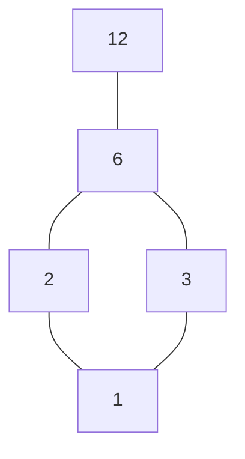

# 关系、函数、等价类与偏序

怎样把“同一类别”变成一个不会自相矛盾的分组？为什么某个任务“最早”开始，不意味着它在所有任务之前？关系是这些问题的统一对象，但等价关系和偏序回答不同的问题：前者把对象归类，后者描述对象之间的方向。

## 1. 关系是有序对集合，函数再加存在与唯一

集合A、B上的二元关系R是A×B的子集；aRb表示(a,b)∈R。对A={1,2,3}、B={甲,乙}，关系{(1,甲),(1,乙),(2,乙)}既可让1有两个关联，也可让3没有关联。它是合法关系，却不是A→B的函数。

函数f:A→B要求

$$
\forall a\in A\ \exists! b\in B:\ (a,b)\in f.
$$

每个输入都要有输出，且只能有一个。像f(A)是实际命中的B子集；陪域B是声明允许的输出集合。单射要求f(a)=f(a′)→a=a′，满射要求∀b∈B∃a∈A f(a)=b，双射两者兼具。换陪域可改变满射性，换定义域可改变单射性，不能只盯函数公式。

例f:{0,1,2}→{0,1,2,3,4}, f(a)=2a为单射、不满射；把陪域换成{0,2,4}才成为双射。g:Z→{0,1,2}, g(n)=n模3为满射、不单射，0和3都有值0。合成g∘f要求f的输出进入g的定义域，(g∘f)(a)=g(f(a))；本例g∘f的值依次0、2、1，恰为有限双射。

有限集合中单射给|A|≤|B|，满射给|A|≥|B|；双射提供精确计数。若A、B等大且有限，单射就是满射。无限集合不允许照搬：n↦n+1在N={0,1,…}到自身为单射却漏掉0。

## 2. 等价关系的三条条件为何缺一不可

同一集合A上的关系~若满足自反、对称、传递，就叫等价关系：

$$
a\sim a;\qquad a\sim b\Rightarrow b\sim a;\qquad
(a\sim b\land b\sim c)\Rightarrow a\sim c.
$$

“差不多近”常不是等价关系。定义实数a~b当|a−b|<1，则自反、对称，但0~0.6、0.6~1.2，而0不~1.2，传递失败。若用它去分组，一条链会把本来“不近”的对象连进同一组；必须另定义连通分量等规则，不能声称原来的“近”自动成为等价类。

对等价关系定义[a]={b∈A:b~a}。每个a属于[a]，所以类非空且覆盖A。若[a]与[b]有交点c，则任取x∈[a]，有x~a、a~c、c~b，于是x~b；得到[a]⊆[b]，交换a、b得到反向包含。因此两类相交就相等，否则不交。这证明等价类构成一个划分。

反过来，给A一个互不相交且覆盖A的非空块划分，定义a~b当二者在同一块，三条性质随即成立。等价关系与划分是同一结构的两种表达。商集合A/~的元素是这些块，不再是原来单个a。

## 3. 模3商类与良定义运算

在Z上定义a~b当3整除a−b。自反因为a−a=0；对称因为a−b=3k推出b−a=−3k；传递因为a−b=3k、b−c=3l推出a−c=3(k+l)。商集有三个元素[0]、[1]、[2]，如[1]={…,−5,−2,1,4,7,…}。

想定义[a]+[b]=[a+b]，必须证明不依赖代表元。若a~a′、b~b′，则(a+b)−(a′+b′)是3的倍数，所以两种代表给同一类。这叫良定义：运算作用于类，不偷用类中某个任意代表的特殊性质。

| + | [0] | [1] | [2] |
| --- | --- | --- | --- |
| [0] | [0] | [1] | [2] |
| [1] | [1] | [2] | [0] |
| [2] | [2] | [0] | [1] |

例如[2]+[2]=[4]=[1]。换成代表−1与5，和为4仍在[1]。映射F([n])=[n²]也良定义，因为n²−m²=(n−m)(n+m)；但H([n])=n这个到Z的“取代表”规则不良定义，同一个[1]可得到1或4。若真要挑代表，应明确另一个选择规则，例如取唯一的0、1、2余数，不能把任意代表当作同一整数。

商集的概念向代数推广还需要运算兼容性；本例只证明这里的加法与平方兼容，不意味着任意等价关系都能支持任意运算。

若想把模3推广到任意整数模数，进入 [[数学/28-数论/02-同余单位与中国剩余定理#同余允许加乘，不自动允许除|同余可约与单位]]：类的加乘良定义后，乘法能否取消还须gcd条件；模4的非零2无逆。再解非互素CRT，带回“类相等”和“选择的整数代表相等”的区别。

### 历史能否合并，要先列允许的未来问题

把历史 $h$ 压成摘要 $s(h)$，再定义 $h\sim_s h'$ 当 $s(h)=s(h')$，当然得到等价关系和划分。但能分组不等于能用这个组完成任务：商类上的更新、查询和未来代价还须**不依赖选了哪段历史作代表**。固定维度、相同数值或相同当前最优值都不能独自证明这一点。

先固定任务 $\mathcal T$：哪些后续输入/动作合法，何时可以查询，查询要求什么输出，怎样计算未来代价或回报。对确定性任务，用 $F_{\mathcal T}(h,e)$ 表示从历史 $h$ 出发执行未来实验 $e$ 得到的任务答案；非法实验也单独记为 $\bot$，因此合法性不同就是可区分。定义任务相关的历史等价：

$$h\equiv_{\mathcal T}h'\quad\Longleftrightarrow\quad
\forall e\in\mathcal E_{\mathcal T},\quad F_{\mathcal T}(h,e)=F_{\mathcal T}(h',e).$$

这里 $\mathcal E_{\mathcal T}$ 包含任务允许的后缀、查询和动作序列，包括无需追加便查询的实验。摘要对这些未来问题充分，要求 $s(h)=s(h')\Rightarrow h\equiv_{\mathcal T}h'$。只要找到**一个相同且允许的未来实验**给出不同答案，就已否定充分性；无需恢复整个历史。反过来，要证明充分须覆盖所有允许实验，而不是只检查几个样例。

若还要只用摘要递推，需额外核对闭合更新：对每个共同合法输入 $u$，有 $s(hu)=s(h'u)$，才能定义 $U(s(h),u)=s(hu)$。查询 $Q(s(h))$、可用动作和增量代价也须不依赖代表。在这组局部条件下，对后续长度归纳：初始摘要相同，每次更新仍相同，每次查询及增量代价相同，所以全部有限实验相同。这给出了可实施的证明；若摘要保留无关细节，预测充分也不自动保证某个拟定更新公式闭合。

随机任务把上述答案相等改成**给定历史、同一合法未来决策规则下，任务所需未来观察/奖励的条件联合分布相同**。决策规则可根据未来可见信息选择动作，两边使用相同规则并保留相同可见约束。要求相同的是分布，不是两次随机采样恰走同一条轨迹。MDP 中相同状态/动作的后继状态与奖励联合核给出这种递推条件；相同当前观察或相同一个期望回报都未必足够。

| 应用与要带去的问题 | 任务要求保留什么 | 具体失败条件与返回入口 |
| --- | --- | --- |
| DFA：下一串符号能否区分这两段历史？ | 所有后续串的接受/拒绝 | `a` 与 `aa` 可合并；`a` 与 `b` 接同一 `b` 后不同。到 [[计算机知识/70-编译原理/10-系统课程/01-形式语言正则与自动机#亲自构造一个识别器\|识别器及后缀可区分性]] 验证。 |
| DP：未来路径的可行性与增量费用还相同吗？ | 同状态下可行选择、状态转移、增量代价 | 同顶点却剩余红边额度0/1，不能同走必需红边。到 [[计算机知识/50-数据结构与算法/20-算法设计系统课程/09-动态规划状态充分性与优化前提#状态是对历史的有损压缩，先问丢掉的信息有没有用\|额度反例与增广状态]] 检查静态模型。 |
| MDP：相同行动的未来分布和时域相同吗？ | Markov转移/奖励联合核、合法动作及剩余任务时间 | 同在 $s_0$，剩一步/两步的最佳动作不同。到 [[AI/10-机器学习与深度学习基础/19-强化学习MDP价值函数与策略梯度#任务时域改变时，s₀仍是同一个决策状态吗\|有限时域回报]] 复算。 |
| 核注意力：约定的读出与追加能区分吗？ | 固定特征、核、读出与更新所需累加量 | 同一 $(S,z)$ 可给同一读出，却不能答第一项。到 [[AI/20-LLM/20-架构/12-MLA线性注意力与状态空间的记忆取舍#同一状态保留哪些读出：固定φ等于1的有限表\|唯一有限状态表]] 改一次查询检验。 |

两条可实际跟随的路线是：先从 DP 额度失败返回本节的良定义条件，再到 MDP 比较剩余时域；或从 DFA 的区分后缀返回本节，再到核注意力表区分“同读出”和“同历史”。每条都在源页就近提供返回链接。连续 LTI 的可观测/rank 最小性与有限 DFA 的后缀等价仍各用自己的模型与证明，已有 [[信号与系统/40-状态控制与辨识/01-状态实现可控可观与最小性\|状态实现的连续与离散边界]] 可作旁支。

**三种“充分”如何接续？** [[数学/30-概率与统计/12-充分统计量与估计效率#总数充分需要哪个模型\|统计充分性]] 先固定参数族：给定统计量后的样本条件分布不依赖未知参数。这里固定未来任务；保存总和足以答“总和”不构成对任意参数族的充分统计量证明。[[AI/13-搜索推理与规划/20-部分可观测决策/01-有限模型belief与决策状态#为什么belief足以递推\|belief的未来决策充分性]] 则在已知固定转移/观测/损失模型下，保存隐藏状态条件分布并保留剩余时域和可见约束；当前观察相同不能代替belief，模型参数未知时可能须联合跟踪参数。每次都先问“对哪个模型、哪些问题充分”。

图表示与隐藏坐标也要先说保留什么查询：[[AI/16-图表示学习/01-图对象消息传递与学习目标#学习对象决定损失和样本单位\|节点、边与图目标]] 决定读出对象；[[AI/10-机器学习与深度学习基础/09-神经网络层激活函数与表示学习#同一算例：隐藏单元置换与参数平均\|同步置换的函数与坐标]] 是可逆坐标变换及读出对齐问题，不能和有损历史合并混为一谈。这些接口不证明一般 GNN、RNN 或 SSM 的通用表示能力。

**撤去提示。** 摘要只保存一段数列的总和。任务允许追加数，并可随时查询平均值；两段历史 $(4)$ 与 $(1,3)$ 能否合并？如果任务再允许查第一项，应保存什么额外信息？

> [!answer]- 答案与改条件
> 不能按总和合并：尚未追加时平均值已是4与2，共同追加2后为3与2。对追加/平均任务保存 $(\text{和},\text{长度})$ 可闭合更新并回答查询；首项查询新增时还须保存首项（空历史另定无首项），仅和与长度仍会合并 $(1,3)$、$(2,2)$。反例给出具体未来实验，修复由规定更新/查询的一般条件证明，不能由摘要维数推出。

本节判据和有限反例在正文给出直接论证。DFA 的语言等价按所有后缀刻画；DP、MDP 和记忆模型的额外条件分别留在各自链接的主解释中。

## 4. 偏序描述方向，反对称不是“不得反向”

偏序≤要求自反、反对称、传递。反对称的准确含义是(a≤b∧b≤a)→a=b；它允许a≤a。对称与反对称也不是逻辑互否，比如相等关系同时满足二者。严格小于<不自反，所以不属于这里的非严格偏序定义；由偏序可定义a<b当a≤b且a≠b。

若任意a、b都可比较，就是全序。集合包含是偏序，但{1}和{2}不可比较。正整数整除a|b是偏序：自反和传递显然；a|b、b|a且二者正，推出a=b。放到全体非零整数上则反对称失败，2|−2且−2|2，必须换对象或取关联的等价类。

在D={1,2,3,6,12}上以整除排序，Hasse图只画覆盖关系：a在b下面，a|b且不存在D中的c满足a<c<b（此处<指严格整除）。省掉自反环和可由传递推出的边。

读图时方向统一由下向上：1|12靠路径表示，不需要直接边；2和3没有上下路径，故不可比。Hasse图的无箭头画法依赖这个上下约定，不能误当无向关系。

## 5. 最小与极小、上界与上确界

元素m是最小元，要求对所有x∈A有m≤x；是极小元，只要求没有不同x满足x≤m。最小元至多一个；极小元可以多个，甚至没有最小元。在子集{2,3,6}中2、3都是极小元，却都不是最小元。最大/极大反向定义；这里6既最大又极大。

对子集S={2,3}，在环境D内的上界是同时被2、3整除的元素，所以是6、12；最小上界为6，称上确界sup S。下界只有1，故下确界inf S=1。若环境改成D′={2,3,6}，下界不存在；极值与确界必须说明所在偏序集合。数值最大不必等于偏序最大，整除序中的6与10按通常数值可比较，按整除却不可比。

要看上确界怎样变成合并规则，带着“上界为何是最小”进入[[计算机知识/65-分布式系统/02-复制一致性与可见性历史#状态合并的收敛与业务不变量|分量max、计数与预约反例]]；再比较[[计算机知识/70-编译原理/09-数据流分析格不动点活跃性与到达定义#收敛前的 may 集合只是暂定值|有限高度工作列表的暂定值]]，最后从预约容量反例返回本节，检查合法业务状态是否对join封闭。

同一包含顺序，换了可取的状态，join也会改变。沿[[AI/13-搜索推理与规划/05-知识表示规则归结与查询#换成闭合状态后，join为什么需要再闭包|Horn闭合状态的最小上界证明]]复算：全部基原子的幂集以并集作join；只取对固定规则闭合的集合时，两局部闭包的普通并集可能漏掉跨分区推论，join须为 $Cl(S\cup U)$。带着“哪一组前提刚在合并后凑齐”进入[[计算机知识/65-分布式系统/02-复制一致性与可见性历史#闭合推理状态与原事实分别怎样合并|同一两分区的复制状态]]，再回本节说明为什么最小上界必须注明环境，而不是见到集合便直接写并集。

要将极大性用于无限存在，进入 [[数学/12-离散数学与逻辑/20-数理逻辑与集合论/10-选择良序Zorn与存在性应用|AC/良序/Zorn的一般证明]]：非空集合偏序、每条链在该偏序内有上界，才保证极大元；极大不等于最大。原 [[数学/16-数学分析/20-泛函分析/05-Hahn-Banach延拓与凸集分离#从任意多的部分延拓到整个空间：链上界与极大元|Hahn–Banach部分延拓]] 的函数图并给链上界，一维支配延拓才把极大域推到整个空间。回本节，有限偏序可逐项找极大元，不能把它当作任意无限链条件的证明。

数据库键描述唯一标识，函数依赖描述固定输入属性后的唯一输出属性，和这里的函数语言相接；但SQL允许重复、NULL等实现规则，需去 [[计算机知识/55-数据库/01-关系模型约束与数据建模|数据库约束主解释]] 读具体边界。

## 6. 练习与答案

1. 定义a~b当a、b为整数且a+b为偶数。证明等价关系并列商类。
2. 在模3商集上，K([n])=[2n+1]是否良定义？J([n])=n的奇偶性是否良定义？
3. 给D″={1,2,3,4,6,12}的整除Hasse图列所有覆盖边，找{4,6}的上下确界。
4. 若g∘f单射，能否推出f单射、g单射？说明假设及反例。

**答案1。** a+a=2a偶，满足自反；a+b=b+a，满足对称；若a+b、b+c偶，则a+c=(a+b)+(b+c)−2b偶，满足传递。两个类是偶整数和奇整数，它也等价于“同奇偶”。

**答案2。** n−m被3整除，则(2n+1)−(2m+1)=2(n−m)仍被3整除，所以K良定义。J不良定义，[0]=[3]而0偶3奇。

**答案3。** 覆盖边由低到高为1–2、1–3、2–4、2–6、3–6、4–12、6–12。{4,6}的公共下界是1、2，最大者2；公共上界只有12，故inf=2、sup=12。4–6没有边，因为4不整除6。

**答案4。** 若f(a)=f(b)，则g(f(a))=g(f(b))，由合成单射得a=b，所以f单射。g未必单射，因为合成只测试f(A)上的g：取A={a}，B={b,c}，C={d}，f(a)=b、g(b)=g(c)=d，合成在单元素集上单射而g不单射。

上一讲 [[数学/12-离散数学与逻辑/01-命题谓词量词与形式证明|逻辑语言]]；下一讲 [[数学/12-离散数学与逻辑/03-计数容斥鸽巢与生成函数|计数与生成函数]] 用双射、固定重数和函数映射证明计数规则。返回 [[数学/12-离散数学与逻辑/00-离散数学与逻辑-MOC|课程入口]]。

## 教材定位

[MCS 2018教材](https://courses.csail.mit.edu/6.042/spring18/mcs.pdf) §4.3–4.5（pp.109–118）给函数、关系与有限基数；§10.6–10.11（pp.439–449）给偏序、线性序与等价关系。模3运算表、整除图、代表元失败例和上述完整证明为本库教学构造。
