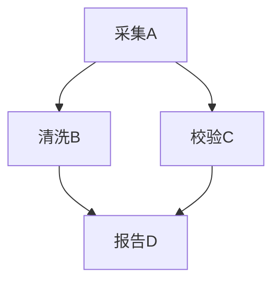

# 递推、归纳、不变量与图模型

一个程序处理一步时保持条件，为什么能保证所有可达步骤都保持？无相邻1的二进制串怎样从小长度推到大长度？两者都把长过程拆成已知前提和合法扩展，但“答案满足递推”“某公式是真答案”“程序一定结束”仍需分别证明。

## 1. 从互斥分类得到递推，先写足初值

令a_n是长度n≥0、没有连续子串11的二进制串数。空串合法，故a₀=1；长度1的0、1都合法，故a₁=2。长度n≥2的合法串分为以0结尾和以1结尾两类。第一类去掉末尾0，与长度n−1合法串一一对应；第二类末尾必须为01，去掉这两位，与长度n−2合法串一一对应。两类不交且覆盖，因此

$$
a_n=a_{n-1}+a_{n-2}\quad(n\ge2),\qquad a_0=1,\ a_1=2.
$$

递推不仅是“看前几个数像这样”。它由双射分类证明，每个较小串都能合法扩展回来。得到a₂=3（00、01、10），a₃=5（000、001、010、100、101），a₄=8，a₅=13。少给一个初值就不唯一：同一二阶递推还容许Fibonacci初值0、1等别的序列。

## 2. 归纳为何有效，怎样选归纳假设

普通归纳证明P(n)对所有n≥0成立，要证P(0)，再对任意n≥0证明P(n)→P(n+1)。有效性可用良序原理解释：若有反例，非负整数反例集合有最小元m；m不为0；P(m−1)真，归纳步推出P(m)，矛盾。良序指每个非空非负整数子集有最小元，不把它搬到全体实数上。

强归纳允许假设P(0),…,P(n)共同推出P(n+1)。它与普通归纳等效：把Q(n)定义成“P(0)至P(n)全部成立”就能用普通归纳。递推依赖前两项时，可以给两个基例并从n≥1做双项归纳，或用强归纳写清已有两项。

例如证明每个整数n≥2能写成有限个素数的乘积：n=2成立。对n>2，若n为素数，乘积只有n本身；若合数，n=uv且2≤u,v<n，强归纳分别分解u、v再相乘。此处仅证存在分解，不证明素因子分解的唯一性，后者需要额外论证。

一个“所有马同色”的错误归纳会把n+1匹马拆成前n与后n两组，借共同的马传递同色；从n=1到2时两组没有共同对象，归纳步在关键边界失败。只有基例正确和大部分归纳步正确不足以覆盖缺失的一步。

## 3. 求解同一个递推：生成函数与闭式校验

取A(x)=∑_{n≥0}a_nxⁿ。将递推乘xⁿ并对n≥2求和，逐项保留初值：

$$
A(x)-1-2x=x(A(x)-1)+x^2A(x),
$$

所以A(x)=(1+x)/(1−x−x²)。这些是形式级数恒等式，不先把x代成1；x=1时计数级数发散。

令φ=(1+√5)/2、ψ=(1−√5)/2，它们满足r²=r+1，φ−ψ=√5、φ+ψ=1、φψ=−1。分母分解为(1−φx)(1−ψx)，直接核对常数项与x项得到

$$
\frac{1+x}{1-x-x^2}
=\frac{\phi^2}{\sqrt5}\frac1{1-\phi x}
-\frac{\psi^2}{\sqrt5}\frac1{1-\psi x},
$$

系数提取给

$$
a_n=\frac{\phi^{n+2}-\psi^{n+2}}{\sqrt5}.
$$

即使分式看起来有无理数，也能用归纳检查它恰为整数计数：n=0时(φ²−ψ²)/√5=(φ−ψ)(φ+ψ)/√5=1；n=1时(φ³−ψ³)/√5=φ²+φψ+ψ²=3−1=2。两根均满足r^(n+2)=r^(n+1)+rⁿ，所以闭式满足同一递推。初值相同、递推逐步唯一决定后项，由归纳得到它就是a_n。这是闭式的完整正确性校验。

闭式适合分析增长，直接浮点实现对很大n可能因舍入给错整数。复算代码用整数递推与有限串枚举；不能把一个近似浮点幂结果当精确计数证明。分治运行时间如T(n)=2T(n/2)+n属于不同递推，要去 [[计算机知识/50-数据结构与算法/20-算法设计系统课程/02-分治排序选择与递推式|分治成本与递推式]] 看规模、取整和输入模型。

## 4. 循环不变量是对可达状态的归纳

状态机包括状态集合S、初始状态和转移关系→。不变量I应满足初始状态的I，以及每个允许转移s→s′上的I(s)→I(s′)。对执行步数归纳，就能证明所有从初始状态可达的状态都满足I。它不必描述所有满足I的状态都可达，也不必对未允许的转移成立。

以Euclid算法求输入正整数A、B的最大公约数：状态(a,b)初始为(A,B)，当b≠0时转移到(b,a mod b)，b=0时返回a。不变量是gcd(a,b)=gcd(A,B)，并有a≥0、b≥0。

为什么保持？写a=qb+r，0≤r<b，则d同时整除a和b，当且仅当d同时整除b和r：前向由r=a−qb，后向由a=qb+r。因此公共正因子集合相同，最大公约数相同。退出时gcd(a,0)=a，故返回值正确。

| 步 | a | b | 余数/下一步 | gcd(a,b) |
| --- | --- | --- | --- | --- |
| 0 | 84 | 30 | 84 mod30=24 | 6 |
| 1 | 30 | 24 | 30 mod24=6 | 6 |
| 2 | 24 | 6 | 24 mod6=0 | 6 |
| 3 | 6 | 0 | 退出返回6 | 6 |

不变量只保证退出后正确，这叫部分正确性。终止另外使用严格下降的非负整数度量b：只要b>0，下一次b′=a mod b满足0≤b′<b；良序排除无限严格下降链，因此必退出。`while True: pass`也可保持“x=x”的不变量，说明保持条件不推出终止。实际程序还应规范0、负数和非整数输入；本讲实现接受非负整数但拒绝(0,0)，并单列这项扩展。

## 5. 图把约束变成可检查的对象

有向图G=(V,E)，E⊆V×V。无向简单图则边是两个不同顶点的无序对，没有自环或多重边。一个walk可重复点和边；路径通常要求顶点不重复。本讲在有向图中约定长度0路径存在，所以每点可达自身；正长度有向环使图不再是DAG（有向无环图）。图中箭头表达什么必须声明，不能把依赖、数据流和时间先后混用。

考虑四个任务：A采集，B清洗，C校验，D出报告。依赖边A→B、A→C、B→D、C→D表示箭头起点必须完成后终点才能开始；没有表达每项耗时或人员资源。

拓扑顺序是每条边都由排列较早点指向较晚点的线性顺序。这里A必先，D必后，B、C任意交换，所以恰有ABCD、ACBD两种。可以枚举4!=24排列逐条查边，这是小图的最小枚举检查。

有限DAG一定有拓扑顺序：若每点都至少一个入边，从某点不断追入边，有限点数迫使重复，得到环，矛盾；所以有入度0点。先删该点，对剩余DAG重复，或用顶点数归纳，就得到一个完整顺序。反方向，若存在环，拓扑顺序会要求v₁早于v₂早于…早于v₁，不可能。因此有限图有拓扑顺序当且仅当无环。

加入D→A会形成环，所有排列都失败；不是排序算法“还没找对”。DAG的可达关系含长度0路径，满足自反、传递，并因无环满足反对称，所以形成偏序。B与C不可比；拓扑顺序是在保留偏序约束时补足比较的线性扩张，并不证明B实际时间早于C。

如果任务可以同时执行，需要再加持续时间、资源和开始时间变量；拓扑顺序只说明依赖相容性。实际BFS、最短路与流算法详见 [[计算机知识/50-数据结构与算法/20-算法设计系统课程/05-图算法网络流与匹配证明|图算法主解释]]，本讲不复制其算法证明。

若边表示无向的非负强度，去 [[数学/12-离散数学与逻辑/30-组合与图论/02-图Laplacian与连通分量#1. 先声明图、权和节点值|加权图的对象与有效连接]]，再用平方和证明矩阵核如何数出正权连通分量。带回“权0不约束端点，负权或有向边须重核算子”的条件；本节任务依赖箭头仍按DAG解释。

如果图是学习器的预测输入，进入 [[AI/16-图表示学习/02-消息传递表达能力与结构反例#逐层证明：任意深度和参数仍相同|六环与双三角形的局部表示反例]]：在同初值、共享局部消息及所声明输入限制下，结构不同也可能产生相同表示。再到该页的 [[AI/16-图表示学习/02-消息传递表达能力与结构反例#图本身有区别：连通分量与 Laplacian 零空间|连通分量与零空间复算]]，沿已给的加权Laplacian入口返回数学前提；图算法能查出分量，不等于这个局部学习器已经编码了分量。

若边表达两个对象不能共享资源，进入 [[数学/12-离散数学与逻辑/30-组合与图论/01-着色团独立集与奇环|着色、团与独立集]]：五环最大团只有2却需要3色，因而局部团下界不等于可行分配；再用 [[数学/12-离散数学与逻辑/30-组合与图论/03-Mantel与Turan极值定理|Mantel–Turán]] 区分禁用局部结构与全局极值。这里的无向冲突模型与上面的任务依赖DAG各有不同含义。

## 6. 练习与答案

1. 证明1+…+n=n(n+1)/2对所有n≥0成立，声明空和。
2. h₀=0，h_n=2h_{n−1}+1（n≥1）。求h_n并给归纳证明。
3. 用Euclid状态轨迹算gcd(35,15)，分别说明正确性与终止依据。
4. 在任务图中删A→C，有多少拓扑顺序？不要默认A仍必须第一。

**答案1。** 空和为0，n=0成立。假设n项和为n(n+1)/2，加入n+1得到n(n+1)/2+(n+1)=(n+1)(n+2)/2，是下一项公式。

**答案2。** h_n=2ⁿ−1。n=0为0；假设h_{n−1}=2^(n−1)−1，代入得2(2^(n−1)−1)+1=2ⁿ−1。不能直接由“递推像翻倍”略过常数−1。

**答案3。** (35,15)→(15,5)→(5,0)，返回5。公共因子集合在每步相同保证退出值为原gcd；b依次15、5、0下降保证退出，两项证明互不替代。

**答案4。** 必须A在B之前，B、C都在D之前，所以D最后；前三点中A在B之前，C自由插入，得ABCD、ACBD、CABD，共3种。C现在可先于A，删边会改变原偏序。

下一讲 [[数学/12-离散数学与逻辑/05-可计算性停机问题与归约方向|可计算性与停机]] 解释为什么不存在对所有程序都成功的终止判断。上一讲 [[数学/12-离散数学与逻辑/03-计数容斥鸽巢与生成函数|计数与生成函数]]；返回 [[数学/12-离散数学与逻辑/00-离散数学与逻辑-MOC|课程入口]]。

## 教材定位

[MCS 2018教材](https://courses.csail.mit.edu/6.042/spring18/mcs.pdf) §5.1–5.3（pp.137–154）给普通/强归纳与良序，§6.1–6.3（pp.173–187）给状态转移、不变量、部分正确性与终止；§16.4（pp.746–751）给线性递推与生成函数；§10.5–10.6（pp.431–442）给DAG和偏序。无相邻1计数、Euclid轨迹与四任务图是本库教学构造。
