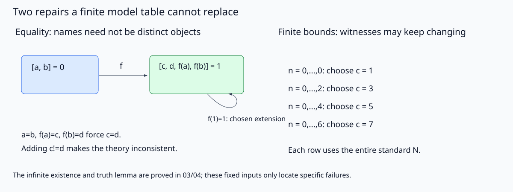

# 模型构造：有限反例核到哪里

Henkin一般构造不是一个已实现的模型求解器。[[数学/12-离散数学与逻辑/20-数理逻辑与集合论/03-Henkin模型与一阶完备性|03]] 的一致性分支选择、无限饱和、完整真值引理均由正文证明；这里只对同一组故障例作精确、可运行的有限证书。旧命题真值表、AI合一/归结与默认扩展实验各有自己的合同，未在本包重跑。

## 规范输入与实现范围

同目录 `model_lab.py` 是真源，只用Python标准库。`FiniteModel` 输入非空互异整数论域、常量解释、有限元总函数表与谓词关系表；逻辑等号固定为对象相同。布尔值不冒整数对象，函数表必须覆盖论域的全部参数元组。公式AST只实现固定一阶构造：`v/c/f`是项，`eq/pred/false/not/and/or/implies/forall/exists`是公式。对象和语法节点分开；有自由变量时需给其全部值，未用变量可任意补成01的全赋值。求值前先核完整语法和签名，短路不会掩盖坏分支。

`ground_congruence` 只对所列有限闭项DAG计算同余；引用的子项须在表内、函数元数一致、图无环。它不凭空加入所有更深函数项，因而**不把有限项表叫作闭项全模型**。本例另给一个总的两点模型来验证所有输入方程。后继算术片段则只核有限个标准自然数不等式；其论域明确为整个N，没有有限表假冒真算术。

## 真实执行与固定结果

2026-10-17实际在共享两槽、单线程runner执行 `python3 model_lab.py`，exit0：`PASS, finite_functions=3413, formula_checks=6826, prefixes=9, rejections=12`。命令也可用 `--output-dir /path/to/new-directory` 写可再生输出。固定AST与模型输入见下方规范源，精确结果在 [实际JSON](实践结果/models-20261017.json)。代码不依赖外部服务，只向声明的output-dir写JSON与SVG。

| 固定对象 | 实际结果 | 它能排除什么误判 |
|---|---|---|
| $a=b,f(a)=c,f(b)=d$ 的六个列出闭项 | 类为{a,b}与{c,d,f(a),f(b)}；另取D={0,1},a=b0,c=d1,f0=1,f1=1，三方程全真，c=d真，c≠d假 | 常量名不保证对象不同；函数同余必须随等号合并 |
| $P(a),\exists x\neg P(x)$ | 旧项单点模型P全真使存在句假；两点a0/h1、P={0}时两前提真、¬P(h)真 | 只靠旧闭项可能缺见证；不能指定原a为新见证 |
| D大小1,2,3,4,5上全部总一元函数 | 总数1/4/27/256/3125；单射数1/2/6/24/120；满射数相同；单射非满射均0 | 有限鸽巢与无限后继的区别，有限扫描不证明一般逻辑有效 |
| $D_k$，k1..5 | 大小k域均满足；k≥2时大小k−1域均不满足 | 无固定有限整体模型；k1在非空域恒真，不用空域当反例 |
| 数码界限n0..B，B0..8 | 每份前缀在标准N取c=B+1均真；下一条n=B+1立即使同一c失败 | 每份有限片段可换解释，不存在一个固定标准c满足全部 |

有限函数计数由实际AST语义逐个求值，6826等于两句×3413函数。正文对任意有限D的单射满射证明与对N后继的无限反模型承担一般断言。12个拒绝覆盖空/重复/bool论域、域外常量、偏函数、谓词元数、缺/域外赋值、未知符号、项元数、非法k与循环项图；这些是实现接口证据，不是新的逻辑元定理。



*图读同一JSON对应类与前缀见证。左边f(1)=1是选定总模型的一种扩张，不是那三条方程强迫；右边每行的域均为整个标准N。图没有画出非标准模型的完整序型，也不把9份前缀冒充无限紧致证明。可改变输入a=b为a≠b，先预测同余与可选函数表，再运行自己的有限模型；这会改变原理论，不是否定03的一般定理。*

## 完整源码镜像

修改规范源时同步本镜像；导入模块仅提供纯函数与类，不执行写文件主程序。

<!-- code-sync: model_lab.py -->
```python
"""Finite model certificates, ground congruence, and finite numeral bounds.
This is not a Henkin consistency oracle, proof searcher, or arithmetic model finder.
Standard-library CLI: python3 model_lab.py [--output-dir PATH].
"""
from itertools import product
from pathlib import Path
import argparse
import json


def V(x): return ('v', x)
def C(c): return ('c', c)
def F(f, *args): return ('f', f, tuple(args))
def Eq(a, b): return ('eq', a, b)
def P(p, *args): return ('pred', p, tuple(args))
def Not(a): return ('not', a)
def And(a, b): return ('and', a, b)
def Implies(a, b): return ('implies', a, b)
def All(x, a): return ('forall', x, a)
def Exists(x, a): return ('exists', x, a)


class FiniteModel:
    """Nonempty integer domain; functions total; logical equality is Python equality.
    AST validation is eager, including branches that short-circuit in evaluation.
    An environment must supply all free variables; unused entries are harmless.
    """
    def __init__(self, domain, constants=None, functions=None, predicates=None):
        self.domain = tuple(domain)
        if not self.domain or any(type(x) is not int for x in self.domain) or len(set(self.domain)) != len(self.domain):
            raise ValueError('nonempty distinct integer domain required')
        self.constants = dict(constants or {})
        self.functions = dict(functions or {})
        self.predicates = dict(predicates or {})
        if any(type(x) is not int or x not in self.domain for x in self.constants.values()):
            raise ValueError('constant outside domain')
        for name, (arity, table) in self.functions.items():
            if type(arity) is not int or arity < 0:
                raise ValueError('function arity')
            expected = set(product(self.domain, repeat=arity))
            if set(table) != expected or any(not isinstance(row,tuple) or any(type(x) is not int for x in row) for row in table) or any(type(x) is not int or x not in self.domain for x in table.values()):
                raise ValueError('function must be total on the declared domain')
        for name, (arity, relation) in self.predicates.items():
            if type(arity) is not int or arity < 0 or any(not isinstance(row,tuple) or len(row) != arity or any(type(x) is not int or x not in self.domain for x in row) for row in relation):
                raise ValueError('predicate tuple outside signature/domain')

    def term_vars(self, t):
        if not isinstance(t, tuple) or not t:
            raise ValueError('malformed term')
        op = t[0]
        if op == 'v' and len(t) == 2 and isinstance(t[1], str):
            return {t[1]}
        if op == 'c' and len(t) == 2 and t[1] in self.constants:
            return set()
        if op == 'f' and len(t) == 3 and t[1] in self.functions and isinstance(t[2], tuple) and len(t[2]) == self.functions[t[1]][0]:
            return set().union(*(self.term_vars(a) for a in t[2]))
        raise ValueError('unknown symbol or term arity')

    def free_vars(self, a):
        if not isinstance(a, tuple) or not a:
            raise ValueError('malformed formula')
        op = a[0]
        if op == 'false' and len(a) == 1:
            return set()
        if op == 'eq' and len(a) == 3:
            return self.term_vars(a[1]) | self.term_vars(a[2])
        if op == 'pred' and len(a) == 3 and a[1] in self.predicates and isinstance(a[2],tuple) and len(a[2]) == self.predicates[a[1]][0]:
            return set().union(*(self.term_vars(t) for t in a[2]))
        if op == 'not' and len(a) == 2:
            return self.free_vars(a[1])
        if op in ('and','or','implies') and len(a) == 3:
            return self.free_vars(a[1]) | self.free_vars(a[2])
        if op in ('forall','exists') and len(a) == 3 and isinstance(a[1],str):
            return self.free_vars(a[2]) - {a[1]}
        raise ValueError('unknown symbol or formula arity')

    def _term(self, t, env):
        op = t[0]
        if op == 'v': return env[t[1]]
        if op == 'c': return self.constants[t[1]]
        return self.functions[t[1]][1][tuple(self._term(x,env) for x in t[2])]

    def _holds(self, a, env):
        op = a[0]
        if op == 'false': return False
        if op == 'eq': return self._term(a[1],env) == self._term(a[2],env)
        if op == 'pred': return tuple(self._term(t,env) for t in a[2]) in self.predicates[a[1]][1]
        if op == 'not': return not self._holds(a[1],env)
        if op == 'and': return self._holds(a[1],env) and self._holds(a[2],env)
        if op == 'or': return self._holds(a[1],env) or self._holds(a[2],env)
        if op == 'implies': return not self._holds(a[1],env) or self._holds(a[2],env)
        values = (self._holds(a[2],dict(env,**{a[1]:d})) for d in self.domain)
        return all(values) if op == 'forall' else any(values)

    def holds(self, a, env=None):
        env = dict(env or {})
        free = self.free_vars(a)
        if not free <= env.keys() or any(type(x) is not int or x not in self.domain for x in env.values()):
            raise ValueError('free variable missing or assignment outside domain')
        return self._holds(a, env)


def distinct_sentence(k):
    if type(k) is not int or k < 1:
        raise ValueError('positive k required')
    a = ('not', ('false',))
    for i in range(k):
        for j in range(i + 1, k):
            a = And(a, Not(Eq(V('x'+str(i)), V('x'+str(j)))))
    for i in reversed(range(k)):
        a = Exists('x'+str(i), a)
    return a


def ground_congruence(terms, applications, equalities):
    """Least congruence on a finite ground-term DAG (not a full infinite term model).
    applications maps a node label to (function name, tuple(argument node labels)).
    Missing function applications are not invented; a separate total finite model is used below.
    """
    terms = tuple(terms)
    if not terms or len(set(terms)) != len(terms) or any(not isinstance(x,str) for x in terms):
        raise ValueError('nonempty unique string node labels required')
    if any(t not in terms or not isinstance(row,tuple) or len(row)!=2 or not isinstance(row[0],str) or not isinstance(row[1],tuple) or any(a not in terms for a in row[1]) for t,row in applications.items()):
        raise ValueError('invalid application DAG nodes')
    arities = {}
    for name,args in applications.values():
        if name in arities and arities[name]!=len(args): raise ValueError('function arity conflict')
        arities[name]=len(args)
    visiting, visited = set(), set()
    def visit(t):
        if t in visiting: raise ValueError('cyclic graph is not a finite ground term')
        if t in visited: return
        visiting.add(t)
        if t in applications:
            for a in applications[t][1]: visit(a)
        visiting.remove(t); visited.add(t)
    for t in terms: visit(t)
    parent = {t:t for t in terms}
    def root(t):
        while parent[t]!=t:
            parent[t]=parent[parent[t]]; t=parent[t]
        return t
    def merge(a,b):
        if a not in parent or b not in parent: raise ValueError('equality references unknown node')
        a,b=root(a),root(b)
        if a==b: return False
        parent[max(a,b)] = min(a,b)
        return True
    for a,b in equalities: merge(a,b)
    rounds = 0
    while True:
        rounds += 1; seen={}; changed=False
        for t,(f,args) in applications.items():
            key=(f,tuple(root(a) for a in args))
            if key in seen: changed=merge(t,seen[key]) or changed
            else: seen[key]=t
        if not changed: break
    groups={}
    for t in terms: groups.setdefault(root(t),[]).append(t)
    return {'classes':sorted(sorted(x) for x in groups.values()),'rounds':rounds}


def build_results():
    a,b,c,d = (C(x) for x in ('a','b','c','d'))
    equalities = [Eq(a,b), Eq(F('f',a),c), Eq(F('f',b),d)]
    model=FiniteModel([0,1],{'a':0,'b':0,'c':1,'d':1},{'f':(1,{(0,):1,(1,):1})})
    equality_truth=[model.holds(x) for x in equalities]
    assert all(equality_truth) and model.holds(Eq(c,d)) and not model.holds(Not(Eq(c,d)))
    quotient=ground_congruence(['a','b','c','d','f(a)','f(b)'],{'f(a)':('f',('a',)),'f(b)':('f',('b',))},[('a','b'),('f(a)','c'),('f(b)','d')])
    assert quotient['classes']==[['a','b'],['c','d','f(a)','f(b)']]
    witness_formula=Exists('x',Not(P('P',V('x'))))
    witness_rows=[]
    for label,m in [('old_term_only',FiniteModel([0],{'a':0},predicates={'P':(1,{(0,)})})),('two_point_witness',FiniteModel([0,1],{'a':0,'h':1},predicates={'P':(1,{(0,)})}))]:
        row={'label':label,'domain':list(m.domain),'constants':m.constants,'P':sorted(list(m.predicates['P'][1])),'P_a':m.holds(P('P',a)),'exists_not_P':m.holds(witness_formula)}
        if label=='two_point_witness': row['not_P_h']=m.holds(Not(P('P',C('h'))))
        witness_rows.append(row)
    assert witness_rows[0]['exists_not_P'] is False and witness_rows[1]['exists_not_P'] is True
    # f injective but not onto: every total function on each fixed finite domain.
    injective=All('x',All('y',Implies(Eq(F('f',V('x')),F('f',V('y'))),Eq(V('x'),V('y')))))
    missing=Exists('y',All('x',Not(Eq(F('f',V('x')),V('y')))))
    function_rows=[]
    for n in range(1,6):
        counts={'n':n,'total_functions':0,'injective':0,'surjective':0,'injective_non_surjective':0,'formula_checks':0}
        for values in product(range(n),repeat=n):
            table={(x,):values[x] for x in range(n)}
            m=FiniteModel(range(n),functions={'f':(1,table)})
            inj=m.holds(injective); nononto=m.holds(missing)
            counts['total_functions']+=1; counts['injective']+=inj; counts['surjective']+=not nononto; counts['injective_non_surjective']+=inj and nononto; counts['formula_checks']+=2
        assert counts['total_functions']==n**n and counts['injective_non_surjective']==0
        function_rows.append(counts)
    size_rows=[]
    for k in range(1,6):
        formula=distinct_sentence(k)
        row={'k':k,'size_k_satisfies':FiniteModel(range(k)).holds(formula),'size_k_minus_one_satisfies':FiniteModel(range(k-1)).holds(formula) if k>1 else None}
        assert row['size_k_satisfies'] is True and (k==1 or row['size_k_minus_one_satisfies'] is False)
        size_rows.append(row)
    prefix_rows=[]
    for bound in range(9):
        chosen=bound+1
        comparisons=[{'numeral':n,'c':chosen,'true_in_standard_N':n<chosen} for n in range(bound+1)]
        assert all(row['true_in_standard_N'] for row in comparisons)
        prefix_rows.append({'largest_numeral':bound,'chosen_c':chosen,'domain':'entire standard N, not a truncated finite domain','comparisons':comparisons,'next_bound_fails_same_c':not chosen<chosen})
    # Eager validation and finite DAG contract failures.
    bad=[]
    cases=[('empty_domain',lambda:FiniteModel([])),('duplicate_domain',lambda:FiniteModel([0,0])),('bool_domain',lambda:FiniteModel([False])),('constant_outside',lambda:FiniteModel([0],{'a':1})),('partial_function',lambda:FiniteModel([0,1],functions={'f':(1,{(0,):1})})),('predicate_arity',lambda:FiniteModel([0],predicates={'P':(1,{(0,0)})})),('free_assignment_missing',lambda:model.holds(Eq(V('x'),V('x')))),('free_assignment_outside',lambda:model.holds(Eq(V('x'),V('x')),{'x':3})),('unknown_symbol',lambda:model.holds(P('unknown',a))),('term_arity',lambda:model.holds(Eq(F('f',a,b),c))),('bad_k',lambda:distinct_sentence(0)),('cyclic_terms',lambda:ground_congruence(['t'],{'t':('f',('t',))},[]))]
    for name,call in cases:
        try: call()
        except ValueError as e: bad.append({'case':name,'error':str(e)})
        else: raise AssertionError('expected rejection '+name)
    return {'status':'PASS','date':'2026-10-17','scope':'finite first-order model certificates; not a Henkin oracle, proof system, arithmetic truth enumeration or nonstandard model representation','ground_quotient':quotient,'total_model_extension':{'domain':[0,1],'constants':model.constants,'f_table':[[0,1],[1,1]],'equation_truth':equality_truth,'c_equals_d':True,'c_not_equals_d':False,'extension_choice':'f(1)=1 is chosen, not forced by the listed ground equations'},'witness_models':witness_rows,'function_enumeration':function_rows,'distinct_sentences':size_rows,'standard_numeral_prefixes':prefix_rows,'rejections':bad}


def svg(result):
    # All labels/classes/prefix witnesses are read from the same result object.
    cls=result['ground_quotient']['classes']
    entries=''.join(f'<text x="674" y="{172+42*i}" font-size="19">n = 0,...,{r["largest_numeral"]}: choose c = {r["chosen_c"]}</text>' for i,r in enumerate(result['standard_numeral_prefixes'][::2][:4]))
    return f'''<svg xmlns="http://www.w3.org/2000/svg" width="1200" height="450" viewBox="0 0 1200 450">
<title>名字的等号商与有限数码片段的标准见证</title><desc>左：a与b合为一类，c、d、f(a)、f(b)合为另一类；实模型取0和1，f(1)=1是额外选择而非方程所迫。右：最大数码0、2、4、6分别取c为1、3、5、7，每份前缀在整个标准自然数域满足，没有一个固定标准c满足全部无限界限。</desc>
<defs><marker id="arr" markerWidth="8" markerHeight="8" refX="7" refY="3" orient="auto"><path d="M0,0 L8,3 L0,6" fill="#334155"/></marker></defs>
<rect width="1200" height="450" fill="#f8fafc"/><g font-family="sans-serif" fill="#0f172a">
<text x="30" y="36" font-size="24">Two repairs a finite model table cannot replace</text>
<text x="36" y="82" font-size="21">Equality: names need not be distinct objects</text><text x="650" y="82" font-size="21">Finite bounds: witnesses may keep changing</text>
<rect x="50" y="130" width="180" height="90" rx="8" fill="#dbeafe" stroke="#2563eb"/><rect x="350" y="130" width="220" height="90" rx="8" fill="#dcfce7" stroke="#15803d"/>
<text x="74" y="164" font-size="19">[{', '.join(cls[0])}] = 0</text><text x="372" y="161" font-size="18">[{', '.join(cls[1])}] = 1</text>
<path d="M232,177 H344" stroke="#334155" fill="none" marker-end="url(#arr)"/><text x="280" y="161" font-size="19">f</text>
<path d="M485,220 C550,290 575,225 535,220" stroke="#334155" fill="none" marker-end="url(#arr)"/><text x="486" y="284" font-size="16">f(1)=1: chosen extension</text>
<text x="50" y="322" font-size="18">a=b, f(a)=c, f(b)=d force c=d.</text><text x="50" y="354" font-size="18">Adding c!=d makes the theory inconsistent.</text>
{entries}
<text x="674" y="358" font-size="18">Each row uses the entire standard N.</text><text x="30" y="416" font-size="16">The infinite existence and truth lemma are proved in 03/04; these fixed inputs only locate specific failures.</text>
</g></svg>'''


def main():
    ap=argparse.ArgumentParser(description=__doc__)
    ap.add_argument('--output-dir',type=Path,default=Path(__file__).resolve().parent)
    args=ap.parse_args();result=build_results()
    (args.output_dir/'assets').mkdir(parents=True,exist_ok=True);(args.output_dir/'实践结果').mkdir(parents=True,exist_ok=True)
    (args.output_dir/'实践结果/models-20261017.json').write_text(json.dumps(result,ensure_ascii=False,indent=2)+'\n')
    (args.output_dir/'assets/henkin-models.svg').write_text(svg(result))
    print(json.dumps({'status':'PASS','finite_functions':sum(r['total_functions'] for r in result['function_enumeration']),'formula_checks':sum(r['formula_checks'] for r in result['function_enumeration']),'prefixes':len(result['standard_numeral_prefixes']),'rejections':len(result['rejections'])}))


if __name__=='__main__': main()
```

返回 [[数学/12-离散数学与逻辑/20-数理逻辑与集合论/00-数理逻辑与集合论-MOC|逻辑与集合论路线]]。模型检查、一般元证明、有限反例、客户端显示与人的理解各有不同证据；某次枚举没有找到反例不能代替所有模型上的后承判断。
