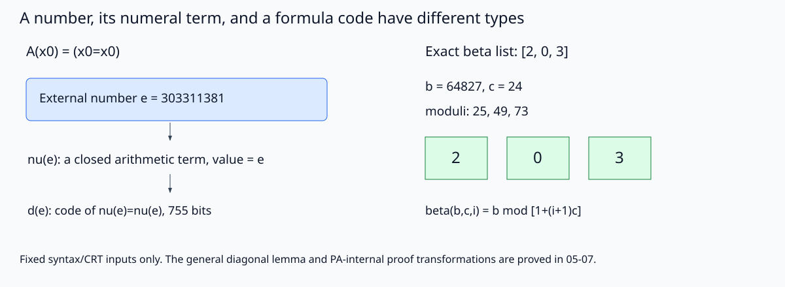

# 算术编码：有限证书能替哪一步消除疑惑

[[数学/12-离散数学与逻辑/20-数理逻辑与集合论/05-算术编码可表示性与证明谓词|05]] 的PA内部一般归纳，及 [[数学/12-离散数学与逻辑/20-数理逻辑与集合论/06-对角引理Godel与Rosser第一不完备|06]] / [[数学/12-离散数学与逻辑/20-数理逻辑与集合论/07-Lob定理与第二不完备的准确范围|07]] 的元定理负责一般结论。这里把最容易串类型的接口变成精确整数：公式的代码e、值为e的数码项ν(e)、替换后公式的代码d(e)，不是同一种对象。代码的优点是让这几次搬运无法含糊带过；代价是代码会膨胀，且一个成功样本并不产生一般自指定理。

## 输入、实现范围与真实输出

同目录 `arithmetization_lab.py` 是规范源，只用Python标准库。项AST为zero/变量/S/加/乘，公式为等号、<、否定、合取、析取、蕴含、全称、存在与矛盾；所有自然数输入拒绝bool与负整数。前缀token采用05的自定界串：最前1作哨兵，再写γ(token数+1)，每个token a写γ(a+1)，其中γ是正整数的前导零长度码。长度加1允许空序列有合法表示；不接受截断串或多余尾位。编码检查不解释公式真假。

闭项替换专供当前d(e)实例，不实现任意开放项的捕获避免替换。d对坏码或含其他自由变量的公式回固定0=0码；被同名量词绑定的变量保持绑定。数码ν用05的二进制合法算术项，避免打印三亿个S。

2026-10-17已通过共享两槽、单线程runner实际执行，exit0。裸Python复现命令为 `python3 arithmetization_lab.py`；加 `--output-dir /path/to/new-directory` 可把结果放进自己的目录。实际stdout：

```json
{"status":"PASS","sequence_inputs":6,"numerals":17,"beta_inputs":5,"self_code_bits":755,"rejections":12}
```

[完整固定输入与实际JSON](实践结果/arithmetization-20261017.json) 保留AST、token、自然数码、β参数和证明树；命令只写所给output-dir的JSON/SVG，导入模块不写文件。

| 可检查的具体断言 | 固定输入与实际结果 | 一般结论由谁承担 |
|---|---|---|
| 串能无损编码，0与空串不混 | 6串包括空串、[0]、[1,0,3]、[2,0,3]、[4,20,20]、0..9。前两码3、21；[2,0,3]码0x48e4 | 唯一分段与有界解析的一般PR性由05证明；6次往返不是注入性证明 |
| 数码是合法项，其值等于外部n | n0..16的17个闭项逐项求值全部等于n；ν(e)也求值为e | ν的一般递归与PA等于一元数码的归纳在05 |
| 自代入函数确实搬运了代码 | A(x₀)=x₀=x₀，e=303311381=0x12142a15；ν(e)值为e；d(e)解成ν(e)=ν(e)，其代码755bit | 此A不是06构造时含D和ψ的E；本次没有生成真正G/R，不是固定点引理实验版证明 |
| 列表可用β余数恢复并延长 | 空串、[0]、[0,0,0]、[2,0,3]、[7,1,4,2]共5组，每组追加5后均恢复目标；[2,0,3]取b64827/c24，模25/49/73 | 05的PA统一Append/CRT归纳；程序只对给定有限列表做普通整数CRT |
| β参数不唯一，给定参数的余数唯一 | (b,c)=(0,1)和(12,1)在i0,1,2均给0 | 不能由解码唯一推参数唯一；05题3已完整区分 |
| 合法有限证明可以保留依赖并接MP根 | A=0=0，B=S0=S0；H后解除得A→A；由=I得A及B，以B作条件证明得A→B，接MP得B | 实现仅H、=I、→I、MP片段；不声称实现01全部规则或05完整PA验证器 |
| c.e.公理叶子需要阶段证据 | 玩具枚举器在第7步输出A、第11步输出B；A附0..7轨迹通过，提前第6步或跳步轨迹被拒 | 玩具枚举器不是任意W；一般带阶段证书/完整轨迹的Δ0关系与内部证明变换在05 |

12个拒绝分支为负数、bool、γ零输入、无哨兵、截断码、未知项、非闭替换项、bool绑定变量、未开放假设、公式不匹配MP、提前W阶段和损坏W轨迹。拒绝是实现合同，不是新的算术元定理。



*图直接读取同一JSON。左侧不把自然数e画成命题真值，右侧不把一组参数画成唯一编码。可先预测把A改成全称绑定x₀后，代入x₀是否应改变公式，再用规范源的自由变量与替换函数核对；正确结果是不改变，因为那次出现被绑定。反之把β输入末项3改4，会改变CRT目标，不能保留原b却宣称仍编码原列表。*

## 为什么不直接给“不完备定理”运行按钮

程序未实现全PA证明检查器、整个验证寄存器机V、算术公式Prf_T、Δ0证明生成器或HBL形式化器。它也不判定T一致，不搜索所有模型，不把固定A的d(e)误标为Gödel句。这些缺口不是本包一般论证的外部等待项：05–07已经在所声明系统与PA内部归纳层面承担相应理论证明；这里清楚标出可执行产物实际上到哪一步，未声明证明助手机械认证。

回到 [[数学/12-离散数学与逻辑/20-数理逻辑与集合论/05-算术编码可表示性与证明谓词#统一的数码证明生成，不止逐个标准值|统一证明生成]]，区分“给某个标准输入得到一份证明”和“PA证明所有内部输入都能生成合法证书”。再回 [[数学/12-离散数学与逻辑/20-数理逻辑与集合论/07-Lob定理与第二不完备的准确范围#不可删的前提与任意“自洽”句的陷阱|换Prov的失败例]]：标准外延相同仍不能自动搬走内部条件，有限表尤其不能完成这次搬运。

## 完整源码镜像

修改源码后同步此镜像；不要把正文中的代码副本当成另一份实现。

<!-- code-sync: arithmetization_lab.py -->
```python
"""Exact finite coding/closed substitution/beta and a tiny ND certificate fragment.
Not a full PA proof checker, fixed-point theorem implementation, or consistency oracle.
Standard library only. CLI writes fixed JSON/SVG to --output-dir (default: this folder).
"""
from pathlib import Path
from math import factorial, gcd
import argparse
import json


ZERO=('zero',)
def Var(i): return ('v',i)
def S(t): return ('S',t)
def Add(a,b): return ('+',a,b)
def Mul(a,b): return ('*',a,b)
def Eq(a,b): return ('eq',a,b)
def Imp(a,b): return ('imp',a,b)
TAGS={'zero':0,'S':1,'+':2,'*':3,'eq':4,'not':5,'and':6,'imp':7,'all':8,'ex':9,'bot':10,'or':11,'lt':12}


def nat(n):
    if type(n) is not int or n<0: raise ValueError('nonnegative int required, excluding bool')
    return n


def gamma(n):
    nat(n)
    if n==0: raise ValueError('gamma takes positive integers')
    bits=bin(n)[2:]
    return '0'*(len(bits)-1)+bits


def encode_sequence(values):
    values=tuple(nat(v) for v in values)
    bits='1'+gamma(len(values)+1)+''.join(gamma(v+1) for v in values)
    return int(bits,2)


def decode_sequence(code):
    nat(code)
    if code==0: raise ValueError('missing sentinel')
    bits=bin(code)[3:]  # remove 0b and the leading sentinel 1
    pos=0
    def take():
        nonlocal pos
        start=pos
        while pos<len(bits) and bits[pos]=='0': pos+=1
        zeros=pos-start
        if pos+zeros>=len(bits): raise ValueError('truncated self-delimiting integer')
        val=int(bits[pos:pos+zeros+1],2)
        pos+=zeros+1
        return val
    length=take()-1
    out=tuple(take()-1 for _ in range(length))
    if pos!=len(bits): raise ValueError('trailing bits')
    return out


def term_tokens(t):
    if not isinstance(t,tuple) or not t: raise ValueError('bad term')
    op=t[0]
    if op=='zero' and len(t)==1: return (0,)
    if op=='v' and len(t)==2: return (20+nat(t[1]),)
    if op=='S' and len(t)==2: return (1,)+term_tokens(t[1])
    if op in ('+','*') and len(t)==3: return (TAGS[op],)+term_tokens(t[1])+term_tokens(t[2])
    raise ValueError('bad term constructor or arity')


def formula_tokens(a):
    if not isinstance(a,tuple) or not a: raise ValueError('bad formula')
    op=a[0]
    if op in ('eq','lt') and len(a)==3: return (TAGS[op],)+term_tokens(a[1])+term_tokens(a[2])
    if op=='bot' and len(a)==1: return (10,)
    if op=='not' and len(a)==2: return (5,)+formula_tokens(a[1])
    if op in ('and','or','imp') and len(a)==3: return (TAGS[op],)+formula_tokens(a[1])+formula_tokens(a[2])
    if op in ('all','ex') and len(a)==3: return (TAGS[op],20+nat(a[1]))+formula_tokens(a[2])
    raise ValueError('bad formula constructor or arity')


def decode_formula(code):
    tokens=decode_sequence(code);pos=0
    def read():
        nonlocal pos
        if pos==len(tokens): raise ValueError('truncated syntax')
        out=tokens[pos];pos+=1;return out
    def term():
        k=read()
        if k==0: return ZERO
        if k>=20: return Var(k-20)
        if k==1: return S(term())
        if k in (2,3): return ('+' if k==2 else '*',term(),term())
        raise ValueError('term token expected')
    def formula():
        k=read()
        if k in (4,12): return ('eq' if k==4 else 'lt',term(),term())
        if k==10: return ('bot',)
        if k==5: return ('not',formula())
        if k in (6,7,11): return ({6:'and',7:'imp',11:'or'}[k],formula(),formula())
        if k in (8,9):
            v=read()
            if v<20: raise ValueError('binder variable token expected')
            return ('all' if k==8 else 'ex',v-20,formula())
        raise ValueError('formula token expected')
    a=formula()
    if pos!=len(tokens): raise ValueError('trailing syntax')
    return a


def encode_formula(a): return encode_sequence(formula_tokens(a))


def term_vars(t):
    term_tokens(t)
    if t[0]=='v': return {t[1]}
    if t[0]=='zero': return set()
    return set().union(*(term_vars(a) for a in t[1:]))


def free_vars(a):
    formula_tokens(a)
    if a[0] in ('eq','lt'): return term_vars(a[1])|term_vars(a[2])
    if a[0]=='bot': return set()
    if a[0]=='not': return free_vars(a[1])
    if a[0] in ('all','ex'): return free_vars(a[2])-{a[1]}
    return free_vars(a[1])|free_vars(a[2])


def numeral(n):
    nat(n)
    if n==0: return ZERO
    if n==1: return S(ZERO)
    doubled=Mul(S(S(ZERO)),numeral(n//2))
    return S(doubled) if n%2 else doubled


def term_value(t, env=None):
    term_tokens(t);env=env or {}
    op=t[0]
    if op=='zero': return 0
    if op=='v':
        if t[1] not in env: raise ValueError('unassigned variable')
        return nat(env[t[1]])
    if op=='S': return term_value(t[1],env)+1
    a,b=term_value(t[1],env),term_value(t[2],env)
    return a+b if op=='+' else a*b


def substitute_closed(a, variable, t):
    """Only closed terms: enough for numeral diagonal substitution, no capture claim beyond it."""
    formula_tokens(a);nat(variable)
    if term_vars(t): raise ValueError('this finite routine accepts closed substituends only')
    def subterm(r):
        if r[0]=='v': return t if r[1]==variable else r
        if r[0]=='zero': return r
        return (r[0],)+(tuple(subterm(x) for x in r[1:]))
    def subformula(f):
        if f[0] in ('eq','lt'): return (f[0],subterm(f[1]),subterm(f[2]))
        if f[0]=='bot': return f
        if f[0] in ('all','ex'): return f if f[1]==variable else (f[0],f[1],subformula(f[2]))
        return (f[0],)+tuple(subformula(x) for x in f[1:])
    return subformula(a)


def diagonal_code(code):
    """d(e) of 06: syntax self-substitution, NOT the full fixed-point construction."""
    nat(code)
    try:
        a=decode_formula(code)
    except ValueError:
        return encode_formula(Eq(ZERO,ZERO))
    if not free_vars(a)<={0}: return encode_formula(Eq(ZERO,ZERO))
    return encode_formula(substitute_closed(a,0,numeral(code)))


def beta(b,c,i):
    return nat(b)%(1+(nat(i)+1)*nat(c))


def encode_beta(values):
    values=tuple(nat(x) for x in values)
    if not values: return {'b':0,'c':1,'moduli':[],'residues':[]}
    c=factorial(len(values))*(max(values)+1)
    moduli=[1+(i+1)*c for i in range(len(values))]
    assert all(gcd(x,y)==1 for i,x in enumerate(moduli) for y in moduli[i+1:])
    b=0;M=1
    for a,m in zip(values,moduli):
        t=((a-b)*pow(M,-1,m))%m
        b+=M*t;M*=m;b%=M
    decoded=[beta(b,c,i) for i in range(len(values))]
    assert decoded==list(values)
    return {'b':b,'c':c,'moduli':moduli,'residues':decoded}


def toy_w_trace(stage):
    return tuple(range(nat(stage)+1))


def toy_w_outputs(trace):
    """Toy enumeration only: releases equality A at step7 and B at step11."""
    if not isinstance(trace,tuple) or not trace or any(type(x) is not int for x in trace) or trace!=tuple(range(len(trace))):
        raise ValueError('invalid toy enumerator trace')
    out=[]
    if len(trace)>7: out.append(Eq(ZERO,ZERO))
    if len(trace)>11: out.append(Eq(S(ZERO),S(ZERO)))
    return out


def check_fragment(proof, context=frozenset()):
    """Only H, =I, implication I/E and toy W leaves; not the full 01/PA/T verifier."""
    if not isinstance(proof,tuple) or not proof: raise ValueError('bad proof node')
    rule=proof[0]
    if rule=='H' and len(proof)==2:
        formula_tokens(proof[1])
        if proof[1] not in context: raise ValueError('assumption not in open context')
        return proof[1]
    if rule=='eqI' and len(proof)==2:
        term_tokens(proof[1]);return Eq(proof[1],proof[1])
    if rule=='impI' and len(proof)==3:
        formula_tokens(proof[1]);return Imp(proof[1],check_fragment(proof[2],context|{proof[1]}))
    if rule=='mp' and len(proof)==3:
        major=check_fragment(proof[1],context);minor=check_fragment(proof[2],context)
        if major[0]!='imp' or major[1]!=minor: raise ValueError('modus ponens formulas do not match')
        return major[2]
    if rule=='W' and len(proof)==4:
        a,stage,trace=proof[1:];formula_tokens(a);nat(stage)
        if len(trace)!=stage+1 or a not in toy_w_outputs(trace): raise ValueError('toy W axiom not certified by this stage')
        return a
    raise ValueError('unknown/unsupported fragment rule')


def graft_mp(major,minor):
    proof=('mp',major,minor)
    check_fragment(proof)
    return proof


def build_results():
    sequence_inputs=[[],[0],[1,0,3],[2,0,3],[4,20,20],list(range(10))]
    sequence_rows=[]
    for seq in sequence_inputs:
        code=encode_sequence(seq);decoded=decode_sequence(code)
        assert decoded==tuple(seq)
        sequence_rows.append({'input':seq,'code_hex':hex(code),'bit_length':code.bit_length(),'decoded':list(decoded)})
    number_rows=[]
    for n in range(17):
        term=numeral(n);assert term_value(term)==n
        number_rows.append({'n':n,'tokens':list(term_tokens(term)),'value':term_value(term)})
    a=Eq(Var(0),Var(0));e=encode_formula(a);g=diagonal_code(e);instance=decode_formula(g)
    assert instance==Eq(numeral(e),numeral(e)) and term_value(instance[1])==e
    bound=('all',0,Eq(Var(0),Var(0)))
    assert diagonal_code(encode_formula(bound))==encode_formula(bound)
    assert decode_formula(encode_formula(('lt',ZERO,S(ZERO))))==('lt',ZERO,S(ZERO))
    assert diagonal_code(0)==encode_formula(Eq(ZERO,ZERO))
    beta_rows=[]
    for seq in [[],[0],[0,0,0],[2,0,3],[7,1,4,2]]:
        row=encode_beta(seq);row['input']=seq
        row['append_5']=encode_beta(seq+[5]);row['append_5']['input']=seq+[5]
        beta_rows.append(row)
    assert [beta(0,1,i) for i in range(3)]==[beta(12,1,i) for i in range(3)]==[0,0,0]
    A=Eq(ZERO,ZERO);B=Eq(S(ZERO),S(ZERO))
    pA=('eqI',ZERO)
    identity=('impI',A,('H',A))
    implication=('impI',A,('eqI',S(ZERO)))
    mp=graft_mp(implication,pA)
    assert check_fragment(identity)==Imp(A,A) and check_fragment(mp)==B
    toy=('W',A,7,toy_w_trace(7));assert check_fragment(toy)==A
    bad=[]
    calls=[('negative_number',lambda:numeral(-1)),('bool_number',lambda:numeral(True)),('bad_gamma',lambda:gamma(0)),('missing_code',lambda:decode_sequence(0)),('truncated_code',lambda:decode_sequence(2)),('unknown_term',lambda:term_tokens(('bad',))),('nonclosed_substitution',lambda:substitute_closed(a,0,Var(1))),('bad_binder',lambda:formula_tokens(('all',True,a))),('open_assumption',lambda:check_fragment(('H',A))),('bad_mp',lambda:check_fragment(('mp',implication,('eqI',S(ZERO))))),('early_W_stage',lambda:check_fragment(('W',A,6,toy_w_trace(6)))),('bad_W_trace',lambda:check_fragment(('W',A,7,(0,1,2,3,4,5,6,9))))]
    for label,call in calls:
        try: call()
        except ValueError as ex: bad.append({'case':label,'error':str(ex)})
        else: raise AssertionError('expected rejection '+label)
    return {'status':'PASS','date':'2026-10-17','boundary':'finite syntax self-substitution d(e), beta and H/=I/implication/toy-W fragment only; no implementation of all PA rules, Henkin, fixed-point lemma, actual G/R sentences, Prov_T arithmetic formula, HBL proof formalizer or consistency search','sequence_codes':sequence_rows,'binary_numerals':number_rows,'self_substitution':{'template':'x0=x0','e':e,'e_hex':hex(e),'numeral_tokens':list(term_tokens(numeral(e))),'d_e_hex':hex(g),'d_e_bit_length':g.bit_length(),'decoded_instance':instance,'term_value':e,'type_note':'e is an external number; nu(e) is a closed term; d(e) is the code of A(nu(e)), not an assertion about its truth'},'beta_rows':beta_rows,'nonunique_beta_parameters':[[0,1],[12,1]],'proof_fragment':{'A':A,'B':B,'identity_proof':identity,'identity_conclusion':check_fragment(identity),'mp_input_major':implication,'mp_input_minor':pA,'mp_proof':mp,'mp_conclusion':check_fragment(mp),'toy_W_stage':7,'toy_W_trace':toy[3],'toy_W_conclusion':check_fragment(toy)},'rejections':bad}


def svg(result):
    d=result['self_substitution'];beta_row=next(x for x in result['beta_rows'] if x['input']==[2,0,3])
    b,c=beta_row['b'],beta_row['c']
    return f'''<svg xmlns="http://www.w3.org/2000/svg" width="1200" height="440" viewBox="0 0 1200 440">
<title>代码、数码闭项与β列表是不同类型</title><desc>左：公式x0等于x0的自然数编码e，数码ν(e)是值为e的闭项，而d(e)是替换后公式的编码；不展示真实Gödel句。右：同一实际CRT输入2、0、3被β参数编码并正确解出，参数不唯一。</desc>
<defs><marker id="a" markerWidth="8" markerHeight="8" refX="7" refY="3" orient="auto"><path d="M0,0 L8,3 L0,6" fill="#334155"/></marker></defs>
<rect width="1200" height="440" fill="#f8fafc"/><g font-family="sans-serif" fill="#0f172a">
<text x="30" y="36" font-size="24">A number, its numeral term, and a formula code have different types</text>
<text x="40" y="86" font-size="21">A(x0) = (x0=x0)</text><text x="650" y="86" font-size="21">Exact beta list: [2, 0, 3]</text>
<rect x="40" y="120" width="460" height="65" rx="7" fill="#dbeafe" stroke="#2563eb"/><text x="60" y="157" font-size="19">External number e = {d['e']}</text>
<path d="M260,188 V215" stroke="#334155" marker-end="url(#a)"/><text x="42" y="251" font-size="19">nu(e): a closed arithmetic term, value = e</text>
<path d="M260,267 V295" stroke="#334155" marker-end="url(#a)"/><text x="42" y="329" font-size="18">d(e): code of nu(e)=nu(e), {d['d_e_bit_length']} bits</text>
<text x="650" y="139" font-size="19">b = {b}, c = {c}</text><text x="650" y="177" font-size="19">moduli: {', '.join(str(x) for x in beta_row['moduli'])}</text>
<rect x="650" y="210" width="95" height="65" fill="#dcfce7" stroke="#15803d"/><rect x="775" y="210" width="95" height="65" fill="#dcfce7" stroke="#15803d"/><rect x="900" y="210" width="95" height="65" fill="#dcfce7" stroke="#15803d"/>
<text x="690" y="250" font-size="24">2</text><text x="815" y="250" font-size="24">0</text><text x="940" y="250" font-size="24">3</text>
<text x="650" y="329" font-size="18">beta(b,c,i) = b mod [1+(i+1)c]</text>
<text x="30" y="403" font-size="16">Fixed syntax/CRT inputs only. The general diagonal lemma and PA-internal proof transformations are proved in 05-07.</text>
</g></svg>'''


def main():
    ap=argparse.ArgumentParser(description=__doc__)
    ap.add_argument('--output-dir',type=Path,default=Path(__file__).resolve().parent)
    args=ap.parse_args();result=build_results()
    (args.output_dir/'assets').mkdir(parents=True,exist_ok=True);(args.output_dir/'实践结果').mkdir(parents=True,exist_ok=True)
    (args.output_dir/'实践结果/arithmetization-20261017.json').write_text(json.dumps(result,ensure_ascii=False,indent=2)+'\n')
    (args.output_dir/'assets/arithmetization-types.svg').write_text(svg(result))
    print(json.dumps({'status':'PASS','sequence_inputs':len(result['sequence_codes']),'numerals':len(result['binary_numerals']),'beta_inputs':len(result['beta_rows']),'self_code_bits':result['self_substitution']['d_e_bit_length'],'rejections':len(result['rejections'])}))


if __name__=='__main__': main()
```
