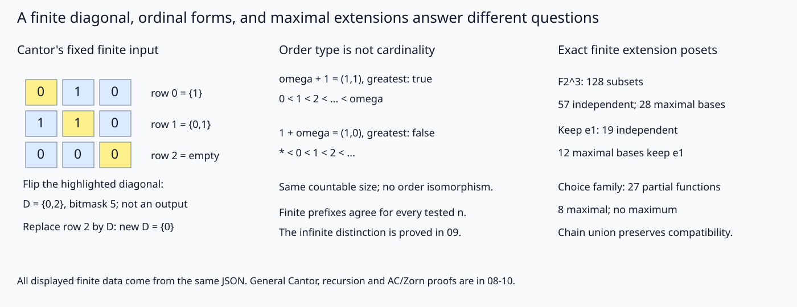

# 有限复算：对角、序型记号与极大扩张各核一件事

[[数学/12-离散数学与逻辑/20-数理逻辑与集合论/08-ZF公理Cantor与模型内外的可数|08]] 的一般Cantor/CSB、[[数学/12-离散数学与逻辑/20-数理逻辑与集合论/09-良序超限递归与序数基数|09]] 的超限递归/Hartogs，以及 [[数学/12-离散数学与逻辑/20-数理逻辑与集合论/10-选择良序Zorn与存在性应用|10]] 的AC/良序/Zorn与扩基都有独立于运行的完整证明。本页用同样的对象检查符号和条件；图中的省略号是正文已证明的序型记号，不是有限程序偷偷保存了一个无穷集合。

## 规范输入与真实执行

同目录 `set_structure_lab.py` 只用Python标准库。实际在2026-10-17经共享两槽、单线程runner执行，exit0：

```json
{"status":"PASS","cantor_functions":531,"ordinal_sums":144,"independent_sets":57,"bases":28,"partial_choices":27,"maximal_choices":8,"rejections":9}
```

裸命令 `python3 set_structure_lab.py` 复生本目录 [JSON实际结果](实践结果/set-structure-20261017.json) 和SVG；`--output-dir /path/to/new-directory` 可将结果另存。导入模块不写文件。固定范围、全枚举生成式与输入都在源码/JSON；结果不取决于随机种子或外部服务。

| 要核的具体断言与重要性 | 有限/符号输入 | 实际观察及其界限 |
|---|---|---|
| 对角只反转本行自身那一位，不能误转整行 | n=0,1,2,3，全部 $f:n\to\mathcal P(n)$，子集用低位对应0的bitmask | 函数数1/2/16/512，总531；每个D_f均不在输出中。每份n的全部2ⁿ种对角值等频；一般任意A仍由08证明 |
| 把逃走的子集加进表，不会使表忽然穷尽 | n3，行mask[2,3,0]，即{1}/{0,1}/∅ | D=5即{0,2}；把末行改5，新D=1即{0}，仍未出现。这个变条件例不是无穷模型 |
| ω+1与1+ω不能用有限列表相等来判同序 | 仅表示 $\omega a+b<\omega^2$，a,b为自然数，输入(a,b)；按09已证串接规则相加 | 网格a0..2/b0..3共12表示的144份和保留精确结果；ω+1=(1,1)有最大元，1+ω=(1,0)无最大元。有限n0..8的两种前缀始终都为n+1，不能从此前缀外推无穷同序 |
| 基的极大性应在指定独立集偏序中判断 | F₂³非零向量1..7，以bit0/1/2分别代表e₁/e₂/e₃；全部128子集 | 独立集按大小1/7/21/28共57；28极大集均三元且span为全部8向量。固定含e₁时19集、12极大基；空链上界用{e₁} |
| 链上界依赖相容性，不是任意两个对象的并 | 同一独立集偏序；另取{1,2}和{3} | 可比对的并仍是较大独立集；非链两集各独立，并{1,2,3}却依赖，因为1 xor2=3。程序核所有可比对，任意有限链的结论再由有限归纳；无穷链一般证明在10 |
| 部分选择的极大≠最大 | I三点，A₀={0,1},A₁={1,2},A₂={0,2}；每指标可不选或选其中两值 | 27部分图、8极大完整图、无最大；125扩张对的并保留较大函数。不是枚举2²⁷条链，更不是用此替AC证明 |
| Hartogs有限版不等于扫描所有序数 | n0..4的全部子集良序，按其排列给具体顺序 | 顺序数1/2/5/16/65，得到的有限序型分别0..n；h(n)=n+1的无更长嵌入依据仍为09有限鸽巢，不是假装已枚举无穷序数 |

`span` 用有限域加法xor，从{0}逐向量闭合，所以无浮点秩阈值。输入可含零向量，它会正确使该组依赖；重复向量不是“两个集合元素”，故接口拒绝。9个拒绝分支覆盖负/bool域、缺行、域外子集、负尾/坏shape序数、域外/重复向量、非法选择值。`choice_graph`只承诺所列固定有限族上的部分值表，不是一般集合选择API。



*左侧黄色对角线是反转的具体位置，行输出与D均读同一JSON；中间表达式的最大元结论按09已证正规形解释；右侧28份基和8份完整选择都是多个极大对象，没有一个“最佳总对象”。全图没有画ZF模型，也没有认证ZF一致、AC独立性或一个无穷Zorn求解器。*

## 改条件，再返回一般证明

先把{1,2}与{3}合并，预测为什么独立性失败；再换成链{1}⊆{1,2}，检查并保持独立。回10找到“有限多个向量都进入同一链成员”这一步：它为一般无限链服务，而程序只核固定小空间。再把一个A_i换成空集，原“所有A_i非空”就失败；不能用原8个完整选择结果继续回答新输入。

要把任意域/任意维数、任意集合的无穷结构接入程序，须另给可表示输入及算法合同；本页没有提供这种升级。代码的收益是把本例错误定位成一位、一个域元素或一个不相容图；代价是有限可表示的对象范围，不能用运行通过取代理论的一般量词。

## 完整源码镜像

规范源修改时同步本镜像；源码是唯一实现，不从镜像反向生成另一版本。

<!-- code-sync: set_structure_lab.py -->
```python
"""Exact finite interfaces for Cantor, ordinal normal forms, and maximal extensions.
No ZF model constructor, consistency/AC oracle, or infinite Zorn algorithm.
Standard library: python3 set_structure_lab.py [--output-dir PATH].
"""
from itertools import product, combinations, permutations
from pathlib import Path
from collections import Counter
import argparse
import json


def nat(n):
    if type(n) is not int or n < 0:
        raise ValueError('nonnegative integer required, excluding bool')
    return n


def diagonal(n, rows):
    nat(n)
    if len(rows) != n or any(type(a) is not int or not 0 <= a < 1 << n for a in rows):
        raise ValueError('one valid subset bitmask per domain element required')
    return sum((1 << i) for i in range(n) if not rows[i] & (1 << i))


def ordinal_pair(a):
    if type(a) is not tuple or len(a) != 2:
        raise ValueError('ordinal requires (omega coefficient, finite tail)')
    return tuple(nat(x) for x in a)


def ordinal_add(a, b):
    a0, a1 = ordinal_pair(a); b0, b1 = ordinal_pair(b)
    return (a0 + b0, b1) if b0 else (a0, a1 + b1)


def has_greatest(a):
    _, finite_tail = ordinal_pair(a)
    return finite_tail > 0


def span(vectors):
    vectors = tuple(vectors)
    if len(set(vectors)) != len(vectors) or any(type(v) is not int or not 0 <= v < 8 for v in vectors):
        raise ValueError('distinct three-bit F2 vectors required')
    s = {0}
    for v in vectors:
        s |= {x ^ v for x in s}
    return s


def independent(vectors):
    return len(span(vectors)) == 1 << len(vectors)


def extends(f, g):
    """f and g are tuples of (index,value); report f subset of g."""
    return set(f) <= set(g)


def choice_graph(values, family):
    if len(values) != len(family):
        raise ValueError('one optional value per family member required')
    if any(x is not None and (type(x) is not int or x not in a) for x, a in zip(values, family)):
        raise ValueError('selected value outside the indexed set')
    return tuple((i, x) for i, x in enumerate(values) if x is not None)


def build_results():
    cantor = []
    for n in range(4):
        counts = Counter(); total = 0
        for rows in product(range(1 << n), repeat=n):
            d = diagonal(n, rows)
            assert d not in rows
            assert all(bool(d & (1 << i)) != bool(rows[i] & (1 << i)) for i in range(n))
            counts[d] += 1; total += 1
        cantor.append({'n': n, 'all_functions': total, 'diagonal_counts': dict(sorted(counts.items()))})
    old = (2, 3, 0); d = diagonal(3, old); new = old[:2] + (d,)
    fixed = {'domain': [0, 1, 2], 'rows_bitmasks': old, 'diagonal': d,
             'changed_rows': new, 'new_diagonal': diagonal(3, new)}
    pairs = list(product(range(3), range(4)))
    ordinal_rows = [{'left': a, 'right': b, 'sum': ordinal_add(a, b)} for a in pairs for b in pairs]
    omega = (1, 0); one = (0, 1)
    ordinal_special = {'omega_plus_one': ordinal_add(omega, one), 'one_plus_omega': ordinal_add(one, omega),
                       'has_greatest': [has_greatest(ordinal_add(omega, one)), has_greatest(ordinal_add(one, omega))],
                       'finite_prefixes': [{'n': n, 'n_plus_one': ordinal_add((0, n), one),
                                            'one_plus_n': ordinal_add(one, (0, n))} for n in range(9)],
                       'boundary': 'Pairs denote proven ordinal forms below omega^2, not finite approximations to infinite sets.'}
    all_subsets = [frozenset(c) for k in range(8) for c in combinations(range(1, 8), k)]
    inds = [s for s in all_subsets if independent(tuple(sorted(s)))]
    maxima = [s for s in inds if not any(s < t for t in inds)]
    assert all(len(s) == 3 and span(tuple(sorted(s))) == set(range(8)) for s in maxima)
    fixed_inds = [s for s in inds if 1 in s]
    fixed_maxima = [s for s in fixed_inds if not any(s < t for t in fixed_inds)]
    comparable = 0
    for a in inds:
        for b in inds:
            if a <= b:
                assert independent(tuple(sorted(a | b))); comparable += 1
    bad_union = frozenset((1, 2, 3))
    assert independent((1, 2)) and independent((3,)) and not independent(tuple(sorted(bad_union)))
    linear = {'field': 'F2', 'dimension': 3, 'nonzero_vectors': list(range(1, 8)),
              'coordinate_encoding': 'bit 0=e1, bit 1=e2, bit 2=e3',
              'all_subsets': len(all_subsets), 'independent_by_size': dict(sorted(Counter(map(len, inds)).items())),
              'independent_count': len(inds), 'maximal_bases': [sorted(s) for s in maxima],
              'fixed_initial_set': [1], 'fixed_independent_count': len(fixed_inds),
              'fixed_maximal_bases': [sorted(s) for s in fixed_maxima],
              'comparable_pair_gluings': comparable, 'empty_chain_upper_bound': [1],
              'nonchain_independent_sets': [[1, 2], [3]], 'dependent_union': sorted(bad_union)}
    family = ((0, 1), (1, 2), (0, 2))
    partials = [choice_graph(t, family) for t in product(*[(None,) + a for a in family])]
    choice_max = [f for f in partials if not any(f != g and extends(f, g) for g in partials)]
    choice_pairs = 0
    for f in partials:
        for g in partials:
            if extends(f, g):
                assert set(f) | set(g) == set(g); choice_pairs += 1
    assert all(len(f) == 3 for f in choice_max)
    choices = {'family': family, 'partial_count': len(partials), 'partials': partials,
               'maximal_choices': choice_max, 'maximum_exists': any(all(extends(g, f) for g in partials) for f in partials),
               'comparable_pair_gluings': choice_pairs, 'empty_chain_upper_bound': []}
    hartogs = []
    for n in range(5):
        orders = [p for k in range(n + 1) for p in permutations(range(n), k)]
        types = sorted(set(map(len, orders)))
        assert types == list(range(n + 1))
        hartogs.append({'n': n, 'wellorders_on_all_subsets': len(orders), 'ordinal_types': types, 'h_n_by_finite_pigeonhole': n + 1})
    invalid = [
        ('negative_domain', lambda: diagonal(-1, ())), ('bool_domain', lambda: diagonal(True, (0,))),
        ('missing_row', lambda: diagonal(2, (0,))), ('outside_subset', lambda: diagonal(2, (0, 4))),
        ('negative_ordinal_tail', lambda: ordinal_add((1, -1), (0, 0))),
        ('malformed_ordinal', lambda: ordinal_add((1,), (0, 0))),
        ('outside_vector', lambda: span((8,))), ('duplicate_vector', lambda: span((1, 1))),
        ('outside_choice', lambda: choice_graph((3, None, None), family))]
    rejections = []
    for name, operation in invalid:
        try: operation()
        except ValueError as e: rejections.append({'case': name, 'error': str(e)})
        else: raise AssertionError('invalid input accepted: ' + name)
    return {'status': 'PASS', 'date': '2026-10-17', 'cantor_exhaustive': cantor, 'cantor_fixed': fixed,
            'ordinal_pair_inputs': pairs, 'ordinal_additions': ordinal_rows, 'ordinal_special': ordinal_special,
            'linear': linear, 'partial_choice': choices, 'hartogs_finite': hartogs, 'rejections': rejections,
            'boundary': 'Finite input checks plus symbolic ordinal normal forms only. No model of ZF or proof of AC independence/consistency; no infinite Zorn computation.'}


def svg(data):
    c = data['cantor_fixed']; o = data['ordinal_special']; v = data['linear']; p = data['partial_choice']
    cells = []
    for i, row in enumerate(c['rows_bitmasks']):
        for j in range(3):
            color = '#dbeafe' if i != j else '#fef08a'
            cells.append(f'<rect x="{45+65*j}" y="{140+55*i}" width="55" height="45" fill="{color}" stroke="#64748b"/><text x="{65+65*j}" y="{169+55*i}">{int(bool(row & (1 << j)))}</text>')
    return f'''<svg xmlns="http://www.w3.org/2000/svg" width="1400" height="540" viewBox="0 0 1400 540">
<title>有限对角、序数正规表示与极大扩张的类型边界</title><desc>左用三点函数的实际位表对角得到子集0和2；中比较omega加1和1加omega的正规表示和有无最大元素；右报告F2三维57独立集28基、含e1的19集12基以及27部分选择8极大。省略号是已证明的无限序型符号，不是程序构造无限模型。</desc>
<rect width="1400" height="540" fill="#f8fafc"/><g fill="#0f172a" font-family="sans-serif">
<text x="30" y="40" font-size="26">A finite diagonal, ordinal forms, and maximal extensions answer different questions</text>
<g font-size="21"><text x="30" y="95">Cantor's fixed finite input</text><text x="490" y="95">Order type is not cardinality</text><text x="980" y="95">Exact finite extension posets</text></g>
<g font-size="23">{''.join(cells)}</g><g font-size="18">
<text x="265" y="170">row 0 = {{1}}</text><text x="265" y="225">row 1 = {{0,1}}</text><text x="265" y="280">row 2 = empty</text>
<text x="40" y="330">Flip the highlighted diagonal:</text><text x="40" y="365">D = {{0,2}}, bitmask {c['diagonal']}; not an output</text>
<text x="40" y="405">Replace row 2 by D: new D = {{0}}</text>
<text x="490" y="145">omega + 1 = (1,1), greatest: true</text><text x="490" y="180">0 &lt; 1 &lt; 2 &lt; ... &lt; omega</text>
<text x="490" y="240">1 + omega = (1,0), greatest: false</text><text x="490" y="275">* &lt; 0 &lt; 1 &lt; 2 &lt; ...</text>
<text x="490" y="335">Same countable size; no order isomorphism.</text><text x="490" y="380">Finite prefixes agree for every tested n.</text><text x="490" y="415">The infinite distinction is proved in 09.</text>
<text x="980" y="150">F2^3: {v['all_subsets']} subsets</text><text x="980" y="190">{v['independent_count']} independent; {len(v['maximal_bases'])} maximal bases</text>
<text x="980" y="235">Keep e1: {v['fixed_independent_count']} independent</text><text x="980" y="275">{len(v['fixed_maximal_bases'])} maximal bases keep e1</text>
<text x="980" y="335">Choice family: {p['partial_count']} partial functions</text><text x="980" y="375">{len(p['maximal_choices'])} maximal; no maximum</text><text x="980" y="415">Chain union preserves compatibility.</text>
<text x="30" y="500" font-size="17">All displayed finite data come from the same JSON. General Cantor, recursion and AC/Zorn proofs are in 08-10.</text>
</g></g></svg>'''


def main():
    ap = argparse.ArgumentParser(description=__doc__)
    ap.add_argument('--output-dir', type=Path, default=Path(__file__).resolve().parent)
    args = ap.parse_args(); data = build_results()
    (args.output_dir/'assets').mkdir(parents=True, exist_ok=True)
    (args.output_dir/'实践结果').mkdir(parents=True, exist_ok=True)
    (args.output_dir/'实践结果/set-structure-20261017.json').write_text(json.dumps(data, ensure_ascii=False, indent=2)+'\n')
    (args.output_dir/'assets/set-structures.svg').write_text(svg(data))
    print(json.dumps({'status': 'PASS', 'cantor_functions': sum(x['all_functions'] for x in data['cantor_exhaustive']),
                      'ordinal_sums': len(data['ordinal_additions']), 'independent_sets': data['linear']['independent_count'],
                      'bases': len(data['linear']['maximal_bases']), 'partial_choices': data['partial_choice']['partial_count'],
                      'maximal_choices': len(data['partial_choice']['maximal_choices']), 'rejections': len(data['rejections'])}))


if __name__ == '__main__': main()
```
