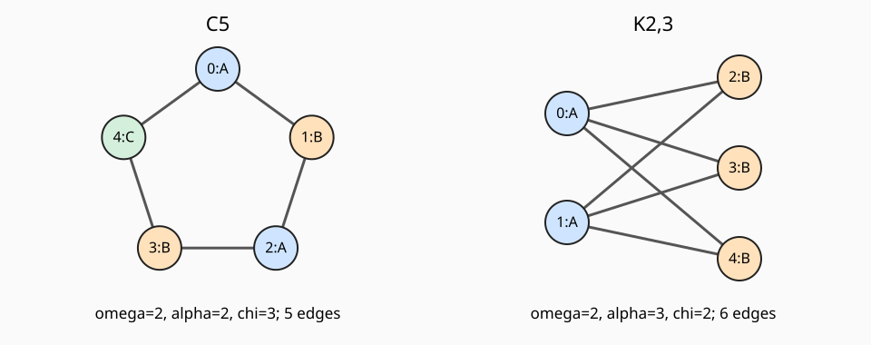
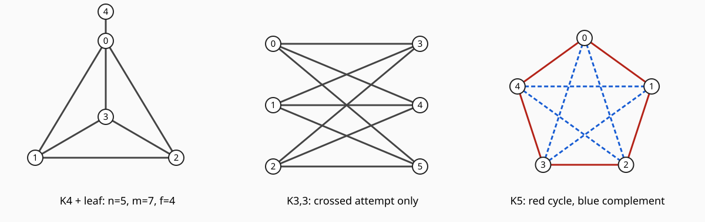

# 着色与极值有限复算

一般定理已由01/03证明。本页用有限、确定性的另一条计算路线检查五环证书、图与矩阵的一致性，以及小图极值计数。没有随机采样、浮点特征值或通用图算法性能结论。

## 断言与重要性

- **高重要性：** 任意有限简单图的奇环判据、Mantel与Turán一般证明。核查对象是正文逻辑、条件和原典；本脚本不证明这些全称命题。
- **中重要性：** C5、K2,3、P5的三个不变量和C5的Laplacian；至多6点所有带编号简单图的禁团极值及达到图数量。这些是正文的有限例和可检查证书，脚本采用子集/颜色枚举、整数位掩码和有理行消元，以发现计数或索引错误。
- **低重要性：** SVG布局。它复用同一边集和配色，字母与颜色双编码；图只展示01已经逐边说明的有限实例，不代证明。

## 输入和运行前可独立得到的预期

命名图按顶点0起编号：C5边为01、12、23、34、40；K2,3的两部为{0,1}与{2,3,4}；P5从C5删40。独立手算预期如下。

| 图 | 团数ω | 独立数α | 色数χ |
|---|---|---|---|
| C5 | 2 | 2 | 3 |
| K2,3 | 2 | 3 | 2 |
| P5 | 2 | 3 | 2 |

C5的L有每行和0；由逐边平方和，核恰为常数列，所以精确秩4、零空间维数1。程序另用 `Fraction` 行消元，不调用谱库。

对每个 $1\le n\le6$，脚本依次枚举全部 $2^{\binom n2}$ 张带编号简单图，检查每个三点/四点集合是否形成禁团，分别保留无K3与无K4图中的最大边数，并统计达到最大值的**带编号图**数量。实际循环没有把图先限制为多部图。

| n | 无K3最大边数 / 达到图数量 | 无K4最大边数 / 达到图数量 |
|---|---|---|
| 1 | 0 / 1 | 0 / 1 |
| 2 | 1 / 1 | 1 / 1 |
| 3 | 2 / 3 | 3 / 1 |
| 4 | 4 / 3 | 5 / 6 |
| 5 | 6 / 10 | 8 / 15 |
| 6 | 9 / 10 | 12 / 15 |

最大边数由正文平衡部公式独立算出。数量也有直接组合预期：例如六点K3-free极值图为K3,3，选一部有 $\binom63$ 种，交换两部不变，故数量10；六点K4-free极值图为K2,2,2，将六个标签分成三个无序点对有 $6!/((2!)^3 3!)=15$ 种。五点K4-free为部大小2,2,1，先选单点，再分无序两对，得 $5\cdot\binom42/2=15$。四点无K4极值图是K4删一边，有6种。较小情形按表中的唯一完全图或两部分组直接核。带编号数量不是同构类型数量；一般极值定理说达到图同构唯一，并不说带编号图只有一个。

全部数学断言使用整数或有理数，预期容差为**零**；SVG布局中的三角函数使用浮点坐标，不参与这些断言。最大的单组枚举只有 $2^{15}=32768$ 张图，不据此宣称能处理大型最大团/最优着色。

## 命令、实际结果与未验证层

源码是 [[数学/12-离散数学与逻辑/30-组合与图论/coloring_extremal_lab.py|coloring_extremal_lab.py]]，仅需支持 `int.bit_count()` 的 Python 3.10+ 标准库。在本目录运行：

```sh
python3 coloring_extremal_lab.py
```

它按固定输入生成本目录的 JSON 和 SVG。维护时遵循当前本机两槽约束；本轮实际命令在2026-10-17通过 `/private/tmp/wwl-next-context/run_local.py --timeout 120 -- python3 <源码绝对路径>` 执行，退出码0。输出为 `PASS`，3个命名图、12行极值数据，最大单组32768张图；没有新增外部依赖。

- 实际精确结果：[[数学/12-离散数学与逻辑/30-组合与图论/实践结果/coloring-extremal-20261017.json|JSON结果]]。
- 图源由同一Python文件中的 `render_figure` 生成；实际图为 

可以先自行预测删除C5的其他一条边会得到什么，再修改命名例；若增大穷举顶点数，图数按 $2^{\binom n2}$ 增长，不能将本轮资源结论外推。源码的固定断言是教学例的检查，不是自动生成一般定理的证明器。

本轮执行没有认证任意n、实际编译器的spill成本、机器代码语义或真人理解；Obsidian实际点击与客户端渲染另属未验层。回 [[数学/12-离散数学与逻辑/30-组合与图论/00-组合与图论-MOC|课程地图]] 选择证明与应用。

## 完整源码镜像

修改以源码为真源，并同步下段；输出文件由源码重生。

<!-- code-sync: ./coloring_extremal_lab.py -->
```python
"""Small exact graph checks; no general theorem is inferred from enumeration.

Python standard library only. Fixed exhaustive sweep: labelled simple graphs,
1 <= n <= 6, excluding K3 or K4. Outputs stay beside this source.
"""
from fractions import Fraction
from itertools import combinations, product
from math import cos, pi, sin
from pathlib import Path
import json


def edge_set(n, pairs):
    result = set()
    for u, v in pairs:
        if not (0 <= u < n and 0 <= v < n) or u == v:
            raise ValueError("expected distinct vertices in range(n)")
        result.add(tuple(sorted((u, v))))
    return result


def invariants(n, edges):
    """Exhaustive subsets and assignments, only for named small examples."""
    clique = independent = ()
    for size in range(n + 1):
        for subset in combinations(range(n), size):
            pairs = list(combinations(subset, 2))
            if all(e in edges for e in pairs):
                clique = subset
            if all(e not in edges for e in pairs):
                independent = subset
    for k in range(1, n + 1):
        witness = next((a for a in product(range(k), repeat=n)
                        if all(a[u] != a[v] for u, v in edges)), None)
        if witness is not None:
            return {"omega": len(clique), "alpha": len(independent),
                    "chi": k, "clique": clique,
                    "independent_set": independent, "coloring": witness}
    raise AssertionError("finite simple graph must be n-colorable")


def laplacian_rank(n, edges):
    matrix = [[Fraction(0) for _ in range(n)] for _ in range(n)]
    for u, v in edges:
        matrix[u][u] += 1
        matrix[v][v] += 1
        matrix[u][v] -= 1
        matrix[v][u] -= 1
    assert all(sum(row) == 0 for row in matrix)
    rows = [row[:] for row in matrix]
    rank = 0
    for col in range(n):
        pivot = next((j for j in range(rank, n) if rows[j][col]), None)
        if pivot is None:
            continue
        rows[rank], rows[pivot] = rows[pivot], rows[rank]
        scale = rows[rank][col]
        rows[rank] = [x / scale for x in rows[rank]]
        for j in range(n):
            if j != rank:
                scale = rows[j][col]
                rows[j] = [a - scale*b for a, b in zip(rows[j], rows[rank])]
        rank += 1
    return {"matrix": [[int(x) for x in row] for row in matrix],
            "rank_exact": rank, "nullity_exact": n-rank}


def forbidden_extrema(n, clique_size):
    pairs = list(combinations(range(n), 2))
    positions = {e: j for j, e in enumerate(pairs)}
    forbidden = [sum(1 << positions[e] for e in combinations(vs, 2))
                 for vs in combinations(range(n), clique_size)]
    best, maximizers, first = -1, 0, 0
    for mask in range(1 << len(pairs)):
        if any(mask & clique == clique for clique in forbidden):
            continue
        count = mask.bit_count()
        if count > best:
            best, maximizers, first = count, 1, mask
        elif count == best:
            maximizers += 1
    return {"n": n, "forbidden_clique": clique_size,
            "graphs_examined": 1 << len(pairs), "max_edges": best,
            "labelled_maximizers": maximizers,
            "first_maximizer": [e for j, e in enumerate(pairs) if first >> j & 1]}


def render_figure(path, cases):
    parts = ['<svg xmlns="http://www.w3.org/2000/svg" width="960" height="380" viewBox="0 0 960 380" role="img" aria-labelledby="title desc">',
             '<title id="title">C5 and K2,3: same clique number, different coloring</title>',
             '<desc id="desc">A five-cycle needs three colors but has no triangle. A complete two-part graph with parts of size two and three needs two colors and reaches the six-edge Mantel bound.</desc>',
             '<rect width="960" height="380" fill="#fafafa"/>']
    colors = ['#cfe5ff', '#ffe1bb', '#d4efdc']
    for index, (name, edges, coloring, coords, caption) in enumerate(cases):
        offset = index * 480
        parts.append(f'<text x="{offset+240}" y="34" text-anchor="middle" font-size="22" font-family="sans-serif">{name}</text>')
        for u, v in sorted(edges):
            x1, y1 = coords[u]; x2, y2 = coords[v]
            parts.append(f'<line x1="{offset+x1:.2f}" y1="{y1:.2f}" x2="{offset+x2:.2f}" y2="{y2:.2f}" stroke="#555" stroke-width="3"/>')
        for v, (x, y) in enumerate(coords):
            letter = 'ABC'[coloring[v]]
            parts.append(f'<circle cx="{offset+x:.2f}" cy="{y:.2f}" r="24" fill="{colors[coloring[v]]}" stroke="#222" stroke-width="2"/>')
            parts.append(f'<text x="{offset+x:.2f}" y="{y+5:.2f}" text-anchor="middle" font-size="16" font-family="sans-serif">{v}:{letter}</text>')
        parts.append(f'<text x="{offset+240}" y="351" text-anchor="middle" font-size="17" font-family="sans-serif">{caption}</text>')
    parts.append('</svg>')
    path.write_text('\n'.join(parts)+'\n')


def main():
    root = Path(__file__).resolve().parent
    c5 = edge_set(5, [(j, (j+1) % 5) for j in range(5)])
    k23 = edge_set(5, product(range(2), range(2, 5)))
    path5 = c5 - {(0, 4)}
    cases = {"C5": (5, c5), "K2_3": (5, k23), "P5": (5, path5)}
    expected = {"C5": (2, 2, 3), "K2_3": (2, 3, 2), "P5": (2, 3, 2)}
    outputs = {}
    for name, (n, edges) in cases.items():
        result = invariants(n, edges)
        assert tuple(result[k] for k in ('omega', 'alpha', 'chi')) == expected[name]
        outputs[name] = result
    lap = laplacian_rank(5, c5)
    assert lap['rank_exact'] == 4 and lap['nullity_exact'] == 1
    # Independent expectations: balanced complete-part constructions and
    # counts of unordered labelled partitions (see the lab's derivation).
    expected_mantel = [(0, 1), (1, 1), (2, 3), (4, 3), (6, 10), (9, 10)]
    expected_k4 = [(0, 1), (1, 1), (3, 1), (5, 6), (8, 15), (12, 15)]
    extrema = []
    for n in range(1, 7):
        for size, expected_rows in ((3, expected_mantel), (4, expected_k4)):
            row = forbidden_extrema(n, size)
            assert (row['max_edges'], row['labelled_maximizers']) == expected_rows[n-1]
            extrema.append(row)
    report = {"status": "PASS", "arithmetic": "integers and fractions; zero tolerance",
              "examples": outputs, "C5_laplacian": lap, "extrema": extrema,
              "boundary": "Only 1<=n<=6 labelled simple graphs; not a proof for general n."}
    (root/'实践结果').mkdir(exist_ok=True)
    (root/'实践结果'/'coloring-extremal-20261017.json').write_text(
        json.dumps(report, ensure_ascii=False, indent=2)+'\n')
    (root/'assets').mkdir(exist_ok=True)
    coords = [(240+109*cos(-pi/2+2*pi*j/5), 185+109*sin(-pi/2+2*pi*j/5)) for j in range(5)]
    render_figure(root/'assets'/'c5-vs-k23.svg', [
        ('C5', c5, [0, 1, 0, 1, 2], coords, 'omega=2, alpha=2, chi=3; 5 edges'),
        ('K2,3', k23, [0, 0, 1, 1, 1], [(145,125),(145,245),(335,85),(335,185),(335,285)],
         'omega=2, alpha=3, chi=2; 6 edges')])
    print(json.dumps({"status": report['status'], "named_graphs": len(outputs),
                      "extremal_rows": len(extrema), "largest_graph_sweep": 32768}))


if __name__ == '__main__':
    main()
```


## 平面与Ramsey的固定实验

04/05的一般结论各由正文证明；下面用标准库程序检查具体边侧、概率计数与反链，不复跑前面的着色/极值源码。输入固定，完整源码为 [[数学/12-离散数学与逻辑/30-组合与图论/planar_ramsey_lab.py|planar_ramsey_lab.py]]。两份源码各自独立生成各自结果文件，不覆盖彼此资产。

**重要性按断言区分：** Euler删环边的拓扑前提、简单性与面长、Ramsey所有整数参数的量词、第一矩严格阈值、LYM随机链证明均属高重要性，由正文及非作者按源/论证独核；以下有限数值与旋转输入属中重要性，用精确计数及独立算法核查。SVG布局只作低重要性展示；它把平面画法、失败画法与随机染色并列以阻止模型混淆。

### 固定输入与运行前预期

三张有明确平面直线画法的图为P3、C4、K4加叶子04。源码中的坐标与边集是规范输入，JSON保存它们及按角度推得的旋转。检查点和线段是否相交使用整数叉积；角度排序和示意图坐标用浮点，但不存在数值谱计算，面数、轨道、期望和包含判断均精确整数/有理数，预期误差为零。

| 图 | n / m / f | 逐面边侧长度 | 独立预期理由 |
|---|---|---|---|
| P3 | 3 / 2 / 1 | 4 | 唯一外面把两条桥各走两次 |
| C4 | 4 / 4 / 2 | 4,4 | 四环内外各走四边 |
| K4加叶04 | 5 / 7 / 4 | 3,3,3,5 | K4三个内三角；外三角加桥往返 |

最后一图旋转表按顶点0至4为 `[[4,2,3,1],[0,3,2],[3,0,1],[0,2,1],[0]]`，JSON还给所有面边侧。例如外面为01、12、20、04、40，长5。源码另输入K3,3的任意循环表：左三点都用 `[3,4,5]`，右三点都用 `[0,1,2]`。它虽能分割18个边侧，却只得到3个轨道，$6-9+3=0$，这些不能当作平面的面；固定脚本并非通用平面性判定器。

Ramsey部分依序枚举K3、K4、K5、K6的全部红蓝边染色数单色三角，另在K6枚举单色K4。同一顶点集合计一次，不把各同色边排列当新团。理论期望由05的指示量公式独立算出；K3好结果为排除两个全同染色的6种，K4好结果18种也可独立分成红P4的12种、红C4的3种和红匹配的3种，K5好结果必须为红C5：每个点红度不能超过2（否则其三个红邻点间必全蓝），同理蓝度不超过2，故红度全2、五点无三角只可能C5，共 $5!/(2\cdot5)=12$ 种。K6的三角好结果由Ramsey六点论证应为0。K6无单色K4的精确计数用于有限复算，不冒充已有手算公式。

| N / k | 全部染色数 | 成功染色数（X=0） | 枚举均值=第一矩公式 |
|---|---|---|---|
| 3 / 3 | 8 | 6 | 1/4 |
| 4 / 3 | 64 | 18 | 1 |
| 5 / 3 | 1024 | 12 | 5/2 |
| 6 / 3 | 32768 | 0 | 5 |
| 6 / 4 | 32768 | 22484 | 15/32 |

K6、k4的实际成功概率为 $22484/32768=5621/8192$，大于第一矩保证的 $17/32$；union bound通常有余量。全红K5坏三角10个，红C5/蓝补图坏三角0个，分别检验“并非每图成功”与“判据失败仍可能存在”。偏置 $p=1/4$ 的 $N=6,k=4$ 预期 $5475/2048$，程序用Fraction复算，不冒称这一行做了偏置随机采样。

严格阈值逐整数检查：对k=3,4,5,6，满足期望严格小于1的最大N分别为3,6,11,17；下一项期望分别为1、35/32、99/64、4641/4096。边界用有理数比较，不能把浮点四舍五入后的“1.00”当作严格小于1。

Sperner部分用四位bitmask表示[4]的16个子集，穷举全部65536个集合族，直接以包含关系筛反链；实际168个反链，最大大小6，达到的带编号集合族只有六个二元子集这一族。另对每个反链计算LYM和验证不超过1。一般n定理与最大层构造仍在05证明，不由这65536行代替。

### 命令、实际输出与边界

在源码所在目录执行 `python3 planar_ramsey_lab.py`。本轮2026-10-17实际通过本机两槽、每槽1线程接口运行：

```sh
python3 /private/tmp/wwl-next-context/run_local.py --timeout 300 -- python3 /private/tmp/wwl-next-157-finish/数学/12-离散数学与逻辑/30-组合与图论/planar_ramsey_lab.py
```

实际退出码0，标准输出：

```json
{"status": "PASS", "plane_cases": 3, "ramsey_rows": 5, "ramsey_colourings": 66632, "set_families": 65536}
```

66632是五组实验染色数之和，其中K6的同一32768种染色分别为k3/k4各枚举一轮，不是66632种互不相同的图。完整输出是 [[数学/12-离散数学与逻辑/30-组合与图论/实践结果/planar-ramsey-20261017.json|JSON实际结果]]。图为 ，由同一源码的render函数生成，不另手改SVG。

这些运行未认证任意图的平面性、任意参数的高效Ramsey构造、真实泛化数据或真人理解；实际Obsidian渲染与点击另属未验层。返回 [[数学/12-离散数学与逻辑/30-组合与图论/04-平面嵌入Euler与不可平面证书|04一般证明]] 或 [[数学/12-离散数学与逻辑/30-组合与图论/05-Ramsey第一矩与极值集合|05一般证明]] 解释有限结果。

### 平面与Ramsey完整源码镜像

<!-- code-sync: ./planar_ramsey_lab.py -->
```python
"""Finite checks for plane face walks, Ramsey edge colours and Sperner families.

Standard library, exact arithmetic for all assertions. Fixed small inputs only.
Rotations are not treated as unconditional certificates of plane embeddings.
"""
from collections import Counter
from fractions import Fraction
from itertools import combinations
from math import atan2, comb, cos, pi, sin
from pathlib import Path
import json


PLANE_CASES = {
    'P3': ([(0, 0), (1, 0), (2, 0)], [(0, 1), (1, 2)]),
    'C4': ([(0, 0), (2, 0), (2, 2), (0, 2)],
           [(0, 1), (1, 2), (2, 3), (0, 3)]),
    'K4_leaf': ([(180, 70), (60, 270), (300, 270), (180, 200), (180, 20)],
                list(combinations(range(4), 2)) + [(0, 4)]),
}


def cross(a, b, c):
    return (b[0]-a[0])*(c[1]-a[1])-(b[1]-a[1])*(c[0]-a[0])


def on_segment(a, b, c):
    return (cross(a, b, c) == 0 and
            min(a[0], b[0]) <= c[0] <= max(a[0], b[0]) and
            min(a[1], b[1]) <= c[1] <= max(a[1], b[1]))


def intersect(a, b, c, d):
    x, y, z, w = cross(a, b, c), cross(a, b, d), cross(c, d, a), cross(c, d, b)
    return ((x*y < 0 and z*w < 0) or on_segment(a, b, c) or
            on_segment(a, b, d) or on_segment(c, d, a) or on_segment(c, d, b))


def rotation_orbits(rotation):
    """All dart orbits; may describe a nonplanar surface, not a plane test."""
    darts = {(u, v) for u, row in enumerate(rotation) for v in row}
    assert all(u in rotation[v] for u, v in darts)
    unseen = set(darts)
    orbits = []
    while unseen:
        start = min(unseen)
        dart, orbit = start, []
        while dart in unseen:
            unseen.remove(dart)
            orbit.append(dart)
            u, v = dart
            row = rotation[v]
            dart = (v, row[(row.index(u)-1) % len(row)])
        assert dart == start
        orbits.append(orbit)
    return orbits


def plane_check(coords, edges):
    n = len(coords)
    assert len(set(coords)) == n
    assert all(u != v and 0 <= u < n and 0 <= v < n for u, v in edges)
    for u, v in edges:
        assert all(not on_segment(coords[u], coords[v], coords[w])
                   for w in range(n) if w not in (u, v))
    for (u, v), (a, b) in combinations(edges, 2):
        if len({u, v, a, b}) == 4:
            assert not intersect(coords[u], coords[v], coords[a], coords[b])
    adjacency = [[] for _ in coords]
    for u, v in edges:
        adjacency[u].append(v)
        adjacency[v].append(u)
    reached, stack = {0}, [0]
    while stack:
        for v in adjacency[stack.pop()]:
            if v not in reached:
                reached.add(v)
                stack.append(v)
    assert len(reached) == n
    # Angular sort only derives the rotation; exact segment tests above
    # establish these particular straight drawings have no crossings.
    rotation = [sorted(row, key=lambda v: atan2(coords[v][1]-coords[u][1],
                                              coords[v][0]-coords[u][0]))
                for u, row in enumerate(adjacency)]
    faces = rotation_orbits(rotation)
    lengths = sorted(map(len, faces))
    assert sum(lengths) == 2*len(edges)
    assert n-len(edges)+len(faces) == 2
    return {'vertices': n, 'edges': len(edges), 'faces': len(faces),
            'coordinates': coords, 'edge_list': edges, 'rotation': rotation,
            'face_darts': faces, 'face_lengths': lengths,
            'sum_face_lengths': sum(lengths), 'euler': 2}


def clique_masks(n, k):
    edges = list(combinations(range(n), 2))
    position = {e: i for i, e in enumerate(edges)}
    return [sum(1 << position[e] for e in combinations(s, 2))
            for s in combinations(range(n), k)]


def count_bad(mask, cliques):
    return sum(mask & c in (0, c) for c in cliques)


def ramsey_sweep(n, k):
    cliques = clique_masks(n, k)
    total = 1 << comb(n, 2)
    distribution = Counter(count_bad(mask, cliques) for mask in range(total))
    average = Fraction(sum(x*count for x, count in distribution.items()), total)
    expected = Fraction(comb(n, k), 1 << (comb(k, 2)-1))
    assert average == expected
    return {'n': n, 'k': k, 'colourings': total, 'good': distribution[0],
            'bad_clique_histogram': dict(sorted(distribution.items())),
            'mean_exact': str(average), 'first_moment_exact': str(expected),
            'good_probability_exact': str(Fraction(distribution[0], total))}


def sperner_sweep():
    subsets = list(range(16))
    comparable = [(a, b) for a, b in combinations(subsets, 2)
                  if a & b == a or a & b == b]
    antichains = 0
    maximum, maximizers = -1, 0
    for family in range(1 << 16):
        if any(family >> a & 1 and family >> b & 1 for a, b in comparable):
            continue
        antichains += 1
        chosen = [a for a in subsets if family >> a & 1]
        assert sum((Fraction(1, comb(4, a.bit_count())) for a in chosen),
                   Fraction(0)) <= 1
        if len(chosen) > maximum:
            maximum, maximizers = len(chosen), 1
        elif len(chosen) == maximum:
            maximizers += 1
    assert (antichains, maximum, maximizers) == (168, 6, 1)
    return {'n': 4, 'families_examined': 65536, 'antichains': antichains,
            'maximum_size': maximum, 'labelled_maximizers': maximizers,
            'middle_layer_bitmasks': [a for a in subsets if a.bit_count() == 2],
            'all_antichains_satisfy_LYM': True}


def render(path):
    svg = ['<svg xmlns="http://www.w3.org/2000/svg" width="1200" height="380" viewBox="0 0 1200 380" role="img" aria-labelledby="title desc">',
           '<title id="title">Plane face counting versus a crossed attempt and Ramsey edge colours</title>',
           '<desc id="desc">Left: crossing-free K4 with leaf edge 04, counted twice by the outer face. Middle: K3,3 drawn with crossings that are not vertices. Right: red C5 and blue complementary C5, neither has a triangle.</desc>',
           '<rect width="1200" height="380" fill="#fafafa"/>']
    coords, edges = PLANE_CASES['K4_leaf']
    cases = [('K4 + leaf: n=5, m=7, f=4', coords, edges, None),
             ('K3,3: crossed attempt only',
              [(65, 75), (65, 180), (65, 285), (315, 75), (315, 180), (315, 285)],
              list((u, v) for u in range(3) for v in range(3, 6)), None),
             ('K5: red cycle, blue complement',
              [(195+120*cos(-pi/2+2*pi*j/5), 185+120*sin(-pi/2+2*pi*j/5))
               for j in range(5)], list(combinations(range(5), 2)),
              {tuple(sorted((j, (j+1) % 5))) for j in range(5)})]
    for index, (title, points, edges, red) in enumerate(cases):
        offset = index*400
        svg.append(f'<text x="{offset+200}" y="350" text-anchor="middle" font-family="sans-serif" font-size="18">{title}</text>')
        for u, v in edges:
            color = '#444' if red is None else ('#b42318' if (u, v) in red else '#175cd3')
            dash = ' stroke-dasharray="7 4"' if red is not None and (u, v) not in red else ''
            a, b = points[u], points[v]
            svg.append(f'<line x1="{offset+a[0]:.2f}" y1="{a[1]:.2f}" x2="{offset+b[0]:.2f}" y2="{b[1]:.2f}" stroke="{color}" stroke-width="3"{dash}/>')
        for vertex, (x, y) in enumerate(points):
            svg.append(f'<circle cx="{offset+x:.2f}" cy="{y:.2f}" r="13" fill="white" stroke="#222" stroke-width="2"/>')
            svg.append(f'<text x="{offset+x:.2f}" y="{y+5:.2f}" text-anchor="middle" font-family="sans-serif" font-size="15">{vertex}</text>')
    svg.append('</svg>')
    path.write_text('\n'.join(svg)+'\n')


def main():
    root = Path(__file__).resolve().parent
    plane = {name: plane_check(*case) for name, case in PLANE_CASES.items()}
    assert [plane[n]['face_lengths'] for n in ('P3', 'C4', 'K4_leaf')] == [[4], [4, 4], [3, 3, 3, 5]]
    # Deliberately arbitrary cyclic orders: K3,3 does not become plane just
    # because a program can enumerate its dart orbits.
    arbitrary = [[3, 4, 5]]*3 + [[0, 1, 2]]*3
    orbits = rotation_orbits(arbitrary)
    rotation_boundary = {'graph': 'K3_3', 'rotation': arbitrary,
                         'dart_orbits': orbits, 'orbit_count': len(orbits),
                         'n_minus_m_plus_orbits': 6-9+len(orbits),
                         'interpretation': 'not plane faces; arbitrary rotation'}
    assert rotation_boundary['n_minus_m_plus_orbits'] != 2
    rows = [ramsey_sweep(n, 3) for n in range(3, 7)] + [ramsey_sweep(6, 4)]
    assert [r['good'] for r in rows] == [6, 18, 12, 0, 22484]
    edges5 = list(combinations(range(5), 2))
    c5 = {tuple(sorted((j, (j+1) % 5))) for j in range(5)}
    red_mask = sum(1 << i for i, e in enumerate(edges5) if e in c5)
    assert count_bad(red_mask, clique_masks(5, 3)) == 0
    thresholds = []
    for k in range(3, 7):
        n = k
        while Fraction(comb(n+1, k), 1 << (comb(k, 2)-1)) < 1:
            n += 1
        thresholds.append({'k': k, 'largest_N_with_mean_lt_1': n,
                           'mean_at_N': str(Fraction(comb(n, k), 1 << (comb(k, 2)-1))),
                           'mean_at_next': str(Fraction(comb(n+1, k), 1 << (comb(k, 2)-1)))})
    biased = comb(6, 4)*(Fraction(1, 4)**6+Fraction(3, 4)**6)
    assert biased == Fraction(5475, 2048)
    report = {'status': 'PASS', 'plane_drawings': plane,
              'arbitrary_rotation_boundary': rotation_boundary,
              'ramsey_sweeps': rows, 'strict_first_moment_thresholds': thresholds,
              'witnesses': {'K5_red_cycle_edges': sorted(c5),
                            'K5_red_cycle_bad_triangles': 0,
                            'K5_all_red_bad_triangles': count_bad((1 << 10)-1, clique_masks(5, 3))},
              'biased_N6_k4_p_quarter_mean': str(biased),
              'sperner': sperner_sweep(),
              'boundary': 'finite exact cases only; no general planarity algorithm or general theorem proof'}
    (root/'实践结果').mkdir(exist_ok=True)
    (root/'assets').mkdir(exist_ok=True)
    (root/'实践结果'/'planar-ramsey-20261017.json').write_text(
        json.dumps(report, ensure_ascii=False, indent=2)+'\n')
    render(root/'assets'/'planar-ramsey.svg')
    print(json.dumps({'status': 'PASS', 'plane_cases': 3, 'ramsey_rows': len(rows),
                      'ramsey_colourings': sum(r['colourings'] for r in rows),
                      'set_families': 65536}))


if __name__ == '__main__':
    main()
```
