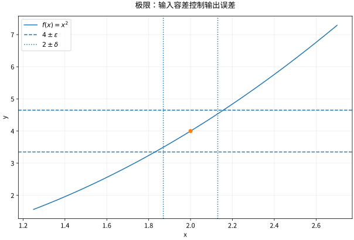

# 函数极限与连续从误差控制到图像

## 先看问题：为什么“代入”有时不是答案

平均速度是时间区间上的位移除以时长。把区间不断缩短时，我们想得到一个稳定的数，却不能直接把时长改成零。这就是极限需要处理的事情：它描述**邻近输入的输出如何受控**，不是给除以零寻找许可。

设 $f$ 在 $a$ 的某个去心邻域有定义。$\lim_{x\to a}f(x)=L$ 的精确定义是

$$
\forall\varepsilon>0\ \exists\delta>0:\quad
0<|x-a|<\delta\Longrightarrow |f(x)-L|<\varepsilon.
$$

先给输出误差 $\varepsilon$，再选择输入容差 $\delta$。$\delta$ 可以依赖 $\varepsilon,a,f$，但不能随已经选入邻域的 $x$ 临时变化。这一量词次序是定义的核心。定义没有要求 $f(a)$ 存在，所以可去间断并不阻止极限存在。

## 从估计反推容差

证明 $x^2\to4$（$x\to2$）。把误差分解成

$$
|x^2-4|=|x-2||x+2|.
$$

先限定 $|x-2|<1$，便有 $1<x<3$，从而 $|x+2|<5$。再取 $\delta=\min(1,\varepsilon/5)$ 即可。这里先把难控制的因子限制住，再让另一个因子足够小，是分析证明反复使用的策略。

极限唯一性也可由误差看出。若两个不同候选 $L,M$ 都成立，取 $\varepsilon=|L-M|/3$，足够近的 $x$ 会同时靠近二者；三角不等式给出 $|L-M|<2|L-M|/3$，矛盾。

## 计算工具为什么能用

有限极限的加、减、乘法遵循通常代数；除法还要求分母极限非零。夹逼定理要求在同一去心邻域内有 $g\le f\le h$，且两端趋于同一个数。例如弧度制下，由单位圆面积比较得到 $\sin x<x<\tan x$（$0<x<\pi/2$），所以

$$
\cos x<\frac{\sin x}{x}<1,
\qquad \lim_{x\to0}\frac{\sin x}{x}=1.
$$

弧度不是装饰：若输入用角度，该极限是 $\pi/180$。从上述极限和 $1-\cos x=2\sin^2(x/2)$ 可得 $(1-\cos x)/x^2\to1/2$。

无穷远极限把“输入靠近 $a$”换成“输入超过某阈值”；无穷极限则把输出误差条件换成“输出超过任意给定高度”。$f\to\infty$ 不是说极限是一个可照常代数运算的实数。$\infty-\infty$、$0\cdot\infty$ 等都需要重新分析。

## 连续性把点值与邻近行为接上

$f$ 在 $a$ 连续，要求 $f(a)$ 有定义且极限等于它。左右极限必须相等才能有双侧极限。连续函数在闭有界区间上达到最大值、最小值，并具有介值性质；紧致性如何支撑这些结论见数学分析课程。单调有界的函数存在相应单侧极限，但跳跃仍可能发生。

算例：对 $x\ne1$，$(x^2-1)/(x-1)=x+1$。所以去心极限为2。把函数在1处补成2得到连续延拓；补成7则仍然不连续。约分只发生在 $x\ne1$，没有证明原式在1处可计算。

*图：对 $f(x)=x^2$、$a=2$，把输出限制在误差带内，需要控制整个输入区间，不是只检查几处采样点。*

## 练习与答案

证明 $\sqrt{x}\to\sqrt a$（$a>0$），并说明为什么不能把正负两条路径检验当成任意多元极限的证明。

> [!question]- 展开推理
> 有理化得 $|\sqrt x-\sqrt a|=|x-a|/(\sqrt x+\sqrt a)\le |x-a|/\sqrt a$，限制 $x>0$ 后取 $\delta=\min(a/2,\varepsilon\sqrt a)$。证明控制了邻域中的全部 $x$。多元情形只检查两条路径会遗漏其他路径；两条路径不同足以否定极限，相同却不足以肯定。

## 继续学习

 下一节：[[数学/15-微积分/02-导数与微分局部线性模型|导数与微分局部线性模型]]。

课程地图：[[数学/15-微积分/00-微积分-MOC|微积分课程地图]]；[[数学/90-资源/06-统一符号约定与定理条件索引|符号与条件索引]]。

## 跨学科连接

[[数学/16-数学分析/04-函数极限连续与一致连续|函数极限连续与一致连续]]。本页只要求每个基点各自能选 $\delta$；目标页要求同一个 $\delta$ 控制全域，并用 Heine–Cantor 定理说明紧致区间上的连续函数为何自动获得这种统一误差控制。

## 核验与延伸阅读

本页为独立编写的讲解、推导与算例；以下一手教材用于对照标准定义与课程范围，不是逐段译写。更具体的主题定位见 [[数学/90-资源/04-六科学术来源与阅读对照|学术来源对照]]。

- [MIT 18.01SC：单变量微积分（课程原始讲义与练习入口）](https://ocw.mit.edu/courses/18-01sc-single-variable-calculus-fall-2010/)
- [MIT 18.02SC：多变量微积分](https://ocw.mit.edu/courses/18-02sc-multivariable-calculus-fall-2010/)
