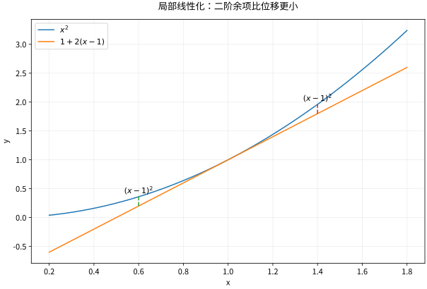

# 导数与微分局部线性模型

## 一阶模型，而不只是切线斜率

在 $a$ 附近，用最简单的线性函数预测 $f$：

$$
f(a+h)=f(a)+Ah+r(h),\qquad \frac{r(h)}{h}\to0.
$$

这样的 $A$ 存在时，称 $f$ 在 $a$ 可导，$A=f'(a)$。等价地，$f'(a)=\lim_{h\to0}[f(a+h)-f(a)]/h$。余项写成 $o(h)$，表示相对于 $h$ 可以忽略，不是绝对等于零。微分 $df=f'(a)\,dx$ 是线性预测，真实增量 $\Delta f$ 还含余项。

对 $f(x)=x^2$，精确展开为 $f(a+h)=a^2+2ah+h^2$，所以导数为 $2a$。切线不是图像附近“最像”的任意直线，而是误差除以位移后趋于零的那一条。

*图：在 $a=1$ 附近，$x^2$ 与切线 $1+2(x-1)$ 的差为 $(x-1)^2$。缩小观察窗口后，二阶误差比一阶位移缩小得更快。*

## 运算法则是误差阶数的账本

若 $f,g$ 在 $a$ 可导，把二者都写成线性项加小余项，相乘后唯一的一阶项为 $f'(a)g(a)h+f(a)g'(a)h$，所以

$$
(fg)'=f'g+fg',\qquad
(f/g)'=\frac{f'g-fg'}{g^2}\quad(g\ne0).
$$

复合函数先把内层增量近似成 $g'(a)h$，再经外层线性映射，得到

$$
(f\circ g)'(a)=f'(g(a))g'(a).
$$

严格证明需要连同余项一起控制；不能把两个“无穷小分数”直接约掉当作证明。$dy/dx$ 的分数外观在换元中很有用，但真正依据是链式法则。

从基本极限推出 $(\sin x)'=\cos x$、$(e^x)'=e^x$；由 $e^{\ln x}=x$ 反求 $(\ln x)'=1/x$（$x>0$）。反函数求导要求原导数非零：$(f^{-1})'(f(a))=1/f'(a)$。例如 $x^3$ 可逆，但逆函数 $\sqrt[3]x$ 在0处没有有限导数，因为原导数在那里为零。

## 复合算例：不要一次跳过所有层

令 $y=\ln(1+x^2)$。内层 $u=1+x^2$，外层 $y=\ln u$，于是

$$
y'=\frac{2x}{1+x^2},\qquad
 y''=\frac{2(1-x^2)}{(1+x^2)^2}.
$$

一阶导数决定局部增减；二阶导数说明斜率在增加还是减少，而不是“二阶导数大就一定函数值大”。在 $x=0$ 附近 $y\approx x^2$，一阶模型是常数0，必须看二阶项才看见弯曲。

对正值可微函数 $y=u(x)^{v(x)}$，先取对数：$\ln y=v\ln u$，得到 $y'=y(v'\ln u+vu'/u)$。底数为负时不能照搬实对数推导；定义域是公式的一部分。

## 可导的边界

可导必连续：$f(a+h)-f(a)=h[f'(a)+o(1)]\to0$。反向不成立。$|x|$ 在0连续但左右差商为 $-1,1$。更细微的是可导不保证导数连续：令 $f(0)=0$，$f(x)=x^2\sin(1/x)$，则 $f'(0)=0$，而非零处 $f'(x)=2x\sin(1/x)-\cos(1/x)$，在0附近振荡。不要把“能求导”与“斜率场平滑”混为一谈。

## 练习与答案

用微分估计 $\sqrt{4.04}$，再用精确式判断估计偏大还是偏小；求 $x^x$ 在 $x>0$ 的导数。

> [!question]- 解答
> 在4处线性化得到 $2+(1/4)\times0.04=2.01$。平方根的二阶导数为 $-1/(4x^{3/2})<0$，图像位于切线下，所以估计偏大。对 $y=x^x$，$\ln y=x\ln x$，故 $y'=x^x(1+\ln x)$。底数和指数同时变化，不能只套幂函数或指数函数中的一条规则。

## 继续学习

前一节：[[数学/15-微积分/01-函数极限与连续从误差控制到图像|函数极限与连续从误差控制到图像]]。 下一节：[[数学/15-微积分/03-中值定理与导数应用单调凸性和优化|中值定理与导数应用单调凸性和优化]]。

课程地图：[[数学/15-微积分/00-微积分-MOC|微积分课程地图]]；[[数学/90-资源/06-统一符号约定与定理条件索引|符号与条件索引]]。

## 跨学科连接

[[数学/16-数学分析/05-微分中值定理与导数的边界|微分中值定理与导数的边界]]。建议比较定义、适用条件与所用范数，再迁移方法。

## 核验与延伸阅读

本页为独立编写的讲解、推导与算例；以下一手教材用于对照标准定义与课程范围，不是逐段译写。更具体的主题定位见 [[数学/90-资源/04-六科学术来源与阅读对照|学术来源对照]]。

- [MIT 18.01SC：单变量微积分（课程原始讲义与练习入口）](https://ocw.mit.edu/courses/18-01sc-single-variable-calculus-fall-2010/)
- [MIT 18.02SC：多变量微积分](https://ocw.mit.edu/courses/18-02sc-multivariable-calculus-fall-2010/)
