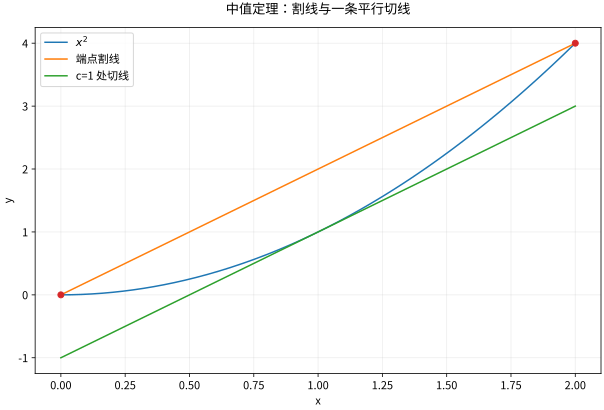

# 中值定理与导数应用单调凸性和优化

## 从局部斜率获得整个区间的信息

Rolle 定理：$f$ 在 $[a,b]$ 连续，在 $(a,b)$ 可导，且 $f(a)=f(b)$，则存在 $c\in(a,b)$ 使 $f'(c)=0$。证明不是凭图想象：连续性保证极值取到；若函数不恒定，至少一个极值在内部；内部极值的左右差商符号相反，可导时共同极限只能为零。

将一般曲线减去端点连线，Rolle 定理立即给出 Lagrange 中值定理：

$$
f(b)-f(a)=f'(c)(b-a).
$$

它把一个有限区间的平均变化率与一个未知位置的瞬时变化率联系起来。$c$ 的存在有保证，却通常不必也无法显式求出。

*图：中值定理比较的是同一区间上的割线与内部切线；闭区间连续、开区间可导不可随意省略。*

## 单调与凸性：条件要写在区间上

若 $f'\ge0$ 在某区间处处成立，中值定理给出 $f$ 单调不减；$f'>0$ 则严格递增。严格递增不要求导数处处严格正，如 $x^3$ 在0导数为零。$f'=0$ 在连通区间上推出常数；若定义域断开，各连通分支的常数可以不同。

凸性的几何定义是

$$
f((1-t)x+ty)\le(1-t)f(x)+tf(y),\quad 0\le t\le1.
$$

对可微函数，凸性等价于导数单调不减，也等价于每条切线都在图像下方：$f(y)\ge f(x)+f'(x)(y-x)$。在 $C^2$ 情形，可用 $f''\ge0$ 判定。严格凸函数至多有一个极小点，但严格凸不等于处处 $f''>0$，$x^4$ 就是例子。

## 最值问题怎样完整做完

先确定定义域及其端点，再找内部驻点和不可导点，最后比较函数值。闭区间上连续函数一定有全局最值；无界开区间可能只有下确界而没有最小值，如 $e^x$ 在实轴上的下确界为0却取不到。

例：周长固定为 $2p$ 的矩形，长 $x$、宽 $p-x$，面积 $A=x(p-x)$，物理域 $0<x<p$。$A'=p-2x$ 在 $x=p/2$ 为零，$A''=-2$，故正方形给最大面积 $p^2/4$。若没有先写物理域，只解驻点方程就无法解释边界和退化图形。

二阶判别：$f'(a)=0$ 且 $f''(a)>0$ 给严格局部极小，负号给极大；$f''(a)=0$ 时无结论。$x^4,-x^4,x^3$ 在0分别给极小、极大、非极值，这三例正好封住常见误推。

## Cauchy 中值定理与 L'Hôpital

若 $f,g$ 满足同样的连续、可导条件，则某个 $c$ 满足

$$
[f(b)-f(a)]g'(c)=[g(b)-g(a)]f'(c).
$$

在 $0/0$ 或 $\infty/\infty$ 型的适当单侧邻域内，若 $g'\ne0$ 且 $f'/g'\to L$（允许适当扩展实数极限），L'Hôpital 法则据此推出 $f/g\to L$。必须先检查未定型，不能对任意商求导。对 $\lim_{x\to0}(1+x)/(1+2x)$，原极限是1，导数比为1/2，正是滥用的反例。

## 练习与答案

证明 $\ln x\le x-1$（$x>0$），并判断 $f(x)=x^4-4x$ 在实轴的全局最小值。

> [!question]- 解答
> 令 $h(x)=x-1-\ln x$，$h'=1-1/x$ 在 $(0,1)$ 为负，在 $(1,\infty)$ 为正，故最小值 $h(1)=0$，等号仅在1。第二题 $f'=4(x^3-1)$，在1前负后正，所以全局最小值是 $f(1)=-3$。也可用 $f''=12x^2\ge0$ 与两端趋于正无穷说明全局性。

## 继续学习

前一节：[[数学/15-微积分/02-导数与微分局部线性模型|导数与微分局部线性模型]]。 下一节：[[数学/15-微积分/04-Taylor展开与误差近似为什么可信|Taylor展开与误差近似为什么可信]]。

课程地图：[[数学/15-微积分/00-微积分-MOC|微积分课程地图]]；[[数学/90-资源/06-统一符号约定与定理条件索引|符号与条件索引]]。

## 跨学科连接

[[数学/16-数学分析/05-微分中值定理与导数的边界|微分中值定理与导数的边界]]。建议比较定义、适用条件与所用范数，再迁移方法。

## 核验与延伸阅读

本页为独立编写的讲解、推导与算例；以下一手教材用于对照标准定义与课程范围，不是逐段译写。更具体的主题定位见 [[数学/90-资源/04-六科学术来源与阅读对照|学术来源对照]]。

- [MIT 18.01SC：单变量微积分（课程原始讲义与练习入口）](https://ocw.mit.edu/courses/18-01sc-single-variable-calculus-fall-2010/)
- [MIT 18.02SC：多变量微积分](https://ocw.mit.edu/courses/18-02sc-multivariable-calculus-fall-2010/)
