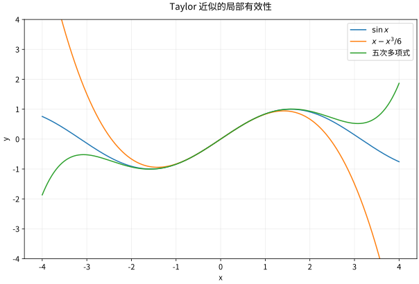

# Taylor展开与误差近似为什么可信

## 近似需要附带误差承诺

只写 $\sin x\approx x$ 没有说明精度，也没有说明范围。上一课的中值定理把两点间的变化与一阶导数联系起来；现在想把同一保证推进到高阶：在 $a$ 匹配函数值及前 $n$ 阶导数的多项式，离开 $a$ 后究竟会偏差多少？

设 $n$ 是非负整数，$I=[\min(a,x),\max(a,x)]$，$f$ 在包含 $I$ 的开区间上属于 $C^{n+1}$，即直到 $n+1$ 阶的导数都存在且连续。这是本页采用的一组足够条件。定义

$$
P_n(t)=\sum_{k=0}^n\frac{f^{(k)}(a)}{k!}(t-a)^k,\qquad
R_n(x)=f(x)-P_n(x).
$$

当 $x\ne a$ 时，存在严格位于 $a,x$ 之间的 $\xi$，使

$$
f(x)=P_n(x)+R_n(x),\qquad
R_n(x)=\frac{f^{(n+1)}(\xi)}{(n+1)!}(x-a)^{n+1}.
$$

$\xi$ 的位置通常未知，但若 $|f^{(n+1)}(t)|\le M$ 对 $I$ 上每个 $t$ 成立，就有

$$
|R_n(x)|\le\frac{M|x-a|^{n+1}}{(n+1)!}.
$$

这把一个未知位置的导数换成整个区间上可控制的量，是实际计算可以使用的保证。$x=a$ 时 $P_n(a)=f(a)$，余项为零，不需要寻找中值点。$n=0$ 时该式就是上一课的 Lagrange 中值定理。

### 用已学的 Rolle 定理保证中值点

固定 $x\ne a$，令

$$
C=\frac{f(x)-P_n(x)}{(x-a)^{n+1}},\qquad
g(t)=f(t)-P_n(t)-C(t-a)^{n+1}.
$$

选择 $C$ 的目的，是让 $g(x)=0$。另一方面，$P_n$ 在 $a$ 匹配 $f$ 的前 $n$ 阶导数，而 $(t-a)^{n+1}$ 的前 $n$ 阶导数在 $a$ 全为零，因此

$$
g(a)=g'(a)=\cdots=g^{(n)}(a)=0.
$$

这些等式怎样产生第 $n+1$ 阶导数的零点？从 $c_0=x$ 开始，$g(a)=g(c_0)=0$，在两点之间用 Rolle，得到 $c_1$ 满足 $g'(c_1)=0$。若 $n\ge1$，又有 $g'(a)=0$，于是对 $g'$ 在 $a,c_1$ 之间再用 Rolle，得到 $c_2$ 满足 $g''(c_2)=0$。一般地，在第 $j+1$ 次应用中，$0\le j\le n$，已知 $g^{(j)}(a)=g^{(j)}(c_j)=0$；Rolle 给出严格位于 $a,c_j$ 之间的 $c_{j+1}$，使 $g^{(j+1)}(c_{j+1})=0$。$C^{n+1}$ 条件保证每次所用函数在相应闭区间连续、内部可导。

这样共应用 $n+1$ 次，取 $\xi=c_{n+1}$，就有

$$
0=g^{(n+1)}(\xi)
=f^{(n+1)}(\xi)-(n+1)!C.
$$

这里 $P_n^{(n+1)}=0$，而 $[(t-a)^{n+1}]^{(n+1)}=(n+1)!$。解出 $C$ 再代回 $R_n(x)=C(x-a)^{n+1}$，便得到 Lagrange 余项。$x<a$ 时每次仍在 $a,c_j$ 两点围成的区间上应用 Rolle；中值点仍在 $x,a$ 之间，带符号的 $(x-a)^{n+1}$ 不变，绝对误差界则使用 $|x-a|$。

*图：同一低阶多项式在展开点附近好用，远离展开点可能迅速变差；“更多项”也不意味着任意位置都有效。图形吻合提示有效范围，误差保证由上面的条件与证明给出。*

## 两个可计算的误差例子

对 $e^{0.1}$ 用二阶式 $1+0.1+0.1^2/2=1.105$。因为 $e^t\le e^{0.1}$（$0\le t\le0.1$），绝对误差不超过 $e^{0.1}10^{-3}/6<1.85\times10^{-4}$。实际值的获得不是误差保证的前提。若改为 $e^{-0.1}$，同一二阶多项式给出 $0.905$，在 $[-0.1,0]$ 上可取 $M=1$，于是误差不超过 $10^{-3}/6$；展开方向改变了区间和带符号余项，绝对误差仍用 $|x|^3$。

对 $\sin x$，使用三阶多项式 $x-x^3/6$。看成四阶 Taylor 多项式（四阶系数为零），因五阶导数绝对值至多1，有

$$
\left|\sin x-x+\frac{x^3}{6}\right|\le\frac{|x|^5}{120}.
$$

在 $|x|\le0.1$ 时上界约 $8.34\times10^{-8}$。若只机械选三阶余项会得到四阶上界，仍正确但不够精细。

## Peano 余项与误差量级

若 $n\ge1$，$f$ 在 $a$ 的邻域属于 $C^n$（这里仍采用足够条件），可写 $f(a+h)=\sum_{k=0}^nf^{(k)}(a)h^k/k!+o(h^n)$。这是 $h\to0$ 的局部阶数信息，不自带显式常数或有效半径。前面的 $C^{n+1}$ 条件进一步给出 $O(h^{n+1})$；不能把两组条件和保证混在一起。$O(h^{n+1})$ 表示存在固定常数在足够小邻域内作上界，和 $o(h^n)$ 不同。不能仅看符号把一个渐近关系当成所有 $h$ 都成立的数值界。

极限例：$\lim_{x\to0}(e^x-1-x)/x^2=1/2$。展开到二阶：分子是 $x^2/2+o(x^2)$。只保留 $e^x=1+x+o(x)$ 不够，因为除以 $x^2$ 后余项尚未受控。

## 无限可微不等于解析

令 $f(0)=0$，$f(x)=e^{-1/x^2}$（$x\ne0$）。所有阶导数在0都为零，但附近非零点函数为正。原因是指数衰减压过任意多项式增长。因此它的 Taylor 级数恒为零，却不等于原函数。有限阶 Taylor 定理仍成立；失败的是把阶数趋于无穷而未经证明令余项消失。

## 从基本定理推导积分余项

**这是读完积分课后的回访段。** 首次按 03→04 学习，上面的 Rolle 证明已经足以完成两个误差例子和本页练习。继续读 [[数学/15-微积分/05-原函数与积分技巧换元分部及有理函数#原函数为何没有万能查表法|05 的分部公式]] 和其“分部积分怎样选方向”中的算例，再读 [[数学/15-微积分/06-定积分与微积分基本定理累积和变化互逆#微积分基本定理第一部分：累积的变化率|06 的基本定理]] 与其“完整算例与常见误用”中的定积分分部公式，之后返回这里。回来的问题是：同一个余项如何表现为下一阶变化的加权累积？

仍设 $n\ge0$ 为整数，$f\in C^{n+1}$ 于包含 $a,x$ 间闭区间的开区间。基本定理先给出零阶余项

$$
f(x)=f(a)+\int_a^x f'(t)\,dt,\qquad
R_0(x)=\int_a^x f'(t)\,dt.
$$

先完整展开 $n=1$。在 $\int_a^x(x-t)f''(t)\,dt$ 中取 $u=x-t$、$dv=f''(t)\,dt$；此时 $x$ 是固定的端点，$du=-dt$、$v=f'(t)$。定积分分部公式与基本定理给出

$$
\begin{aligned}
\int_a^x(x-t)f''(t)\,dt
&=[(x-t)f'(t)]_a^x+\int_a^x f'(t)\,dt\\
&=-(x-a)f'(a)+f(x)-f(a).
\end{aligned}
$$

移项就是 $f(x)=f(a)+f'(a)(x-a)+R_1(x)$，其中 $R_1(x)=\int_a^x(x-t)f''(t)\,dt$。线性模型剩下的误差因此由二阶变化累积而来。

一般阶数延续的是这一明确递推。记

$$
I_n(x)=\frac1{n!}\int_a^x f^{(n+1)}(t)(x-t)^n\,dt.
$$

对 $n\ge1$，取 $u=(x-t)^n/n!$、$dv=f^{(n+1)}(t)\,dt$，则 $du=-(x-t)^{n-1}dt/(n-1)!$、$v=f^{(n)}(t)$，所以

$$
\begin{aligned}
I_n(x)
&=\left[\frac{(x-t)^n}{n!}f^{(n)}(t)\right]_a^x
 +\frac1{(n-1)!}\int_a^x (x-t)^{n-1}f^{(n)}(t)\,dt\\
&=-\frac{f^{(n)}(a)}{n!}(x-a)^n+I_{n-1}(x).
\end{aligned}
$$

因为 $I_0=f(x)-f(a)$，逐次代入这条递推，每一步减去一个 Taylor 项，得到 $I_n=f(x)-P_n(x)=R_n(x)$，即

$$
R_n(x)=\frac1{n!}\int_a^x f^{(n+1)}(t)(x-t)^n\,dt.
$$

$x<a$ 时以上等式仍按有向积分使用，边界项也不变；不能随意交换上、下限而不改符号。若 $|f^{(n+1)}|\le M$，则先把绝对值估计写在正向区间上：

$$
|R_n(x)|\le\frac{M}{n!}
\int_{\min(a,x)}^{\max(a,x)}|x-t|^n\,dt
=\frac{M|x-a|^{n+1}}{(n+1)!}.
$$

这与首读时的 Lagrange 余项给出同一保证。对于上面的 $e^{0.1}$ 二阶近似，

$$
R_2(0.1)=\frac12\int_0^{0.1}e^t(0.1-t)^2\,dt,
\qquad
|R_2(0.1)|\le\frac{e^{0.1}}2\int_0^{0.1}(0.1-t)^2\,dt
=\frac{e^{0.1}10^{-3}}6.
$$

若改为 $x=-0.1$，积分从 $0$ 走到 $-0.1$，被积函数 $e^t(x-t)^2$ 非负，所以 $R_2(-0.1)\le0$，与 Lagrange 余项中的负三次幂一致；绝对值仍由 $10^{-3}/6$ 控制。积分余项把同一误差解释为下一阶变化的加权累积，也为后续多元 Taylor 与数值积分误差提供可推广的思路。

## 练习与答案

求 $(\cos x-1+x^2/2)/x^4$ 在0的极限；说明怎样把 $\ln(1+x)$ 的二阶近似用于 $|x|\le1/4$ 并估计误差。

> [!question]- 解答
> $\cos x=1-x^2/2+x^4/24+o(x^4)$，极限为 $1/24$。对 $\ln(1+x)$，三阶导数为 $2/(1+x)^3$，在该区间绝对值不超过 $128/27$，所以近似 $x-x^2/2$ 的误差不超过 $64|x|^3/81$。这个上界未必最紧，但条件和保证是明确的。

## 继续学习

前一节：[[数学/15-微积分/03-中值定理与导数应用单调凸性和优化|中值定理与导数应用单调凸性和优化]]。 下一节：[[数学/15-微积分/05-原函数与积分技巧换元分部及有理函数|原函数与积分技巧换元分部及有理函数]]。

读完 05–06 后，返回本页 [[#从基本定理推导积分余项|积分余项段]]，用同一个指数近似核对误差的累积来源；首次学习不需要提前进入数学分析课程。

课程地图：[[数学/15-微积分/00-微积分-MOC|微积分课程地图]]；[[数学/90-资源/06-统一符号约定与定理条件索引|符号与条件索引]]。

## 跨学科连接

[[数学/16-数学分析/09-幂级数解析性与Taylor反例|幂级数解析性与Taylor反例]]。本页用有限阶余项给局部数值保证；目标页区分“各阶导数存在”“Taylor 级数收敛”和“级数和等于原函数”，并用同一个平坦函数说明 $C^\infty$ 仍可不解析。

## 核验与延伸阅读

本页为独立编写的讲解、推导与算例；以下一手教材用于对照标准定义与课程范围，不是逐段译写。更具体的主题定位见 [[数学/90-资源/04-六科学术来源与阅读对照|学术来源对照]]。

- [MIT 18.01SC：单变量微积分（课程原始讲义与练习入口）](https://ocw.mit.edu/courses/18-01sc-single-variable-calculus-fall-2010/)
- [MIT 18.02SC：多变量微积分](https://ocw.mit.edu/courses/18-02sc-multivariable-calculus-fall-2010/)
