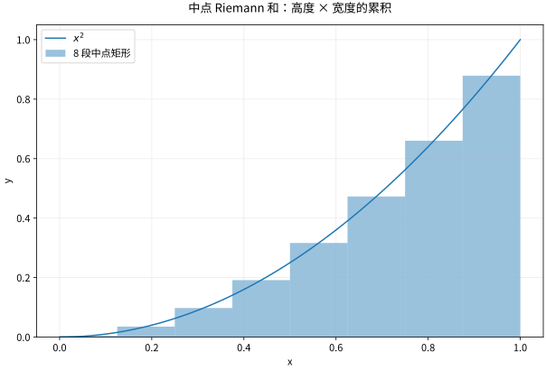

# 定积分与微积分基本定理累积和变化互逆

## 从带符号面积到累积量

把 $[a,b]$ 分成小区间，长度 $\Delta x_i$，在每段选样点 $\xi_i$。Riemann 和是 $\sum f(\xi_i)\Delta x_i$。若网格最大长度趋于0时，无论怎样分割与选点都趋向同一值，就定义为 $\int_a^bf(x)dx$。这比“画很多窄矩形”多了一层要求：极限不能依赖你的选点偏好。

$f$ 有正负时积分是带符号累积；几何面积是 $\int |f|$。连续函数在闭区间可积。进一步的 Darboux 判据、可积但不连续的函数与零测集见数学分析课程。

*图：这里以固定分割的中点和演示累积。单组越来越密的分割可能提示答案，但可积性要求所有足够细分割的和都被统一控制。*

## 微积分基本定理第一部分：累积的变化率

令 $F(x)=\int_a^xf(t)dt$，若 $f$ 在 $x$ 连续，则

$$
\frac{F(x+h)-F(x)}h=\frac1h\int_x^{x+h}f(t)dt\longrightarrow f(x).
$$

证明直接估计差：平均值与 $f(x)$ 的差不超过小区间上 $|f(t)-f(x)|$ 的上界，该上界因连续性趋零。$h<0$ 时积分方向同时反转，结论不变。因而连续函数都能这样构造原函数。

第二部分：若 $F'=f$ 且 $f$ 连续，则

$$
\int_a^bf(x)dx=F(b)-F(a).
$$

理由是 $G(x)=\int_a^xf$ 满足 $G'=f=F'$，所以 $F-G$ 为常数。微分研究局部变化，积分记录累积，二者在条件成立时互相逆转。

## 变上限、参数与链式法则

若 $f$ 连续，$u,v$ 可导，

$$
\frac d{dx}\int_{u(x)}^{v(x)}f(t)dt
=f(v(x))v'(x)-f(u(x))u'(x).
$$

例 $H(x)=\int_{x}^{x^2}e^{-t^2}dt$，无需知道初等原函数，直接有 $H'(x)=2xe^{-x^4}-e^{-x^2}$。若被积函数本身也依赖参数，还需额外的含参积分求导定理，不能漏掉内部偏导积分。

## 完整算例与常见误用

计算 $\int_{-1}^1 x^2dx=[x^3/3]_{-1}^1=2/3$。若求 $\int_{-1}^1x\,dx$，结果0，不代表图形没有面积；总面积是1。

错误示范：对 $\int_{-1}^1x^{-2}dx$ 直接用原函数 $-1/x$ 算出 $-2$。问题不是积分可以为负，而是函数在0有不可积奇点，基本定理不能跨过0使用。拆成两个反常积分后均发散到正无穷。

换元、分部积分的定积分版本分别为

$$
\int_a^bf(g(x))g'(x)dx=\int_{g(a)}^{g(b)}f(u)du,
\quad
\int_a^bu v' dx=[uv]_a^b-\int_a^bu'v dx.
$$

每一步都应该保留变量及边界，尤其不要在已经换成 $u$ 的积分里继续使用原来的 $x$ 端点。

## 练习与答案

计算 $\int_0^1 2x e^{x^2}dx$；判断 $F(x)=\int_0^x|t|dt$ 在0的一阶与二阶可导性。

> [!question]- 解答
> 换元 $u=x^2$，上下限仍是0、1，结果 $e-1$。第二题分段积分得 $F(x)=x|x|/2$，基本定理给 $F'=|x|$，所以在0一阶可导且导数0；$|x|$ 在0不可导，故 $F$ 在0没有二阶导数。积分可以提升一阶正则性，但不会无条件把函数变成无限光滑。

## 继续学习

前一节：[[数学/15-微积分/05-原函数与积分技巧换元分部及有理函数|原函数与积分技巧换元分部及有理函数]]。 下一节：[[数学/15-微积分/07-积分应用与数值积分几何物理和误差|积分应用与数值积分几何物理和误差]]。

课程地图：[[数学/15-微积分/00-微积分-MOC|微积分课程地图]]；[[数学/90-资源/06-统一符号约定与定理条件索引|符号与条件索引]]。

## 跨学科连接

[[数学/16-数学分析/06-Riemann积分Darboux判据与可积性|Riemann积分Darboux判据与可积性]]。建议比较定义、适用条件与所用范数，再迁移方法。

## 核验与延伸阅读

本页为独立编写的讲解、推导与算例；以下一手教材用于对照标准定义与课程范围，不是逐段译写。更具体的主题定位见 [[数学/90-资源/04-六科学术来源与阅读对照|学术来源对照]]。

- [MIT 18.01SC：单变量微积分（课程原始讲义与练习入口）](https://ocw.mit.edu/courses/18-01sc-single-variable-calculus-fall-2010/)
- [MIT 18.02SC：多变量微积分](https://ocw.mit.edu/courses/18-02sc-multivariable-calculus-fall-2010/)
