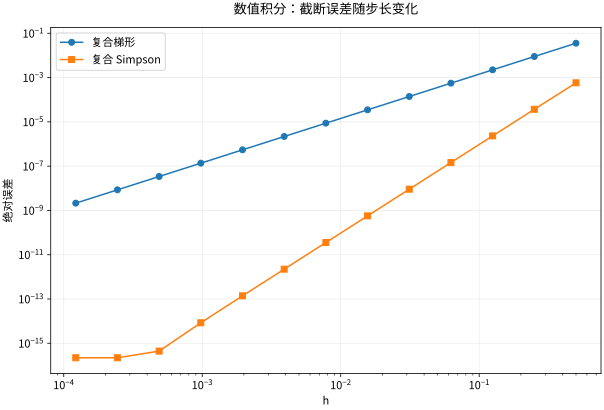

# 积分应用与数值积分几何物理和误差

## 先建立小片模型，再积分

积分应用不是看到图形就找公式。先确定坐标、量纲、小片大小及累积对象。例如密度 $\rho(x)$ 的细杆，长度元 $dx$ 上质量为 $\rho(x)dx$，所以质量 $M=\int\rho dx$、一阶矩 $\int x\rho dx$、质心 $\bar x=(\int x\rho dx)/M$。分母要求 $M>0$。

旋转体截面法先求垂直于轴的截面积 $A(x)$，体积为 $\int A(x)dx$。圆盘给 $\pi R^2$，垫圈给 $\pi(R^2-r^2)$，薄壳给 $2\pi r\,h\,dr$。圆柱壳的半径、高度、厚度要来自同一个坐标选择；同一实体可用两种切片法相互验证。

## 弧长与功：微小长度不是横坐标增量

对 $C^1$ 曲线 $y=f(x)$，局部位移向量是 $(dx,f'(x)dx)$，其长度为 $\sqrt{1+f'^2}\,dx$，于是

$$
L=\int_a^b\sqrt{1+f'(x)^2}\,dx.
$$

当曲线不是单值函数时改用参数式 $L=\int|\mathbf r'(t)|dt$。对变力沿直线做功，$W=\int_a^b F(x)dx$。弹簧力 $kx$ 从0拉到 $d$，外力做功为 $kd^2/2$，不能用末端力乘全程得到 $kd^2$。

算例：$0\le x\le1$、密度 $\rho(x)=2x$ 的细杆，质量1，质心 $\bar x=\int_0^12x^2dx=2/3$。密度向右增加，所以质心比几何中点更靠右，这是量纲和方向的独立检查。

## 数值积分就是带误差分析的近似累积

设等步长 $h=(b-a)/n$。复合中点法与梯形法分别为

$$
M_n=h\sum_{i=0}^{n-1}f(a+(i+1/2)h),
\qquad
T_n=h\left[\frac{f(a)+f(b)}2+\sum_{i=1}^{n-1}f(a+ih)\right].
$$

若 $f\in C^2[a,b]$ 且 $|f''|\le K$，则 $|I-M_n|\le K(b-a)h^2/24$，$|I-T_n|\le K(b-a)h^2/12$。局部 Taylor 展开表明一段误差是 $O(h^3)$，累积约 $1/h$ 段成为全局 $O(h^2)$。这解释了步长减半时误差通常缩为约四分之一。

取 $a<b$，令 $n$ 为**正偶数**、$h=(b-a)/n$，并定义采样值 $f_j=f(a+jh)$（$j=0,1,\ldots,n$）。复合 Simpson 法用每对相邻小区间上的三点拟合二次多项式：

$$
S_n=\frac h3\left[
 f_0+f_n
 +4\sum_{k=1}^{n/2}f_{2k-1}
 +2\sum_{k=1}^{n/2-1}f_{2k}
\right].
$$

第一个求和取内部奇数下标 $1,3,\ldots,n-1$；第二个取内部偶数下标 $2,4,\ldots,n-2$。当 $n=2$ 时第二个为空和，值为 0。端点只各算一次，所以权重可直接检查：

$$
S_2=\frac h3(f_0+4f_1+f_2),\qquad
S_4=\frac h3(f_0+4f_1+2f_2+4f_3+f_4).
$$

每个面板的中点权重为 4；内部偶数点同时是左右两面板的端点，各贡献 1，合成 2。这里 $n$ 数的是小区间，面板数为 $n/2$，不能把单面板误记成 $n=1$。

在 $[0,1]$ 上用 $1,x,x^2,x^3$ 复算权重：

| $f(x)$ | $n=2$：$\frac16(f_0+4f_1+f_2)$ | $n=4$：$\frac1{12}(f_0+4f_1+2f_2+4f_3+f_4)$ | $\int_0^1 f(x)\,dx$ |
| --- | --- | --- | --- |
| $1$ | $6/6=1$ | $12/12=1$ | $1$ |
| $x$ | $3/6=1/2$ | $6/12=1/2$ | $1/2$ |
| $x^2$ | $2/6=1/3$ | $4/12=1/3$ | $1/3$ |
| $x^3$ | $(3/2)/6=1/4$ | $3/12=1/4$ | $1/4$ |

若 $f\in C^4[a,b]$（四阶导数在闭区间连续），且在**整个区间**有 $|f^{(4)}(x)|\le K_4$，记 $I=\int_a^b f(x)\,dx$，则

$$
|I-S_n|\le\frac{K_4(b-a)h^4}{180}
=\frac{K_4(b-a)^5}{180n^4}.
$$

这是精确算术中的截断误差上界，需要已知的导数界；只在采样点估计导数并不保证该界成立。它对三次多项式也精确：每个对称面板上，二次插值遗漏的三次部分为奇函数，积分抵消，不是因为拟合了三次式。等价地，三次多项式的四阶导数为零，误差界给零。

*图：对 $e^x$ 在 $[0,1]$ 的积分，双对数坐标中观察误差随步长的斜率。极细网格时舍入会破坏理想幂律，因此应同时看截断误差和浮点误差。*

## 反例与选法边界

高阶公式需要高阶光滑性。$|x|$、端点奇异函数或狭窄尖峰会削弱固定步长的效果；应在不光滑点分段、先作变量代换或使用带局部估计的自适应细分。两次计算结果接近不必然证明都正确，它们可能同时漏掉一个窄峰。

## 练习与答案

对 $\int_0^1x^2dx$ 使用单段梯形和单个 Simpson 面板，求误差；求 $y=x$、$0\le x\le1$ 绕 $x$ 轴旋转的体积。

> [!question]- 解答
> 精确积分为1/3，梯形给1/2，误差为1/6；Simpson 取0、1/2、1，得 $(1/6)(0+4\times1/4+1)=1/3$，精确。旋转截面面积为 $\pi x^2$，体积 $\pi/3$，与底面半径1、高1的圆锥公式一致。

## 继续学习

前一节：[[数学/15-微积分/06-定积分与微积分基本定理累积和变化互逆|定积分与微积分基本定理累积和变化互逆]]。 下一节：[[数学/15-微积分/08-反常积分无穷区间和奇点|反常积分无穷区间和奇点]]。

课程地图：[[数学/15-微积分/00-微积分-MOC|微积分课程地图]]；[[数学/90-资源/06-统一符号约定与定理条件索引|符号与条件索引]]。

## 跨学科连接

[[数学/46-数理方程/19-差分格式稳定性CFL与收敛|差分格式稳定性CFL与收敛]]。建议比较定义、适用条件与所用范数，再迁移方法。

## 核验与延伸阅读

本页为独立编写的讲解、推导与算例；以下一手教材用于对照标准定义与课程范围，不是逐段译写。更具体的主题定位见 [[数学/90-资源/04-六科学术来源与阅读对照|学术来源对照]]。

- [OpenStax *Calculus Volume 2* §3.6：Numerical Integration](https://openstax.org/books/calculus-volume-2/pages/3-6-numerical-integration)：本次核对 Theorem 3.6 的正偶数分割与式 (3.14) 权重，以及 “Error Bound for Simpson’s Rule” 的式 (3.15)。本页表格另以有理数独立复算。
- [MIT 18.01SC：单变量微积分（课程原始讲义与练习入口）](https://ocw.mit.edu/courses/18-01sc-single-variable-calculus-fall-2010/)
- [MIT 18.02SC：多变量微积分](https://ocw.mit.edu/courses/18-02sc-multivariable-calculus-fall-2010/)
