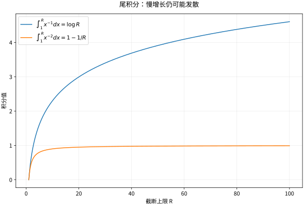

# 反常积分无穷区间和奇点

## 发散区间也能有有限累积，但必须取极限

对于 $f$ 在 $[a,\infty)$ 的每个有限区间可积，定义

$$
\int_a^\infty f(x)dx=\lim_{R\to\infty}\int_a^Rf(x)dx,
$$

仅当右侧有限极限存在时称收敛。若 $a$ 是奇点，定义 $\int_a^bf=\lim_{\varepsilon\downarrow0}\int_{a+\varepsilon}^bf$。有多个奇点或两端无穷时，必须分开各处极限并各自收敛，不能靠相互抵消蒙混过关。

## 两个 $p$ 型基准，阈值方向相反

直接求原函数得到

$$
\int_1^\infty x^{-p}dx\text{ 收敛}\iff p>1,
\qquad
\int_0^1 x^{-p}dx\text{ 收敛}\iff p<1.
$$

$p=1$ 都出现对数发散。无穷远要求衰减得够快；端点附近要求爆炸得不太快。这两个问题的方向正好相反，不能只记“$p>1$ 收敛”而忘记考察的是哪里。

*图：图中展示无穷远截断积分随上限增长的变化。增长看起来缓慢不代表已收敛，尤其对数发散可以隐藏在有限观察窗口里。*

## 比较法是把复杂函数放到尺度上

对非负函数，若 $0\le f\le g$ 且 $\int g$ 收敛，则 $\int f$ 收敛；若 $0\le g\le f$ 且 $\int g$ 发散，则 $\int f$ 发散。若 $f/g\to c\in(0,\infty)$，二者同敛散，比较只需在所考察端点附近成立。

例：$\int_1^\infty dx/(x^2+x)$，因为 $f(x)\le x^{-2}$ 而收敛。分式分解后精确值为 $\ln2$。又如 $\int_e^\infty dx/[x(\ln x)^p]$，令 $u=\ln x$，变为 $\int_1^\infty u^{-p}du$，阈值仍为 $p>1$。多一层对数可以改变临界情形，说明仅比较多项式次数有时不够。

## 振荡可以带来条件收敛

对 $\int_1^\infty\sin x/x\,dx$，分部积分得到

$$
\int_R^S\frac{\sin x}{x}dx
=\left[-\frac{\cos x}{x}\right]_R^S-\int_R^S\frac{\cos x}{x^2}dx.
$$

尾部绝对值不超过 $3/R$（可进一步收紧），因而满足 Cauchy 收敛准则。但 $\int_1^\infty|\sin x|/x\,dx$ 发散：在每周期中 $|\sin x|\ge1/2$ 的固定长度子区间提供与调和级数同阶的正贡献。这叫条件收敛。绝对收敛对换序、交换积分等操作更稳健，条件收敛则需要专门审查。

## 主值不是通常反常积分

$\int_{-1}^1dx/x$ 的两个单侧反常积分分别发散，通常积分不存在。对称截断

$$
\operatorname{pv}\int_{-1}^1\frac{dx}{x}
=\lim_{\varepsilon\downarrow0}\left(\int_{-1}^{-\varepsilon}\frac{dx}{x}+\int_{\varepsilon}^{1}\frac{dx}{x}\right)=0
$$

定义的是 Cauchy 主值，是另一个对象。非对称截断可能给别的值；例如左侧截到 $-2\varepsilon$、右侧从 $\varepsilon$ 开始，极限为 $\ln2$。主值在复分析和分布中有用，但必须显式标注。

## 练习与答案

判断 $\int_0^1x^{-1/2}dx$、$\int_1^\infty x^{-1/2}dx$、$\int_0^1\ln x\,dx$。

> [!question]- 解答
> 第一项收敛且等于2；第二项发散。第三项用 $x\ln x-x$，并由 $x\ln x\to0$ 得积分为 $-1$，其绝对积分为1，所以绝对收敛。函数在端点无界不等于积分发散，关键是累积的增长阶。

## 继续学习

前一节：[[数学/15-微积分/07-积分应用与数值积分几何物理和误差|积分应用与数值积分几何物理和误差]]。 下一节：[[数学/15-微积分/09-数项级数与幂级数无限求和的计算|数项级数与幂级数无限求和的计算]]。

课程地图：[[数学/15-微积分/00-微积分-MOC|微积分课程地图]]；[[数学/90-资源/06-统一符号约定与定理条件索引|符号与条件索引]]。

## 跨学科连接

[[数学/16-数学分析/10-反常积分与含参积分的极限交换|反常积分与含参积分的极限交换]]。建议比较定义、适用条件与所用范数，再迁移方法。

## 核验与延伸阅读

本页为独立编写的讲解、推导与算例；以下一手教材用于对照标准定义与课程范围，不是逐段译写。更具体的主题定位见 [[数学/90-资源/04-六科学术来源与阅读对照|学术来源对照]]。

- [MIT 18.01SC：单变量微积分（课程原始讲义与练习入口）](https://ocw.mit.edu/courses/18-01sc-single-variable-calculus-fall-2010/)
- [MIT 18.02SC：多变量微积分](https://ocw.mit.edu/courses/18-02sc-multivariable-calculus-fall-2010/)
