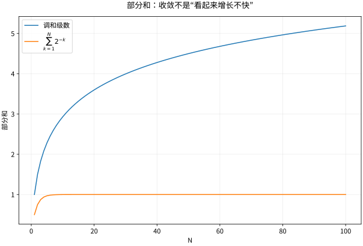

# 数项级数与幂级数无限求和的计算

## 无限求和先被定义为一个数列问题

$\sum_{n=1}^{\infty}a_n$ 的意义是部分和 $S_N=\sum_{n=1}^Na_n$ 的极限。必须先问 $S_N$ 收敛，再问和是多少。收敛必有 $a_n=S_n-S_{n-1}\to0$，但反向不成立：调和级数中，每段 $2^{k-1}<n\le2^k$ 的贡献至少为 $1/2$，所以部分和无界。

几何级数提供最基本的有限恒等式：

$$
1+r+\cdots+r^N=\frac{1-r^{N+1}}{1-r},\qquad r\ne1.
$$

仅当 $|r|<1$ 时余项消失，得到 $\sum_{n=0}^{\infty}r^n=1/(1-r)$。例如把 $r=2$ 代进无限公式会给负数，不是奇妙求和，而是越过收敛域。

## 判别法要顺着结构选择

正项级数可比较：$0\le a_n\le b_n$ 时，$\sum b_n$ 收敛推出 $\sum a_n$ 收敛。$\sum n^{-p}$ 当且仅当 $p>1$ 收敛，可由积分比较证明。含阶乘适合比值法，含 $n$ 次幂适合根值法：若 $\limsup\sqrt[n]{|a_n|}<1$，绝对收敛；若大于1，通项不趋零；等于1无结论。比值极限为1也无结论，$1/n$ 与 $1/n^2$ 就给两种结果。

交错级数 $\sum(-1)^{n-1}b_n$ 若 $b_n\downarrow0$，其奇、偶部分和夹住同一极限，且截断误差不超过下一项 $b_{N+1}$。这是一种带直接误差估计的条件收敛机制。绝对收敛允许任意重排保持和，条件收敛不能随意重排，详见数学分析级数章节。

## 幂级数把许多函数放进同一个框架

对 $\sum_{n=0}^{\infty}c_n(x-a)^n$，收敛半径满足

$$
\frac1R=\limsup_{n\to\infty}|c_n|^{1/n},
$$

约定右侧为0时 $R=\infty$，为无穷时 $R=0$。$|x-a|<R$ 绝对收敛，$|x-a|>R$ 发散，端点必须逐个检查。在内部任意闭子区间上一致收敛，可逐项积分与求导；导数级数半径相同，但端点行为可能改变。

从几何级数积分可得

$$
\ln(1+x)=\sum_{n=1}^{\infty}\frac{(-1)^{n-1}x^n}{n},\quad -1<x\le1.
$$

首先在 $|x|<1$ 内推导，再用端点收敛和 Abel 型结论处理 $x=1$；不能把端点结论伪装成内部逐项积分自动覆盖。对 $x=-1$ 得负调和级数，发散。

## 算例：如何选级数计算对数

用交错级数计算 $\ln2$ 达到 $10^{-6}$ 的误差保证，需要约百万项，理论正确却效率很低。令 $y=(x-1)/(x+1)$，由两条对数级数相减得到

$$
\ln x=2\sum_{k=0}^{\infty}\frac{y^{2k+1}}{2k+1},\qquad x>0.
$$

$x=2$ 时 $y=1/3$，收敛呈几何速度。保留到 $k=N$，尾部可界为 $2|y|^{2N+3}/[(2N+3)(1-y^2)]$。相同函数换一种表示，计算量可以完全不同；这也是数值分析为何不止查公式。

*图：有限窗口中的增长快慢与收敛性不是同义词。调和部分和增长慢，但没有有限极限。*

## 练习与答案

求 $\sum_{n=1}^{\infty}n x^{n-1}$ 的收敛域与和；判断 $\sum(-1)^{n-1}/\sqrt n$ 是否绝对收敛。

> [!question]- 解答
> 在 $|x|<1$ 对几何级数逐项求导得 $1/(1-x)^2$。$x=\pm1$ 时通项不趋零，所以端点都发散。第二题是交错收敛，但绝对级数 $\sum n^{-1/2}$ 发散，因而条件收敛。误差界是下一项的大小，重排则不受该结论保护。

## 继续学习

前一节：[[数学/15-微积分/08-反常积分无穷区间和奇点|反常积分无穷区间和奇点]]。 下一节：[[数学/15-微积分/10-参数曲线极坐标与空间曲线|参数曲线极坐标与空间曲线]]。

课程地图：[[数学/15-微积分/00-微积分-MOC|微积分课程地图]]；[[数学/90-资源/06-统一符号约定与定理条件索引|符号与条件索引]]。

## 跨学科连接

[[数学/16-数学分析/08-函数列函数项级数与一致收敛|函数列函数项级数与一致收敛]]。本页先在固定 $x$ 检查幂级数收敛并单独处理端点；目标页说明为何保持连续性或交换极限与积分、求导需要全域统一的尾项控制，并用 M 判别法把数项级数界转成一致收敛。

## 核验与延伸阅读

本页为独立编写的讲解、推导与算例；以下一手教材用于对照标准定义与课程范围，不是逐段译写。更具体的主题定位见 [[数学/90-资源/04-六科学术来源与阅读对照|学术来源对照]]。

- [MIT 18.01SC：单变量微积分（课程原始讲义与练习入口）](https://ocw.mit.edu/courses/18-01sc-single-variable-calculus-fall-2010/)
- [MIT 18.02SC：多变量微积分](https://ocw.mit.edu/courses/18-02sc-multivariable-calculus-fall-2010/)
