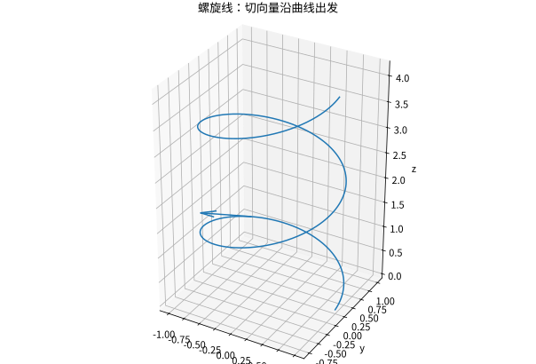

# 参数曲线极坐标与空间曲线

## 参数是描述运动的方式，不是曲线本身

圆不能在整个平面中写成一个单值 $y=f(x)$，却可写为 $\mathbf r(t)=(R\cos t,R\sin t)$。参数 $t$ 可以是时间，也可以只是标签。不同速度的参数化可以描出同一几何曲线，弧长应保持不变，速度则会改变。

若 $\mathbf r\in C^1$ 且 $\mathbf r'(t)\ne0$，曲线称正则。速度向量 $\mathbf v=\mathbf r'$，速率 $v=\|\mathbf r'\|$，单位切向量 $\mathbf T=\mathbf r'/v$。弧长变量满足 $ds=vdt$，故

$$
L=\int_a^b\|\mathbf r'(t)\|dt.
$$

若参数走了同一段两次，该积分会把长度数两次；它计算的是参数化的总路程，而非自动去重后的点集长度。

## 曲率度量方向改变，而不受行进速度影响

曲率定义为 $\kappa=\|d\mathbf T/ds\|$。对三维 $C^2$ 正则曲线，

$$
\kappa=\frac{\|\mathbf r'\times\mathbf r''\|}{\|\mathbf r'\|^3}.
$$

当 $\kappa>0$ 时可定义主法向量 $\mathbf N$，并把加速度分解为

$$
\mathbf r''=\frac{dv}{dt}\mathbf T+v^2\kappa\mathbf N.
$$

第一项改变速率，第二项改变方向。匀速圆周运动速率不变，但仍有向心加速度。对三维曲线还可定义副法向 $\mathbf B=\mathbf T\times\mathbf N$ 与挠率；其作用是度量曲线离开局部密切平面的程度，详细推导见曲线几何补充。

算例：螺旋线 $\mathbf r(t)=(a\cos t,a\sin t,bt)$，$a>0$。$v=\sqrt{a^2+b^2}$，$\kappa=a/(a^2+b^2)$，一个周期长度 $2\pi\sqrt{a^2+b^2}$。$b$ 增大使同一角度变化被分摊到更长的空间路径上，因此曲率变小。

*图：升高率改变了曲线的弧长和弯曲程度。图中箭头表示一个位置的切向，而不是从原点指向该点的位置向量。*

## 极坐标：角度和半径都在改变

$x=r\cos\theta,y=r\sin\theta$。若 $r=r(\theta)$，则

$$
ds=\sqrt{r^2+(r')^2}\,d\theta.
$$

扇形小片面积为 $\tfrac12r^2d\theta$，所以当给定参数区间无重复覆盖、边界构成相应扇形区域时，$A=\tfrac12\int r(\theta)^2d\theta$。负半径、回绕、自交都要先理清实际描迹，不能让积分悄悄多算几遍。

例心形线 $r=1+\cos\theta$，$0\le\theta\le2\pi$ 描一周，面积

$$
A=\frac12\int_0^{2\pi}(1+2\cos\theta+\cos^2\theta)d\theta=\frac{3\pi}{2}.
$$

在尖点处参数导数退化，需要分段理解正则性，但面积积分仍可正常计算。

## 参数求导与消参的边界

若 $x'(t)\ne0$，局部可用 $x$ 为自变量，$dy/dx=y'/x'$，且 $d^2y/dx^2=(1/x')d(y'/x')/dt$。$x'=0$ 可能表示竖直切线，也可能是参数退化，不能一概宣布曲线不可导。

## 练习与答案

对摆线 $x=t-\sin t,y=1-\cos t$，$0\le t\le2\pi$，求一拱弧长。判断 $\mathbf r(t)=(t^3,0)$ 在0处正则与否，以及其几何点集是否有切线。

> [!question]- 解答
> 速率 $\sqrt{(1-\cos t)^2+\sin^2t}=2\sin(t/2)$，该区间正弦非负，积分得到8。第二条参数曲线在0导数为零，不是正则参数化，但点集就是 $x$ 轴，有明确切线。参数的缺陷不能直接当成几何对象的缺陷。

## 继续学习

前一节：[[数学/15-微积分/09-数项级数与幂级数无限求和的计算|数项级数与幂级数无限求和的计算]]。 下一节：[[数学/15-微积分/11-多元极限偏导与全微分|多元极限偏导与全微分]]。

课程地图：[[数学/15-微积分/00-微积分-MOC|微积分课程地图]]；[[数学/90-资源/06-统一符号约定与定理条件索引|符号与条件索引]]。

## 跨学科连接

[[数学/20-线性代数与几何/09-向量空间基维数与坐标|向量空间基维数与坐标]]。本页默认标准基把位置、速度和加速度写成坐标列；目标页区分向量本身与相对一组基的坐标，解释更换基时坐标改变而几何向量不变。

## 核验与延伸阅读

本页为独立编写的讲解、推导与算例；以下一手教材用于对照标准定义与课程范围，不是逐段译写。更具体的主题定位见 [[数学/90-资源/04-六科学术来源与阅读对照|学术来源对照]]。

- [MIT 18.01SC：单变量微积分（课程原始讲义与练习入口）](https://ocw.mit.edu/courses/18-01sc-single-variable-calculus-fall-2010/)
- [MIT 18.02SC：多变量微积分](https://ocw.mit.edu/courses/18-02sc-multivariable-calculus-fall-2010/)
