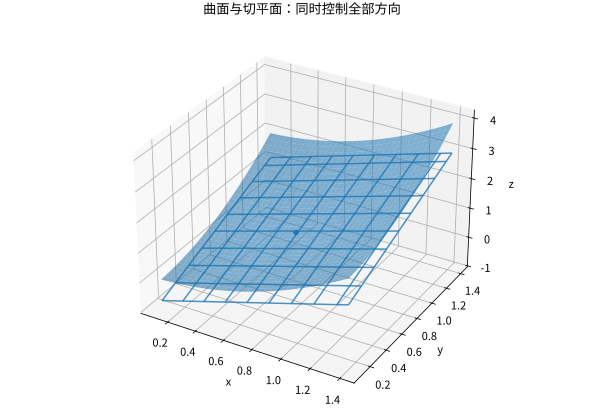

# 多元极限偏导与全微分

## 多条输入通道需要一个统一的局部模型

对 $f:\mathbb R^n\to\mathbb R$，在 $a$ 全可微是指存在一个线性映射 $L$，使

$$
f(a+h)=f(a)+Lh+r(h),\qquad
\frac{|r(h)|}{\|h\|}\to0.
$$

有限维内 $Lh=\nabla f(a)^{\mathsf T}h$，但这是在全可微成立后得到的表达。偏导 $\partial_i f(a)$ 只沿第 $i$ 条坐标轴观察；各轴的行为并不自动控制斜方向，更不自动控制任意弯曲路径。

多元极限同样要求对整个去心球内的点统一控制。若沿两条路径给出不同极限，就足以否定；沿所有直线极限相同也仍可能失败，例如

$$
g(x,y)=\frac{x^2y}{x^4+y^2}\quad((x,y)\ne(0,0)).
$$

沿 $y=kx$ 均趋于0（$k=0$ 单独看），但沿 $y=x^2$ 恒为1/2。极坐标法只有在角度方向上给出统一界时才能证明极限，不能固定角度之后就忘记它还可以随半径变化。

## 偏导存在却不可微的可计算反例

令 $f(0,0)=0$，$f(x,y)=xy/\sqrt{x^2+y^2}$。由 $2|xy|\le x^2+y^2$ 可得 $|f|\le\sqrt{x^2+y^2}/2$，所以在原点连续；两坐标偏导都为0。

若全可微，唯一候选线性映射是零。但沿 $y=x>0$，

$$
\frac{|f(x,x)|}{\sqrt{2x^2}}=\frac12,
$$

不趋于0，因此不可微。这个例子把“连续且偏导都存在”仍不足以推出全可微说得很具体。

*图：对光滑函数，切平面近似同时控制所有方向。切平面不是把两条坐标切线画出来就自动获得的结论。*

## 一个实用的充分条件及其理由

若所有偏导在点的邻域存在，并在该点连续，则函数在那里全可微。二维证明把总增量拆成先走 $x$ 再走 $y$：

$$
f(a+h,b+k)-f(a,b)
=[f(a+h,b+k)-f(a,b+k)]+[f(a,b+k)-f(a,b)].
$$

分别使用一元中值定理，得到某些邻近点处的偏导乘以 $h,k$。偏导连续使其与 $f_x(a,b),f_y(a,b)$ 的差都变小，总误差可被 $\varepsilon(|h|+|k|)\le\sqrt2\varepsilon\|(h,k)\|$ 控制。证明告诉我们，连续性用于将沿折线路径测到的斜率统一回基点。

## 梯度、方向导数与 Hessian

全可微且 $u$ 为单位向量时，$D_uf=\nabla f\cdot u$。Cauchy–Schwarz 给出最大方向导数 $\|\nabla f\|$，在非零梯度方向取到。梯度依赖内积和坐标度量；这里使用标准欧氏内积。

若 $f\in C^2$，则混合偏导相等，Hessian 对称，二阶展开为

$$
f(a+h)=f(a)+\nabla f(a)\cdot h+\tfrac12h^{\mathsf T}H_f(a)h+o(\|h\|^2).
$$

算例 $f(x,y)=x^2+xy+2y^2$，$\nabla f=(2x+y,x+4y)$，Hessian $\begin{bmatrix}2&1\\1&4\end{bmatrix}$ 正定。二阶型决定局部弯曲，而不仅是各坐标二阶偏导的正负。

## 练习与答案

计算上例在 $(1,0)$ 沿 $u=(1,1)/\sqrt2$ 的方向导数；说明只检验 $f_{xx}>0,f_{yy}>0$ 为什么不能保证局部极小。

> [!question]- 解答
> 梯度为 $(2,1)$，点积得到 $3/\sqrt2$。反例 $x^2+4xy+y^2$ 在原点驻点，两条纯二阶偏导均为2，但沿 $y=-x$ 函数等于 $-2x^2$，所以是鞍点。必须检查完整二次型，包括交叉项。

## 继续学习

前一节：[[数学/15-微积分/10-参数曲线极坐标与空间曲线|参数曲线极坐标与空间曲线]]。 下一节：[[数学/15-微积分/12-多元链式法则隐函数与约束优化|多元链式法则隐函数与约束优化]]。

课程地图：[[数学/15-微积分/00-微积分-MOC|微积分课程地图]]；[[数学/90-资源/06-统一符号约定与定理条件索引|符号与条件索引]]。

## 跨学科连接

[[数学/16-数学分析/11-多元微分逆映射与隐函数定理|多元微分逆映射与隐函数定理]]。本页建立全微分的统一线性近似；目标页进一步说明 Jacobian 可逆如何把线性近似升级为局部逆或隐函数，并给出仅在一点导数可逆仍不足的反例。

## 核验与延伸阅读

本页为独立编写的讲解、推导与算例；以下一手教材用于对照标准定义与课程范围，不是逐段译写。更具体的主题定位见 [[数学/90-资源/04-六科学术来源与阅读对照|学术来源对照]]。

- [MIT 18.01SC：单变量微积分（课程原始讲义与练习入口）](https://ocw.mit.edu/courses/18-01sc-single-variable-calculus-fall-2010/)
- [MIT 18.02SC：多变量微积分](https://ocw.mit.edu/courses/18-02sc-multivariable-calculus-fall-2010/)
