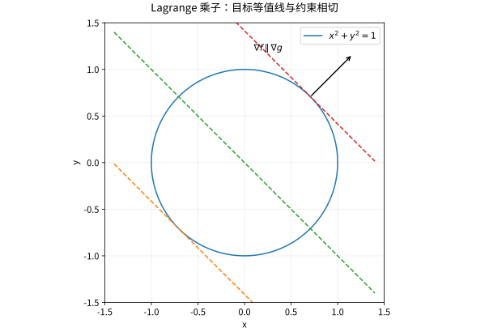

# 多元链式法则隐函数与约束优化

## 链式法则是线性映射的复合

设 $g:\mathbb R^n\to\mathbb R^m$、$f:\mathbb R^m\to\mathbb R^p$ 在相应点全可微，采用 Jacobian 行对应输出、列对应输入的约定，则

$$
D(f\circ g)(x)=Df(g(x))Dg(x).
$$

矩阵形状是 $(p\times m)(m\times n)=p\times n$。复合求导之所以相乘，是因为一阶小增量先经一个线性映射，再经另一个。对标量损失，梯度反向传播为 $\nabla_x(f\circ g)=Dg(x)^{\mathsf T}\nabla f(g(x))$。

算例 $z=x^2+y^2$，$x=r\cos\theta,y=r\sin\theta$。由链式法则 $z_r=2x\cos\theta+2y\sin\theta=2r$，$z_\theta=2x(-r\sin\theta)+2y(r\cos\theta)=0$。直接消参得 $z=r^2$，两路一致。

## 隐函数：方程什么时候真的定义一个函数

对于 $F(x,y)=0$，若 $F\in C^1$、$F(a,b)=0$ 且 $F_y(a,b)\ne0$，则在该点附近唯一确定一个 $C^1$ 函数 $y=\varphi(x)$，且

$$
\varphi'(x)=-\frac{F_x(x,\varphi(x))}{F_y(x,\varphi(x))}.
$$

这是局部结论。对圆 $x^2+y^2=1$，在 $(0,1)$ 附近可解 $y=\sqrt{1-x^2}$；在 $(1,0)$ 不能在包含该点的开放 $x$ 邻域上把整个圆写成同一光滑 $y(x)$，却可以交换变量求 $x(y)$。

隐函数定理的高维条件是所选未知变量对应的 Jacobian 方阵可逆。仅有某个偏导不为零不能替代多方程系统的满秩条件。

## 无约束极值与约束极值不是同一个方向集合

无约束内部极值要求梯度为零；约束极值只需要沿可行切方向的一阶变化为零。对于 $g(x)=0$ 的光滑正则约束，$\nabla g\ne0$，切向量 $v$ 满足 $\nabla g\cdot v=0$。若 $\nabla f$ 对全部这些切向量都正交，就必须与约束法向平行：

$$
\nabla f(x)=\lambda\nabla g(x),\qquad g(x)=0.
$$

多个约束要求梯度线性无关，并把右侧换成线性组合。这说明乘子来自法空间，不是凭空引入的代数技巧。

*图：在线性目标与单位圆相切的位置，目标梯度和约束梯度平行。乘子方程只给候选点，仍须比较并检查约束正则性。*

## 完整算例：椭圆上的线性函数

求 $f(x,y)=x+y$ 在 $x^2+4y^2=1$ 的最值。方程 $1=2\lambda x,1=8\lambda y$ 给 $x=4y$；代入得 $20y^2=1$，所以 $(x,y)=\pm(2/\sqrt5,1/(2\sqrt5))$，极值为 $\pm\sqrt5/2$。约束集紧且梯度不为零，因此候选覆盖全局极值。也可用 Cauchy–Schwarz：写成 $(x,2y)\cdot(1,1/2)$，立即得同一上界并确定取等条件。

## 乘子不能无条件使用

最小化 $f(x)=x$，约束 $g(x)=x^2=0$，唯一可行点0当然既是最小也是最大，但 $f'(0)=1$ 不等于任何 $\lambda g'(0)=0$。失败原因是约束在0不正则，不是极值不存在。

不等式约束还需活跃约束、乘子符号与互补松弛，即 KKT 条件；其完整介绍放入优化补充，不能把等式乘子方程直接当成全部约束优化。

## 练习与答案

求 $x^2+y^2$ 在 $x+y=1$ 上的最小值；判断原点对约束 $y^2=x^3$ 是否是正则点。

> [!question]- 解答
> $2x=\lambda,2y=\lambda$ 给 $x=y=1/2$，最小值1/2；也可由 $(x+y)^2\le2(x^2+y^2)$ 证明全局下界。第二题 $g=y^2-x^3$ 的梯度在原点为零，因此非正则；那里是尖点，须参数化或直接分析可行集合。

## 继续学习

前一节：[[数学/15-微积分/11-多元极限偏导与全微分|多元极限偏导与全微分]]。 下一节：[[数学/15-微积分/13-重积分与变量代换从切片到Jacobian|重积分与变量代换从切片到Jacobian]]。

课程地图：[[数学/15-微积分/00-微积分-MOC|微积分课程地图]]；[[数学/90-资源/06-统一符号约定与定理条件索引|符号与条件索引]]。

## 跨学科连接

[[数学/16-数学分析/11-多元微分逆映射与隐函数定理|多元微分逆映射与隐函数定理]]。本页用链式法则计算并陈述隐函数与正则约束的规则；目标页从逆映射定理完整推出矩阵形式的隐函数导数，并区分局部可解与全局可逆。

## 核验与延伸阅读

本页为独立编写的讲解、推导与算例；以下一手教材用于对照标准定义与课程范围，不是逐段译写。更具体的主题定位见 [[数学/90-资源/04-六科学术来源与阅读对照|学术来源对照]]。

- [MIT 18.01SC：单变量微积分（课程原始讲义与练习入口）](https://ocw.mit.edu/courses/18-01sc-single-variable-calculus-fall-2010/)
- [MIT 18.02SC：多变量微积分](https://ocw.mit.edu/courses/18-02sc-multivariable-calculus-fall-2010/)
