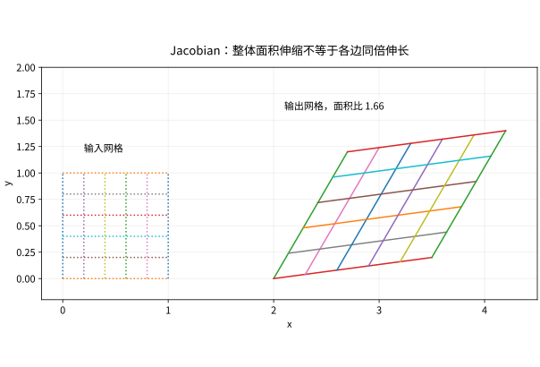

# 重积分与变量代换从切片到Jacobian

## 多重积分仍是“小量相加”，但要尊重区域

二重积分 $\iint_Df\,dA$ 把区域划成面积小片，累加函数值乘面积。对连续函数和适当有界区域，可以写成累次积分。若

$$
D=\{(x,y):a\le x\le b,\ \alpha(x)\le y\le\beta(x)\},
$$

则 $\iint_Df\,dA=\int_a^b\int_{\alpha(x)}^{\beta(x)}f(x,y)dy\,dx$。内层变量活动时，外层变量固定。换次序不是交换两个微分符号，而是重新描述同一个区域。

例：$D=\{0\le y\le x\le1\}$。原顺序是 $\int_0^1\int_0^x f\,dy\,dx$；反过来先固定 $y$，$x$ 从 $y$ 到1，所以为 $\int_0^1\int_y^1f\,dx\,dy$。对 $f=x+y$，计算得1/2。

## Jacobian 为什么出现在面积元里

设 $T(u,v)=(x(u,v),y(u,v))$ 是 $C^1$ 的一一坐标变换，内部 Jacobian 行列式非零。一个小矩形被局部线性映射送成平行四边形，其面积是原面积的 $|\det DT|$ 倍，因此

$$
\iint_Df(x,y)dxdy
=\iint_{T^{-1}(D)} f(T(u,v))\left|\frac{\partial(x,y)}{\partial(u,v)}\right|dudv.
$$

绝对值意味着面积不因坐标反向变成负数。若映射多对一而未分块或处理重数，会重复计数。严格证明需控制非线性余项与区域边界，见数学分析的换元章。

*图：线性映射的行列式控制面积比，不是每个边长的共同放大倍数。剪切能改变形状而保持面积。*

## 极坐标、柱坐标与球坐标

极坐标 $x=r\cos\theta,y=r\sin\theta$ 的行列式为 $r$，因此 $dA=r\,dr\,d\theta$。柱坐标只增加独立的 $z$，体积元仍乘 $r$。球坐标约定 $\rho\ge0$、极角 $0\le\varphi\le\pi$、方位角 $0\le\theta<2\pi$：

$$
x=\rho\sin\varphi\cos\theta,\quad y=\rho\sin\varphi\sin\theta,\quad z=\rho\cos\varphi,
\quad dV=\rho^2\sin\varphi\,d\rho d\varphi d\theta.
$$

极点和角度接缝处不是一一正则坐标，但它们属于可单独处理的零体积集合；在积分中可以分块应用定理。不同书交换两个角的名字很常见，必须以坐标公式为准。

## 高斯积分的完整连接

令 $I=\int_{-\infty}^{\infty}e^{-x^2}dx$，先由比较证明其有限且为正。利用非负函数的 Tonelli 定理，

$$
I^2=\iint_{\mathbb R^2}e^{-(x^2+y^2)}dxdy
=\int_0^{2\pi}\int_0^\infty e^{-r^2}rdrd\theta=\pi,
$$

所以 $I=\sqrt\pi$。注意积分平方、交换积分、极坐标变换各有依据。此例把一元特殊积分、二维几何与概率正态归一化连起来，而不是靠“漂亮换元”跳过收敛问题。

## 练习与答案

计算单位圆盘上 $\iint_D(x^2+y^2)dA$，以及半径 $R$ 球的体积；说明为什么单位圆盘不能用 $\int_0^1\int_0^{2\pi}f\,d\theta dr$ 代替面积积分。

> [!question]- 解答
> 圆盘积分为 $\int_0^{2\pi}\int_0^1r^3drd\theta=\pi/2$。球体积为 $\int_0^R\rho^2d\rho\int_0^\pi\sin\varphi d\varphi\int_0^{2\pi}d\theta=4\pi R^3/3$。漏掉 $r$ 会把靠近原点与远处的同样角度宽度误认为拥有同样面积。

## 继续学习

前一节：[[数学/15-微积分/12-多元链式法则隐函数与约束优化|多元链式法则隐函数与约束优化]]。 下一节：[[数学/15-微积分/14-曲线积分与保守场路径为何重要|曲线积分与保守场路径为何重要]]。

课程地图：[[数学/15-微积分/00-微积分-MOC|微积分课程地图]]；[[数学/90-资源/06-统一符号约定与定理条件索引|符号与条件索引]]。

## 跨学科连接

[[数学/16-数学分析/12-多重积分换元与积分次序|多重积分换元与积分次序]]。建议比较定义、适用条件与所用范数，再迁移方法。

## 核验与延伸阅读

本页为独立编写的讲解、推导与算例；以下一手教材用于对照标准定义与课程范围，不是逐段译写。更具体的主题定位见 [[数学/90-资源/04-六科学术来源与阅读对照|学术来源对照]]。

- [MIT 18.01SC：单变量微积分（课程原始讲义与练习入口）](https://ocw.mit.edu/courses/18-01sc-single-variable-calculus-fall-2010/)
- [MIT 18.02SC：多变量微积分](https://ocw.mit.edu/courses/18-02sc-multivariable-calculus-fall-2010/)
