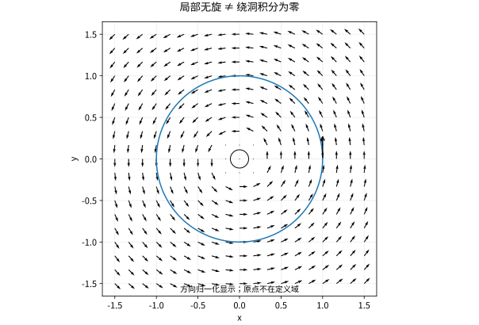

# 曲线积分与保守场路径为何重要

## 沿曲线积累有两种不同对象

标量线积分 $\int_Cf\,ds$ 累积线密度、温度加权长度等，$ds\ge0$，反向走曲线不改结果。向量场线积分 $\int_C\mathbf F\cdot d\mathbf r$ 累积沿运动方向的做功，反向则变号。

设 $U\subset\mathbb R^n$ 为开集，有向曲线 $C$ 由分段 $C^1$ 路径 $\mathbf r:[a,b]\to U$ 参数化，$f:U\to\mathbb R$ 与 $\mathbf F:U\to\mathbb R^n$ 连续，则

$$
\int_Cf\,ds=\int_a^bf(\mathbf r(t))\|\mathbf r'(t)\|dt,
\qquad
\int_C\mathbf F\cdot d\mathbf r=\int_a^b\mathbf F(\mathbf r(t))\cdot\mathbf r'(t)dt.
$$

第一种乘速率，第二种乘速度向量；混淆两者会把方向信息抹掉。

## 从链式法则得到线积分基本定理

若 $\mathbf F=\nabla\phi$，$\phi$ 在包含路径的开集上 $C^1$，则

$$
\mathbf F(\mathbf r(t))\cdot\mathbf r'(t)
=\frac d{dt}\phi(\mathbf r(t)),
\quad
\int_C\mathbf F\cdot d\mathbf r=\phi(B)-\phi(A).
$$

这类场叫保守场，积分只依赖端点。反过来，在路径连通开集上，若所有分段光滑路径的积分只依赖端点，可固定基点、用路径积分定义 $\phi$，通过沿坐标短线段增加端点证明 $\nabla\phi=\mathbf F$（假设场连续）。

算例 $\mathbf F=(2xy,x^2)$。由 $\phi_x=2xy$ 得 $\phi=x^2y+h(y)$，再比较 $\phi_y=x^2+h'(y)$，得到 $h'=0$。从 $(0,0)$ 到 $(1,2)$ 任意路径的积分均为2。

## 旋度为零为什么还不够

二维 $\mathbf F=(P,Q)$ 若为 $C^1$ 保守场，则 $Q_x-P_y=0$。在单连通开集上反向也成立；但去掉原点的平面不满足该拓扑条件。

考虑

$$
\mathbf F(x,y)=\left(-\frac{y}{x^2+y^2},\frac{x}{x^2+y^2}\right).
$$

在原点外旋度为零。沿单位圆逆时针参数化 $(\cos t,\sin t)$，点积恒为1，故闭合积分为 $2\pi$，不可能有全局单值势函数。局部势是角度，但绕一圈会增加 $2\pi$。这与复对数的分支障碍是同一现象。

*图：场在原点未定义。不能把跨过原点的圆盘当作定理的合法填充面，因此“局部无旋”不意味着这个绕洞回路上的环流为零。*

## 路径直接计算的检查流程

先画出路径与方向，再选覆盖一次的参数范围，代入坐标后计算 $d\mathbf r$ 或 $ds$。例如 $\mathbf F=(-y,x)$ 沿单位圆逆时针一周，积分为 $2\pi$；沿上半圆从右到左为 $\pi$；走同一路径相反方向则为负。这些结果可在 [[数学/15-微积分/16-Green-Gauss-Stokes内部变化与边界累积|Green–Gauss–Stokes 章节]] 用 Green 定理核验。

## 练习与答案

判断 $(y,x)$ 是否保守，并计算从 $(1,1)$ 到 $(2,3)$ 的积分；对 $C$ 为单位圆一周，比较 $\int_C1\,ds$ 与 $\int_Cdx$。

> [!question]- 解答
> 势函数为 $xy$，积分为 $6-1=5$。单位圆周长积分为 $2\pi$，$\int_Cdx=x_{\rm end}-x_{\rm start}=0$。后一式不是长度，是位移的第一坐标累积；闭合后当然抵消。

## 继续学习

前一节：[[数学/15-微积分/13-重积分与变量代换从切片到Jacobian|重积分与变量代换从切片到Jacobian]]。 下一节：[[数学/15-微积分/15-曲面积分与通量法向和面积元|曲面积分与通量法向和面积元]]。

课程地图：[[数学/15-微积分/00-微积分-MOC|微积分课程地图]]；[[数学/90-资源/06-统一符号约定与定理条件索引|符号与条件索引]]。

## 跨学科连接

[[数学/45-复变函数/04-复曲线积分原函数与Cauchy定理|复曲线积分原函数与Cauchy定理]]。令 $f=u+iv$、$dz=dx+i\,dy$，则 $\int_\gamma f\,dz=\int_\gamma(u\,dx-v\,dy)+i\int_\gamma(v\,dx+u\,dy)$；把它看成两项实向量场线积分，可直接迁移本页的方向反转、原函数导致路径无关，以及绕洞闭路积分受定义域限制的判断。

## 核验与延伸阅读

本页为独立编写的讲解、推导与算例；以下一手教材用于对照标准定义与课程范围，不是逐段译写。更具体的主题定位见 [[数学/90-资源/04-六科学术来源与阅读对照|学术来源对照]]。

- [MIT 18.01SC：单变量微积分（课程原始讲义与练习入口）](https://ocw.mit.edu/courses/18-01sc-single-variable-calculus-fall-2010/)
- [MIT 18.02SC：多变量微积分](https://ocw.mit.edu/courses/18-02sc-multivariable-calculus-fall-2010/)
