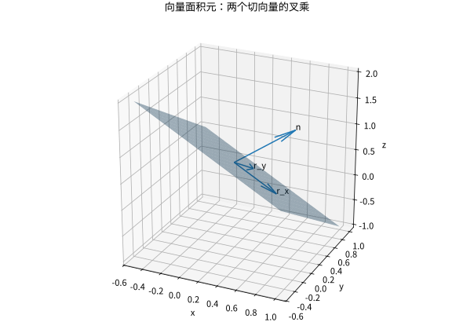

# 曲面积分与通量法向和面积元

## 面积与穿过表面的量必须分开

设 $D\subset\mathbb R^2$，$\mathbf r:D\to\mathbb R^3$ 是 $C^1$ 参数化。它把参数平面的小矩形送成空间中的小平行四边形。两条边近似 $\mathbf r_u\,du,\mathbf r_v\,dv$，所以面积元为

$$
dS=\|\mathbf r_u\times\mathbf r_v\|dudv.
$$

若已选定方向并以 $\mathbf n$ 表示相应单位法向，可用向量面积元 $\mathbf n\,dS=\pm(\mathbf r_u\times\mathbf r_v)dudv$。交换参数顺序会改变叉乘符号，但不会改变无向面积。参数化必须正则并正确覆盖曲面，重复覆盖也会重复积分。

## 两类曲面积分

对曲面上的连续标量场 $f$，标量曲面积分 $\iint_Sf\,dS$ 用于薄壳质量等；对曲面上的连续向量场 $\mathbf F$，通量积分

$$
\iint_S\mathbf F\cdot\mathbf n\,dS
$$

计算场沿指定法向穿过表面的有向累积。速度场乘密度可给质量流率；量纲是密度乘速度再乘面积，不是体积。闭合面通常选外法向，开曲面必须由题目指定方向。

对于图像面 $z=g(x,y)$，向上取向时

$$
\mathbf r_x\times\mathbf r_y=(-g_x,-g_y,1),
\quad dS=\sqrt{1+g_x^2+g_y^2}\,dxdy.
$$

算通量时直接点乘向量面积元，不必先单位化再把同一个长度乘回去。算标量面积时则必须保留范数。

*图：两个切向量张成切平面，叉乘给法向。向量面积元同时编码方向与面积伸缩，不等于单位法向本身。*

## 完整算例：斜平面的通量

取平面 $z=1-x-y$ 在三角形 $D=\{x\ge0,y\ge0,x+y\le1\}$ 上的部分，向上法向。参数化 $(x,y,1-x-y)$ 给向量面积元 $(1,1,1)dxdy$。对 $\mathbf F=(x,y,z)$，点积为 $x+y+z=1$，所以通量等于三角形面积 $1/2$。

若改算曲面面积，则面积元为 $\sqrt3dxdy$，答案为 $\sqrt3/2$。这两个问题用同一个参数域，却不是同一个积分。

## 球面的参数化与极点退化

半径 $R$ 的球面可用 $\mathbf r(\varphi,\theta)=R(\sin\varphi\cos\theta,\sin\varphi\sin\theta,\cos\varphi)$。面积元为 $R^2\sin\varphi\,d\varphi d\theta$，$0\le\varphi\le\pi$、$0\le\theta\le2\pi$。参数在极点退化、角度接缝重复，但这些零面积例外可通过分块处理。

对径向场 $\mathbf F=\mathbf r$，外单位法向为 $\mathbf r/R$，点积为 $R$，所以通量为 $4\pi R^3$。散度定理会给另一条计算路线：散度等于3，乘球体积同样得到 $4\pi R^3$。

## 方向、闭合和奇点三件事

开曲面可以有通量，但不能直接用散度定理当成闭合边界。若补一个面封闭区域，要减去补面通量。若场在包围区域内部有奇点，即使曲面上光滑，仍不能直接对整个体积套定理；应挖去小球后分析极限。这是点源场、Green 函数和基本解的共同技术。

## 练习与答案

计算 $z=x^2+y^2$、$x^2+y^2\le1$ 的曲面面积；对同一曲面向上取向、$\mathbf F=(0,0,1)$，求通量。

> [!question]- 解答
> 面积为 $2\pi\int_0^1r\sqrt{1+4r^2}dr=\pi(5\sqrt5-1)/6$。通量的向量面积元第三分量为1，所以等于投影圆盘面积 $\pi$。面积与竖直通量不同，倾斜表面对竖直穿透量贡献要乘法向的竖直分量。

## 继续学习

前一节：[[数学/15-微积分/14-曲线积分与保守场路径为何重要|曲线积分与保守场路径为何重要]]。 下一节：[[数学/15-微积分/16-Green-Gauss-Stokes内部变化与边界累积|Green-Gauss-Stokes内部变化与边界累积]]。

课程地图：[[数学/15-微积分/00-微积分-MOC|微积分课程地图]]；[[数学/90-资源/06-统一符号约定与定理条件索引|符号与条件索引]]。

## 跨学科连接

[[数学/46-数理方程/15-Green函数基本解与边界响应|Green函数基本解与边界响应]]。基本解的点源使场在源点不光滑；Green 表示正是在挖去源点小球后用边界通量留下源点贡献，对应本页“内部有奇点时不能直接套散度定理”的边界。

## 核验与延伸阅读

本页为独立编写的讲解、推导与算例；以下一手教材用于对照标准定义与课程范围，不是逐段译写。更具体的主题定位见 [[数学/90-资源/04-六科学术来源与阅读对照|学术来源对照]]。

- [MIT 18.01SC：单变量微积分（课程原始讲义与练习入口）](https://ocw.mit.edu/courses/18-01sc-single-variable-calculus-fall-2010/)
- [MIT 18.02SC：多变量微积分](https://ocw.mit.edu/courses/18-02sc-multivariable-calculus-fall-2010/)
