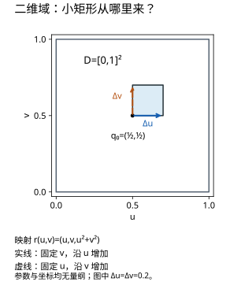
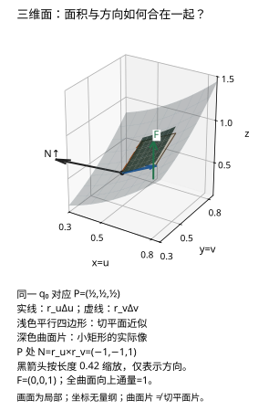

# 曲面积分与通量法向和面积元

## 面积与穿过表面的量必须分开

设 $D\subset\mathbb R^2$ 是有界、边界分段光滑的参数域，$\mathbf r:D\to\mathbb R^3$ 在 $D$ 的开邻域上是 $C^1$。以下单图公式要求 $\mathbf r_u\times\mathbf r_v\ne0$，并在除边界等零面积集合外单次覆盖曲面。多张图需分片，避免在重叠处重复计数。对紧曲面上的连续场，以下积分存在；非紧、奇点或不连续场须另查可积性。它把参数平面的小矩形送成空间中的小平行四边形。两条边近似 $\mathbf r_u\,du,\mathbf r_v\,dv$，所以面积元为

$$
dS=\|\mathbf r_u\times\mathbf r_v\|dudv.
$$

若已选定方向并以 $\mathbf n$ 表示相应单位法向，可用向量面积元 $\mathbf n\,dS=\pm(\mathbf r_u\times\mathbf r_v)dudv$。交换参数顺序会改变叉乘符号，但不会改变无向面积。参数化必须正则并正确覆盖曲面，重复覆盖也会重复积分。

## 两类曲面积分

对曲面上的连续标量场 $f$，标量曲面积分 $\iint_Sf\,dS$ 用于薄壳质量等；对曲面上的连续向量场 $\mathbf F$，通量积分

$$
\iint_S\mathbf F\cdot\mathbf n\,dS
$$

计算场沿指定法向穿过表面的有向累积。速度场乘密度可给质量流率；量纲是密度乘速度再乘面积，不是体积。闭合面通常选外法向，开曲面必须由题目指定方向。

对于图像面 $z=g(x,y)$，向上取向时

$$
\mathbf r_x\times\mathbf r_y=(-g_x,-g_y,1),
\quad dS=\sqrt{1+g_x^2+g_y^2}\,dxdy.
$$

算通量时直接点乘向量面积元，不必先单位化再把同一个长度乘回去。算标量面积时则必须保留范数。

*图：两个切向量张成切平面，叉乘给法向。向量面积元同时编码方向与面积伸缩，不等于单位法向本身。*

## 同一小例：二维参数域到三维曲面片

**读者问题：明明只给两列参数，为什么面积和法向都要用三维叉积？** 固定

$$
D=[0,1]^2,\qquad \mathbf r(u,v)=(u,v,u^2+v^2),\qquad \mathbf F(x,y,z)=(0,0,1),
$$

取向朝上，所有参数、坐标和场分量均为**无量纲**教学量。$\mathbf r$ 是 $\mathbb R^2\to\mathbb R^3$ 的光滑映射，$D\mathbf r=[\mathbf r_u\ \mathbf r_v]$ 为 $3\times2$ 矩阵；坐标索引为 $q^1=u,q^2=v$，两个空间导数都是三分量向量。$\mathbf r$ 的前两分量保留 $u,v$，故不会重复覆盖；它在单位正方形及其开邻域都正则。

*图 1（[PNG 备用](assets/surface-domain-2d.png)）：$q_0=(1/2,1/2)$ 的右上小矩形。实线固定 $v$、增加 $u$；虚线固定 $u$、增加 $v$。图中边长 $0.2$ 只为可见；面积元来自边长趋于零的极限。*

先不看三维图，亲手写出 $\mathbf r_u(q_0)$ 和 $\mathbf r_v(q_0)$，按分量计算叉积，再判断它是否朝上。这里的“朝上”只要求法向第三分量为正，不要求法向恰好竖直。

### 先手算局部叉积，再读方向

$$
\mathbf r_u=(1,0,2u),\qquad \mathbf r_v=(0,1,2v),\qquad
\mathbf N=\mathbf r_u\times\mathbf r_v=(0\cdot2v-2u\cdot1,\;2u\cdot0-1\cdot2v,\;1\cdot1-0\cdot0)=(-2u,-2v,1).
$$

在 $q_0$，空间点为 $P=(1/2,1/2,1/2)$，两切向量为 $(1,0,1),(0,1,1)$，因此 $\mathbf N=(-1,-1,1)$、$\|\mathbf N\|=\sqrt3$。点积 $\mathbf N\cdot\mathbf r_u=\mathbf N\cdot\mathbf r_v=0$，第三分量为正，且全域 $\|\mathbf N\|\ge1$，正则条件已兑现。相应**单位法向**是 $\mathbf n=\mathbf N/\|\mathbf N\|$，它的长度为 1。

*图 2（[PNG 备用](assets/surface-patch-3d.png)）：三维增加了曲面的高度，独立参数仍只有 $u,v$ 两个。深色曲面片是图 1 小矩形的实际像；浅色平行四边形是 $P$ 点切平面上的线性近似。实线、虚线两边分别表示 $\mathbf r_u\Delta u,\mathbf r_v\Delta v$。黑箭头将 $\mathbf N$ 归一后缩放为 0.42，仅表示朝向；它的画面长度不能读作 $\sqrt3$ 或面积元。绿色 $\mathbf F$ 是给定场，和法向是两个对象。*

不看图也可描述对应：参数 $u$ 增加时，空间 $x$ 增加且 $z$ 随 $u^2$ 增加；参数 $v$ 增加时，空间 $y$ 增加且 $z$ 随 $v^2$ 增加。两方向张成局部切平面，叉积垂直于二者。真实小片带曲率；例如有限 $u$ 边的实际位移为 $(\Delta u,0,\Delta u+(\Delta u)^2)$，切向近似只保留 $(\Delta u,0,\Delta u)$。图中的有限平行四边形并不等于真实曲面片。

### 从局部近似到两个积分

$C^1$ 可微性给 $\mathbf r(q_0+h)-\mathbf r(q_0)=D\mathbf r(q_0)h+o(\|h\|)$。小矩形两边的主导项因而是 $\mathbf r_u\Delta u,\mathbf r_v\Delta v$；它们叉积的范数为 $\|\mathbf N\|\Delta u\Delta v$。细分后取极限，得到

$$
dS=\sqrt{1+4u^2+4v^2}\,du\,dv,\qquad
\mathbf n\,dS=(-2u,-2v,1)\,du\,dv.
$$

$dS$ 是非负标量面积元；$\mathbf n\,dS$ 是有向的三分量面积元；$\mathbf N$ 是乘上 $du\,dv$ **之前**的面积密度向量。三者不能混写。此处 $du\,dv$ 表示正的参数面积测度；普通二重积分交换积分先后并不变号，变号的是叉积两列的顺序或曲面所选取向。

$$
\Phi_\uparrow=\int_0^1\int_0^1\mathbf F(\mathbf r(u,v))\cdot(-2u,-2v,1)\,du\,dv=1,
\qquad A=\int_0^1\int_0^1\sqrt{1+4u^2+4v^2}\,du\,dv>1.
$$

在 $P$，$\mathbf F\cdot\mathbf n=1/\sqrt3$，乘 $dS=\sqrt3\,du\,dv$ 后恰好抵消。面越斜，面积变大但场的法向投影变小；本例的竖直通量等于参数域面积。$\mathbf F$ 若有水平分量，该抵消不能照搬。面积的解析值为

$$
A=1+\frac{7\ln5-\arctan(4/3)}{12}\approx1.861564180753091.
$$

想独立检验这个面积值，可令 $f=\sqrt{1+4u^2+4v^2}$，直接微分得到 $\partial_u(uf)+\partial_v(vf)=3f-1/f$。逐次用微积分基本定理积分，有

$$
3A=2\int_0^1\sqrt{5+4t^2}\,dt+J,\quad
J=\int_0^1\int_0^1\frac{du\,dv}{\sqrt{1+4u^2+4v^2}}
=\frac{\ln5}{2}-\frac{\arctan(4/3)}4.
$$

$J$ 的最后一步可用代换 $x=2u,y=2v$，在 $[0,2]^2$ 上求混合原函数 $H=x\ln(y+R)+y\ln(x+R)-\arctan(xy/R)$（$R=\sqrt{1+x^2+y^2}$，$H_{xy}=1/R$），再除以 4。边界积分为 $3+5\ln5/4$；二者合起来给上述解析值。图和数值求积可以对照这个值，但不能替代导数与取极限的论证。

若要赋予长度单位，另设 $\mathbf r_L=L(u,v,u^2+v^2)$，$L>0$ 为长度尺度，则两导数带长度单位，$dS$ 带 $L^2$，单位法向仍无量纲。若场是速度，通量单位为长度三次方/时间；若场是质量通量密度，结果为质量/时间。这是重新指定物理模型，本页图的数据仍全为无量纲。

### 重参数化与取向反例

只把本例的法向改为朝下，$dS$ 不变，$\mathbf n\,dS$ 变号，所以通量为 $-1$。另一种容易误判的变化是 $\boldsymbol\rho(s,t)=\mathbf r(t,s)=(t,s,t^2+s^2)$：曲面和覆盖次数都相同，但 $\boldsymbol\rho_s\times\boldsymbol\rho_t=(2t,2s,-1)$ 默认朝下。若题目仍要求朝上，应取它的负号；通量仍是 $1$。因此“换一套参数”本身不应改变一个**已经指定取向**的通量。

一般地，对一一对应的 $C^1$ 坐标变换 $(u,v)=\psi(s,t)$，$\det D\psi\ne0$ 时，

$$
\boldsymbol\rho_s\times\boldsymbol\rho_t=(\mathbf r_u\times\mathbf r_v)\circ\psi\;\det D\psi.
$$

无向面积用 $|\det D\psi|$；有向叉积保留行列式的符号，并须和指定法向核对。比如 $\boldsymbol\rho(s,t)=\mathbf r(2s,t)$ 在 $[0,1/2]\times[0,1]$ 上朝向相同，叉积密度放大 2，而参数域面积缩小一半，通量仍为 1。若照抄 $[0,1]^2$，会覆盖另一块曲面；若坐标变换导数退化，不能直接声称它是正则换元。

若想知道面积伸缩为什么也能从度量得到，带本例的两切向量去读 [[数学/35-微分几何/02-参数曲面度量法向与形算子#同一抛物面：叉积与Gram行列式如何对应|叉积与 Gram 行列式]]；在那里计算 $EG-F^2$ 后，返回本节核对它与 $\|\mathbf N\|^2$ 相等。进入形算子部分前，先保留“面积由一阶导数、法向变化由二阶导数”的区别。

### 无提示迁移题

给曲面 $z=2x^2+y^2$ 在 $0\le x\le2,0\le y\le1$ 上的部分，取向朝下，场为 $\mathbf F(x,y,z)=(x,0,1)$。求通量，并交出定义域、参数化、正则性与单次覆盖的理由、方向检查和积分。允许任何等价正则参数化；结果不要求用图中参数名。

> [!question]- 迁移题答案与等价解判据
> 用 $\mathbf r(x,y)=(x,y,2x^2+y^2)$，向上叉积是 $(-4x,-2y,1)$，朝下向量面积元为 $(4x,2y,-1)dx\,dy$。正则因第三分量绝对值为1；前两分量恒等，故单次覆盖。被积函数 $4x^2-1$，通量 $\int_0^1\int_0^2(4x^2-1)dx\,dy=26/3$。若用单位正方形参数化 $(2s,t,8s^2+t^2)$，朝下叉积为 $(16s,4t,-2)$，点积 $32s^2-2$，积分同为 $26/3$。等价解按覆盖、取向、变量与场代入一致性判定，不按某套符号判定。只写“朝下所以通量负”不成立，场在部分曲面沿朝下法向的分量为正。

图、625 个网格点、解析对照与复现命令见 [[数学/15-微积分/17-曲面通量图例源码与复算#复现与证据边界|图例源码与复算]]：带上本节 $\mathbf N$ 和通量预测，运行后返回比较 CSV 的面积密度与通量密度。它验证这个有限例的计算与图源，未验证真实 Obsidian 客户端或真人迁移结果。

## 完整算例：斜平面的通量

取平面 $z=1-x-y$ 在三角形 $D=\{x\ge0,y\ge0,x+y\le1\}$ 上的部分，向上法向。参数化 $(x,y,1-x-y)$ 给向量面积元 $(1,1,1)dxdy$。对 $\mathbf F=(x,y,z)$，点积为 $x+y+z=1$，所以通量等于三角形面积 $1/2$。

若改算曲面面积，则面积元为 $\sqrt3dxdy$，答案为 $\sqrt3/2$。这两个问题用同一个参数域，却不是同一个积分。

## 球面的参数化与极点退化

半径 $R$ 的球面可用 $\mathbf r(\varphi,\theta)=R(\sin\varphi\cos\theta,\sin\varphi\sin\theta,\cos\varphi)$。面积元为 $R^2\sin\varphi\,d\varphi d\theta$，$0\le\varphi\le\pi$、$0\le\theta\le2\pi$。参数在极点退化、角度接缝重复，但这些零面积例外可通过分块处理。

对径向场 $\mathbf F=\mathbf r$，外单位法向为 $\mathbf r/R$，点积为 $R$，所以通量为 $4\pi R^3$。散度定理会给另一条计算路线：散度等于3，乘球体积同样得到 $4\pi R^3$。

## 方向、闭合和奇点三件事

开曲面可以有通量，但不能直接用散度定理当成闭合边界。若补一个面封闭区域，要减去补面通量。若场在包围区域内部有奇点，即使曲面上光滑，仍不能直接对整个体积套定理；应挖去小球后分析极限。这是点源场、Green 函数和基本解的共同技术。

## 练习与答案

计算 $z=x^2+y^2$、$x^2+y^2\le1$ 的曲面面积；对同一曲面向上取向、$\mathbf F=(0,0,1)$，求通量。

> [!question]- 解答
> 面积为 $2\pi\int_0^1r\sqrt{1+4r^2}dr=\pi(5\sqrt5-1)/6$。通量的向量面积元第三分量为1，所以等于投影圆盘面积 $\pi$。面积与竖直通量不同，倾斜表面对竖直穿透量贡献要乘法向的竖直分量。

## 继续学习

前一节：[[数学/15-微积分/14-曲线积分与保守场路径为何重要|曲线积分与保守场路径为何重要]]。 下一节：[[数学/15-微积分/16-Green-Gauss-Stokes内部变化与边界累积|Green-Gauss-Stokes内部变化与边界累积]]。

课程地图：[[数学/15-微积分/00-微积分-MOC|微积分课程地图]]；[[数学/90-资源/06-统一符号约定与定理条件索引|符号与条件索引]]。

## 跨学科连接

[[数学/46-数理方程/15-Green函数基本解与边界响应|Green函数基本解与边界响应]]。基本解的点源使场在源点不光滑；Green 表示正是在挖去源点小球后用边界通量留下源点贡献，对应本页“内部有奇点时不能直接套散度定理”的边界。

## 核验与延伸阅读

本页为独立编写的讲解、推导与算例；以下一手教材用于对照标准定义与课程范围，不是逐段译写。更具体的主题定位见 [[数学/90-资源/04-六科学术来源与阅读对照|学术来源对照]]。

- [MIT 18.01SC：单变量微积分（课程原始讲义与练习入口）](https://ocw.mit.edu/courses/18-01sc-single-variable-calculus-fall-2010/)
- [MIT 18.02SC：多变量微积分](https://ocw.mit.edu/courses/18-02sc-multivariable-calculus-fall-2010/)

- [MIT 18.02 Lecture 28 原始授课文字稿](https://ocw.mit.edu/courses/18-02-multivariable-calculus-fall-2007/f30ec4e4a6f638b41e8ffacdf564120b_18_022007L28.pdf)：PDF pp.2–3 核对小矩形线性化、叉积与朝上符号，pp.5–6 核对一般参数式的向量面积元；本页抛物面正方形例与面积解析式为独立推导。
- [MIT 18.02 V9 Surface Integrals 原始讲义](https://ocw.mit.edu/courses/18-02-multivariable-calculus-fall-2007/b99f7b21fccbe519c0839995574b4da8_surface_integrls.pdf)：讲义 §1、§2 核对取向和图像面的通量公式，§3 核对标量面积积分仍保留根号；未据此声称完整复核本页其他原有算例。
