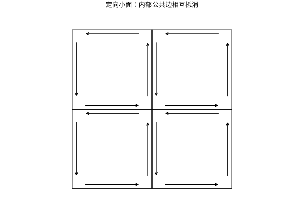

# Green-Gauss-Stokes内部变化与边界累积

## 一条共同主线：内部差异在相邻小块上抵消

把区域剖分成许多小块，对每块写“内部变化等于边界累积”。相邻块的公共边界被相反方向计算两次，彼此抵消，只剩外边界。Green、Gauss、Stokes 都体现这一结构，但它们作用的对象、维度和取向不同，不能混成同一条坐标公式。

## Green 定理：平面区域与闭合曲线

设 $D$ 为有界平面区域，边界分段 $C^1$，按正向定向（外边界逆时针、洞的边界顺时针）；$P,Q\in C^1$ 于包含 $\overline D$ 的开集，则

$$
\oint_{\partial D}Pdx+Qdy=\iint_D(Q_x-P_y)dA.
$$

在矩形上由一元基本定理分别积分 $Q_x,P_y$ 即得；一般区域通过分割和极限推广。取 $P=-y/2,Q=x/2$，右侧为面积，因此 $A=\tfrac12\oint(xdy-ydx)$。对单位圆，积分为 $\pi$。取 $P=-y,Q=x$，环流为 $2\pi$，与直接参数化一致。

## Gauss 散度定理：体积源汇与外向通量

设 $\Omega\subset\mathbb R^3$ 为有界区域，$\partial\Omega$ 是分片 $C^1$ 的闭合可定向曲面，取外单位法向 $\mathbf n$；$\mathbf F\in C^1$ 于包含 $\overline\Omega$ 的开集，则

$$
\iint_{\partial\Omega}\mathbf F\cdot\mathbf n\,dS
=\iiint_\Omega\nabla\cdot\mathbf F\,dV.
$$

散度 $\partial_xF_1+\partial_yF_2+\partial_zF_3$ 是单位体积的净流出率。对小长方体，东西两面的通量差近似 $\partial_xF_1\Delta V$，另外两对面同理。相加得到局部公式，再累加全区域。$\nabla\cdot\mathbf F=0$ 意味无体积源汇，不意味着场处处为零。

## Stokes 定理：曲面旋度与边界环流

对紧致有向分片光滑曲面 $S$，边界方向由右手规则与法向相容，$\mathbf F$ 在曲面邻域 $C^1$，

$$
\oint_{\partial S}\mathbf F\cdot d\mathbf r
=\iint_S(\nabla\times\mathbf F)\cdot\mathbf n\,dS.
$$

旋度在法向上的分量度量小回路的单位面积环流。只要合法曲面具有同一带方向边界，就可选择容易积分的那一个；但必须检查场在替代曲面的邻域也有定义。

*图：内部共享边的相反定向是边界定理成立的结构原因。洞的内边界不会自动消失，它需要与外边界相反的绕行方向。*

## 综合算例：同一圆周用两种办法

设 $C$ 是 $x^2+y^2=1,z=0$，从上看逆时针，$\mathbf F=(-y/2,x/2,z)$。直接参数化点积为1/2，积分得到 $\pi$。旋度为 $(0,0,1)$，在向上的单位圆盘上通量为圆盘面积 $\pi$。

也可使用上半球作 $S$，取使边界方向一致的外法向：旋度是常向量，通量等于向水平面的有向投影面积，仍为 $\pi$。这说明积分不依赖中间曲面的形状，但取向必须一致。

## 奇点反例与微分形式的桥梁

径向场 $\mathbf F(x)=x/\|x\|^3$ 在原点外散度为零，但围住原点的球面通量为 $4\pi$。不能因此说散度定理错误，因为场在球内原点不满足条件。挖去半径 $\varepsilon$ 小球，在球壳上定理成立，内外通量恰好抵消。分布意义下，这个点源用 Dirac 质量表示。

更统一的写法是 $\int_Md\omega=\int_{\partial M}\omega$，其中 $\omega$ 为微分形式。这里“外微分”和“边界”都具有再作用一次为零的性质。详细定义、坐标计算与取向见微分形式专题；本页不把这行抽象记号当作省略前三个定理条件的理由。

## 练习与答案

用散度定理计算 $\mathbf F=(x^3,y^3,z^3)$ 穿出单位球的通量；说明平面无旋场绕洞环流不为零与 Green 定理如何相容。

> [!question]- 解答
> 散度为 $3(x^2+y^2+z^2)=3r^2$，积分 $3\times4\pi\int_0^1r^4dr=12\pi/5$。第二题应在去洞区域应用 Green：外边界环流加顺时针内边界环流等于0，而不是只留下外边界。把洞填上会把场未定义的点放入区域，破坏假设。

## 继续学习

前一节：[[数学/15-微积分/15-曲面积分与通量法向和面积元|曲面积分与通量法向和面积元]]。

课程地图：[[数学/15-微积分/00-微积分-MOC|微积分课程地图]]；[[数学/90-资源/06-统一符号约定与定理条件索引|符号与条件索引]]。

## 跨学科连接

[[数学/46-数理方程/11-Laplace-Poisson方程与最大值原理|Laplace-Poisson方程与最大值原理]]。取 $\mathbf F=\nabla u$，Gauss 定理给出 $\int_\Omega\Delta u\,dV=\int_{\partial\Omega}\partial_nu\,dS$；结合 $-\Delta u=f$，即可读出 Neumann 数据 $g=\partial_nu$ 必须满足 $\int_\Omega f+\int_{\partial\Omega}g=0$。

## 核验与延伸阅读

本页为独立编写的讲解、推导与算例；以下一手教材用于对照标准定义与课程范围，不是逐段译写。更具体的主题定位见 [[数学/90-资源/04-六科学术来源与阅读对照|学术来源对照]]。

- [MIT 18.01SC：单变量微积分（课程原始讲义与练习入口）](https://ocw.mit.edu/courses/18-01sc-single-variable-calculus-fall-2010/)
- [MIT 18.02SC：多变量微积分](https://ocw.mit.edu/courses/18-02sc-multivariable-calculus-fall-2010/)
