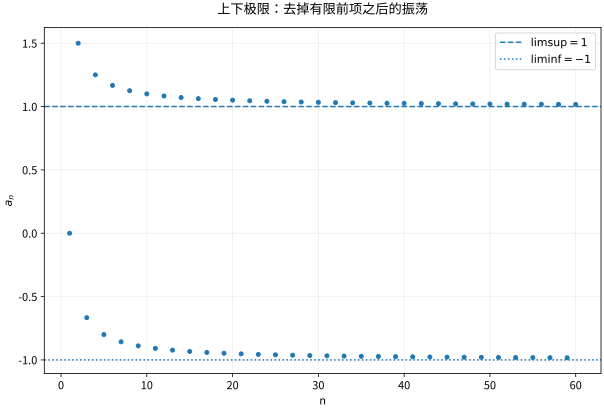

# 数列极限子列与上下极限

## 数列极限的量词如何转成证明

$a_n\to L$ 表示对任意 $\varepsilon>0$，存在 $N$，使所有 $n\ge N$ 都满足 $|a_n-L|<\varepsilon$。有限项修改不改变极限，因为定义只关心尾部。收敛数列一定有界，但有界并不保证整个数列收敛，$(-1)^n$ 就在两个值之间往返。

任何子列 $a_{n_k}$ 若索引严格递增，都继承已存在的极限。逆命题需要量词准确：若每个子列都能抽出一个进一步子列收敛到同一个 $L$，则原数列收敛到 $L$。若不收敛，就存在一个固定 $\varepsilon_0$，可不断选出离 $L$ 至少 $\varepsilon_0$ 的项，形成与假设矛盾的子列。

## Bolzano–Weierstrass 的二分证明

有界实数列包含在某个闭区间里。把区间二分，至少一半包含无穷多项；不断选这样的闭半区间，就得到长度趋零的闭区间套。由完备性其交集是唯一点 $L$。每步在当前区间内选一项，索引严格大于上一次，便得到收敛到 $L$ 的子列。

这个结论不是说整个数列收敛，而是从混乱的有界序列里总能抽取一个稳定观察序列。后面的紧致性会把这种抽取能力变成存在性证明的通用工具。

## 上下极限追踪尾部仍然能到达的高度

对有界数列定义 $u_n=\sup_{k\ge n}a_k$、$l_n=\inf_{k\ge n}a_k$。前者递减、后者递增，因此

$$
\limsup a_n=\lim u_n,\qquad \liminf a_n=\lim l_n.
$$

它们分别是最大的和最小的子列极限。$a_n$ 收敛当且仅当二者相等。无界数列可以在扩展实数意义下定义，但要避免 $\infty-\infty$ 的非法运算。

算例 $a_n=(-1)^n+1/n$：偶数子列趋于1，奇数子列趋于 $-1$，所以上极限1、下极限 $-1$。瞬时最大值或前几个极大项不决定上极限，因为尾部上确界最终会抛弃这些有限项。

*图：尾部包络不是逐项曲线的普通最大最小值。有限早期异常值会被丢弃，但持续出现的两种子列行为会保留下来。*

## Cauchy 判据：不用预先知道极限

Cauchy 性要求对每个 $\varepsilon>0$，存在 $N$ 使 $m,n\ge N$ 时 $|a_n-a_m|<\varepsilon$。收敛显然推出此性。反向先由 Cauchy 性得到有界，再取收敛子列 $a_{n_k}\to L$；选足够晚的一项，把 $|a_n-L|$ 拆成 $|a_n-a_{n_k}|+|a_{n_k}-L|$，即可证明全数列趋于 $L$。反向依赖实数完备性；在有理数中逼近 $\sqrt2$ 的数列就是反例。

“相邻项差趋零”弱得多：调和部分和相邻差 $1/n\to0$，却不是 Cauchy。Cauchy 比较的是尾部**任意两项**，而不只是相邻项。

## 递推数列要先证明有界与单调

取 $a_1=1$，$a_{n+1}=\sqrt{2+a_n}$。归纳得 $1\le a_n\le2$；并由 $x\le\sqrt{2+x}$ 在 $1\le x\le2$ 上成立得到递增。因此存在极限 $L$。连续性允许在递推式中取极限，得到 $L^2=L+2$，再由 $L\ge1$ 选 $L=2$。若一开始只解固定点方程，并不能保证迭代一定靠近其中某个根。

## 练习与答案

求 $\limsup \sin(n\pi/2)$ 与 $\liminf$；给出 $a_{n+1}-a_n\to0$ 却发散的数列，并指出它在哪里违反 Cauchy 性。

> [!question]- 解答
> 周期项为1、0、-1、0，所以分别为1、-1。可取调和部分和 $H_n$；虽然相邻差趋零，但 $H_{2n}-H_n=\sum_{k=n+1}^{2n}1/k\ge1/2$，尾部两项始终能相隔至少1/2，违反 Cauchy 性。

## 继续学习

前一节：[[数学/16-数学分析/01-实数完备性上确界与基本不等式|实数完备性上确界与基本不等式]]。 下一节：[[数学/16-数学分析/03-度量空间开闭集紧致与连通|度量空间开闭集紧致与连通]]。

课程地图：[[数学/16-数学分析/00-数学分析-MOC|数学分析课程地图]]；[[数学/90-资源/06-统一符号约定与定理条件索引|符号与条件索引]]。

## 跨学科连接

[[数学/15-微积分/09-数项级数与幂级数无限求和的计算|数项级数与幂级数无限求和的计算]]。建议比较定义、适用条件与所用范数，再迁移方法。

## 核验与延伸阅读

本页为独立编写的讲解、推导与算例；以下一手教材用于对照标准定义与课程范围，不是逐段译写。更具体的主题定位见 [[数学/90-资源/04-六科学术来源与阅读对照|学术来源对照]]。

- [Jiří Lebl：Basic Analysis I & II，作者开放教材](https://www.jirka.org/ra/html/ra.html)
